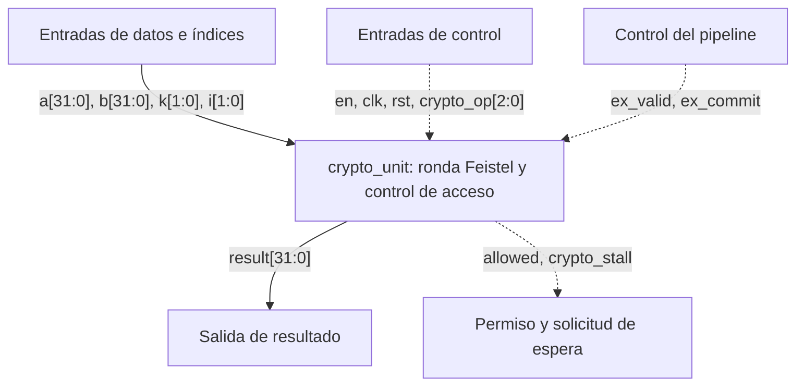
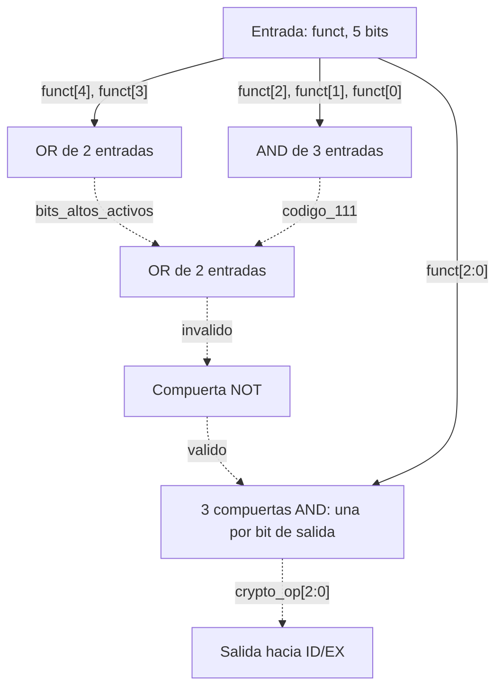
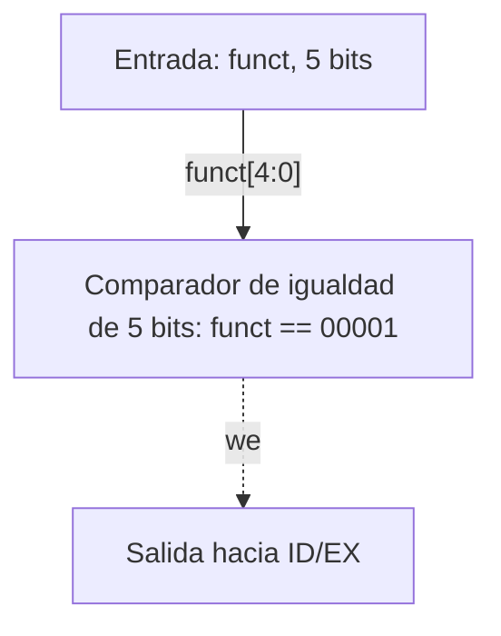

# Diseño de CRYPTO 

El módulo CRYPTO calcula rondas Feistel, autentica mediante Lamport OTP y
controla una bóveda de llaves. La autenticación usa Ascon-Hash256 para H, con
tokens y ancla de 32 bits. F se utiliza únicamente para las rondas Feistel.
`crypto_unit` ejecuta las operaciones en EX; `crypto_dec`, ubicado dentro de
`dispatch`, las decodifica en ID. `auth` ocupa varios ciclos y mantiene el
bundle en EX hasta terminar; las otras operaciones se ejecutan en una etapa EX.

En los diagramas, las flechas continuas representan datos y las punteadas,
control. Los rangos indican el ancho; las señales sin rango tienen un bit.
Los nombres agrupados en una flecha son cables individuales. Una señal
repetida, como `a`, `clk` o `rst`, corresponde a la misma conexión.

## 1. Primer nivel: interfaz de `crypto_unit`



| Señal | Dirección | Ancho | Función |
|---|---|---|---|
| `clk` | Entrada | 1 bit | Reloj de los registros internos y de la bóveda. |
| `rst` | Entrada | 1 bit | Reset asíncrono, activo alto y con prioridad. |
| `en` | Entrada | 1 bit | Habilita CRYPTO; recibe `sel` desde ID/EX. |
| `ex_valid` | Entrada | 1 bit | Indica que ID/EX contiene un bundle válido. |
| `ex_commit` | Entrada | 1 bit | Permite finalizar el bundle y aplicar sus efectos una sola vez. |
| `crypto_op` | Entrada | 3 bits | Indica la operación decodificada. |
| `k`, `i` | Entrada | 2 bits cada una | Seleccionan llave y subllave. |
| `a`, `b` | Entrada | 32 bits cada una | Operandos compartidos con ALU1. |
| `result` | Salida | 32 bits | Resultado de una `feis` permitida; cero en los demás casos. |
| `allowed` | Salida | 1 bit | Indica si la operación tiene permiso; no indica que el hash haya terminado. |
| `crypto_stall` | Salida | 1 bit | Solicita mantener el bundle en EX mientras `auth` no está terminada. |

`a` contiene el valor leído de `rs1` y `b`, el de `rs2`. Los índices `k` e
`i` provienen de los campos de la instrucción, no del banco de registros.

Sin una operación válida (`en = 0` o `ex_valid = 0`), la unidad conserva
el estado, deshabilita lectura y escritura, y entrega `allowed = 0` y `result = 0`. El reset actúa incluso si `en` vale
cero. Las llaves, banderas y ancla son internas; no tienen puertos de lectura
hacia el programa.

## 2. Segundo nivel: estructura de `crypto_unit`


| Bloque | Función | Naturaleza |
|---|---|---|
| `crypto_datapath` | Calcula la ronda Feistel y contiene el motor de hash y el comparador OTP. | Ronda y comparación combinacionales; hash secuencial. |
| `crypto_control` | Comprueba permisos, inicia y acepta el hash, solicita espera y calcula el estado siguiente. | Combinacional. |
| `crypto_state` | Guarda las tres banderas y el ancla OTP. | Secuencial. |
| `key_vault` | Guarda las llaves y entrega la subllave seleccionada. | Lectura combinacional y escritura secuencial. |

`a` llega al control, al XOR de ronda, a la entrada del motor de hash y a
`write_data` de la bóveda. `b` y `subkey` llegan directamente a F. El ancla
llega al control y al comparador OTP. `clk` y `rst` llegan al datapath, al
estado y a la bóveda; `rst` también llega al control.

El control envía `auth_start` y `auth_accept` al datapath. El datapath
devuelve `auth_busy`, `auth_done` y `auth_match`; también entrega `result`.
El control envía `crypto_stall` al pipeline y recibe `ex_valid` y
`ex_commit`. Sus valores `*_next` llegan a `crypto_state`; `read_en` y
`write_en` llegan a la bóveda. `allowed` sale directamente del control.

## 3. Tercer nivel: bloques internos

Los nombres de los bloques representan la lógica prevista en SystemVerilog.
Los MUX y compuertas no requieren archivos `.sv` separados.

### 3.1 `crypto_datapath`


| Dirección | Puertos del módulo |
|---|---|
| Entradas | `clk`, `rst`, `a[31:0]`, `b[31:0]`, `subkey[31:0]`, `ancla_otp[31:0]`, `auth_start`, `auth_accept`, `do_feis` |
| Salidas | `result[31:0]`, `auth_match`, `auth_busy`, `auth_done` |

| Bloque | Entradas | Salida y función |
|---|---|---|
| `feistel_f` | `b[31:0]`, `subkey[31:0]` | `f_out[31:0]`: calcula F para la ronda. |
| `round_xor` | `a[31:0]`, `f_out[31:0]` | `ronda[31:0] = a XOR f_out`. |
| `result_mux` | `ronda`, cero, `do_feis` | `result[31:0]`: ronda permitida o cero. |
| `auth_hash32` | `clk`, `rst`, `start = auth_start`, `accept = auth_accept`, `token[31:0] = a` | `hash32[31:0]`, `busy = auth_busy`, `done = auth_done`. Calcula H con una ronda por ciclo. |
| `auth_comparator` | `hash32[31:0]`, `ancla_otp[31:0]` | `auth_match`: igualdad de los 32 bits. Solo se utiliza cuando `auth_done = 1`. |

```text
rol5   = {b[26:0], b[31:27]}
rol13  = {b[18:0], b[31:19]}
sum32  = rol5 + subkey
f_out  = sum32 XOR rol13
ronda  = a XOR f_out
result = do_feis ? ronda : 0
```

Las rotaciones son conexiones fijas. La suma conserva 32 bits, descarta el
acarreo final y no activa `exc`. Cada `feis` calcula una sola ronda; cuatro
instrucciones con la alternancia de operandos del ISA completan Feistel4.

**Autenticación Lamport OTP**

H es el valor entero little-endian formado por los primeros cuatro bytes
de Ascon-Hash256 del token. Si H coincide con `ancla_otp`, el token se acepta
y pasa a ser la nueva ancla. La siguiente autenticación requiere el eslabón
anterior de la cadena. El hash se calcula en cada `auth`, sin leer la bóveda.

Los tokens y el ancla tienen 32 bits. Ese ancho limita el espacio de
búsqueda a 2^32 tokens, aunque Ascon-Hash256 produzca un hash de 256 bits.

### 3.2 `crypto_control`


| Dirección | Puertos del módulo |
|---|---|
| Entradas | `en`, `rst`, `ex_valid`, `ex_commit`, `crypto_op[2:0]`, `a[31:0]`, `auth`, `kvlock`, `exc`, `ancla_otp[31:0]`, `auth_match`, `auth_busy`, `auth_done` |
| Salidas | `allowed`, `read_en`, `write_en`, `do_feis`, `auth_start`, `auth_accept`, `crypto_stall`, `auth_next`, `kvlock_next`, `exc_next`, `ancla_next[31:0]` |

| Bloque | Entradas | Salida y función |
|---|---|---|
| `active_logic` | `en`, `ex_valid`, `rst` | `activo = en AND ex_valid AND NOT rst`. |
| `op_decode` | `crypto_op[2:0]` | `es_feis`, `es_auth`, `es_logout`, `es_write`, `es_lock`, `es_sanc`: identifican la operación. Todas valen cero para NOP o `111`. |
| `permission_logic` | `activo`, operación identificada, `auth`, `kvlock` | `allowed`: selecciona el permiso requerido. |
| `effect_enable` | `activo`, `allowed`, `es_feis`, `es_write`, `ex_commit` | Genera lectura, escritura y selección del resultado. |
| `auth_handshake` | `activo`, `es_auth`, `auth_busy`, `auth_done`, `ex_commit` | Genera `auth_start`, `auth_accept` y `crypto_stall`. |
| `next_state_logic` | `activo`, `ex_commit`, operación identificada, `allowed`, `auth_done`, `auth_match`, `auth`, `kvlock`, `exc`, `ancla_otp`, `a` | Calcula `auth_next`, `kvlock_next`, `exc_next` y `ancla_next`; conserva los valores actuales por defecto. |

El control es combinacional, no recibe `clk` y no guarda registros.
`op_decode` identifica la operación de tres bits en EX; es distinto de
`crypto_dec`, que traduce `funct[4:0]` en ID.

**Permisos y habilitaciones**

| Operación | `allowed` cuando `activo = 1` |
|---|---|
| `feis`, `kv_lock`, `sanc` | `auth`. |
| `kv_write` | `auth AND NOT kvlock`. |
| `auth`, `logout` | 1. |
| NOP o código interno inválido | 0. |

Con `activo = 0`, `allowed = 0`. En `auth`, `allowed` permite intentar la
autenticación; la validez del token depende de `auth_match`.

```text
auth_req     = activo AND es_auth
crypto_stall = auth_req AND NOT auth_done
auth_start   = auth_req AND NOT auth_busy AND NOT auth_done
auth_accept  = auth_req AND auth_done AND ex_commit
do_feis      = activo AND es_feis AND allowed
read_en      = do_feis
write_en     = activo AND es_write AND allowed AND ex_commit
```

**Significado de las banderas**

| Bandera | Significado cuando vale uno |
|---|---|
| `auth` | Hay una sesión autorizada para ejecutar operaciones privilegiadas. |
| `kvlock` | La bóveda está sellada: no se permite escribir llaves, aunque haya autorización. |
| `exc` | Ocurrió un error de acceso: token inválido u operación privilegiada rechazada. |

**Cambios de estado**

La tabla describe los valores guardados después de cada evento. “Igual”
significa conservar el valor. El control prepara los cambios de las
operaciones con `activo = 1` y `ex_commit = 1`. Para `auth`, además exige
`auth_done = 1`. Mientras se calcula H, las banderas, el ancla y las llaves
se conservan. El reset actúa directamente sobre los
registros y tiene prioridad, sin depender de `en`.

| Evento | `auth` | `kvlock` | `exc` | Ancla | Bóveda |
|---|---|---|---|---|---|
| Reset | 0 | 0 | 0 | `RESET_ANCHOR` del ISA | Todas las palabras en cero. |
| Sin operación válida, NOP, código inválido o espera de `auth` | igual | igual | igual | igual | igual |
| Fin de `auth`, token válido | 1 | igual | 0 | `a` | igual |
| Fin de `auth`, token inválido | 0 | igual | 1 | igual | igual |
| `logout` | 0 | igual | igual | igual | igual |
| `feis` permitida | igual | igual | igual | igual | igual |
| `kv_write` permitida | igual | igual | igual | igual | Guardar `a` en `llaves[k][i]`. |
| `kv_lock` permitido | igual | 1 | igual | igual | igual |
| `sanc` permitido | igual | igual | igual | `a` | igual |
| Operación privilegiada rechazada | igual | igual | 1 | igual | igual |

Solo una autenticación válida o el reset limpian `exc`. El sello `kvlock`
persiste hasta el reset, que también borra las llaves. Una operación
rechazada no cambia las llaves ni el ancla y no escribe el registro destino.

### 3.3 `crypto_state`

| Dirección | Puertos del módulo |
|---|---|
| Entradas | `clk`, `rst`, `auth_next`, `kvlock_next`, `exc_next`, `ancla_next[31:0]` |
| Salidas | `auth`, `kvlock`, `exc`, `ancla_otp[31:0]` |


Es un solo módulo con cuatro registros internos, que suman 35 bits:

| Registro | Entrada D | Salida Q | Ancho | Reset |
|---|---|---|---|---|
| `auth_reg` | `auth_next` | `auth` | 1 bit | 0 |
| `kvlock_reg` | `kvlock_next` | `kvlock` | 1 bit | 0 |
| `exc_reg` | `exc_next` | `exc` | 1 bit | 0 |
| `anchor_reg` | `ancla_next[31:0]` | `ancla_otp[31:0]` | 32 bits | `RESET_ANCHOR` del ISA |

En cada flanco de subida se guardan las entradas D. El reset es asíncrono,
activo alto y prioritario. Para conservar un registro, el control envía su
valor actual como `*_next`; por eso no hay una entrada `en` adicional.
Las salidas Q vuelven al control, y el ancla también llega al datapath.

**Ancla inicial.** Se genera una cadena con la H basada en Ascon:
`x0` es la semilla y `x(j+1) = H(xj)`. Su último eslabón `xn` se utiliza como
`RESET_ANCHOR`; los tokens se presentan como `x(n-1)`, `x(n-2)`, hasta `x0`.
El valor numérico se obtiene con la misma codificación de bytes y selección
de salida descritas en S3.5. Ese valor define `RESET_ANCHOR` en el ISA.

El reset restaura el ancla inicial de esa misma cadena. Por eso los tokens
consumidos pueden volver a aceptarse después de un reset, siguiendo de
nuevo el orden de la cadena. El diseño no conserva el avance de Lamport
entre reinicios; el reset también borra las llaves y cierra la sesión.

### 3.4 `key_vault`

| Dirección | Puertos del módulo |
|---|---|
| Entradas | `clk`, `rst`, `k[1:0]`, `i[1:0]`, `read_en`, `write_en`, `write_data[31:0]` |
| Salidas | `subkey[31:0]` |


La bóveda guarda cuatro llaves de 128 bits en una matriz `llaves[0:3][0:3]`.
Cada posición contiene 32 bits: `k` selecciona la llave e `i`, la subllave.
El almacenamiento total es de 512 bits.

| Bloque | Entradas | Salida y función |
|---|---|---|
| `word_decode` | `k[1:0]`, `i[1:0]` | `word_sel[15:0]`: activa la selección correspondiente a `{k, i}`. |
| `write_enable_logic` | `word_sel`, `write_en` | `word_we[15:0]`: hace AND entre cada selección y el permiso de escritura. |
| `word_input_mux` | Palabras actuales, `write_data[31:0]`, `word_we` | `llaves_next`: selecciona conservar o cargar cada palabra. |
| `key_registers` | `llaves_next`, `clk`, `rst` | Guarda las 16 palabras en subida; el reset asíncrono las borra. |
| `read_mux` | Palabras actuales, `k`, `i` | `palabra[31:0] = llaves[k][i]`. |
| `read_gate` | `palabra`, cero, `read_en` | `subkey`: entrega la palabra con uno y cero con cero. |

`write_data` recibe `a[31:0]`. `word_sel` y `word_we` contienen 16 señales de
un bit; la posición seleccionada corresponde al índice `4*k + i`.
`llaves_next` son 16 palabras de 32 bits en las entradas de los registros,
sin almacenamiento adicional.

Solo cambia la palabra seleccionada cuando `write_en = 1`; las otras quince
se conservan. El reset tiene prioridad sobre la escritura. La lectura es
combinacional: cambiar `k` o `i` cambia la selección sin esperar al reloj.
Los permisos se calculan en `crypto_control`; `auth` y `kvlock` no entran a
la bóveda.

La subllave solo sale hacia F. El camino hacia `result` pasa por
F, el XOR de ronda y el MUX habilitado por `do_feis`; fuera de una `feis`
permitida, `result = 0`. No existe un camino para copiar directamente una
subllave al banco de registros ni a la memoria de datos.

### 3.5 `auth_hash32`: motor Ascon de una ronda por ciclo


| Dirección | Puertos del módulo |
|---|---|
| Entradas | `clk`, `rst`, `start`, `accept`, `token[31:0]` |
| Salidas | `hash32[31:0]`, `busy`, `done` |

| Bloque | Función y señales |
|---|---|
| `token_pad` | Forma `message[63:0] = {32'h00000001, token[31:0]}`. |
| `init_absorb` | Carga cinco constantes de 64 bits; hace XOR de `message` con la primera. |
| `ascon_state_reg` | Guarda `s0` a `s4`, cinco palabras de 64 bits; carga el estado inicial o la salida de una ronda. |
| `round_counter` | Guarda `round_idx[3:0]`, desde 0 hasta 11. |
| `round_constants` | Entrega `rc[7:0]` correspondiente a `round_idx`. |
| `ascon_round` | Recibe el estado de 320 bits y `rc`; entrega `round_state[319:0]`. Es combinacional y se reutiliza doce veces. |
| `last_compare` | Genera `last_round = (round_idx == 11)`. |
| `hash_control` | Guarda `busy` y `done`; genera `load_init`, `round_en`, `count_clear` y `count_inc`. |
| `hash_output` | Cableado `hash32 = s0[31:0]`; la salida solo es válida con `done = 1`. |

**Habilitaciones internas**

```text
load_init   = start AND NOT busy AND NOT done
round_en    = busy
count_clear = load_init
count_inc   = busy AND NOT last_round
```

`ascon_state_reg` carga `init_state` con `load_init`; con `round_en` carga
`round_state`. En otro caso conserva sus cinco palabras. El contador se
limpia al cargar un token, avanza hasta 11 y conserva ese valor en la última
ronda. El reset tiene prioridad en todos los registros.

Los buses de estado usan el mismo orden de palabras:

```text
state[319:0]       = {s4, s3, s2, s1, s0}
init_state[319:0]  = {s4_init, s3_init, s2_init, s1_init, s0_init XOR message}
round_state[319:0] = {s4_next, s3_next, s2_next, s1_next, s0_next}
```

Cada palabra tiene 64 bits; `s0` ocupa los bits `[63:0]`.

**Codificación y cálculo**

Los bytes del token se introducen en este orden: `token[7:0]`, `[15:8]`,
`[23:16]`, `[31:24]`. El relleno añade un bit uno en la posición 32 y ceros
hasta completar 64 bits. El estado inicial es el resultado precalculado de
la inicialización de Ascon-Hash256; no depende del token y no se calcula
al encender. Las constantes son:

```text
s0_init = 0x9B1E5494E934D681
s1_init = 0x4BC3A01E333751D2
s2_init = 0xAE65396C6B34B81A
s3_init = 0x3C7FD4A4D56A4DB3
s4_init = 0x1A5C464906C5976D
```

En el flanco de inicio se carga `s0 = s0_init XOR message` y las otras
cuatro constantes. Después se ejecuta Ascon-p[12]. Los primeros cuatro
bytes del hash corresponden a `s0[31:0]`, interpretados como un entero
little-endian. No se calculan los bloques restantes de salida porque H
conserva únicamente esos cuatro bytes.

Cada ronda aplica la constante mediante XOR en `s2`, la sustitución no
lineal sobre las cinco palabras y la difusión mediante XOR y rotaciones.
El circuito implementa Ascon-Hash256 de NIST SP 800-232. Las doce
constantes, en orden, son:
`F0`, `E1`, `D2`, `C3`, `B4`, `A5`, `96`, `87`, `78`, `69`, `5A`, `4B`.

**Lógica de `ascon_round`**

La ronda recibe `s0` a `s4` y entrega cinco palabras nuevas. Todas las
variables de las siguientes ecuaciones tienen 64 bits. `rc` se extiende
con ceros y se aplica en los ocho bits bajos de `s2`.

```text
x0 = s0
x1 = s1
x2 = s2 XOR zero_extend(rc)
x3 = s3
x4 = s4

x0 = x0 XOR x4
x4 = x4 XOR x3
x2 = x2 XOR x1

t0 = x0 XOR ((NOT x1) AND x2)
t1 = x1 XOR ((NOT x2) AND x3)
t2 = x2 XOR ((NOT x3) AND x4)
t3 = x3 XOR ((NOT x4) AND x0)
t4 = x4 XOR ((NOT x0) AND x1)

y0 = t0 XOR t4
y1 = t1 XOR t0
y2 = NOT t2
y3 = t3 XOR t2
y4 = t4
```

Las asignaciones de `x` se evalúan en el orden mostrado; las expresiones de
`t` utilizan los cinco valores de `x` ya preparados. La difusión produce
cada palabra de salida como `yj XOR ROR64(yj, r1) XOR ROR64(yj, r2)`:

| Palabra de salida | `r1` | `r2` |
|---|---|---|
| `s0_next` | 19 | 28 |
| `s1_next` | 61 | 39 |
| `s2_next` | 1 | 6 |
| `s3_next` | 10 | 17 |
| `s4_next` | 7 | 41 |

`ROR64` es una rotación fija a la derecha sobre 64 bits. Esta lógica es
combinacional; el almacenamiento ocurre en `ascon_state_reg`.

**Secuencia del motor**

| Evento | Actualización |
|---|---|
| Reset | `busy = 0`, `done = 0`, contador y estado interno en cero; cancela el cálculo. |
| `start = 1` estando libre | Carga el token con relleno, contador en cero y `busy = 1`. |
| Subida con `busy = 1` y `last_round = 0` | Guarda una ronda e incrementa el contador. |
| Subida con `busy = 1` y `last_round = 1` | Guarda la ronda 11, conserva el contador en 11, pone `busy = 0` y `done = 1`. |
| Resultado pendiente | Conserva estado y `done = 1` hasta recibir `accept`. |
| `accept = 1` | Limpia `done`; queda disponible para otra autenticación. |

`start` solo se acepta con `busy = 0` y `done = 0`. El motor no reinicia el
cálculo porque la instrucción `auth` permanezca en EX. Sus registros internos
continúan actualizándose durante la espera del pipeline.

La instrucción `auth` ocupa **14 ciclos en EX**: uno de carga, doce de
ronda y uno de finalización. El resultado queda disponible después de la
última ronda; en el siguiente flanco se actualiza el estado de acceso y se
libera el bundle. No se encadenan las doce rondas en una sola ruta
combinacional.

## 4. `crypto_dec`: decodificador en ID

`crypto_dec` es combinacional y está dentro de `dispatch`, fuera de
`crypto_unit`. Recibe `funct[4:0]` y genera `crypto_op[2:0]` y `we`, que
viajan por ID/EX. No recibe `clk`, `rst` ni autorización.

| `funct` | Operación | `crypto_op` | `we` |
|---|---|---|---|
| `00000` | NOP | `000` | 0 |
| `00001` | `feis` | `001` | 1 |
| `00010` | `auth` | `010` | 0 |
| `00011` | `logout` | `011` | 0 |
| `00100` | `kv_write` | `100` | 0 |
| `00101` | `kv_lock` | `101` | 0 |
| `00110` | `sanc` | `110` | 0 |
| `00111`–`11111` | Libre | `000` | 0 |

**Validación y salida de operación**



**Habilitación de escritura**



Se validan los cinco bits completos. Los códigos libres producen NOP y
`we = 0`; no se convierten en operaciones válidas al descartar bits altos.
Solo `feis` habilita escritura. El código interno `111` se trata como NOP.

## 5. Integración y temporización

`feis`, `kv_write`, `kv_lock`, `sanc`, `logout` y NOP se ejecutan en una etapa EX.
`auth` mantiene su bundle en EX durante carga, doce rondas y finalización.
El mismo `sel` de ID/EX llega a `en` y al MUX de resultado del slot 1.

El pipeline utiliza espera y validez. `ex_valid` indica que
ID/EX contiene una instrucción real; `ex_commit` es la habilitación de
finalización del bundle. En este contrato, sin otras fuentes de espera:

```text
ex_commit = ex_valid AND NOT crypto_stall AND NOT rst
```

| Elemento | Comportamiento durante `crypto_stall = 1` |
|---|---|
| PC, IF/ID e ID/EX | Conservan el bundle y sus operandos. |
| BRU en ID | No aplica redirección del PC ni vaciado hasta que el pipeline pueda avanzar. |
| EX/WB | Recibe una burbuja inválida, en lugar de volver a capturar el bundle retenido. |
| WB | El bundle anterior termina una sola vez; las burbujas posteriores no escriben registros. |
| Memoria de datos | No aplica stores: su escritura se condiciona con `ex_commit`. |
| Resto de slots en EX | Sus resultados se conservan o recalculan con operandos estables; se capturan una sola vez al liberar el bundle. |
| Estado de acceso y bóveda | Conservan sus valores hasta `ex_commit`; el motor Ascon sí avanza. |

La validez viaja con el bundle por IF/ID, ID/EX y EX/WB. Se utiliza un bit
por registro de pipeline:

| Bit | Actualización |
|---|---|
| `valid_ifid` | Se carga en uno al capturar un bundle de instrucciones; conserva su valor durante la espera. Un vaciado o reset lo pone en cero. |
| `ex_valid` | Es la validez de ID/EX. Recibe `valid_ifid` al avanzar y conserva su valor durante la espera. Una burbuja o reset lo pone en cero. |
| `valid_exwb` | Recibe `ex_commit` en cada subida: vale cero durante la espera y uno al finalizar un bundle válido. El reset lo pone en cero. |

Una burbuja o un vaciado deja en cero la validez del registro afectado.
Los registros de pipeline necesitan habilitaciones para conservar sus datos.
No basta congelar EX/WB con una habilitación de escritura activa, porque WB
podría repetir la escritura. `valid_exwb` condiciona las escrituras de los
cuatro slots en el banco de registros durante el flanco de bajada.

| Conexión | Función |
|---|---|
| `crypto_op`, `a`, `b`, `k`, `i`, `sel`, `ex_valid` desde ID/EX | Se mantienen estables mientras se calcula H. |
| `crypto_stall` hacia el control del pipeline | Solicita conservación del bundle y supresión de efectos repetidos. |
| `ex_commit` hacia CRYPTO y memoria | Autoriza los efectos del bundle al finalizar. |
| `result` → MUX del slot 1 → EX/WB | Entrega el resultado de `feis` para escribirlo en WB. |
| `we_idex AND allowed`, condicionado por la validez de EX/WB | Habilita escritura de la rama CRYPTO en WB. |

Cuando `auth_done = 1`, `crypto_stall` baja. En la siguiente subida se
aplica `auth_match`, se guarda el token `a` como ancla si es válido y se
emite `auth_accept`. El bundle pasa a EX/WB y el siguiente entra a EX.
Los operandos retenidos garantizan que `a` sigue siendo el token iniciado.

Una `auth` válida seguida de `feis` puede utilizar la nueva autorización
cuando termina la espera. `kv_write` seguida de `feis` puede utilizar la
subllave actualizada. Las dependencias entre registros generales requieren
un bundle de separación: un resultado producido en N se utiliza en N+2.
El software no debe utilizar la espera de `auth` como sustituto de esa regla.

Los cambios secuenciales usan asignaciones no bloqueantes. El reset
asíncrono tiene prioridad, cancela el hash y borra banderas, llaves y validez.
Un salto tomado conserva la operación CRYPTO del bundle anterior que está
en EX; durante la espera, su redirección en ID solo se aplica al reanudar.

La ruta Feistel atraviesa selección de subllave, suma, XOR de F, XOR de ronda
y MUX de resultado. La ruta del motor Ascon atraviesa una sola ronda entre
registros de 320 bits. La frecuencia máxima se determina mediante síntesis
y análisis de tiempos de ambas rutas.

## 6. Verificación

La verificación cubre F, bóveda, decodificador, permisos y reset. Para H
se compara el prefijo de cuatro bytes con una referencia independiente de
Ascon-Hash256 de NIST usando exactamente la codificación de S3.5. Deben
probarse tokens con bits en ambos extremos y valores variados, para detectar
errores de orden de bytes, relleno, constantes y selección de salida.

La autenticación válida e inválida solo modifica el estado al finalizar.
Se comprueba que hay doce rondas, que la operación no se reinicia mientras
permanece en EX y que `done` se conserva hasta su aceptación. El reset en
cualquier ronda debe cancelar el cálculo sin aplicar un resultado pendiente.

La integración se comprueba con `auth` junto a operaciones en otros slots,
incluidos stores: ningún efecto se aplica antes de finalizar ni se repite.
El bundle anterior escribe en WB una sola vez, los saltos en ID se retienen
y el bundle siguiente utiliza el estado de acceso ya actualizado.

Los vectores de F y Feistel se han comprobado con una referencia C. Las
ecuaciones de H se han contrastado con un vector público de Ascon-Hash256.
Las pruebas RTL de los módulos y de la integración de varios ciclos se
realizarán al implementar el diseño en SystemVerilog.

## 7. Especificación de Ascon

Se utiliza [NIST SP 800-232, Ascon-Hash256](https://nvlpubs.nist.gov/nistpubs/SpecialPublications/NIST.SP.800-232.pdf):
S3 para las rondas, S5.1 para el hash y el apéndice A.3 para la inicialización
precalculada. H es una especialización con entrada fija de cuatro bytes y
salida truncada a cuatro bytes; no expone el hash completo de 256 bits.
