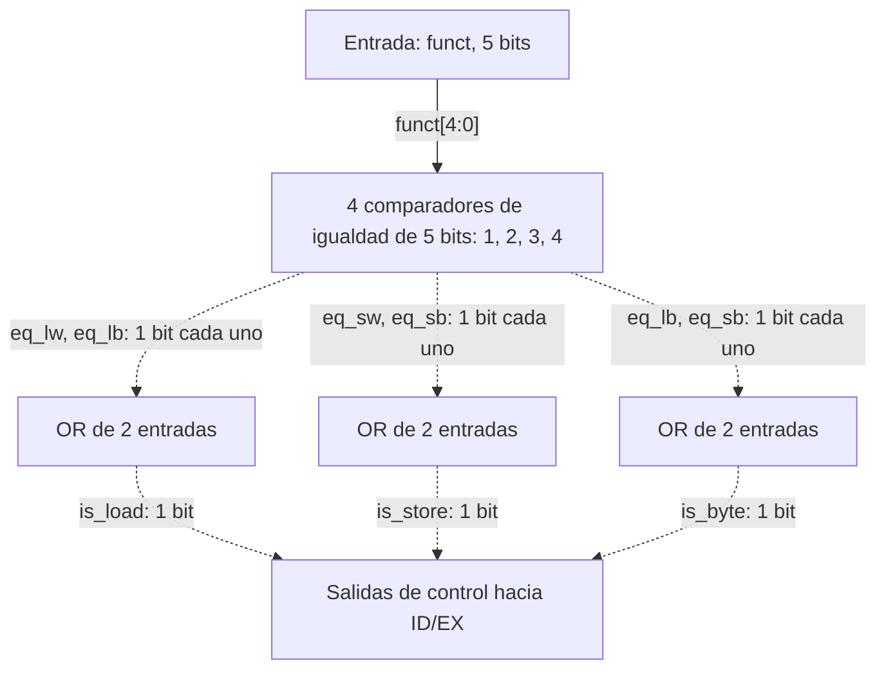
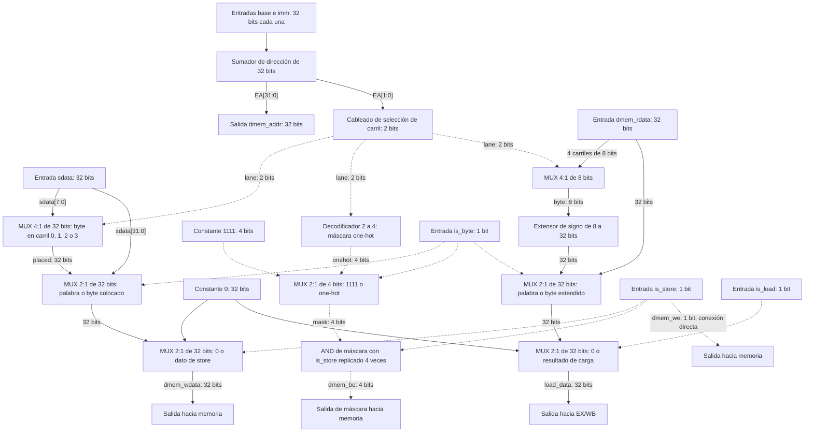
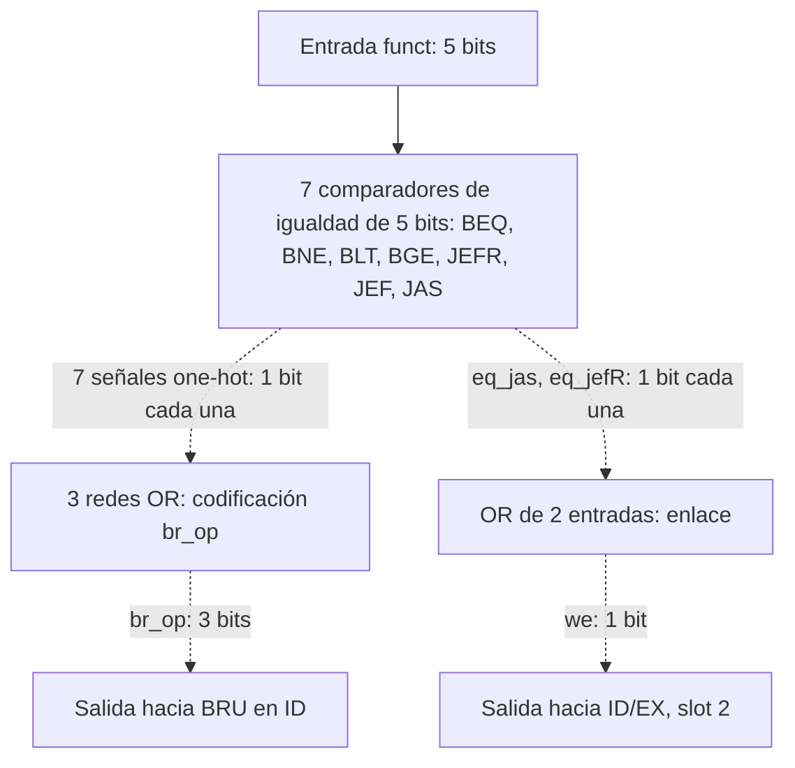
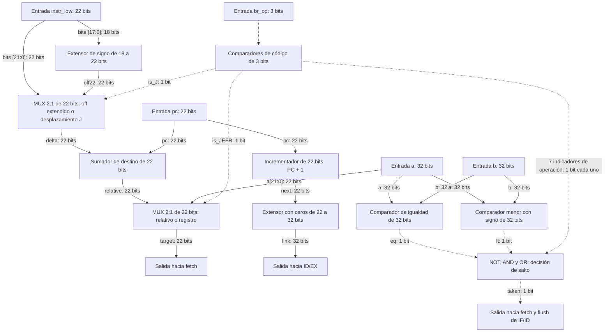

# Diseño modular de nivel 3: LSU, BRU y sus decodificadores

**Proyecto:** procesador VLIW para cifrado por bloques, CE-4301, Grupo 6.  
**Parte asignada en la imagen:** `lsu.sv`, `lsu_dec`, `bru.sv`, `bru_dec`.  


## 1. Convenciones y ubicación en el procesador

En los diagramas Mermaid, **flecha continua = dato** y **flecha discontinua = control**. Cada etiqueta declara señal y ancho. Un selector de byte es un multiplexor de cuatro entradas de 8 bits; no es una memoria adicional. Una extensión es cableado, no un registro.

| Módulo | Etapa | Naturaleza | Estado propio |
|---|---|---|---|
| `lsu_dec` | ID, dentro de `dispatch` | Combinacional | Ninguno |
| `lsu.sv` | EX | Combinacional | Ninguno |
| `bru_dec` | ID, dentro de `dispatch` | Combinacional | Ninguno |
| `bru.sv` | ID | Combinacional | Ninguno |

Estos cuatro módulos no tienen `clk` ni `rst`. Los registros de segmentación, PC, memoria y banco de registros están fuera de ellos y conservan el reloj y reset ya definidos. Agregar un registro dentro de la BRU retrasaría el salto; agregarlo dentro de la LSU cambiaría la latencia de las cargas.

### 1.1 Cableado que debe conservar el integrador

| Elemento | Fuente | Destino |
|---|---|---|
| `funct_LSU[4:0]` | Slot 3, bits `[30:26]` del bundle en IF/ID | `lsu_dec` |
| `base[31:0]` | Lectura A del slot 3: registro indicado por `[21:18]` | ID/EX → LSU |
| `sdata[31:0]` | Lectura B del slot 3: registro indicado por `[25:22]` | ID/EX → LSU |
| `imm[31:0]` | Extensión en ID de slot 3 `[17:0]` | ID/EX → LSU |
| Controles LSU | `lsu_dec` | ID/EX → LSU; `is_load` también habilita escritura en WB |
| `funct_BRU[4:0]` | Slot 2 `[30:26]` | `bru_dec` |
| `a`, `b` | Lecturas A y B del slot 2: campos `[21:18]` y `[25:22]` | BRU en el mismo ID |
| `pc[21:0]` | PC del bundle en IF/ID | BRU; nunca el PC adelantado de IF |
| `instr_low[21:0]` | Slot 2 `[21:0]` | BRU |
| `br_op[2:0]` | `bru_dec` | BRU, directamente en ID |
| `we_BRU`, `rd[3:0]`, `link[31:0]` | Decodificador, slot 2 `[25:22]`, BRU | ID/EX → EX/WB → escritura del slot 2 en WB |
| `taken`, `target` | BRU | `fetch` para siguiente PC; `taken` también vacía IF/ID |

El bit `sel` no entra a estos decodificadores: solo selecciona ALU1/CRYPTO en el slot 1. El uso del campo `[25:22]` como fuente en un store es intencional; no se debe sustituir por `[17:14]`.

## 2. `lsu_dec`: decodificador de memoria

**Objetivo:** traducir el `funct` del slot 3 a tres controles independientes que indiquen carga, almacenamiento y tamaño byte. Entrada: `funct[4:0]`. Salidas: `is_load`, `is_store`, `is_byte`, de un bit cada una. Mantiene exactamente microarquitectura §3.4.

### 2.1 Diagrama de nivel 3



### 2.2 Bloques y comportamiento

| Bloque | Objetivo | Entradas | Salidas | Funcionamiento y justificación |
|---|---|---|---|---|
| Comparadores de código ×4 | Reconocer cada operación | `funct[4:0]` y constantes de ISA | `eq_lw`, `eq_sw`, `eq_lb`, `eq_sb`, 1 bit cada una | Cada igualdad reconoce un único código. No hay estado ni interpretación dependiente del ciclo. |
| OR de carga | Habilitar las dos cargas | `eq_lw`, `eq_lb` | `is_load` | Se activa en `lw` o `lb`. |
| OR de store | Habilitar escritura de memoria | `eq_sw`, `eq_sb` | `is_store` | Se activa en `sw` o `sb`; no se activa por una carga. |
| OR de tamaño | Elegir acceso de byte | `eq_lb`, `eq_sb` | `is_byte` | Ambas operaciones de byte comparten selección de carril. |

### 2.3 Tabla de decodificación, ISA §6.3

| `funct` | Instrucción | `is_load` | `is_store` | `is_byte` |
|---|---|---|---|---|
| `00000` | `nopi` | 0 | 0 | 0 |
| `00001` | `lw` | 1 | 0 | 0 |
| `00010` | `sw` | 0 | 1 | 0 |
| `00011` | `lb` | 1 | 0 | 1 |
| `00100` | `sb` | 0 | 1 | 1 |
| `00101`–`11111` | Reservados | 0 | 0 | 0 |

Los códigos reservados tienen la misma ausencia de efectos que `nopi`. Las salidas se asignarán completamente en la futura lógica combinacional para evitar latches. Para controles válidos, `is_load` e `is_store` nunca son uno simultáneamente.

## 3. `lsu.sv`: unidad de carga y almacenamiento

**Objetivo:** calcular la dirección efectiva, adaptar stores a los carriles de memoria y formar el resultado de las cargas. Trabaja en EX y cumple ISA §§5.4 y 6.3.

### 3.1 Interfaz fija, microarquitectura §3.5

| Puerto | Dirección respecto a LSU | Ancho | Significado |
|---|---|---|---|
| `base`, `sdata`, `imm` | Entrada | 32 cada uno | Base, dato de store y desplazamiento ya extendido |
| `is_load`, `is_store`, `is_byte` | Entrada | 1 cada uno | Control registrado en ID/EX |
| `dmem_rdata` | Entrada | 32 | Palabra completa leída de memoria |
| `dmem_addr` | Salida | 32 | Dirección efectiva de byte |
| `dmem_wdata` | Salida | 32 | Palabra completa o byte ubicado en el carril |
| `dmem_we` | Salida | 1 | Habilitación de escritura de memoria |
| `dmem_be` | Salida | 4 | Habilitación individual de bytes |
| `load_data` | Salida | 32 | Resultado de carga para EX/WB |

### 3.2 Diagrama de nivel 3



### 3.3 Bloques funcionales

| Bloque | Objetivo | Entradas | Salidas | Explicación y justificación |
|---|---|---|---|---|
| Sumador de dirección | Obtener `EA = base + imm` | Dos buses de 32 bits | `EA[31:0]` | Suma de 32 bits, acarreo final descartado. Un único modo base más desplazamiento requiere un único sumador. |
| Cableado de carril | Identificar byte dentro de palabra | `EA[1:0]` | `lane[1:0]` | Los dos bits representan posiciones 0–3. La dirección completa sigue saliendo por `dmem_addr`. |
| Colocador de store | Situar el byte bajo de `sdata` | `sdata[7:0]`, `lane[1:0]` | `placed[31:0]` | MUX 4:1 entre cuatro concatenaciones fijas con ceros. No requiere desplazador de barril general. |
| MUX de dato de store | Elegir store de palabra o byte | `sdata`, `placed`, `is_byte` | `store_value[31:0]` | `sw` conserva los 32 bits; `sb` conserva únicamente el byte bajo. |
| MUX de habilitación de dato | Fijar salida inactiva | Cero, `store_value`, `is_store` | `dmem_wdata` | Cero si no hay store. Es una decisión de determinismo, sin efecto arquitectónico cuando `we=0`. |
| Decodificador 2→4 | Elegir único carril escrito | `lane[1:0]` | `onehot[3:0]` | Una salida por posición; imprescindible para preservar los demás bytes. |
| MUX de máscara y AND ×4 | Seleccionar tamaño y desactivar escritura | `1111`, `onehot`, `is_byte`, `is_store` | `dmem_be[3:0]` | `sw` habilita cuatro bytes; `sb` uno; sin store todos quedan deshabilitados. |
| Conexión de habilitación | Autorizar escritura de memoria | `is_store` | `dmem_we` | Conexión directa conforme a interfaz. La LSU no genera un reloj. |
| Selector de carga | Extraer byte de memoria | Cuatro bytes de `dmem_rdata`, `lane` | `byte_value[7:0]` | MUX 4:1 de 8 bits; orden little endian. |
| Extensor de signo | Mantener el entero del byte | `byte_value[7:0]` | `signed_byte[31:0]` | Replica el bit 7 en los 24 bits superiores. Extender con ceros implementaría otra instrucción. |
| MUX de resultado | Elegir ancho y fijar salida inactiva | Palabra, byte extendido, cero; `is_byte`, `is_load` | `load_data` | Dos MUX 2:1 en cascada: palabra/byte y resultado/cero. |

### 3.4 Relaciones exactas de datos y control

Se usan concatenaciones `{...}` y repetición de bits para describir cableado:

```text
EA             = (base + imm) mod 2^32
lane           = EA[1:0]
dmem_addr      = EA
placed         = MUX_lane({24'b0,sdata[7:0]}, {16'b0,sdata[7:0],8'b0},
                          {8'b0,sdata[7:0],16'b0}, {sdata[7:0],24'b0})
onehot         = MUX_lane(0001, 0010, 0100, 1000)
store_value    = is_byte ? placed : sdata
dmem_wdata     = is_store ? store_value : 0
dmem_we        = is_store
dmem_be        = {4{is_store}} AND (is_byte ? onehot : 1111)
byte_value     = MUX_lane(rdata[7:0], rdata[15:8], rdata[23:16], rdata[31:24])
signed_byte    = {{24{byte_value[7]}}, byte_value[7:0]}
load_data      = is_load ? (is_byte ? signed_byte : dmem_rdata) : 0
```

No se extiende el inmediato otra vez en la LSU: en ID ya se generó `imm = {{14{slot3[17]}}, slot3[17:0]}` y se guardó en ID/EX. La suma funciona tanto con desplazamientos positivos como negativos.

| `lane` | Byte seleccionado de memoria | `be` para `sb` | `wdata` con `sdata[7:0]=AA` |
|---|---|---|---|
| `00` | `[7:0]` | `0001` | `000000AA` |
| `01` | `[15:8]` | `0010` | `0000AA00` |
| `10` | `[23:16]` | `0100` | `00AA0000` |
| `11` | `[31:24]` | `1000` | `AA000000` |


**Alineación:** para `lw/sw`, la memoria usa la dirección de palabra y descarta `[1:0]`; la LSU no cambia `dmem_addr`. Una `lw` con `EA=0x1002` entrega la palabra que contiene `0x1000`, según el plan y el ISA. El programador debe alinear accesos normales. No se crea una excepción de alineación ni un acceso que combine dos palabras. Con 64 KB, microarquitectura §3.6 usa `[15:2]` como índice y descarta bits altos; la LSU tampoco agrega verificación de rango.

### 3.5 Funcionamiento conjunto y ejemplo

Para `lb r7, 2(r6)` con `r6=0x1000`, ID decodifica carga de byte y extiende el 2. En EX la LSU calcula `EA=0x1002`; la memoria entrega, por ejemplo, `0x7F80FF01`. El carril 2 contiene `0x80`, por lo que `load_data=0xFFFFFF80`. EX/WB conserva ese resultado y WB lo escribe en `r7`. La memoria no se escribe porque `is_store=0`.

Para `sb` en esa dirección con `sdata=0x123456AA`, la LSU produce `dmem_wdata=0x00AA0000`, `dmem_be=0100`, `dmem_we=1`. La palabra anterior `0x7F80FF01` pasa a `0x7FAAFF01`: los otros tres bytes quedan intactos.

La ruta combinacional de carga es ID/EX → sumador → memoria → selector de byte → extensor → MUX → EX/WB. Debe cumplir el período de reloj; una latencia contractual de un ciclo no demuestra por sí misma una frecuencia máxima.

## 4. `bru_dec`: decodificador de saltos

**Objetivo:** traducir `funct` del slot 2 a una operación interna de tres bits y a la habilitación de escritura del enlace. Entrada: `funct[4:0]`. Salidas: `br_op[2:0]` y `we`, de un bit. Cumple microarquitectura §3.8.

### 4.1 Diagrama de nivel 3



### 4.2 Tabla de códigos

La codificación interna se propone aquí porque el documento del grupo la deja libre. **`br_op` no es el campo `funct` del programa.** Cambiarla internamente exige mantener BRU y decodificador sincronizados, pero no cambia el código del ensamblador.

| `funct` de ISA | Instrucción | `br_op` interno | Nombre | `we` |
|---|---|---|---|---|
| `00000` | `nopi` | `000` | `BR_NONE` | 0 |
| `00001` | `beq` | `001` | `BR_BEQ` | 0 |
| `00010` | `bne` | `010` | `BR_BNE` | 0 |
| `00011` | `blt` | `011` | `BR_BLT` | 0 |
| `00100` | `bge` | `100` | `BR_BGE` | 0 |
| `00101` | `jefR` | `111` | `BR_JEFR` | 1 |
| `10000` | `jef` | `101` | `BR_JEF` | 0 |
| `10001` | `jas` | `110` | `BR_JAS` | 1 |
| Los otros 24 códigos | Reservados | `000` | `BR_NONE` | 0 |

### 4.3 Bloques y funcionamiento conjunto

| Bloque | Objetivo | Entradas | Salidas | Funcionamiento y justificación |
|---|---|---|---|---|
| Comparadores ×7 | Reconocer operaciones válidas | `funct[4:0]`, constantes | Siete señales de igualdad | Solo un comparador puede activarse para un código conocido. |
| Codificador por tres redes OR | Formar operación interna | Siete señales de igualdad | `br_op[2:0]` | OR por cada bit del código elegido; sin coincidencia produce cero. No hay prioridad porque las igualdades son excluyentes. |
| OR de enlace | Autorizar escritura en WB | `eq_jas`, `eq_jefR` | `we` | Solo llamadas/saltos con enlace escriben registro; los saltos condicionales no escriben. |

```text
br_op[0] = eq_beq OR eq_blt OR eq_jef OR eq_jefR
br_op[1] = eq_bne OR eq_blt OR eq_jas OR eq_jefR
br_op[2] = eq_bge OR eq_jef OR eq_jas OR eq_jefR
we       = eq_jas OR eq_jefR
```


## 5. `bru.sv`: unidad de control de flujo

**Objetivo:** determinar si se toma el salto, calcular su destino y producir el enlace de retorno. Es combinacional y resuelve en ID, conforme a ISA §§5.3, 6.2 y 10.

### 5.1 Interfaz fija, microarquitectura §3.9

| Puerto | Dirección | Ancho | Significado |
|---|---|---|---|
| `pc` | Entrada | `PC_W=22` | PC del bundle que está en ID |
| `a`, `b` | Entrada | 32 cada uno | Valores de registros fuente |
| `instr_low` | Entrada | 22 | Bits `[21:0]` del slot 2 |
| `br_op` | Entrada | 3 | Operación interna del decodificador |
| `taken` | Salida | 1 | Se debe redirigir el PC y vaciar IF/ID |
| `target` | Salida | `PC_W=22` | Índice del bundle de destino |
| `link` | Salida | 32 | PC siguiente, extendido con ceros |

### 5.2 Diagrama de nivel 3



### 5.3 Bloques funcionales

| Bloque | Objetivo | Entradas | Salidas | Funcionamiento y justificación |
|---|---|---|---|---|
| Comparadores de código | Identificar operación interna | `br_op[2:0]` | Siete indicadores; `is_J` | Igualdades con códigos de §5.2; `is_J = is_JEF OR is_JAS`. |
| Extensor de desplazamiento B | Mantener signo de `off` | `instr_low[17:0]` | `off22[21:0]` | Repite el bit 17 cuatro veces. Evita tratar −2 como un desplazamiento positivo grande. |
| MUX de desplazamiento | Compartir sumador relativo | `off22`, `instr_low[21:0]`, `is_J` | `delta[21:0]` | B usa 18 bits extendidos; J ya tiene 22 bits. |
| Sumador de destino | Calcular destino relativo | `pc`, `delta`, 22 bits | `relative[21:0]` | Un único sumador sirve para B, `jef` y `jas`; solo hay un salto por bundle. |
| MUX de destino | Resolver relativo o indirecto | `relative`, `a[21:0]`, `is_JEFR` | `target[21:0]` | `jefR` usa el registro; los otros saltos usan suma relativa. |
| Incrementador | Calcular dirección de retorno | `pc[21:0]`, constante 1 | `next[21:0]` | Separado del sumador de destino: `jas` requiere destino y enlace simultáneamente. |
| Extensor con ceros | Adaptar enlace al banco | `next[21:0]` | `link[31:0]` | El PC es índice sin signo; se agregan diez ceros. |
| Comparador de igualdad | Obtener condición compartida | `a`, `b`, 32 bits | `eq` | Sirve para `beq`; su negación sirve para `bne`. |
| Comparador menor con signo | Obtener orden correcto | `a`, `b`, 32 bits | `lt` | Sirve para `blt`; su negación sirve para `bge`. No comparte recursos con ALU. |
| Red NOT/AND/OR | Elegir condición de salto | Indicadores de operación, `eq`, `lt` | `taken` | Condicionales dependen de comparador; `jef`, `jas`, `jefR` son siempre tomados; `BR_NONE` nunca. |


### 5.4 Comparación con signo

El bloque menor interpreta ambos operandos como enteros de 32 bits en complemento a dos. A nivel funcional:

```text
eq = (a == b)
lt = signed32(a) < signed32(b)
```

Una realización coherente es: si los signos son distintos, `lt = a[31]`; si son iguales, se usa comparación de magnitud sin signo. Esto también ordena correctamente los dos negativos. Por ejemplo, `0xFFFFFFFD` representa −3 y debe ser menor que 5, aunque sin signo sea mucho mayor. No se deduce `lt` solamente del bit de signo de `a-b`, porque el desbordamiento puede invertirlo.

### 5.5 Cálculo de destino y enlace

Para `PC_W=22`, definido por este ISA:

```text
off22    = {{4{instr_low[17]}}, instr_low[17:0]}
jdelta22 = instr_low[21:0]
is_J     = is_JEF OR is_JAS
delta    = is_J ? jdelta22 : off22
relative = (pc + delta) mod 2^22
target   = is_JEFR ? a[21:0] : relative
next     = (pc + 1) mod 2^22
link     = {10'b0, next}
```

El campo J **ya tiene el ancho del sumador**: no necesita un extensor adicional con `PC_W=22`. Un desplazamiento negativo se representa en complemento a dos; la suma binaria y el descarte de acarreo generan el resultado modular correcto. Estos módulos no agregan excepciones por desbordamiento del PC. Cambiar el ancho arquitectónico del PC requiere revisar el contrato; no basta cambiar un parámetro aisladamente.

Las sumas usan el PC del bundle actual, **sin `+1` adicional**. No se desplaza `off` por dos ni por cuatro: cada unidad del desplazamiento es un bundle. La instrucción `jefR` es indirecta absoluta y tampoco suma PC.

### 5.6 Decisión de salto

```text
taken = (is_BEQ AND eq)
     OR (is_BNE AND NOT eq)
     OR (is_BLT AND lt)
     OR (is_BGE AND NOT lt)
     OR is_JEF OR is_JAS OR is_JEFR
```

| Operación | Condición `taken` | Destino cuando se toma | Escritura de enlace |
|---|---|---|---|
| `BR_NONE` | 0 | No se consume | No |
| `beq` | `eq` | `pc + off22` | No |
| `bne` | `!eq` | `pc + off22` | No |
| `blt` | `lt` | `pc + off22` | No |
| `bge` | `!lt` | `pc + off22` | No |
| `jef` | 1 | `pc + jdelta22` | No |
| `jas` | 1 | `pc + jdelta22` | Sí, en `rd` |
| `jefR` | 1 | `a[21:0]` | Sí, en `rd` |

`target` y `link` se calculan continuamente según las ecuaciones, incluso en `nopi`. Eso no produce efectos: `taken=0` impide usar el destino y `we=0` impide escribir el enlace. No se agregan MUX de salida para ponerlos a cero. Para `jas/jefR`, `rd=0` descarta el enlace en el banco; el salto se toma igual.

### 5.7 Funcionamiento conjunto y temporización

Ejemplo: el bundle 10 contiene una ALU en el slot 0 y `blt r3,r4,-2` en el slot 2, con `r3=-3` y `r4=5`. En ID el comparador produce `lt=1`; el extensor forma −2 en 22 bits y el sumador produce 8. `taken=1` redirige el PC al bundle 8 y solicita el vaciado de IF/ID en el siguiente flanco de subida.

| Ciclo | IF | ID | EX | WB | Acción |
|---|---|---|---|---|---|
| t | 11 | 10 | 9 | 8 | BRU resuelve el salto de 10 hacia 8 |
| t+1 | 8 | Burbuja | 10 | 9 | Se descartó 11; las otras operaciones del bundle 10 ejecutan |
| t+2 | 9 | 8 | Burbuja | 10 | El bundle 10 completa escritura |

La BRU no vacía ID/EX ni EX/WB y no elimina su propio bundle. `taken` es la señal que el integrador conecta al vaciado; no existe un puerto `flush` nuevo. Un salto no tomado conserva la búsqueda secuencial. Esto corresponde a la política de continuar por el siguiente bundle y corregir si el salto se toma.

Si el salto lee un registro producido por una operación del mismo bundle, recibe **el valor anterior**. Una dependencia entre bundles necesita un bundle intermedio independiente o vacío conforme a ISA §9.1. El adelantamiento mostrado en las lecciones no se añade al diseño VLIW del proyecto.

La ruta de decisión incluye lectura de registros , comparador , red de decisión , control del PC/IF-ID. La ruta de destino incluye decodificación y MUX , sumador , MUX de destino. Con el banco escrito en bajada, debe verificarse también el tiempo disponible desde esa escritura hasta la captura en subida; no se presume que toda esa ruta tenga un ciclo completo.


