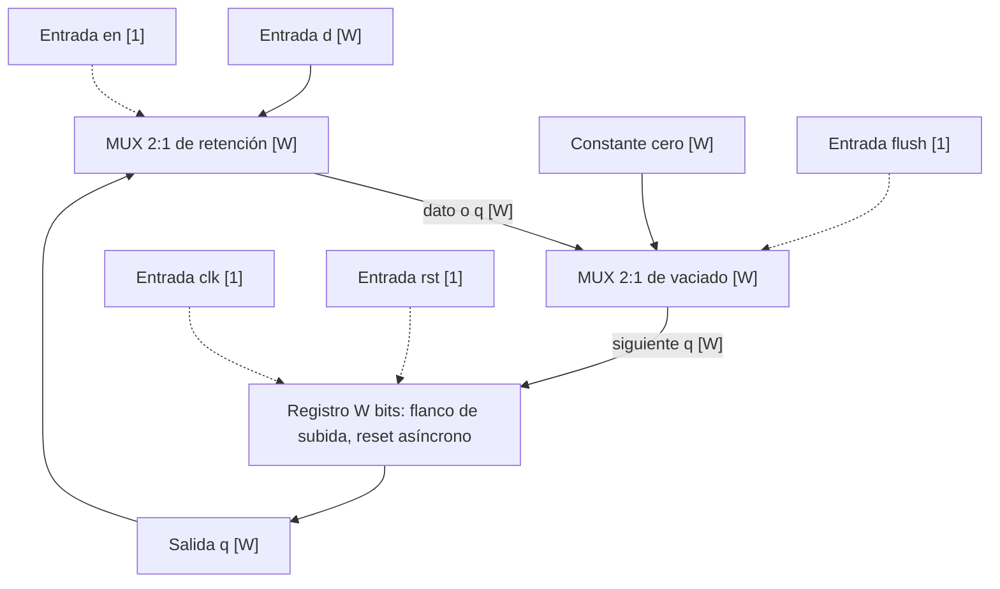
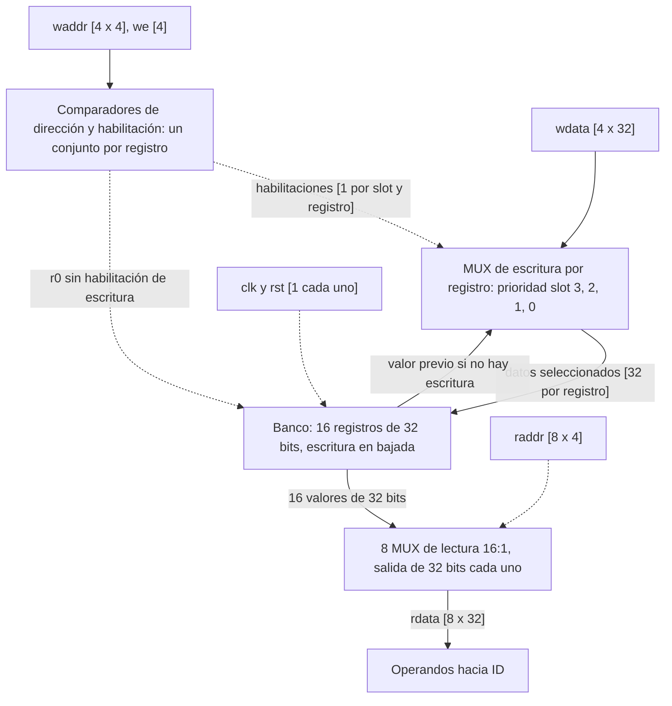
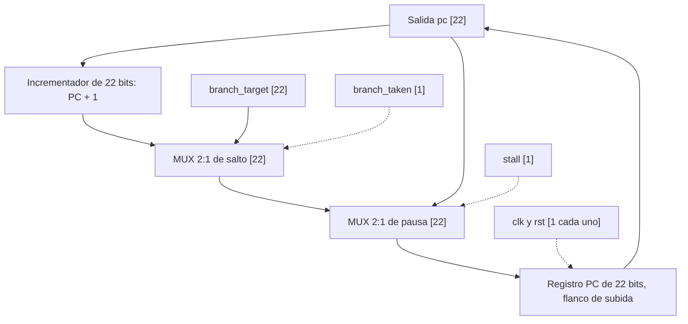
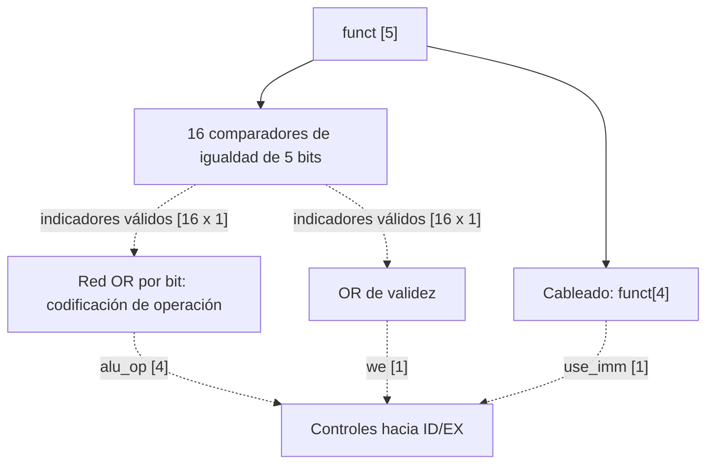
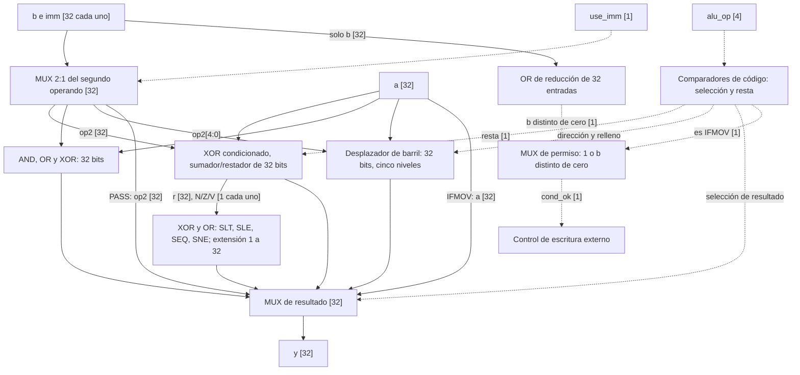
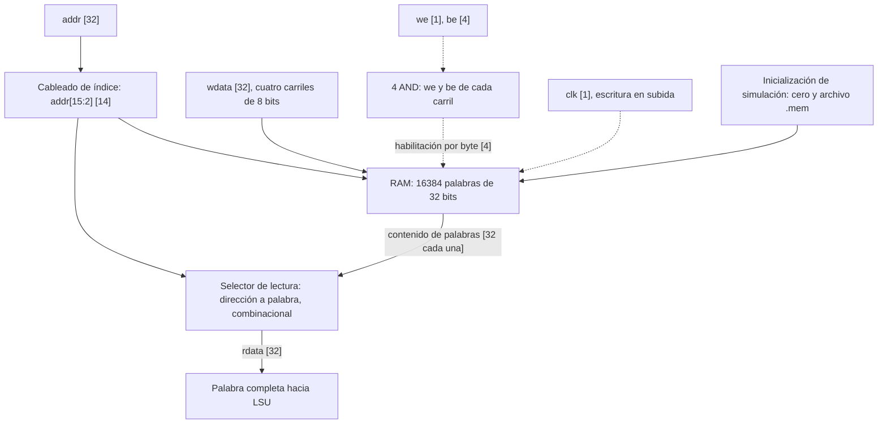
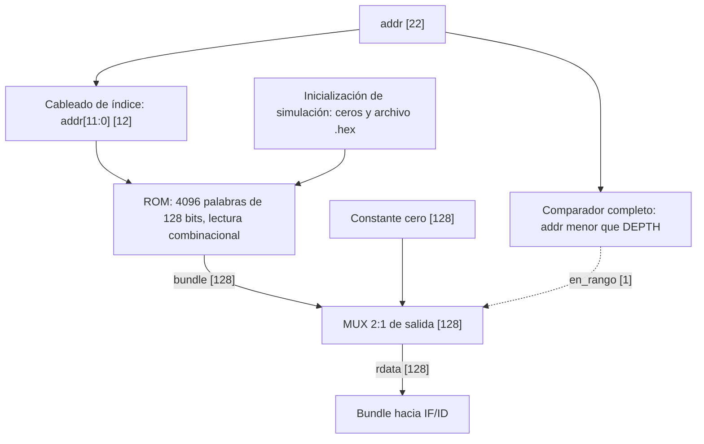

# Diseño modular de componentes del procesador VLIW

**CE-4301 Arquitectura de Computadores I — Grupo 6**  
**Alcance:** tareas 4 a 9 del plan de trabajo.  
**Fecha:** 12 de octubre de 2026.  
**Versión:** 1.0.  
**Estado:** especificación de diseño; implementación y validación de RTL pendientes.

## 1. Objetivo y alcance

Definir la organización digital, interfaces, comportamiento temporal y criterios de verificación de los componentes que almacenan y transportan información, obtienen instrucciones y realizan operaciones aritméticas y lógicas en el procesador VLIW. El diseño conserva la semántica del ISA y las interfaces de la microarquitectura oficial del 11 de octubre de 2026.

| Tarea | Módulo | Función | Etapa o ubicación |
|---|---|---|---|
| 4 | `pipe_reg` | Retención y transferencia de información entre etapas | IF/ID, ID/EX, EX/WB y validez |
| 5 | `regfile` | Almacenamiento de registros de propósito general | Lectura en ID; escritura en WB |
| 6 | `fetch` | Conservación y selección del siguiente PC | IF |
| 7 | `alu_dec` | Traducción de `funct` a controles de ALU | ID, dentro de `dispatch` |
| 7 | `alu` | Operaciones aritméticas, lógicas, comparaciones y desplazamientos | EX, dos instancias |
| 8 | `memory` | Memoria de datos con escritura por byte | Conectada a LSU en EX |
| 9 | `imem` | Lectura del bundle de instrucciones | IF |

Las seis tareas comprenden **siete módulos**, dado que la tarea 7 incluye la ALU y su decodificador. `dispatch`, `core`, `top`, LSU, BRU y CRYPTO constituyen el contexto de integración y quedan fuera del diseño interno de este documento.

La descripción sigue la metodología de diseño modular [R1, §3.5.3]: descomposición en bloques digitales, identificación de entradas y salidas, definición de buses y explicación de su funcionamiento conjunto. Los diagramas corresponden al **nivel 3**. Las tablas de control, ecuaciones y relaciones temporales complementan la especificación funcional necesaria para el nivel 4; no representan esquemas eléctricos por compuertas ni una implementación ya validada.

## 2. Condiciones de arquitectura y diseño

| Propiedad | Especificación |
|---|---|
| Bundle | 128 bits, cuatro slots de 32 bits |
| Datos y registros | 32 bits; 16 registros; `r0` constante cero |
| Organización | Harvard: memorias de datos e instrucciones independientes |
| Pipeline | IF → ID → EX → WB |
| PC | 22 bits; dirección expresada como índice de bundle |
| Calendarización | Estática; no se incorpora resolución dinámica de dependencias de datos |
| Acceso a registros | Lectura combinacional; escritura en flanco de bajada |
| Reset de registros | Asíncrono, activo alto |
| Escritura de memoria | En flanco de subida; sin reset de contenido |
| Pausa estructural | `auth` ocupa CRYPTO durante 14 ciclos; `fetch.stall` y `pipe_reg.en` permiten conservar etapas |

El reset prevalece sobre cualquier habilitación. El vaciado de un registro de segmentación es **síncrono**. Los bloques combinacionales asignan todas sus salidas para cualquier combinación de control; los códigos no definidos no producen escrituras arquitectónicas.

En los diagramas, una flecha continua identifica un bus de datos y una flecha discontinua una señal de control. Los corchetes de las etiquetas indican el ancho del bus, salvo que se indique explícitamente una selección de bits.

Los parámetros de interfaz son los definidos en [R3, §4.3]. Los valores arquitectónicos evaluados son los de la tabla anterior; la parametrización de un módulo no autoriza modificar por separado el contrato con el compilador.

## 3. Tarea 4: registro de segmentación `pipe_reg`

### 3.1 Objetivo e interfaz

Almacenar un bus de `W` bits y actualizarlo en el flanco de subida, permitiendo vaciarlo o conservarlo durante una pausa. No interpreta instrucciones ni campos internos.

| Parámetro | Valor por defecto | Descripción |
|---|---|---|
| `W` | 1 | Ancho del bus almacenado |

| Puerto | Dirección | Ancho | Función |
|---|---|---|---|
| `clk` | Entrada | 1 | Reloj; captura en flanco de subida |
| `rst` | Entrada | 1 | Reset asíncrono activo alto |
| `flush` | Entrada | 1 | Selección de cero en el próximo flanco |
| `en` | Entrada | 1 | Habilita carga; en cero conserva el contenido |
| `d` | Entrada | `W` | Información de la etapa anterior |
| `q` | Salida | `W` | Información almacenada para la etapa siguiente |

### 3.2 Diagrama funcional



### 3.3 Bloques y comportamiento temporal

| Bloque | Objetivo | Entradas | Salida | Funcionamiento |
|---|---|---|---|---|
| MUX de retención | Elegir carga o conservación | `d`, `q`: `W`; `en`: 1 | `hold_data`: `W` | Con `en=1` selecciona `d`; con `en=0` selecciona `q` |
| MUX de vaciado | Sustituir el dato por una burbuja | `hold_data`, cero: `W`; `flush`: 1 | `next_q`: `W` | Con `flush=1` selecciona cero, independientemente de `en` |
| Registro | Conservar información entre ciclos | `next_q`, `clk`, `rst` | `q`: `W` | Captura en subida; reset pone cero inmediatamente |

La prioridad es `rst > flush > en`. Fuera del reset, los cambios de `flush`, `en` o `d` no alteran `q` hasta el siguiente flanco de subida.

| `rst` | `flush` | `en` | Efecto |
|---|---|---|---|
| 1 | X | X | `q=0` inmediatamente |
| 0 | 1 | X | `q=0` en subida |
| 0 | 0 | 1 | `q=d` en subida |
| 0 | 0 | 0 | Conservación de `q` |

`X` en esta tabla significa condición indiferente, no un valor desconocido del simulador.

### 3.4 Justificación e integración

Un registro de segmentación retiene datos y controles requeridos por etapas posteriores [R5, §3.1.2]. El vaciado se realiza en el flanco porque la BRU calcula su decisión desde IF/ID: borrar IF/ID de forma asíncrona modificaría la propia instrucción que origina el salto antes de aplicar la redirección [R3, §3.13].

La habilitación permite conservar IF/ID e ID/EX durante `auth`. EX/WB recibe ceros durante la pausa para evitar repetir escrituras. El valor cero representa controles inactivos y, en IF/ID, un bundle de `nopi`.

| Registro lógico | Instancias de datos | `flush` | `en` |
|---|---|---|---|
| IF/ID | Bundle: 128 bits; PC: 22 bits | `id_redirect` | `~crypto_stall` |
| ID/EX | Slots: 106, 114, 37 y 103 bits; PC: 22 bits | 0 | `~crypto_stall` |
| EX/WB | Cuatro slots de 37 bits; PC: 22 bits | `crypto_stall` | 1 |
| Validez | Un bit por etapa | Según vaciado de su etapa | Según habilitación de su etapa |

La división por compartimentos no permite avanzar slots de manera independiente: las instancias de la misma etapa comparten reloj y controles de avance.

### 3.5 Criterios de verificación

`tb_pipe_reg`, con `W=8`, debe verificar reset entre flancos; captura de `11` y `22`; vaciado con `d≠0`; conservación hasta el flanco cuando `flush` cambia a mitad del ciclo; prioridad de reset; conservación de `55` durante tres ciclos con `en=0`; y salida cero cuando `flush=1` y `en=0` [R4, tarea 4].

## 4. Tarea 5: banco de registros `regfile`

### 4.1 Objetivo, parámetros e interfaz

Permitir que los cuatro slots lean dos operandos simultáneamente y escriban sus resultados en WB sin competir por un puerto compartido.

| Parámetro | Valor por defecto | Función |
|---|---|---|
| `NUM_SLOTS` | 4 | Puertos de escritura |
| `XLEN` | 32 | Ancho del dato |
| `NUM_REGS` | 16 | Cantidad de registros |
| `AW` | `$clog2(NUM_REGS)=4` | Ancho de dirección |
| `NUM_RD` | `2*NUM_SLOTS=8` | Puertos de lectura |

| Puerto | Dirección | Ancho o estructura |
|---|---|---|
| `clk`, `rst` | Entrada | 1 cada uno |
| `raddr` | Entrada | Arreglo empaquetado `[NUM_RD-1:0][AW-1:0]` |
| `rdata` | Salida | Arreglo empaquetado `[NUM_RD-1:0][XLEN-1:0]` |
| `waddr` | Entrada | Arreglo empaquetado `[NUM_SLOTS-1:0][AW-1:0]` |
| `wdata` | Entrada | Arreglo empaquetado `[NUM_SLOTS-1:0][XLEN-1:0]` |
| `we` | Entrada | `[NUM_SLOTS-1:0]` |

El slot `s` lee por los puertos `2s` y `2s+1`; escribe por el puerto `s`. No se agrega un puerto de depuración.

### 4.2 Diagrama funcional



### 4.3 Bloques y funcionamiento

| Bloque | Objetivo | Entradas | Salidas | Funcionamiento |
|---|---|---|---|---|
| Banco de registros | Almacenar valores arquitectónicos | Dato por registro, habilitación, reloj y reset | 16 valores de 32 bits | Reset asíncrono a cero; escritura solo en bajada |
| Comparadores y bloqueo | Determinar el destino de escritura | `waddr[s]`, `we[s]`, índice de registro | Habilitaciones por registro y slot | Para registro `j≠0`, habilita si `we[s]` y `waddr[s]=j`; `r0` nunca se habilita |
| MUX de prioridad | Resolver coincidencias de escritura | Datos y habilitaciones de cuatro slots | Dato siguiente del registro | Selecciona el slot habilitado de número mayor; sin coincidencia conserva el valor previo |
| MUX de lectura ×8 | Entregar operandos simultáneos | Contenido del banco, dirección de cada puerto | `rdata[p]` | Lectura combinacional: `rdata[p]=regs[raddr[p]]` |

La prioridad describe un comportamiento digital determinista si llegan destinos repetidos. El ISA sigue prohibiendo que dos slots escriban el mismo registro en un bundle válido; la prioridad no constituye calendarización dinámica ni hace válida esa combinación [R2, §9.3].

### 4.4 Temporización y justificación

En subida, EX/WB recibe resultados; en bajada, `regfile` los escribe; antes de la siguiente subida, ID lee el nuevo contenido. Un consumidor situado dos bundles después del productor puede utilizar el resultado, con un bundle intermedio de separación, sin forwarding [R2, §9.1; R3, §4.1].

La escritura se concentra en un único dominio de eventos de bajada, con selección por slot. No se proponen cuatro procesos independientes que puedan competir por el mismo registro. El bloqueo de escritura en `r0` mantiene su valor cero después del reset, por lo que los puertos de lectura no requieren multiplexores adicionales para ese caso.

Los arreglos empaquetados conservan la interfaz acordada y evitan depender del soporte de puertos de arreglos no empaquetados en Icarus. Los demás registros tienen roles de software; el hardware no distingue temporales, enlace o puntero global por nombre.

### 4.5 Criterios de verificación

| Caso en `tb_regfile` | Resultado esperado |
|---|---|
| Reset asíncrono | Los 16 registros en cero |
| Escritura de `CAFE` en `r5` | Valor nuevo después de bajada |
| Escritura de cualquier dato en `r0` | Lectura de cero |
| Cuatro destinos distintos | Permanecen las cuatro escrituras |
| Slots 1 y 3 escriben `r6` | Se conserva el dato del slot 3 |
| `we=0` | No cambia el registro |
| Ocho lecturas distintas | Cada puerto entrega su registro |
| Ocho lecturas de `r7` | Ocho salidas iguales |
| Leer y escribir `r9` | Antes de bajada: valor viejo; después: nuevo |
| Flanco de subida sin bajada posterior | Ninguna escritura todavía |

## 5. Tarea 6: unidad de búsqueda `fetch`

### 5.1 Objetivo e interfaz

Conservar el índice del bundle de IF y determinar el próximo índice mediante avance secuencial, salto o pausa.

| Parámetro | Valor por defecto |
|---|---|
| `PC_W` | 22 |

| Puerto | Dirección | Ancho | Función |
|---|---|---|---|
| `clk`, `rst` | Entrada | 1 cada uno | Captura en subida; reset asíncrono |
| `stall` | Entrada | 1 | Conserva el PC |
| `branch_taken` | Entrada | 1 | Redirección proporcionada por el control de ID |
| `branch_target` | Entrada | `PC_W` | Índice de destino |
| `pc` | Salida | `PC_W` | Dirección hacia `imem` y dato hacia IF/ID |

### 5.2 Diagrama funcional



### 5.3 Bloques, prioridad y justificación

| Bloque | Entradas | Salida | Función |
|---|---|---|---|
| Incrementador | `pc`, constante 1 | `seq_pc` de `PC_W` bits | Obtiene el bundle siguiente; descarta acarreo final |
| MUX de salto | `seq_pc`, `branch_target`, `branch_taken` | `redirect_pc` | Elige secuencial o destino |
| MUX de pausa | `redirect_pc`, `pc`, `stall` | `next_pc` | Conserva `pc` si hay pausa, aun con salto solicitado |
| Registro PC | `next_pc`, `clk`, `rst` | `pc` | Captura en subida; reset inmediato a cero |

Fuera del reset:

`next_pc = stall ? pc : (branch_taken ? branch_target : pc + 1)`.

La prioridad es `rst > stall > branch_taken > avance secuencial`. El PC cuenta bundles: no se incrementa en 4 ni en 16. Su incrementador es independiente del de la BRU porque IF e ID contienen bundles distintos; la BRU calcula el enlace del bundle de ID [R3, §3.12].

La decisión y el destino proceden del control de ID. `fetch` no vuelve a comparar operandos ni almacena historial de saltos. Al aplicar una redirección, el integrador vacía IF/ID en el mismo flanco. Durante la pausa de `auth`, el PC y las etapas detenidas conservan el bundle; al reanudar se aplica el salto pendiente según el control de integración.

### 5.4 Criterios de verificación

`tb_fetch` debe comprobar: reset a cero; cuatro avances que producen 1, 2, 3 y 4; salto a 8; salto posterior a 2; reset inmediato entre flancos desde PC distinto de cero; conservación durante tres ciclos de pausa y avance al liberarla; y prioridad de `stall` cuando coincida con `branch_taken`. Se agrega como frontera el avance desde el máximo PC, cuyo resultado de `PC_W` bits es cero.

## 6. Tarea 7: decodificador `alu_dec`

### 6.1 Objetivo e interfaz

Interpretar el `funct` de los slots de ALU y generar una operación interna, la selección del segundo operando y la habilitación de escritura.

| Puerto | Dirección | Ancho | Función |
|---|---|---|---|
| `funct` | Entrada | 5 | Campo `[30:26]` de la instrucción |
| `alu_op` | Salida | 4 | Operación interna según tabla oficial |
| `use_imm` | Salida | 1 | Selecciona inmediato en lugar de `b` |
| `we` | Salida | 1 | Autoriza escritura para instrucciones válidas |

### 6.2 Diagrama funcional



Los comparadores reconocen códigos excluyentes. La red de codificación reproduce la tabla siguiente; su salida por defecto es suma. No se requiere una máquina de estados ni una memoria con reloj.

### 6.3 Tabla de decodificación

| `funct` | Instrucción | `alu_op` | Operación interna | `use_imm` | `we` |
|---|---|---|---|---|---|
| `00000` | `nopi` | `0000` | ADD, resultado ignorado | 0 | 0 |
| `00001` | `add` | `0000` | ADD | 0 | 1 |
| `00010` | `sub` | `0001` | SUB | 0 | 1 |
| `00011` | `and` | `0010` | AND | 0 | 1 |
| `00100` | `or` | `0011` | OR | 0 | 1 |
| `00101` | `xor` | `0100` | XOR | 0 | 1 |
| `00110` | `sll` | `0101` | SLL | 0 | 1 |
| `00111` | `srl` | `0110` | SRL | 0 | 1 |
| `01000` | `sra` | `0111` | SRA | 0 | 1 |
| `01001` | `slt` | `1000` | SLT | 0 | 1 |
| `01010` | `sle` | `1001` | SLE | 0 | 1 |
| `01011` | `seq` | `1010` | SEQ | 0 | 1 |
| `01100` | `sne` | `1011` | SNE | 0 | 1 |
| `01101` | `ifmov` | `1100` | IFMOV | 0 | 1 |
| `10000` | `saddi` | `0000` | ADD | 1 | 1 |
| `10001` | `xori` | `0100` | XOR | 1 | 1 |
| `10010` | `mov` | `1101` | PASS | 1 | 1 |
| `01110`, `01111` | Reservados | `0000` | Ignorada | 0 | 0 |
| `10011`–`11111` | Reservados | `0000` | Ignorada | 1 | 0 |

Son 16 operaciones de ISA con efecto y `nopi`; se representan mediante 14 operaciones internas. `add/saddi` comparten suma y `xor/xori` comparten XOR. La selección de inmediato se conserva como `use_imm=funct[4]`, incluso en códigos reservados; `we=0` impide que tengan efecto. `alu_op` no sustituye la codificación binaria del ISA [R3, §§3.2 y 4.8].

La verificación debe recorrer los 32 códigos, comparar todas las salidas con la tabla y comprobar transiciones de una operación válida a un código reservado. El resultado de `ifmov` aún puede cancelar la escritura en EX; esa condición depende de un dato y no se resuelve en este decodificador.

## 7. Tarea 7: unidad aritmética y lógica `alu`

### 7.1 Objetivo e interfaz

Realizar operaciones de 32 bits dentro de EX. Existen dos instancias del mismo módulo, asociadas a slots 0 y 1. En el slot 1, el control externo selecciona el resultado de ALU1 o CRYPTO.

| Puerto | Dirección | Ancho | Función |
|---|---|---|---|
| `a`, `b`, `imm` | Entrada | 32 cada uno | Operandos de registro e inmediato extendido |
| `alu_op` | Entrada | 4 | Código interno |
| `use_imm` | Entrada | 1 | Selector del segundo operando |
| `y` | Salida | 32 | Resultado |
| `cond_ok` | Salida | 1 | Permite escritura; cero solo en IFMOV con `b=0` |

### 7.2 Diagrama funcional



### 7.3 Bloques internos

| Bloque | Entradas y salidas | Función y justificación |
|---|---|---|
| MUX de segundo operando | `b`, `imm`, `use_imm` → `op2` | Permite compartir los caminos de datos de instrucciones R e I |
| Comparadores de operación | `alu_op` → controles internos | Seleccionan resta, desplazamiento, resultado y IFMOV |
| Sumador/restador | `a`, `op2`, `sub` → `r` | Un recurso aritmético compartido; `sub=1` en SUB y las cuatro comparaciones |
| Generador de condiciones | `a`, `op2`, `r`, `sub` → `N`, `Z`, `V` | Proporciona igualdad y orden con signo corregido por desbordamiento |
| Comparaciones | `N`, `Z`, `V` → cuatro resultados de 32 bits | Produce 0 o 1 en bit 0, con 31 ceros superiores |
| Bloque lógico | `a`, `op2` → AND, OR y XOR | Operaciones bit a bit de 32 bits |
| Desplazador | `a`, `op2[4:0]`, modo → dato de 32 bits | Cinco niveles de selección para desplazamientos de 1, 2, 4, 8 y 16 posiciones |
| MUX de resultado | Resultados de bloques, `a`, `op2`, selección → `y` | IFMOV selecciona `a`; PASS selecciona `op2`; códigos internos 1110/1111 entregan cero |
| Detector no cero y MUX de permiso | `b`, condición IFMOV → `cond_ok` | IFMOV no escribe cuando `b=0`; el control no depende de `imm` |

### 7.4 Ecuaciones aritméticas y condiciones

Todas las operaciones aritméticas conservan los 32 bits bajos:

```text
op2 = use_imm ? imm : b
sub = alu_op pertenece a {SUB, SLT, SLE, SEQ, SNE}
x   = op2 XOR {32{sub}}
r   = (a + x + sub) mod 2^32
N   = r[31]
Z   = (r == 0)
V   = sub ? ((a[31] XOR op2[31]) AND (r[31] XOR a[31]))
          : ((NOT (a[31] XOR op2[31])) AND (r[31] XOR a[31]))
SLT = N XOR V
SLE = SLT OR Z
SEQ = Z
SNE = NOT Z
```

Las señales `N`, `Z` y `V` son condiciones combinacionales internas; no se almacenan en un registro de banderas arquitectónico. `V` corrige el signo aparente de una resta que desborda: comparar `0x7FFFFFFF` con `0x80000000` únicamente por `r[31]` produciría un orden incorrecto.

La cantidad de desplazamiento es `sh=op2[4:0]`. SLL inserta ceros por la derecha; SRL inserta ceros por la izquierda; SRA replica el signo de `a` por la izquierda. El resultado de SRA requiere interpretación con signo de `a`.

La habilitación se define como:

`cond_ok = (alu_op == IFMOV) ? (b != 0) : 1`.

IFMOV siempre produce `y=a`; la conservación del destino cuando `b=0` se obtiene suprimiendo la escritura. `core` calcula `we_final=we_dec AND cond_ok`. No se lee el valor antiguo de `rd` ni se añade un tercer puerto al banco [R3, §3.3].

### 7.5 Criterios de verificación

| Operación o condición en `tb_alu` | Entrada | Resultado esperado |
|---|---|---|
| ADD con desbordamiento | `7FFFFFFF + 1` | `80000000` |
| SUB negativa | `0 - 1` | `FFFFFFFF` |
| SLT con signos extremos | `7FFFFFFF, 80000000` y orden inverso | 0 y 1 |
| SLT negativo | `-1, 0` | 1 |
| SLT/SLE con igualdad | `5, 5` | 0 y 1 |
| SEQ/SNE con igualdad | `7, 7` | 1 y 0 |
| SRA/SRL | `80000000`, desplazamiento 4 | `F8000000` y `08000000` |
| SLL, cinco bits bajos | `1`, cantidad 33 | 2 |
| AND | `F0F0, FF00` | `F000` |
| OR | `F0, 0F` | `FF` |
| XOR/XORI | `FF, 0F` | `F0` |
| SADDI | `5`, inmediato `FFFFFFFF` | 4 |
| MOV | `a=123`, inmediato `ABC` | `ABC` |
| IFMOV no habilitado | `a=DEAD`, `b=0` | `y=DEAD`, `cond_ok=0` |
| IFMOV habilitado | `a=DEAD`, `b=5` | `y=DEAD`, `cond_ok=1` |
| ADD con segundo operando cero | `3, 0` | `y=3`, `cond_ok=1` |
| Códigos internos 1110 y 1111 | Cualquier dato conocido | `y=0`, `cond_ok=1` |

Los resultados anteriores son criterios de aceptación, no resultados de una simulación de RTL ya realizada para esta entrega.

## 8. Tarea 8: memoria de datos `memory`

### 8.1 Objetivo, parámetros e interfaz

Almacenar datos de propósito general, entregar una palabra de 32 bits de forma combinacional y modificar únicamente los bytes habilitados en el flanco de subida.

| Parámetro | Valor por defecto | Función |
|---|---|---|
| `DEPTH_WORDS` | 16384 | Cantidad de palabras; capacidad de 64 KB |
| `INIT_FILE` | Cadena vacía | Archivo de inicialización `.mem` |

| Puerto | Dirección | Ancho | Función |
|---|---|---|---|
| `clk` | Entrada | 1 | Escritura en flanco de subida |
| `addr` | Entrada | 32 | Dirección de byte |
| `wdata` | Entrada | 32 | Dato colocado por LSU |
| `we` | Entrada | 1 | Habilitación de escritura |
| `be` | Entrada | 4 | Máscara de habilitación de carriles |
| `rdata` | Salida | 32 | Palabra leída |

No existe un puerto `rst`. La inicialización ocurre al comenzar la simulación y no se repite con el reset del núcleo.

### 8.2 Diagrama funcional



### 8.3 Bloques, comportamiento y formato

| Bloque | Entradas | Salida o estado | Función |
|---|---|---|---|
| Cableado de índice | `addr` | `idx` de `AW` bits | `AW=log2(DEPTH_WORDS)`; selecciona `addr[AW+1:2]` |
| Arreglo RAM | Índice, datos, habilitación y reloj | `mem[0:DEPTH_WORDS-1]` | Palabras de 32 bits; cuatro carriles de 8 bits |
| AND por carril | `we`, `be[i]` | `byte_we[i]` | Habilita escritura del byte correspondiente |
| Selector de lectura | Índice y RAM | `rdata=mem[idx]` | Lectura combinacional de palabra completa |
| Inicialización | `INIT_FILE` y ceros | Contenido inicial | Cero en todo el arreglo; después carga del archivo si se especifica |

Para cada carril `i=0,1,2,3`, en subida y con `we AND be[i]=1`:

`mem[idx][8i+7:8i] ← wdata[8i+7:8i]`.

Los bytes no habilitados conservan su valor. La memoria no extiende signos ni selecciona el byte de una carga: esas funciones pertenecen a LSU. La máscara permite ejecutar SB sin una lectura-modificación-escritura adicional.

El direccionamiento de datos es por byte y el orden es little endian [R5, §2.3.1; R6, Lección 4, diapositiva 15]. Con el valor por defecto, el índice usa `[15:2]`: los bits `[1:0]` se ignoran para la selección de palabra y los bits altos se descartan. `0x2002` selecciona la misma palabra que `0x2000`; `0x12000` también se refleja en `0x2000`. No existe excepción de rango en esta memoria.

`DEPTH_WORDS` debe ser potencia de dos para este índice directo, como establece [R3, §3.6]. El mapa del compilador debe mantener los datos dentro de la capacidad física.

La inicialización usa una palabra hexadecimal por línea y marcas `@` en **unidades de palabra**. El ejemplo de cuatro bytes `Hola` en `0x1000` es:

```text
@400
616C6F48
```

Esta inicialización y el volcado pertenecen al entorno de simulación; no se atribuye a `$readmemh` una escritura externa durante la ejecución normal del procesador.

### 8.4 Integración y justificación temporal

La lectura combinacional permite que LSU calcule dirección y resultado de LW/LB dentro de EX, sin una etapa MEM adicional. Un SW termina su escritura en el flanco que separa su EX del EX del bundle siguiente; por eso una carga posterior a la misma dirección obtiene el dato nuevo sin un bundle intermedio [R2, §9.4].

Durante la pausa de `auth`, el integrador calcula `we_mem=lsu_we AND ex_commit`, con `ex_commit=ex_valid AND NOT crypto_stall AND NOT rst`. La memoria recibe esa habilitación externa; no añade una entrada `stall` ni borra datos en reset.

### 8.5 Criterios de verificación

`tb_memory` debe comprobar la carga del ejemplo anterior; cero en posiciones no inicializadas; SW de `12345678` en `0x2000`; SB con `be=0100` y dato `00AA0000`, que deja `12AA5678`; conservación con `we=0`; conservación con máscara cero; lectura desalineada en `0x2002`; reflejo en `0x12000`; dato viejo antes de subida y nuevo después; y compatibilidad del volcado con el formato de inicialización. Deben verificarse además los cuatro carriles individualmente.

## 9. Tarea 9: memoria de instrucciones `imem`

### 9.1 Objetivo, parámetros e interfaz

Entregar el bundle completo indicado por el PC. Las direcciones fuera de la capacidad deben producir un bundle de ceros y no reflejarse sobre el inicio del programa.

| Parámetro | Valor por defecto | Función |
|---|---|---|
| `DEPTH` | 4096 | Cantidad de bundles; capacidad de 64 KB |
| `PC_W` | 22 | Ancho de dirección en bundles |
| `INIT_FILE` | Cadena vacía | Archivo `.hex` de programa |

| Puerto | Dirección | Ancho | Función |
|---|---|---|---|
| `addr` | Entrada | `PC_W` | Índice de bundle |
| `rdata` | Salida | 128 | Bundle completo |

No existen reloj, reset o puerto de escritura de ejecución.

### 9.2 Diagrama funcional



### 9.3 Bloques y comportamiento

| Bloque | Entradas | Salidas | Función y justificación |
|---|---|---|---|
| Comparador de rango | `addr` completo y `DEPTH` | `en_rango` | Verifica el índice antes de consumir el contenido de ROM |
| Índice local | Bits bajos de `addr`, `IW=clog2(DEPTH)` | Índice de ROM | Selección interna con `IW=12` en la configuración acordada |
| Arreglo ROM y selector | Índice y contenido inicial | Bundle de 128 bits | Un bundle por posición; lectura combinacional |
| MUX de salida | Bundle, cero, `en_rango` | `rdata` | Fuera de rango selecciona cero |
| Inicialización | `INIT_FILE` | Contenido de ROM | Primero ceros; después carga del programa |

La condición se expresa como `rdata = (addr < DEPTH) ? rom[indice] : 128'b0`. El comparador usa el PC completo, no solo sus 12 bits bajos. Así, `addr=4096` no vuelve al bundle 0. La ausencia de una instrucción HALT no provoca la repetición involuntaria del programa: las posiciones vacías y fuera de rango entregan `nopi`.

Se conserva la diferencia entre memorias: `memory` refleja bits altos según su contrato; `imem` entrega cero fuera de rango. Unificar ambas políticas modificaría el comportamiento especificado [R3, §§3.6 y 3.7].

### 9.4 Formato y criterios de verificación

El `.hex` contiene una palabra de 128 bits por línea. Los grupos se escriben en orden `slot3_slot2_slot1_slot0`, con slot 0 en los bits menos significativos. El programa de [R2, §11] es:

```text
00000000_00000000_49400003_49000000
00000000_00000000_00000000_00000000
00000000_0D500000_00000000_41100001
```

`tb_imem` debe verificar las tres posiciones de programa; cero en la posición 3; contenido de `DEPTH-1`; cero en `DEPTH` y `DEPTH+1`; cero con el PC máximo; y lectura idéntica de un archivo con separadores `_` y comentarios `//`.

## 10. Funcionamiento conjunto, riesgos y aceptación

Después del reset, `fetch.pc=0`, `regfile` contiene ceros y los registros de segmentación representan etapas vacías. `imem` entrega el bundle 0; IF/ID lo captura mientras el PC selecciona el bundle siguiente. En ID se decodifican operaciones y se leen operandos; ID/EX conserva esos datos y controles. En EX las ALU operan en paralelo con LSU y CRYPTO. EX/WB captura resultados; en bajada `regfile` escribe los destinos habilitados.

La organización Harvard permite leer un bundle en IF y un dato en EX simultáneamente. Los ocho puertos de lectura y cuatro de escritura del banco evitan contención entre slots válidos. Las dependencias RAW permanecen a cargo del software; no se introduce forwarding ni detección dinámica [R2, §§1.1 y 9; R5, §5.1].

Cuando CRYPTO solicita pausa, IF e ID/EX conservan información, EX/WB recibe burbujas y la habilitación externa evita repetir stores. Una redirección tomada se aplica con el vaciado de IF/ID; las otras operaciones del bundle del salto deben completar su ejecución.

| Aspecto de integración | Criterio |
|---|---|
| Interfaces | Coinciden con nombres, anchos y parámetros de [R3, §4.3] |
| Temporalidad | Subida para segmentación, PC y RAM; bajada para banco de registros |
| Pausa | Conservación coherente de bundles y validez; efectos externos una sola vez |
| ALU y banco | Escritura final condicionada por `cond_ok` |
| Carga y memoria | Lectura combinacional y adaptación de byte realizada por LSU |
| Inicialización | Sin valores desconocidos por posiciones no cargadas |
| Códigos reservados | Ninguna escritura arquitectónica |

La ruta de ID requiere especial atención: si un operando se acaba de escribir en bajada, el banco, la BRU y el control disponen de medio período hasta la captura en subida. EX dispone de un período para el cálculo de ALU o dirección, acceso de datos y adaptación de carga. Este documento define profundidad funcional y restricciones temporales; no declara una frecuencia máxima obtenida por síntesis.

Un componente se acepta cuando su testbench cumple los casos definidos, produce cero fallos y genera el VCD correspondiente. Los módulos integrados deben volver a verificarse mediante pruebas de subsistemas y del procesador. El diseño no sustituye esos resultados ni permite presentar los criterios esperados como evidencia de RTL ejecutado.

## 11. Referencias

- **[R1]** Hernández R., M. A. *Diseño Modular*. Transcripción de material del Laboratorio de Diseño Lógico, §3.5.3, p. 3; sin año indicado.
- **[R2]** Grupo 6. (2026). *ISA propio*, revisión 1 con aclaraciones C-01 a C-17. §§3, 5.2, 6.1, 8, 9 y 11.
- **[R3]** Grupo 6. (2026, 11 de octubre). *Microarquitectura del procesador VLIW*. §§1.3–1.5, 2.5–2.11, 3.1–3.3, 3.6–3.7, 3.12–3.14 y 4.1–4.8.
- **[R4]** Grupo 6. (2026, 11 de octubre). *Plan de trabajo — CE-4301* y *Plan de implementación por módulo*. Tareas 4–9 y convenciones generales.
- **[R5]** González Gómez, J. *Notas de clase de Arquitectura de Computadores I*, v0.2. §§2.3.1, 3.1.2, 3.2.1, 3.2.2 y 5.1.
- **[R6]** González Gómez, J. Material de CE-4301: *Lección 3, Formas de Organización*; *Lección 4, Principios del ISA I*, diapositiva 15; *Lección 5, Principios del ISA II*; *Lección 6, ILP y Pipeline*; *Lección 7, Pipeline 2*; *Lección 11, Introducción a VLIW*, diapositivas 4–6 y 12.
- **[R7]** [Repositorio del proyecto, rama develop](https://github.com/tati2327/vliw-block-cipher/tree/develop), commit `8e1713dbbd679bc056d39dee74a6bb125a062cc1`, consultado el 12 de octubre de 2026. Documentos oficiales situados en `docs/`. El ISA ubicado allí es la referencia vigente; las copias antiguas no prevalecen sobre él.
