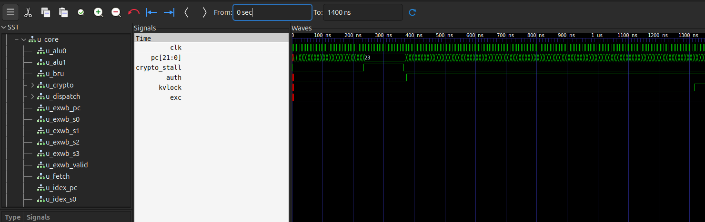

# Integración con el compilador (CE1108)

Contrato entre el procesador VLIW de este repositorio (CE4301) y el compilador
`ccom` del lenguaje Calser (CE1108). En el Grupo 6 ambos lados los desarrolla el
mismo equipo; este documento fija lo que el compilador debe generar, lo que el
procesador garantiza y la evidencia de que funcionan juntos (enunciado §6.1
punto 3 y §6.2).

Documentos relacionados: [isa.md](isa.md) (especificación completa del ISA),
[microarchitecture.md](microarchitecture.md) (implementación) y
[simulation.md](simulation.md) (uso detallado de la simulación).

## 1. Alcance

| Lado | Entrega | Recibe |
|---|---|---|
| Compilador (`ccom`) | `.hex`, `.mem`, `.bin` y `.asm` de cada programa | Este contrato, el ISA y el modelo de simulación |
| Procesador | Modelo SystemVerilog, `make sim`, ensamblador propio `tools/asm.py` | Programas generados por `ccom` |

El ensamblador propio (`tools/asm.py`) es independiente del compilador: no usa ni
llama a `ccom`. Ensambla los `.asm` que genera `ccom` y produce un `.hex` idéntico
bit a bit al del compilador (comprobado con los tres ejercicios), lo que confirma
que ambos lados codifican igual.

## 2. ISA que respeta el compilador

Resumen; la definición completa está en [isa.md](isa.md).

- Instrucción de 32 bits; *bundle* de 128 bits con 4 slots.

| Slot | Bits del bundle | Unidad |
|---|---|---|
| 0 | 31..0 | ALU0 |
| 1 | 63..32 | ALU1 o CRYPTO (bit 31 de la instrucción = `sel`; 1 = CRYPTO) |
| 2 | 95..64 | BRU (saltos) |
| 3 | 127..96 | LSU (memoria) |

- `nopi` es `funct = 00000`; un bundle vacío son 128 bits en cero.
- Formatos (campos en la misma posición en todos):

| Tipo | 31 | 30..26 | 25..22 | 21..18 | 17..0 |
|---|---|---|---|---|---|
| R | sel | funct | rd | rs1 | rs2 (17..14), resto reservado |
| I | sel | funct | rd | rs1 | imm 18 bits con signo |
| B | sel | funct | rs2 | rs1 | off 18 bits con signo |
| J | sel | funct | rd | target 22 bits con signo (21..0) | |
| CRYPTO | 1 | funct | rd | rs1 | rs2 (17..14), k (13..12), i (11..10) |

- Saltos relativos al bundle del salto, en bundles: `off = dir(etiqueta) − PC`.
- Memoria de instrucciones: 4096 bundles. Memoria de datos: 64 KiB direccionados
  por byte, *little endian*.

## 3. Reglas que debe cumplir el código generado

| Regla | Motivo en el procesador |
|---|---|
| Entre la instrucción que escribe un registro y la que lo lee debe haber al menos un bundle intermedio (el lector va dos o más bundles después); en el bundle inmediato se lee el valor viejo | No hay detección de riesgos ni *forwarding* ([isa.md](isa.md) §9.1) |
| Dos slots de un mismo bundle no pueden escribir el mismo registro | Escritura simultánea en WB; `asm.py` lo rechaza |
| Un salto tomado descarta el bundle siguiente; los demás slots del bundle del salto sí se ejecutan | La BRU resuelve en ID y vacía IF/ID (una burbuja) |
| `auth` ocupa la unidad CRYPTO 14 ciclos y detiene el pipeline 13 ciclos extra | Única pausa del procesador (`crypto_stall`, [isa.md](isa.md) §9.2); no requiere nada del compilador |
| El programa termina con `fin_main: jef fin_main` | No hay instrucción de parada; el testbench detecta un `jef` con desplazamiento 0 en ID |
| División o módulo entre cero, o exponente negativo, saltan a `.L_arith_error: jef .L_arith_error` | Decisión del equipo; también es un salto a sí mismo, así que la simulación también se detiene ahí y el resultado esperado no coincide |

`ccom` cumple la primera regla con su organizador de bundles: exige distancia 2
(un bundle intermedio) para lectura después de escritura. `sim_asm.py` del
compilador reporta 0 avisos de separación en los tres ejercicios.

## 4. Registros y memoria

| Registro | Código | Uso en `ccom` |
|---|---|---|
| `rz` | 0 | Cero cableado; base de toda dirección absoluta (`lw t0, 64(rz)`) |
| `rl` | 1 | Enlace de retorno: lo escribe `jas`, lo lee `jefR rz, rl` |
| `rx` | 2 | Puntero de la pila de llamadas (por software, con `sw`/`lw`/`saddi`) |
| `rg` | 3 | Puntero global por convención; `ccom` no lo usa |
| `t0`–`t11` | 4–15 | Temporales de expresiones, argumentos, rutinas aritméticas y cifrado |

El procesador no tiene pila por hardware. En el ISA `rx` es un temporal libre
([isa.md](isa.md) §8); usarlo como puntero de pila es una convención de `ccom`.

| Rango de datos | Contenido |
|---|---|
| `0x0000`– | Variables globales en orden de declaración, luego un área estática por función |
| fin de áreas – `0x0FFF` | Pila de llamadas (`rx`), crece hacia arriba; mínimo 256 B |
| `0x1000`–`0xFFFF` | Datos externos cargados con `tools/load_file.py` (archivos a cifrar) |

Los datos de `ccom` deben caber en `0x0000`–`0x0FFF`.

Área de una función: variable de retorno, parámetros, locales y, al final, 12
casillas (48 B) para guardar temporales (`temp_base`). Los parámetros y el
retorno no viajan en registros: cada uno tiene su casilla fija.

Llamada: el llamador apila `rl` y los temporales vivos (`sw t, 0(rx)`,
`saddi rx, rx, 4`), copia los argumentos a las casillas de los parámetros y ejecuta
`jas rl, .L_func_f`. La función pone su retorno en 0, ejecuta el cuerpo y vuelve
con `jefR rz, rl`. El llamador desapila y lee la casilla de retorno.

## 5. Lo que el ISA no tiene y genera el compilador

| Operación | Cómo la genera `ccom` |
|---|---|
| `*` | Rutina en línea de suma y desplazamiento |
| `/` y `%` | Rutina en línea de 32 iteraciones de desplazamiento y resta; signo corregido al final |
| `^` | Exponenciación por cuadrados, con multiplicaciones en línea |
| Constantes de más de 18 bits | `mov` + `sll` + `saddi`; las negativas se niegan con `sub rd, rz, rd` |

Las rutinas usan etiquetas internas (`__ccom_arith_*`) y 11 de los 12 temporales.

## 6. CRYPTO desde el lenguaje

| Sentencia Calser | Instrucción |
|---|---|
| `autenticar [t]` | `auth` |
| `cerrar_sesion []` | `logout` |
| `cargar_llave [k, w, valor]` | `kv_write rs1, k, w` |
| `sellar []` | `kv_lock` |
| `cambiar_ancla [a]` | `sanc` |
| `cifrar [origen, destino, bloques, k]` | Plantilla con `feis` en el slot 1 (4 rondas por bloque de 8 bytes) |
| `descifrar [origen, destino, bloques, k]` | La misma plantilla con las subllaves en orden inverso (3, 2, 1, 0) y las mitades intercambiadas ([isa.md](isa.md) §5.5) |

`k` y `w` deben ser literales porque son campos de la instrucción.

Valores acordados para la cadena de demostración (`make lamport`, semilla
`0xCAFEDECE`):

| Dato | Valor |
|---|---|
| Ancla después del reset (x100) | `0xFEFF95FF` |
| Primer token válido (x99) | `0xF47BD70B` = `-193210613` |
| Siguiente token (x98) | `0xA45326BA` = `-1538054470` |
| Llave 0 (KA) | `19114957, -1985229329, 324508639, 610839776` |
| Llave 1 (KB) | `286331153, 572662306, 858993459, 1145324612` |

Con un token inválido, `auth` deja `AUTH=0` y `EXC=1`, y las `feis` y `kv_write`
posteriores no se ejecutan. El simulador del compilador (`sim_asm.py`) no calcula
Ascon: acepta cualquier token salvo uno reservado. Por eso el token solo se
valida en este procesador.

## 7. Archivos de intercambio

| Archivo | Lo produce | Lo consume | Formato |
|---|---|---|---|
| `.hex` | `ccom` o `tools/asm.py` | `imem.sv` (`$readmemh`) | Un bundle por línea, `slot3_slot2_slot1_slot0` en hexadecimal |
| `.mem` | `ccom`, `tools/load_file.py` | `memory.sv` (`$readmemh`) | Marcas `@índice_de_palabra` y palabras de 32 bits |
| `.bin` | `ccom` | Entrega del compilador (no se usa en simulación) | Definido por `ccom`: encabezado de 16 bytes (bundles, entrada, tamaño y dirección de datos) + bundles + datos |
| `.asm` | `ccom -s` | `tools/asm.py`, revisión | Un bundle por línea `{ s0 \| s1 \| s2 \| s3 }`, etiquetas `nombre:`, comentarios `#` |
| `.exp.mem` | El equipo, a partir de la traza del compilador | `tb_programa` | Como `.mem`; solo se comparan las palabras listadas |

## 8. Modelo de simulación para la contraparte (§6.1 punto 3)

Requisitos: Icarus Verilog (`iverilog -g2012`), GNU Make, Python 3 y GTKWave para
ver ondas. `make help` lista todo.

Flujo con un programa del compilador:

```bash
# En el repositorio del compilador
./ccom -s programa.cls -o salida/programa.bin   # genera .bin, .hex, .mem y .asm

# En este repositorio
cp salida/programa.hex salida/programa.mem programs/
make sim PROG=programa
```

`make sim PROG=<nombre o ruta>`:

- Carga `<base>.hex` en la memoria de instrucciones. Si solo existe `<base>.asm`,
  o si es más nuevo que el `.hex`, lo ensambla antes con `tools/asm.py`.
- Carga `<base>.mem` en la memoria de datos si existe (o el archivo dado en
  `DATA=`).
- Compara contra `<base>.exp.mem` si existe (o el dado en `EXP=`).
- Corre hasta el salto a sí mismo (límite de 50 000 ciclos) y 5 ciclos más para
  vaciar el pipeline.
- Imprime: ciclo de llegada al fin, comprobación de X/Z en PC, bundle y
  escrituras de WB, registros en decimal y hexadecimal, palabras de memoria
  distintas de cero en `DESDE`–`HASTA`, estado `auth`/`kvlock`/`exc`, y
  `Casos: N; Fallos: N`.
- Deja `build/<nombre>/ondas.vcd` y `build/<nombre>/dump.mem` (volcado completo de
  la memoria de datos). `make waves_prog PROG=<nombre>` abre las ondas.

Para cargar un archivo externo (por ejemplo, el que cifra el ejercicio 3) se usa
`tools/load_file.py` y se pasa el `.mem` resultante con `DATA=`; los resultados se
sacan del volcado con `tools/extract_data.py`. Los comandos completos están en
[simulation.md](simulation.md#ejercicio-3-cifrado-con-el-compilador).

## 9. Validación conjunta (§6.2)

Los tres ejercicios del compilador, generados con `make ejercicios` en el
repositorio de `ccom`, se ejecutaron en el procesador sin modificarlos. Están en
`programs/ejercicio{1,2,3}.*`.

| Ejercicio | Bundles | Ciclos en el procesador | Resultado en el procesador | Esperado (compilador) | Casos / Fallos |
|---|---|---|---|---|---|
| 1, factorial | 80 | 230 | `f` (`0x44`) = 120; `res`=120, `n`=5, `i`=6, `x`=5 | `f = 120` | 7 / 0 |
| 2, búsqueda en matriz | 162 | 382 | `p` (`0x84`, `0x88`) = [1, 1]; `ok` (`0x8C`) = 1 | `ok = verdadero`, `p = [1, 1]` | 5 / 0 |
| 3, cifrado por segmentos | 927 | 17084 | Cifrado idéntico a la referencia en C; descifrado idéntico al original; `auth=0 kvlock=1 exc=0` | Ida y vuelta correcta | 2 / 0 |

Cómo se cubre cada punto del §6.2:

- **Bundles bien formados**: `tb_programa` comprueba en cada ciclo que el PC, el
  bundle en ID y toda escritura de WB no tengan X/Z (0 ciclos con problema en los
  tres). Además, `tools/asm.py` reensambla los `.asm` de `ccom` y produce `.hex`
  idénticos, así que la codificación coincide entre ambos lados.
- **Dependencias respetadas**: el procesador no detecta riesgos; si el compilador
  omitiera el bundle intermedio entre una escritura y su lectura, los resultados
  serían incorrectos. Los tres
  dan el valor esperado, y `sim_asm.py` reporta 0 avisos de separación.
- **Resultado verificado contra referencia**: ejercicios 1 y 2 contra el `.exp.mem`
  tomado de la traza del compilador; ejercicio 3 contra `tools/feistel4_ref.c`.

Reproducir:

```bash
make sim PROG=ejercicio1
make sim PROG=ejercicio2
# Ejercicio 3: bloque completo en simulation.md (carga del archivo, make sim,
# extracción y las dos comparaciones con cmp)
```

Ejercicio 3 en detalle:

- El programa solo recibe direcciones: lee de `0x1000`, escribe el cifrado en
  `0x2000` y el descifrado en `0x3000`. El archivo se carga antes con
  `load_file.py`.
- Autentica con el token x99 (`-193210613`), carga las llaves KA y KB, sella la
  bóveda y cierra la sesión al final (`auth=0 kvlock=1 exc=0`).
- (a) `cmp` del descifrado (`0x3000`) contra el archivo original: idénticos.
- (b) `cmp` del cifrado (`0x2000`) contra `feistel4_ref` con KA, KB y
  `--segmento 16`: idénticos.

Ciclos frente al simulador del compilador: `sim_asm.py` reporta 231, 383 y 17085
ciclos; el procesador llega al fin en 230, 382 y 17084. La diferencia es de un
ciclo y constante en los tres programas, incluido el que autentica. No se
investigó la causa; al ser constante, no depende del código ejecutado, y los
resultados de memoria coinciden en ambos.

Captura de GTKWave del ejercicio 3, de 0 a 1400 ns:



- `crypto_stall` está en 1 de 235 a 365 ns: 13 ciclos de 10 ns, la pausa de `auth`;
  el PC del fetch se queda en 23 durante ese tramo.
- `auth` sube a 1 en 375 ns: el token x99 fue aceptado.
- `kvlock` sube a 1 en 1315 ns: `sellar` después de cargar las ocho subllaves.
- `exc` se mantiene en 0 todo el tiempo.

Señales: `tb_programa.clk`, `dut.u_core.u_fetch.pc`, `dut.u_core.crypto_stall` y
`dut.u_core.u_crypto.u_crypto_state.{auth,kvlock,exc}`.

## 10. Limitaciones conocidas

- El ejercicio 3 está compilado para exactamente 1024 bytes (128 bloques); otro
  tamaño requiere cambiar el programa en Calser. El procesador y las herramientas
  de carga aceptan cualquier tamaño.
- `sim_asm.py` no verifica el token de Lamport; esa verificación solo ocurre en el
  procesador.
- Los datos de `ccom` deben caber en `0x0000`–`0x0FFF`, y el desborde de la pila de
  llamadas no se detecta en ejecución.
- La validación es en simulación (Icarus Verilog); no se ejecutó en hardware
  físico.
