# Microarquitectura del procesador VLIW

**CE 4301 Arquitectura de Computadores I**
Instituto Tecnológico de Costa Rica · Escuela de Ingeniería en Computadores

**Estado:** niveles 1 a 4 cerrados para todos los módulos, incluida la jerarquía de memoria de datos.
**Última actualización:** 22 de noviembre de 2026
**Especificación de referencia:** `docs/isa.md`, revisión 1

---

## Contenido

0. [Alcance y método](#0-alcance-y-método)
1. [Nivel 1 — El procesador como caja negra](#1-nivel-1--el-procesador-como-caja-negra)
2. [Nivel 2 — Organización del procesador](#2-nivel-2--organización-del-procesador)
3. [Nivel 3 — Interfaz de cada módulo](#3-nivel-3--interfaz-de-cada-módulo)
4. [Nivel 4 — Especificación para implementar](#4-nivel-4--especificación-para-implementar)
5. [Medición y verificación](#5-medición-y-verificación)
6. [Registro de decisiones](#6-registro-de-decisiones)

---

## 0. Alcance y método

Este documento describe **cómo se implementa** el ISA de `isa.md`. No modifica
el ISA: ante cualquier diferencia, `isa.md` es la fuente oficial y la
microarquitectura debe ajustarse a él. La jerarquía de memoria de datos (cachés,
buffers y memoria principal con latencia) se agregó sin cambiar el ISA ni el
contrato con el compilador.

El diseño se describe de arriba hacia abajo en cuatro niveles:

| Nivel | Contenido |
|---|---|
| 1 | El procesador como caja negra y sus interfaces con las memorias |
| 2 | Etapas del pipeline, registros de segmentación, flujo de control y jerarquía de memoria de datos |
| 3 | Interfaz y bloques internos de cada módulo |
| 4 | Temporización, tablas de decodificación y declaración exacta de cada módulo |

Las **interfaces del Nivel 3 están fijas**: permiten que cada módulo se diseñe y
pruebe por separado. El interior de cada módulo (bloques, tablas, máquinas de
estado) está documentado en la subsección correspondiente. Los detalles de
implementación de las cachés y del buffer de líneas están, además, en
[`l1_cache.md`](l1_cache.md), [`l2_cache.md`](l2_cache.md) y
[`line_buffer.md`](line_buffer.md).

**Referencias.** «Enunciado I» es el enunciado del primer proyecto del curso
(ISA propio y procesador VLIW) y «enunciado II» el del segundo (jerarquía de
caché y medición de rendimiento). «Notas» son las notas de clase del curso. La
terminología de cachés (conjunto, vía, etiqueta, *write-back*,
*write-allocate*, AMAT) es la de las notas §6.2 y §6.3.

### 0.1 Clasificación de la organización

Siguiendo la terminología de las notas de clase del curso, el procesador es un
**VLIW con segmentación diversificada** (notas §4.1.4, §5.1): un único
*front-end* de búsqueda y decodificación compartido, y una etapa de ejecución
dividida en unidades funcionales especializadas que convergen en una única etapa
de escritura.

Como en todo VLIW, **no existe red de despacho**: cada campo del paquete está
ligado de forma fija a una unidad funcional, de modo que el campo mismo
determina el destino (notas §5.1). La única decisión de despacho del diseño es el
multiplexor del slot 1, gobernado por el bit `sel`.

La memoria de datos es una **jerarquía bloqueante de dos niveles** (notas
§6.3.4): L1-D, L2 unificada y memoria principal, con un *write buffer* entre L1
y L2 y un *eviction buffer* entre L2 y la memoria. Cada nivel atiende un solo
fallo a la vez.

### 0.2 Equivalencia de términos

| `isa.md` y este documento | Notas de clase |
|---|---|
| *bundle* | paquete |
| *slot* | campo |
| `nopi` | NOP |
| pausa (`stall`) | detención del pipeline |
| *write buffer*, *eviction buffer* | buffer de escritura, buffer de desalojo |

---

## 1. Nivel 1 — El procesador como caja negra

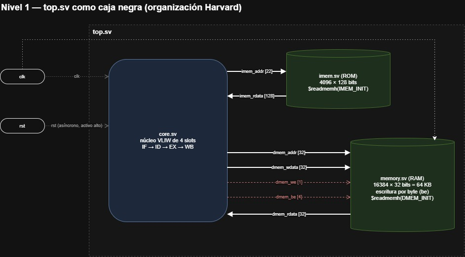

### 1.1 Interfaz externa de `top.sv`

El sistema completo (núcleo, ROM de instrucciones, jerarquía de datos y memoria
principal) se expone con solo dos señales. Las memorias se inicializan con
`$readmemh`.

| Puerto | Dir | Bits | Descripción |
|---|---|---|---|
| `clk` | in | 1 | Reloj del sistema, 100 MHz |
| `rst` | in | 1 | Reset asíncrono, activo alto (§2.9) |

### 1.2 Organización de la memoria: Harvard

Memoria de instrucciones y memoria de datos físicamente separadas, cada una con
su propio bus. La jerarquía de caché existe solo del lado de datos.

**Justificación.** En cada ciclo, IF lee un bundle mientras la LSU, en EX, puede
acceder a un dato. Con una memoria unificada ambos accesos competirían por el
mismo puerto: un riesgo estructural en cada `lw`/`sw`, que habría que resolver
con una pausa. Duplicar el recurso es la solución estructural por defecto de
todo procesador segmentado (notas §3.2.1) y elimina ese conflicto. La ROM de
instrucciones responde en un ciclo y no tiene caché: el enunciado II define la
jerarquía para datos.

Lo que la organización Harvard **no** elimina es la latencia propia de la memoria
de datos. Un fallo de caché tarda varios ciclos y retiene el bundle en EX; es un
riesgo estructural que se resuelve con una pausa de todo el pipeline, como
permite el enunciado II §3.3 (§2.10, §2.11).

| Memoria | Módulo | Equivale a | Ancho de lectura | Dirección | Escritura |
|---|---|---|---|---|---|
| Instrucciones | `imem.sv` | ROM síncrona | 128 bits (un bundle) | Índice de bundle | Nunca |
| Datos | `main_memory.sv`, detrás de la jerarquía elegida con `CACHE` (§2.12) | RAM de líneas con reloj propio | Palabra de 32 bits hacia el núcleo; línea de 256 bits entre niveles | Byte; la jerarquía separa línea `addr[15:5]`, palabra `addr[4:2]` y carril | Máscara de bytes |

Se usan módulos distintos, y no uno solo parametrizado, porque cumplen funciones
distintas: forzar un puerto de escritura en la ROM solo para reutilizar código
no aporta nada. La memoria de datos que el enunciado I llama `memory` (64 KB,
*little endian*, inyección de archivos) la cumple ahora `main_memory`. El módulo
original `memory.sv`, una RAM combinacional de palabras, se conserva con su
*testbench* como componente independiente, pero `top` ya no lo instancia.

### 1.3 Interfaces entre el núcleo y las memorias

**Núcleo ↔ `imem.sv`**

| Señal | Dir (desde el núcleo) | Bits | Nota |
|---|---|---|---|
| `imem_addr` | out | `PC_W` | Índice de bundle |
| `imem_en` | out | 1 | Habilitación de carga del registro de salida de la ROM (`~stall`) |
| `imem_flush` | out | 1 | Vaciado síncrono del registro de salida (`id_redirect`) |
| `imem_rdata` | in | 128 | Bundle completo, **lectura síncrona**: llega un flanco después de `imem_addr` |

**Núcleo ↔ jerarquía de datos (interfaz de palabra)**

Es la misma interfaz para las tres configuraciones: el núcleo no sabe si detrás
hay una L1 (`l1_cache.sv`) o el adaptador directo (`mem_adapter.sv`).

| Señal | Dir (desde el núcleo) | Bits | Nota |
|---|---|---|---|
| `dmem_req` | out | 1 | Pedido de palabra válido, único por operación de memoria en EX |
| `dmem_listo` | in | 1 | Respuesta válida, **incluso en el mismo ciclo del pedido** (acierto en L1) |
| `dmem_addr` | out | 32 | Dirección de byte; la jerarquía separa línea, palabra y carril |
| `dmem_wdata` | out | 32 | Dato ya acomodado en su carril de byte por la LSU |
| `dmem_we` | out | 1 | Escritura |
| `dmem_be` | out | 4 | Máscara de bytes: `1111` en `sw`, un solo bit en `sb` |
| `dmem_rdata` | in | 32 | Palabra completa, válida con `dmem_listo`; la LSU selecciona y extiende el byte |

La memoria **no conoce bytes ni alineación**: la selección de byte y la
extensión de signo las hace la LSU (`isa.md` §5.4). El protocolo de esta
interfaz está en §2.13.

### 1.4 Parámetros

Exigidos por el enunciado I §5.1 en lugar de constantes incrustadas.

| Parámetro | Valor por defecto | Dónde se declara | Descripción |
|---|---|---|---|
| `NUM_SLOTS` | 4 | `regfile.sv` | Slots por bundle; fija los puertos del banco (`NUM_RD = 2 * NUM_SLOTS` lecturas, `NUM_SLOTS` escrituras) |
| `XLEN` | 32 | `regfile.sv` | Ancho de registros y datos |
| `NUM_REGS` | 16 | `regfile.sv` | Registros de propósito general |
| `PC_W` | 22 | `top.sv`, `core.sv`, `fetch.sv`, `bru.sv`, `imem.sv` | Ancho del PC, igual al sumador de destino de `isa.md` §5.3 |
| `IMEM_DEPTH` | 4096 | `top.sv` (pasa a `DEPTH` de `imem.sv`) | Bundles en `imem.sv` (64 KB de instrucciones) |
| `DMEM_WORDS` | 16384 | `top.sv` | Palabras de datos; la memoria principal tiene tamaño fijo y otro valor produce `$fatal` |
| `CACHE` | 2 | `top.sv` | Jerarquía de datos: 0 sin caché, 1 L1 y *write buffer*, 2 jerarquía completa (§2.12) |
| `MEM_DIV` | 4 | `top.sv` (pasa a `main_memory.sv`) | Divisor del reloj de memoria: 2, 4 o 5 (50, 25 o 20 MHz) |
| `DEPTH` | 4 y 8 | `line_buffer.sv` (fijado en cada instancia de `top`) | Líneas del *write buffer* (4) y del *eviction buffer* (8) |
| `REPL` | 0 | `l2_cache.sv` | Selector de reemplazo de L2; la implementación actual usa LFSR para cualquier valor |
| `INIT_FILE` | `""` | `imem.sv`, `main_memory.sv` | Archivo de inicialización; `top` lo recibe como `IMEM_INIT` y `DMEM_INIT` |

**Qué se parametriza y qué no.** Se parametrizan los anchos y tamaños que no forman
parte del contrato del ISA: `XLEN` y `NUM_REGS` en `regfile.sv`, y `PC_W`, `IMEM_DEPTH` y
`DMEM_WORDS` en `top.sv`. El ancho del bundle (128 bits) es fijo, definido por el ISA, y
no es un parámetro: está escrito directamente en `core`, `dispatch` y en los anchos de
`pipe_reg`, igual que los cuatro slots con su unidad fija por slot. Son el formato del
bundle y la asignación de slots de `isa.md` §3, de modo que cambiarlos es cambiar el ISA
(y el contrato con el compilador), no una configuración de la microarquitectura.
`NUM_SLOTS` solo existe en `regfile.sv`, donde dimensiona los puertos del banco; cambiarlo
no reconfigura el resto del procesador.

Las geometrías de las cachés (4 KB y 2 vías en L1, 16 KB y 4 vías en L2, líneas
de 32 B) son las del enunciado II §3.2 y están fijas en cada módulo como
`localparam`. La configuración de la jerarquía, la latencia de memoria y el
tamaño de los buffers sí son parámetros, porque son los ejes del análisis de
rendimiento.

**Sobre `PC_W`.** El PC cuenta bundles, no bytes. 22 bits alcanzan para unos
4 millones de bundles. El direccionamiento de 32 bits de `isa.md` §2 aplica a la
memoria de datos.

### 1.5 Formatos de inicialización

Los enunciados exigen `$readmemh` para la memoria de instrucciones (enunciado I
§5.3) y un `.mem` «o similar» con los bytes del archivo (§5.4), pero no fijan el
ancho de línea ni el orden. Estos formatos son el contrato entre el hardware y
las herramientas (ensamblador, carga y extracción).

**Programa para `imem.sv` (`.hex`): un bundle de 128 bits por línea**, con los
slots en el orden de `isa.md` §3 (slot 3 a la izquierda, slot 0 a la derecha).
La línea *n* es el bundle *n*, igual que el PC.

```
05D80000_00000000_00000000_054D0000     // bundle 0: lw r7,0(r6) en slot 3; add r5,r3,r4 en slot 0
00000000_00000000_00000000_00000000     // bundle 1: vacío
```

**Datos para `main_memory.sv` y el monitor (`.mem`): una palabra de 32 bits por
línea**, con marcas `@` en unidades de palabra. Los bytes de un archivo se
agrupan de 4 en 4 en orden *little endian*, y la dirección inicial debe ser
múltiplo de 4. Ejemplo: el texto `Hola` cargado en `0x1000`:

```
@400          // 0x1000 / 4
616C6F48      // bytes 'H'(48) 'o'(6F) 'l'(6C) 'a'(61), el primero en el byte menos significativo
```

**Volcado de datos**: `tb_programa` lo genera al terminar la simulación con
`$writememh(archivo, u_monitor.mem)`, **siempre la memoria completa y sin
rango**. El archivo tiene 16384 palabras de 32 bits, una por línea, en el mismo
orden *little endian* del `.mem`: la línea de datos *n* es la palabra de la
dirección `4·n`. Icarus no escribe marcas `@` en el volcado, solo líneas de
comentario `// …`, que se ignoran. `extract_data.py` ubica una dirección contando
líneas de datos desde 0.

```
// 0x00000000
00000000      // palabra 0, dirección 0x0000
...
616c6f48      // palabra 0x400, dirección 0x1000: 'H' 'o' 'l' 'a'
```

**Por qué se vuelca la copia del monitor y no `main_memory`.** Con cachés
*write-back*, al terminar un programa el dato más nuevo puede estar en L1, en un
buffer o en L2, y no en la memoria principal. El monitor (§5.3) mantiene una
copia de la memoria con cada store confirmado en la interfaz de palabra, así que
su contenido es el estado arquitectónico de la memoria sin forzar un vaciado de
la jerarquía.

---

## 2. Nivel 2 — Organización del procesador

Las subsecciones 2.1 a 2.11 describen el pipeline; las 2.12 a 2.16, la
jerarquía de memoria de datos.

### 2.1 Jerarquía de módulos

```
top.sv
├── u_imem               imem: ROM síncrona de bundles
├── g_direct             CACHE=0
│   └── u_mem_adapter    palabra → línea, sin almacenamiento
├── g_cache              CACHE=1
│   ├── u_l1             l1_cache: L1-D, 4 KB, 2 vías
│   └── u_wbuf           line_buffer: write buffer, 4 líneas
├── g_cache2             CACHE=2 (por defecto)
│   ├── u_l1             l1_cache: L1-D, 4 KB, 2 vías
│   ├── u_wbuf           line_buffer: write buffer, 4 líneas
│   ├── u_l2             l2_cache: L2, 16 KB, 4 vías
│   └── u_ebuf           line_buffer: eviction buffer, 8 líneas
├── u_memory             main_memory: 64 KB, reloj dividido
└── u_core
    ├── u_fetch
    ├── u_dispatch       (alu_dec ×2, crypto_dec, bru_dec, lsu_dec)
    ├── u_regfile
    ├── u_bru
    ├── u_alu0, u_alu1
    ├── u_crypto         (crypto_control, crypto_datapath, auth_hash32, crypto_state, key_vault)
    ├── u_lsu
    ├── u_perf_counters
    └── pipe_reg ×15     (registros de segmentación y bits de validez)
```

Solo uno de los tres bloques `generate` existe en cada elaboración. `u_memory`
está fuera de ellos, así que la ruta `dut.u_memory` es la misma en las tres
configuraciones.

La lista del enunciado I §7.2 (`top, alu, lsu, bru, crypto_unit, key_vault,
dispatch, regfile, memory`) es la mínima. Se agregan `core`, `fetch`, `pipe_reg`
e `imem` para separar responsabilidades, como valora el enunciado I §5.1, y los
módulos de la jerarquía y de medición que pide el enunciado II.

### 2.2 Diagrama del pipeline

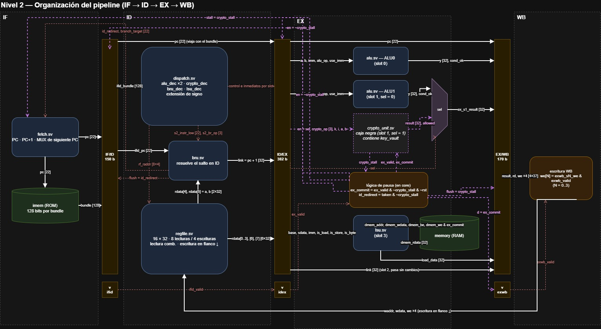

Los registros de segmentación miden 151 bits (IF/ID), 386 bits (ID/EX) y
171 bits (EX/WB), incluido el bit de validez de cada etapa; su contenido está en §2.6.

Cuatro etapas, `IF → ID → EX → WB`, sin etapa MEM separada: el acceso a datos
ocurre en EX y, si la jerarquía no responde en el mismo ciclo, EX se retiene
con `mem_stall` (§2.11).

### 2.3 Qué ocurre en cada etapa

| Etapa | Trabajo |
|---|---|
| **IF** | Se presenta el PC a `imem`; en el flanco la ROM registra el bundle de 128 bits (ese registro es IF/ID); se elige el siguiente PC (`PC + 1`, el destino de la BRU o el mismo PC durante una pausa) |
| **ID** | `dispatch` separa los cuatro slots y los decodifica en paralelo; se leen los 8 operandos del `regfile`; se extiende el inmediato; **la BRU resuelve el salto**; se cuenta cuántas operaciones no-NOP trae el bundle |
| **EX** | ALU0, ALU1 o CRYPTO, y LSU ejecutan en paralelo; la LSU hace un único pedido de palabra a la jerarquía de datos y el bundle espera la respuesta; el slot 2 solo transporta el valor de enlace |
| **WB** | Los cuatro slots escriben en el `regfile`, en el flanco de bajada |

### 2.4 Unidad de avance: el bundle

**Un PC por bundle, no por slot.** Los cuatro slots entran juntos a IF y viajan
juntos por el pipeline. `PC + 1` es el bundle siguiente, y no es posible saltar
a la mitad de un bundle.

Los cuatro slots **leen** juntos en ID y **escriben** juntos en WB, pero no se
**evalúan** en el mismo ciclo: la BRU decide en ID, y las demás unidades trabajan
un ciclo después, en EX. **Las pausas también son por bundle**: si el slot 3
espera a la memoria o el slot 1 espera a `auth`, se detiene el bundle completo.

**El PC viaja por los tres registros de segmentación** porque:
- la BRU necesita el PC del bundle que está en ID, no el que está en IF, para
  calcular `PC + off` y el enlace `PC + 1`;
- permite identificar en el `.vcd` qué bundle ocupa cada etapa, que es lo que
  demuestra el solapamiento exigido por el enunciado I §5.1.

### 2.5 Decodificación

**En ID, con un decodificador independiente por unidad**, instanciados dentro de
`dispatch`.

| Decodificador | Slot | Produce |
|---|---|---|
| `alu_dec` (×2) | 0 y 1 | `alu_op`, `use_imm`, `we` |
| `crypto_dec` | 1 | `crypto_op`, `we` |
| `bru_dec` | 2 | `br_op`, `we` (solo `jas`/`jefR`) |
| `lsu_dec` | 3 | `is_load`, `is_store`, `is_byte` |

**Justificación.**
- Las notas de clase definen ID como la etapa donde «se decodifica la
  instrucción y se leen del banco de registros los operandos» (notas §3.1.2), y
  el enunciado I §5.1 exige que decode/dispatch decodifique y despache en el mismo
  ciclo.
- El espacio de `funct` es independiente por unidad (`isa.md` §6): `00001` es
  `add`, `beq` o `lw` según el slot. Con un decodificador por unidad, cada tabla
  vive junto a su unidad y se mantiene junto con ella.
- Los registros de segmentación llevan «la información de control que las
  etapas siguientes todavía necesitan» (notas §3.1.2): EX recibe control ya
  traducido y solo ejecuta.

**Las direcciones de lectura no requieren decodificación.** Como cada slot tiene
una unidad fija, la posición de los registros fuente también es fija:

| Slot | Puerto A del `regfile` | Puerto B del `regfile` |
|---|---|---|
| 0, 1 (ALU, CRYPTO) | bits 21..18 (`rs1`) | bits 17..14 (`rs2`) |
| 2 (BRU) | bits 21..18 (`rs1`) | bits 25..22 (`rs2` del formato B) |
| 3 (LSU) | bits 21..18 (`rs1`) | bits 25..22 (fuente de `sw`/`sb`) |

Si una instrucción no usa un puerto, este se lee de todos modos y el valor se
ignora: leer no tiene efecto.

**Valores inválidos** (`isa.md` §4.1):

| Caso | Comportamiento del hardware |
|---|---|
| `funct` sin instrucción asignada | El decodificador produce `we = 0` y ninguna acción: equivale a `nopi` |
| `sel = 1` en los slots 0, 2 o 3 | El bit no se conecta |
| Dos slots del mismo bundle con el mismo `rd` | Gana el slot de número mayor (§3.1); indefinido para el programador |

**Operaciones por bundle.** Para la métrica de instrucciones (§5.1), ID suma las
operaciones no-NOP a partir de las salidas de los decodificadores, sin otra tabla
de códigos:

```
ops_count = s0_we
          + (s1_sel ? (s1_crypto_op != 0) : s1_we)
          + (s2_br_op != 0)
          + (s3_is_load | s3_is_store)          // 0..4, 3 bits
```

### 2.6 Registros de segmentación

**IF/ID — 151 bits**

| Campo | Bits | Origen |
|---|---|---|
| `bundle` | 128 | Registro de salida de `imem` (ROM síncrona): `ifid_bundle = imem_rdata`; `flush = id_redirect` lo pone en cero y `valid` lo marca anulado |
| `pc` | 22 | PC actual |
| `valid` | 1 | `1` al buscar; `0` tras vaciado (§2.11) |

**ID/EX — 386 bits**

| Slot | Campos | Bits |
|---|---|---|
| 0 — ALU0 | `a`, `b`, `imm`, `alu_op`, `use_imm`, `rd`, `we` | 32+32+32+4+1+4+1 = 106 |
| 1 — ALU1/CRYPTO | `a`, `b`, `imm`, `alu_op`, `use_imm`, `sel`, `crypto_op`, `k`, `i`, `rd`, `we` | 32+32+32+4+1+1+3+2+2+4+1 = 114 |
| 2 — BRU | `link`, `rd`, `we` | 32+4+1 = 37 |
| 3 — LSU | `base`, `sdata`, `imm`, `is_load`, `is_store`, `is_byte`, `rd` | 32+32+32+1+1+1+4 = 103 |
| — | `pc` | 22 |
| — | `valid` | 1 |
| — | `ops_count` (operaciones no-NOP, para medición) | 3 |
| | **Total** | **386** |

Notas:
- **`alu_op` es una codificación interna**, no el `funct`: `saddi` llega como
  suma, `xori` como XOR y `mov` como «pasar el inmediato». La ALU no repite
  casos. Son 14 operaciones en 4 bits.
- **El inmediato se extiende con signo a 32 bits en ID** (copia del bit 17), de
  modo que todo lo que llega a EX trabaja en 32 bits.
- **El multiplexor de segundo operando queda dentro de la ALU**, en EX, porque
  `isa.md` §5.2 lo lista como bloque interno de la ALU.
- **En el slot 1, `a` y `b` se comparten** entre ALU1 y CRYPTO: son los mismos
  dos puertos del `regfile` (`isa.md` §5.1).
- **En el slot 3, `we` es `is_load`**: `sw` y `sb` no escriben registro.
- **En el slot 2, `link = PC + 1`**, calculado en ID y extendido con ceros.
- **`ops_count` viaja con el bundle** y se retiene con él durante una pausa, de
  modo que un bundle detenido varios ciclos se cuenta una sola vez, al
  confirmarse.

**EX/WB — 171 bits**

| Campo | Bits por slot | Total |
|---|---|---|
| `result` | 32 | 128 |
| `rd` | 4 | 16 |
| `we` | 1 | 4 |
| `pc` | — | 22 |
| `valid` | — | 1 |
| | | **171** |

Origen de `result` y de `we` en cada slot:

| Slot | `result` | `we` final |
|---|---|---|
| 0 | Salida de ALU0 | `we AND cond_ok` de ALU0 (§3.3) |
| 1 | ALU1 o CRYPTO, según `sel` | `sel = 0`: `we AND cond_ok` de ALU1; `sel = 1`: `we AND allowed` de CRYPTO |
| 2 | `link`, sin cambios | `we` |
| 3 | Dato leído, con selección de byte y extensión de signo ya aplicadas | `is_load` |

### 2.7 Saltos

**La BRU resuelve en ID** (`isa.md` §5.3, §10; notas §3.2.3). Cuando el salto se
toma y no hay pausa, `id_redirect = 1`:

1. `id_redirect` y `branch_target` llegan a `fetch`, que carga el destino en el
   PC en el siguiente flanco de subida.
2. **La misma señal vacía IF/ID** en ese flanco (el registro de salida de `imem`,
   `u_ifid_pc` y `u_ifid_valid`): el bundle que ya había entrado a IF se descarta.

**Se descarta el bundle siguiente, no el que contiene el salto.** Un bundle se
ejecuta siempre completo; el salto solo decide cuál bundle viene después
(`isa.md` §10).

**Traza.** El bundle 10 contiene `add r5, r3, r4` en el slot 0 y
`beq r6, r7, −2` (tomado) en el slot 2.

| Ciclo | IF | ID | EX | WB | Lo que ocurre |
|---|---|---|---|---|---|
| t | 11 | **10** | 9 | 8 | La BRU calcula `10 + (−2) = 8` y activa `branch_taken` |
| t+1 | 8 | ~~11~~ → vacío | **10** | 9 | El PC cargó 8; IF/ID se vació; el `add` del bundle 10 se ejecuta |
| t+2 | 9 | 8 | vacío | **10** | El `add` escribe `r5` |

**El vaciado sale gratis.** Vaciar IF/ID pone 128 bits en cero, que se
decodifican como `nopi` en los cuatro slots con `we = 0`. Ese bundle vacío
atraviesa ID/EX y EX/WB sin efecto. Por eso **solo IF/ID se vacía por un
salto**. EX/WB también tiene `flush`, pero solo para las burbujas de las pausas
(§2.11).

**Salto durante una pausa.** Si el bundle con el salto está en ID mientras EX
está detenido, `id_redirect` vale 0 y el salto queda retenido junto con IF/ID;
se aplica una sola vez, en el ciclo en que la pausa termina.

### 2.8 CRYPTO

CRYPTO ocupa el slot 1 cuando `sel = 1`. Su interfaz con el pipeline está fija
(§3.10); su interior (bóveda, función F, Lamport, control de acceso) se
documenta en esa subsección.

- **Escritura condicionada.** El decodificador solo sabe que `feis` escribe; si
  hay permiso lo sabe CRYPTO, porque `AUTH` vive dentro de ella. El `we` final
  del slot 1 es `we AND allowed`, calculado en EX.
- **Latencia de 1 ciclo**, escritura en WB como todas las unidades, **salvo
  `auth`**: calcula el hash Ascon en 14 ciclos y congela el pipeline mientras
  tanto (§2.11).
- **La bóveda y el estado se escriben al final de EX**, no en WB. El enunciado I
  §4.1 describe WB como la etapa que escribe «cuando corresponda, en la bóveda de
  llaves», pero deja libertad en la organización. Se escribe en EX por la misma
  razón que la memoria de datos con un `sw`: la bóveda no es un registro de
  propósito general y no tiene que esperar a WB. Así, un `feis` en el bundle
  siguiente a un `kv_write` ya usa la palabra nueva, igual que un `lw` después de
  un `sw` (§2.10).
- **Aislamiento.** La bóveda, `ancla_otp` y el registro de estado son internos.
  Ningún puerto de salida los expone hacia el `regfile` ni hacia la memoria
  (`isa.md` §7.1).

### 2.9 Reset

**Asíncrono, activo alto** para los registros que se borran. El ancla OTP es la
excepción: conserva su valor durante el reset normal y se inicializa de forma
síncrona durante el arranque protegido. El contenido de las memorias (ROM y RAM
principal) tampoco se borra.

**Justificación.** Es el patrón `flopr` de registro con reset asíncrono, y
coincide con el «reset físico» de `isa.md` §7: una señal que actúa de inmediato,
sin depender del reloj.

| Elemento | Valor tras el reset |
|---|---|
| PC | 0 |
| IF/ID, ID/EX, EX/WB | Todo en cero: bundles de `nopi` con `we = 0` |
| Bits de validez (§2.11) | 0 |
| `regfile` | Todos los registros en cero |
| `hecho`, `mem_read_saved` (§2.11) | 0: no hay respuesta de memoria guardada |
| `imem` | Contenido sin cambio (lo inicializa `$readmemh`); registro de salida en cero |
| `main_memory` | RAM sin cambio; protocolo, acceso pendiente y contadores en cero |
| `l1_cache`, `l2_cache` | Todas las líneas inválidas y limpias; LRU, LFSR, fallo pendiente y contadores reiniciados |
| `line_buffer` (ambos) | Cola vacía; contadores en cero |
| `perf_counters` | Los siete contadores en cero |
| CRYPTO | Banderas, llaves y hash pendiente en cero; el ancla se conserva. Con `rst = 1` e `init_anchor = 1` en subida, carga `RESET_ANCHOR` (`isa.md` §7.2) |

Limpiar el `regfile` no lo exige `isa.md`, pero evita valores `X` en el `.vcd` y
hace reproducible toda simulación.

**El reset no vacía la jerarquía.** Invalidar las cachés y vaciar los buffers
descarta las líneas sucias que todavía no llegaron a la memoria principal. El
reset es un reinicio del procesador, no un protocolo de vaciado ni un mecanismo
de persistencia. La copia del monitor del *testbench* (§5.3) no se reinicia.

**Arranque protegido (`init_anchor`).** `init_anchor` no sale del reset
normal ni de una instrucción: lo genera `top` con un registro de encendido,
`por_done`. Este vale 0 al encender o configurar el sistema (se inicializa en la
declaración, como el valor de configuración de un registro en una FPGA) y pasa
a 1 en el primer flanco de subida con `rst = 1`:

```systemverilog
logic por_done = 1'b0;                         // valor al encender o configurar
always_ff @(posedge clk) if (rst) por_done <= 1'b1;
assign init_anchor = rst & ~por_done;          // solo en el primer reset
```

Así, el primer reset carga `RESET_ANCHOR` y los resets posteriores conservan el
ancla: un token consumido no vuelve a valer. `top` sigue exponiendo solo `clk` y
`rst` (§1.1), y los *testbenches* no cambian: basta con mantener `rst = 1` en el
primer flanco de subida, como ya hacen todos.

### 2.10 Riesgos

| Riesgo | Tratamiento | Responsable |
|---|---|---|
| Estructural entre instrucciones y datos | Eliminado por la organización Harvard | Hardware |
| Estructural de banco de registros | Eliminado: 8 puertos de lectura y 4 de escritura | Hardware |
| Estructural de memoria de datos (latencia de un fallo de caché) | Pausa de todo el pipeline con `mem_stall` (§2.11) | Hardware |
| Estructural de CRYPTO (`auth` ocupa la unidad 14 ciclos) | Pausa de todo el pipeline con `crypto_stall` (§2.11) | Hardware |
| RAW entre registros | Separación de 1 bundle, por escritura y lectura en mitades opuestas del ciclo (§4.1) | Software |
| WAR, WAW entre bundles | No ocurren: el pipeline es en orden (notas §3.2.2) | — |
| WAW dentro de un bundle | Prohibido por `isa.md` §9.3 | Software |
| De control | Resolución en ID y vaciado de un bundle | Hardware |

No hay *forwarding* entre unidades, *scoreboarding* ni pausas por dependencia de
datos (enunciado I §4.1; `isa.md` §1.1). Las dos pausas son estructurales y
**transparentes para el compilador**: durante una pausa WB solo contiene
burbujas, así que la regla de separación de 1 bundle no cambia.

**Dependencias a través de memoria.** Un `sw` se aplica en el flanco en que su
pedido recibe `listo` (en L1 si acierta; tras el llenado si falla), y un `lw` del
bundle siguiente hace su pedido en su propio EX, ya con el valor nuevo: no hace
falta separación (`isa.md` §9.4). Con un solo núcleo, cada palabra tiene una
única copia vigente: L1 si la tiene, y si no, la más nueva en el orden de
búsqueda *write buffer* → L2 → *eviction buffer* → memoria (§2.16). Por eso no
hay problema de coherencia que resolver.

### 2.11 Pausas

`core` junta las dos causas de pausa en una sola señal:

```
stall = crypto_stall | mem_stall
```

`crypto_stall` sale de CRYPTO mientras un `auth` calcula; `mem_stall` retiene el
bundle en EX mientras la jerarquía de datos no responde. Las dos retienen el
mismo bundle hasta que **ambas** unidades terminaron, y `stall` gobierna todos los
puntos de control:

| Elemento | Comportamiento con `stall = 1` | Implementación en `core` |
|---|---|---|
| PC | Se conserva | `u_fetch.stall = stall` |
| IF/ID (registro de salida de `imem`, `u_ifid_pc`, `u_ifid_valid`) | Se conserva | `en = ~stall` |
| ID/EX (incluidos `u_idex_valid` y `u_idex_ops_count`) | Se conserva: los operandos del bundle detenido quedan estables | `en = ~stall` |
| EX/WB | Recibe una burbuja | `flush = stall`; `u_exwb_valid` recibe `ex_commit` (0) |
| BRU en ID | No redirige el PC ni vacía IF/ID hasta reanudar | `id_redirect = id_branch_taken & ifid_valid & ~stall` |
| CRYPTO | Avanza el hash; aplica banderas, ancla y bóveda solo con `ex_commit` | Interno de `crypto_unit` |
| Jerarquía de datos | Atiende el único pedido del bundle; un store se aplica una sola vez | `dmem_req`, `hecho` (abajo) |
| `regfile` | WB solo escribe bundles válidos | `we[N] = exwb_sN_we & exwb_valid` |

**Señales de confirmación**

| Señal | De → a | Ecuación |
|---|---|---|
| `crypto_stall` | `u_crypto` → `core` | Interna de CRYPTO: `auth_req AND NOT auth_done` |
| `mem_stall` | `core` | `memory_bundle AND NOT hecho AND NOT dmem_listo` |
| `ex_valid` | `u_idex_valid` → `u_crypto` | Bit de validez del bundle que está en EX |
| `ex_commit` | `core` → `u_crypto`, `u_exwb_valid`, `u_perf_counters`, `hecho` | `ex_valid & ~stall & ~rst` |

`ex_commit` marca el único ciclo en que el bundle de EX termina: aplica el estado
de CRYPTO, pasa a EX/WB como válido y se cuenta.

**Bits de validez.** Tres instancias de `pipe_reg` de 1 bit:

| Instancia | `d` | `en` | `flush` | Significado |
|---|---|---|---|---|
| `u_ifid_valid` | `1'b1` | `~stall` | `id_redirect` | IF/ID contiene un bundle buscado y no anulado |
| `u_idex_valid` (`ex_valid`) | `ifid_valid` | `~stall` | `0` | ID/EX contiene un bundle real |
| `u_exwb_valid` | `ex_commit` | `1` | `0` | El bundle en EX/WB terminó una sola vez |

Con la convención «cero = `nopi`» (§2.7), el `flush` de EX/WB ya basta para que
WB no escriba. `exwb_valid` es redundante, pero se mantiene como protección
explícita: WB solo escribe bundles confirmados.

#### Pausa por `auth`

`auth` ocupa CRYPTO **14 ciclos en EX**: uno de carga, doce de ronda y uno de
finalización (§3.10). Son 13 ciclos de pausa y un ciclo de confirmación. Es un
riesgo estructural: el enunciado I §4.1 permite la pausa si se documenta y
justifica (`isa.md` §1.1, §9.2).

**Traza.** Bundle B con `auth` entra a EX en el ciclo `c`:

| Ciclo | IF | ID | EX | WB | `crypto_stall` | `ex_commit` |
|---|---|---|---|---|---|---|
| c | B+2 | B+1 | B | B−1 | 1 | 0 |
| c+1 … c+12 | B+2 | B+1 | B | burbuja | 1 | 0 |
| c+13 | B+2 | B+1 | B | burbuja | 0 | 1 |
| c+14 | B+3 | B+2 | B+1 | B | 0 | 1 |

**Temporización.** `crypto_stall` sale de registros internos de CRYPTO
(`busy`, `done`) y de ID/EX, al inicio del ciclo. Llega a las habilitaciones y al
multiplexor del PC sin pasar por la ruta crítica de ID (§4.7).

#### Pausa por memoria

El núcleo hace **un solo pedido por bundle**, desde EX y solo con un bundle
válido. `hecho` recuerda que el pedido ya recibió respuesta, y
`mem_read_saved` guarda la palabra leída:

```systemverilog
assign memory_bundle = ex_valid && (idex_s3_is_load || idex_s3_is_store);
assign dmem_req      = memory_bundle && !hecho && !rst;
assign mem_stall     = memory_bundle && !hecho && !dmem_listo;
assign dmem_we       = lsu_dmem_we && dmem_req;        // el store viaja con el pedido único
assign lsu_rdata     = hecho ? mem_read_saved : dmem_rdata;

always_ff @(posedge clk or posedge rst)
  if (rst)                       begin hecho <= 0; mem_read_saved <= 0; end
  else if (ex_commit)            begin hecho <= 0; mem_read_saved <= 0; end
  else if (dmem_req && dmem_listo) begin hecho <= 1; mem_read_saved <= dmem_rdata; end
```

- **Acierto en L1:** `dmem_listo = 1` en el mismo ciclo del pedido, `mem_stall = 0`
  y el bundle se confirma sin pausa, igual que con una RAM combinacional.
- **Fallo:** `mem_stall = 1` mientras la jerarquía resuelve el fallo. En el ciclo
  en que `dmem_listo` sube, `mem_stall` baja y, si CRYPTO no está detenido, el
  bundle se confirma: EX/WB captura la palabra en ese mismo flanco.
- **Store una sola vez:** `dmem_we` depende de `dmem_req`, no de `ex_commit`. El
  store se aplica cuando su pedido recibe `listo`; desde ese flanco `hecho = 1`
  y el pedido no se repite aunque el bundle siga detenido por CRYPTO.

**Traza.** Bundle B con `lw` entra a EX en el ciclo `c` y su acceso necesita
`N` ciclos (tabla de §2.16; por ejemplo, `N = 8` con fallo en L1 y acierto en L2):

| Ciclo | IF | ID | EX | WB | `dmem_req` | `dmem_listo` | `mem_stall` | `ex_commit` |
|---|---|---|---|---|---|---|---|---|
| c | B+2 | B+1 | B | B−1 | 1 | 0 | 1 | 0 |
| c+1 … c+N−1 | B+2 | B+1 | B | burbuja | 1 | 0 | 1 | 0 |
| c+N | B+2 | B+1 | B | burbuja | 1 | 1 | 0 | 1 |
| c+N+1 | B+3 | B+2 | B+1 | B | — | — | — | — |

Son `N` ciclos de pausa y la palabra llega a WB en el ciclo `c+N+1`. Con `N = 0`
(acierto en L1) la traza se reduce a la de un bundle sin pausa.

#### Coexistencia de las dos pausas

Un bundle puede traer `auth` en el slot 1 y un acceso a memoria en el slot 3. Las
dos unidades trabajan a la vez y el bundle se confirma cuando ambas terminaron;
la pausa total es la unión de las dos esperas, no la suma:

- **La memoria termina primero.** `hecho = 1` guarda la respuesta; el pedido no se
  repite y el store ya quedó aplicado. El bundle sigue detenido por
  `crypto_stall`.
- **CRYPTO termina primero.** El motor de hash conserva `auth_done` hasta que
  `ex_commit` consume el resultado, así que no se reinicia mientras espera la
  memoria. El bundle sigue detenido por `mem_stall`.
- **Terminan en el mismo ciclo.** No hace falta guardar nada: EX/WB captura el
  resultado en ese flanco.

`pausa_total` cuenta los ciclos con `stall = 1`, una vez aunque coincidan las dos
causas (§5.1).

### 2.12 Jerarquía de memoria de datos


El parámetro `CACHE` de `top` elige una de tres jerarquías. En las tres, el
núcleo usa la misma interfaz de palabra y `u_memory` es la misma instancia de
`main_memory`.

| `CACHE` | Bloque | Camino de datos |
|---|---|---|
| 0 | `g_direct` | `u_core` → `u_mem_adapter` → `u_memory` |
| 1 | `g_cache` | `u_core` → `u_l1` → `u_wbuf` (4) → `u_memory` |
| 2 (defecto) | `g_cache2` | `u_core` → `u_l1` → `u_wbuf` (4) → `u_l2` → `u_ebuf` (8) → `u_memory` |

```text
CACHE = 2

u_core ──palabra──▶ u_l1 ──línea──▶ u_wbuf ──línea──▶ u_l2 ──línea──▶ u_ebuf ──línea──▶ u_memory
                     │                ▲                 │                ▲
                     └──push víctima──┘                 └──push víctima──┘
                       sucia de L1                        sucia de L2
```

- **`CACHE = 0`** es la línea base sin caché: cada operación de memoria es un
  acceso de línea completo a `main_memory`, con su latencia `Tmem` (§3.6).
  `mem_adapter` no guarda líneas.
- **`CACHE = 1`** agrega L1 y su *write buffer*. Un fallo de L1 se resuelve en el
  buffer (si tiene la línea) o en la memoria principal.
- **`CACHE = 2`** es la jerarquía completa del enunciado II §3.2–§3.4.

Los dos buffers son instancias del mismo módulo, `line_buffer`, con distinto
`DEPTH`. Cada uno recibe líneas sucias del nivel de arriba por un puerto de
*push*, las escribe hacia abajo en segundo plano y deja pasar las lecturas del
nivel de arriba, respondiéndolas él mismo si tiene la línea (*store-to-load
forwarding*).

### 2.13 Interfaces de la jerarquía

Hay tres interfaces. Todas usan el mismo reloj `clk`; solo `main_memory` tiene
un dominio de reloj interno (§3.6).

**Interfaz de palabra (núcleo ↔ L1 o adaptador).** `req`, `we`, `addr[31:0]`,
`wdata[31:0]`, `be[3:0]` → `rdata[31:0]`, `listo`.

- El núcleo pide una sola vez por bundle, solo con un bundle válido en EX, y
  mantiene el pedido hasta recibir `listo` (§2.11).
- `listo` puede subir en el mismo ciclo del pedido. Es lo que da el acierto de L1
  sin pausa.
- Un store se aplica una sola vez, en el flanco en que `req && listo && we`.
- El receptor atiende una operación a la vez; el núcleo no presenta otra hasta
  completar la primera.

**Interfaz de línea (entre niveles).** Una sola interfaz para todas las fronteras
de línea: L1 → *write buffer*, *write buffer* → L2, L2 → *eviction buffer*,
*eviction buffer* → memoria y adaptador → memoria. Es la de `main_memory`, así
que cualquier nivel se puede probar contra la memoria real.

| Señal | Sentido | Bits | Significado |
|---|---|---|---|
| `req`, `we` | maestro → esclavo | 1, 1 | Pedido válido; escritura si `we = 1` |
| `line_addr` | maestro → esclavo | 11 | Índice de línea, `addr[15:5]` |
| `wdata`, `wmask` | maestro → esclavo | 256, 32 | Línea y máscara de bytes; las cachés siempre escriben la línea completa (`wmask` en unos) |
| `accepted` | esclavo → maestro | 1 | Pulso registrado al aceptar el pedido |
| `ready` | esclavo → maestro | 1 | El próximo flanco termina el acceso; el maestro consume la respuesta en ese mismo flanco |
| `ready_rdata` | esclavo → maestro | 256 | Línea leída, estable con `ready` |
| `resp_src` | esclavo → maestro | 2 | Con `ready`: origen de la línea (0 memoria, 1 L2, 2 buffer) |

Reglas:
- El maestro mantiene `req` y el bus hasta ver `accepted`, y entonces baja `req`.
  Si no lo baja, el esclavo lo toma como otro pedido.
- Un esclavo atiende un pedido a la vez.
- Un esclavo puede dar `ready` en el mismo ciclo del pedido, sin `accepted`
  previo (*forwarding* desde un buffer); el maestro debe aceptar esa respuesta.
- `resp_src` sube por la jerarquía sin cambios para que L1 atribuya cada pausa a
  su origen. `main_memory` no tiene esa salida: el último buffer (o el adaptador)
  recibe `0`.

**Puerto de *push* (nivel de arriba → buffer).** `push`, `push_addr[10:0]`,
`push_data[255:0]` → `full`.

- Con `full = 0`, la línea se guarda en el flanco. Con `full = 1` no se guarda y
  el que empuja debe esperar con su fallo detenido; esos ciclos se cuentan como
  pausa por buffer lleno.
- Una víctima sucia se empuja en el mismo ciclo en que sale el pedido de
  llenado, así que el desalojo no agrega ciclos salvo con el buffer lleno.

### 2.14 Políticas

| Tema | Política | Justificación |
|---|---|---|
| L1-D: organización | 4 KB, 2 vías, 64 conjuntos, líneas de 32 B | Enunciado II §3.2.2 |
| L1-D: escritura | *Write-back* con *write-allocate*; un store que acierta escribe en L1 y marca la línea sucia | Misma política que L2; hacia abajo solo viajan líneas completas, igual en los dos buffers; menos tráfico hacia L2 |
| L1-D: reemplazo | LRU con un bit por conjunto | Con 2 vías es exacto y casi tan barato como FIFO |
| L1-D: acierto | Combinacional, en el mismo ciclo del pedido | Enunciado II §3.3: el acierto en L1 no detiene el pipeline |
| L2: organización | 16 KB, 4 vías, 128 conjuntos, líneas de 32 B, unificada | Enunciado II §3.2.3 |
| L2: escritura | *Write-back*; una escritura de una línea ausente la instala sin leer memoria | La línea llega completa desde el *write buffer* |
| L2: reemplazo | Primero una vía inválida; si no hay, la que indica un LFSR de 8 bits | L2 solo ve los fallos de L1, donde el aleatorio compite bien con LRU a un costo menor |
| L2: tiempo de acceso | 8 ciclos para cualquier acceso: lectura o escritura, acierto o instalación | Enunciado II §3.2.3; mientras escribe, L2 está ocupada |
| Inclusión L1/L2 | NINE (ni inclusiva ni exclusiva) | Con un solo núcleo la ventaja de la inclusiva (filtrar *snooping* entre varias L1) no aplica; se evita la invalidación hacia atrás y su costo en la tasa de aciertos de L1 |
| Llenado tras fallo en L2 | La línea se instala en L2 y en L1 | L2 conserva la copia cuando L1 la desaloja; un segundo recorrido de datos que caben en L2 acierta en L2 |
| *Write buffer* | 4 líneas | Esconde el desalojo de L1 detrás del llenado |
| *Eviction buffer* | 8 líneas | Cada entrada esconde un acceso de `Tmem` |
| *Forwarding* desde un buffer | Mismo ciclo, desde la entrada más nueva con esa dirección; la entrada sigue en la cola | Respuesta sin pausa adicional; costo: ruta combinacional larga (§4.7) |
| Prioridad hacia abajo | La lectura (llenado) antes que el drenaje; un drenaje ya aceptado no se interrumpe | El llenado detiene el pipeline; el drenaje no |
| Escritura de línea en memoria | Cuesta `Tmem`, igual que una lectura | Conservador: el enunciado II §3.2.5 solo define la lectura |
| Jerarquía bloqueante | Un fallo en curso por nivel | Notas §6.3.4 |

Los tamaños de los buffers son valores por defecto; el análisis de rendimiento
los compara con otros valores de `DEPTH`.

### 2.15 Direcciones

Espacio de datos de 64 KB (16 bits de dirección de byte). Los bits superiores
de `addr` se ignoran, como en la RAM original: una dirección de 64 KB o más se
refleja sobre la memoria.

| Nivel | Conjuntos | Desplazamiento | Índice | Etiqueta |
|---|---|---|---|---|
| L1-D | 4 KB / (2 × 32 B) = 64 | `addr[4:0]` | `addr[10:5]` (6 bits) | `addr[15:11]` (5 bits) |
| L2 | 16 KB / (4 × 32 B) = 128 | `addr[4:0]` | `addr[11:5]` (7 bits) | `addr[15:12]` (4 bits) |

La palabra dentro de la línea es `addr[4:2]` y el carril de byte `addr[1:0]`; el
índice de línea en la interfaz de línea es `addr[15:5]` (11 bits, 2048 líneas).

**Ejemplo.** `lw` en `0x1A64`:

| Campo | Bits | Valor |
|---|---|---|
| Línea | `addr[15:5]` | `0x0D3` |
| Palabra en la línea | `addr[4:2]` | 1 |
| Conjunto de L1 / etiqueta de L1 | `addr[10:5]` / `addr[15:11]` | 19 / 3 |
| Conjunto de L2 / etiqueta de L2 | `addr[11:5]` / `addr[15:12]` | 83 / 1 |

### 2.16 Temporización de un acceso

**Orden de búsqueda en un fallo de L1:** *write buffer* → L2 → *eviction buffer*
→ memoria. Sale de la estructura: cada buffer deja pasar la lectura y la responde
él mismo si tiene la línea, de lo más nuevo a lo más viejo.

Pausa del bundle en EX para un `lw` o un `sw`, con los niveles inferiores libres.
`Tmem = 25 + 7·MEM_DIV` (§3.6).

| Caso | Pausa | `MEM_DIV = 2` | `MEM_DIV = 4` | `MEM_DIV = 5` |
|---|---|---|---|---|
| Acierto en L1 | 0 | 0 | 0 | 0 |
| Fallo en L1, línea en el *write buffer* | 0 | 0 | 0 | 0 |
| Fallo en L1, acierto en L2 | 8 | 8 | 8 | 8 |
| Fallo en L1 y L2, línea en el *eviction buffer* | 8 | 8 | 8 | 8 |
| Fallo en L1 y L2 | 8 + `Tmem` | 47 | 61 | 68 |
| `CACHE = 1`: fallo en L1, línea en memoria | `Tmem` | 39 | 53 | 60 |
| `CACHE = 0`: cualquier acceso | `Tmem` | 39 | 53 | 60 |

- L2 da `ready` 8 ciclos después del ciclo del pedido en un acierto. En un fallo
  pide la línea abajo al terminar esos 8 ciclos, y la memoria responde `Tmem`
  ciclos después.
- **Contención.** Si el nivel de abajo está ocupado, el llenado espera, y esos
  ciclos son costo real. Ejemplo: un drenaje del *write buffer* hacia L2 empieza
  en el ciclo 0 y L1 falla en el ciclo 3 con la línea en L2. L2 queda libre en el
  ciclo 8 y el llenado está listo en el 16: 13 ciclos de pausa en lugar de 8.
- **Buffer lleno.** Si la víctima de L1 (o de L2) es sucia y su buffer está
  lleno, el fallo no sale hasta que se libere una entrada; L1 cuenta esos ciclos
  aparte (`stall_full_cycles`). Una víctima limpia o inválida no necesita espacio.

**AMAT.** Con la jerarquía completa, el tiempo promedio de acceso nominal (notas
§6.2.4), medido en ciclos y con el acierto de L1 como un ciclo, es

```
AMAT = 1 + m_L1 · (8 + m_L2 · Tmem)
```

donde `m_L1` y `m_L2` son las tasas de fallo locales. La fórmula no modela el
*forwarding*, la contención ni las esperas por buffer lleno; por eso el
*testbench* también calcula el AMAT medido a partir de la pausa real (§5.4).

---
## 3. Nivel 3 — Interfaz de cada módulo

Convenciones comunes a todos los módulos:

- `rst` es asíncrono y activo alto; los módulos combinacionales no lo usan.
- La lógica combinacional asigna valores por defecto a todas sus salidas al
  inicio del bloque, para no inferir *latches*.
- Cada módulo tiene su *testbench* `tb_<módulo>.sv`, que genera `tb_<módulo>.vcd`.

Cada subsección fija la interfaz y documenta el **interior** del módulo: bloques,
tablas y decisiones.

### 3.1 `regfile.sv`

Banco de 16 registros de 32 bits, 8 puertos de lectura y 4 de escritura.

| Puerto | Dir | Bits | Descripción |
|---|---|---|---|
| `clk`, `rst` | in | 1 | |
| `raddr[0:7]` | in | 8 × 4 | Direcciones de lectura. El slot *s* usa los puertos `2s` (A) y `2s+1` (B) |
| `rdata[0:7]` | out | 8 × 32 | Lectura **combinacional** |
| `waddr[0:3]` | in | 4 × 4 | Dirección de escritura de cada slot |
| `wdata[0:3]` | in | 4 × 32 | Dato de cada slot |
| `we[0:3]` | in | 4 × 1 | Habilitación de cada slot |

Comportamiento:
- **Escritura en el flanco de bajada** (§4.1).
- `r0` (`rz`) siempre se lee como cero; las escrituras a él se descartan.
- Si dos slots escriben el mismo registro, gana el de número mayor.
- El reset pone los 16 registros en cero.

**Interior**

| Parámetro | Valor | Origen |
|---|---|---|
| `NUM_REGS` | 16 | `isa.md` §2 |
| `XLEN` | 32 | `isa.md` §2 |
| `NUM_SLOTS` | 4 | `isa.md` §3 |
| `NUM_RD` | `2 × NUM_SLOTS` = 8 | Dos operandos por slot (`isa.md` §5.1) |
| `NUM_WR` | `NUM_SLOTS` = 4 | Un resultado por slot |
| `AW` | `$clog2(NUM_REGS)` = 4 | Ancho de dirección |

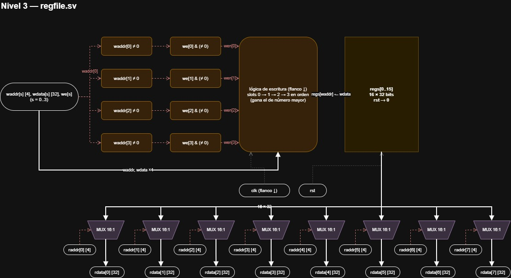

| Bloque | Función | Justificación |
|---|---|---|
| Arreglo `regs` | 16 registros de 32 bits | `isa.md` §8 |
| Lógica de escritura | Un solo bloque en el flanco de bajada que recorre los 4 puertos en orden y escribe si `we[s] = 1` y `waddr[s] ≠ 0` | Escribir en bajada da 1 bundle de separación (§4.1). Al recorrer en orden, la última asignación gana: el slot 3 tiene prioridad sin lógica adicional |
| Bloqueo de `r0` | La condición `waddr[s] ≠ 0` impide escribir `r0`; el reset lo deja en cero | Cuesta 4 comparadores (uno por escritura); forzar la lectura costaría 8 (uno por lectura) |
| 8 multiplexores de lectura | `rdata[p] = regs[raddr[p]]`, combinacional | 4 slots leen 2 operandos cada uno en el mismo ciclo (`isa.md` §5.1, §9.3) |

**Declaración de puertos.** Los puertos con varios elementos se declaran como
arreglos **empaquetados** (`logic [NUM_RD-1:0][AW-1:0] raddr`), no como arreglos
no empaquetados (`logic [AW-1:0] raddr [NUM_RD]`). Es el mismo circuito, pero
los arreglos no empaquetados como puertos de módulo tienen soporte incompleto en
algunas versiones de Icarus Verilog. Esto aplica también a `dispatch` y `core`.

**Simulación.** Como el `regfile` escribe en el flanco de bajada e ID/EX captura
en el de subida, nunca coinciden: no hay carreras entre bloques que dependan del
orden de evaluación del simulador. Los *testbenches* leen los registros por
jerarquía (`dut.u_core.u_regfile.regs[5]`); no hace falta un puerto de
depuración.

**Plan de verificación**

| Caso | Estímulo | Esperado |
|---|---|---|
| Reset | `rst = 1` | Los 16 registros en cero |
| Escritura simple | `we[0] = 1`, `waddr[0] = 5`, `wdata[0] = 0xCAFE` | Tras el flanco de bajada, `regs[5] = 0xCAFE` |
| `r0` | Escribir `0x1234` en `r0` | `rdata` del puerto que lee `r0` = 0 |
| 4 escrituras simultáneas | Los 4 slots a registros distintos | Las 4 quedan |
| Prioridad | Slots 1 y 3 al mismo registro | Queda el valor del slot 3 |
| `we = 0` | `waddr` y `wdata` válidos con `we = 0` | El registro no cambia |
| 8 lecturas simultáneas | 8 direcciones distintas | Cada `rdata` corresponde a su dirección |
| Misma dirección en varios puertos | Los 8 puertos leen `r7` | Los 8 entregan el mismo valor |
| Escritura y lectura en el mismo ciclo | Escribir `r9` y leer `r9` en el mismo ciclo | Antes del flanco de bajada: valor viejo; después: valor nuevo |
| Escritura en subida ignorada | Cambiar `we`/`wdata` y dar solo un flanco de subida | El registro no cambia hasta el flanco de bajada |

### 3.2 `alu_dec` (dentro de `dispatch`)

Traduce el `funct` de una instrucción de ALU a las señales de control de la ALU.
Combinacional.

| Puerto | Dir | Bits | Descripción |
|---|---|---|---|
| `funct` | in | 5 | Bits 30..26 de la instrucción |
| `alu_op` | out | 4 | Operación interna (tabla de §4.8) |
| `use_imm` | out | 1 | Segundo operando: `0` = `rs2`, `1` = inmediato |
| `we` | out | 1 | `1` en las 16 instrucciones válidas; `0` en `nopi` y en los `funct` libres |

**Interior.** Verificado con un modelo de referencia contra la tabla de `isa.md` §6.1.

Es una tabla de búsqueda: un `case` sobre `funct` sin estado. Cada instrucción
válida da su `alu_op` y `we = 1`. `nopi` y los `funct` libres dan `we = 0`, y con
eso el slot no tiene efecto aunque la ALU calcule algo.

```
use_imm = funct[4]      // en las 16 válidas: el bit alto separa R (0) de I (1)
we      = funct ∈ {00001..01101, 10000..10010}
alu_op  = tabla de §4.8
```

| Decisión | Razón |
|---|---|
| `alu_op` de 4 bits con 14 códigos | Las 16 instrucciones caben en 14 operaciones internas: `add`/`saddi` comparten la suma y `xor`/`xori` comparten el XOR; solo cambia `use_imm` |
| `use_imm = funct[4]` | `isa.md` §6.1 pone todas las de formato I en `1xxxx`. Así no hace falta otra columna en la tabla |
| `we = 0` en `nopi` y libres | Un `funct` sin asignar no debe escribir nada (convención §4.2) |

### 3.3 `alu.sv`

Combinacional. Dos instancias idénticas (slots 0 y 1).

| Puerto | Dir | Bits | Descripción |
|---|---|---|---|
| `a` | in | 32 | Valor de `rs1` |
| `b` | in | 32 | Valor de `rs2` |
| `imm` | in | 32 | Inmediato ya extendido con signo |
| `alu_op` | in | 4 | Operación |
| `use_imm` | in | 1 | Selecciona `imm` en lugar de `b` como segundo operando |
| `y` | out | 32 | Resultado |
| `cond_ok` | out | 1 | `0` solo en `ifmov` con `b == 0` (no debe escribir); `1` en todo lo demás |

Bloques internos según `isa.md` §5.2: sumador/restador, bloque lógico,
desplazador de barril (5 bits bajos del segundo operando), multiplexor de segundo
operando, multiplexor de resultado. Las comparaciones se derivan de la resta,
con signo y corregidas por desbordamiento.

**Por qué `cond_ok`.** `ifmov` deja `rd` sin cambio si `rs2 == 0`. El slot solo
tiene dos puertos de lectura (`rs1`, `rs2`), así que el valor previo de `rd` no
está disponible para reescribirlo: la única implementación posible es **no
escribir**. La condición depende de un dato, así que se calcula en EX.

**Interior.** Verificado con un modelo de referencia (21 de 21 casos del plan de
verificación).

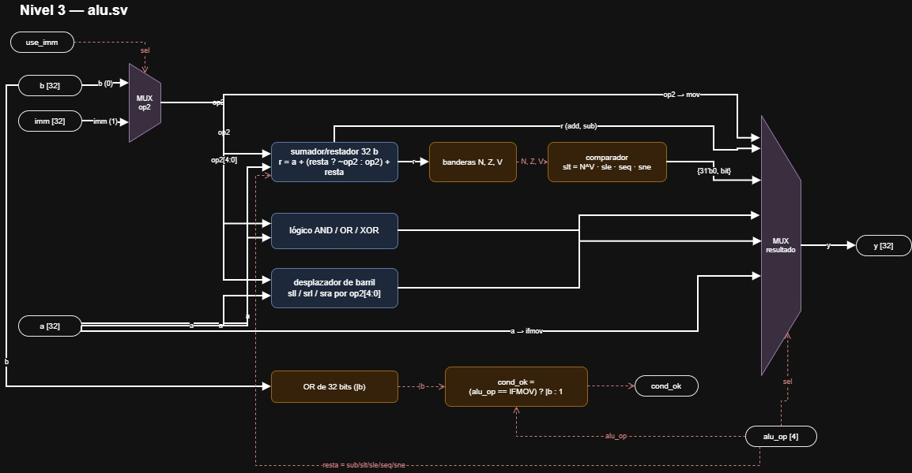

| Bloque | Qué hace | Por qué así |
|---|---|---|
| MUX de `op2` | `op2 = use_imm ? imm : b` | Un solo camino de datos para formato R e I |
| Sumador/restador | `r = a + (resta ? ~op2 : op2) + resta` | Un sumador sirve a `add`, `saddi`, `sub` y las 4 comparaciones. `resta = 1` en `sub`, `slt`, `sle`, `seq`, `sne` |
| Banderas | `N = r[31]`, `Z = (r == 0)`, `V = (a[31] == x[31]) & (r[31] != a[31])`, con `x` el segundo sumando ya invertido | Necesarias para comparar con signo |
| Comparador | `slt = N XOR V`, `sle = slt OR Z`, `seq = Z`, `sne = ~Z`; resultado `{31'b0, bit}` | `N` solo falla con desbordamiento; `N ^ V` corrige (p. ej. `0x7FFFFFFF < 0x80000000` da 0) |
| Lógico | AND, OR y XOR de `a` con `op2` | Directo |
| Desplazador de barril | `a << sh`, `a >> sh`, `$signed(a) >>> sh`, con `sh = op2[4:0]` | En hardware son 5 niveles de MUX (1, 2, 4, 8, 16). Solo se usan los 5 bits bajos (`isa.md` §6.1) |
| MUX de resultado | Elige según `alu_op` | `ifmov` saca `a`; `mov` saca `op2` (ignora `rs1`) |
| `cond_ok` | `cond_ok = (alu_op == ifmov) ? (b != 0) : 1` | Ver arriba. Usa `b` (rs2), nunca `imm` |

El `we` final del slot se calcula en EX como `we & cond_ok` (§3.14).

**Plan de verificación** (`tb_alu`):

| Caso | Entrada | Esperado |
|---|---|---|
| Suma con desbordamiento | `add 0x7FFFFFFF, 1` | `0x80000000` |
| Resta negativa | `sub 0, 1` | `0xFFFFFFFF` |
| `slt` con desbordamiento | `slt 0x7FFFFFFF, 0x80000000` | `0` |
| `slt` con desbordamiento | `slt 0x80000000, 0x7FFFFFFF` | `1` |
| `slt` negativo | `slt -1, 0` | `1` |
| Iguales | `slt 5,5` / `sle 5,5` | `0` / `1` |
| `seq` / `sne` | `7, 7` | `1` / `0` |
| `sra` / `srl` | `0x80000000, 4` | `0xF8000000` / `0x08000000` |
| Solo 5 bits | `sll 1, 33` | `2` |
| Lógicas | `and 0xF0F0,0xFF00` / `or 0xF0,0x0F` / `xor 0xFF,0x0F` | `0xF000` / `0xFF` / `0xF0` |
| Inmediato | `xori 0xFF, 0x0F` / `saddi 5, -1` | `0xF0` / `4` |
| `mov` | `rs1 = 123`, `imm = 0xABC` | `0xABC` |
| `ifmov` | `a = 0xDEAD`, `b = 0` / `b = 5` | `y = 0xDEAD`, `cond_ok = 0` / `1` |
| `cond_ok` fuera de `ifmov` | `add` con `b = 0` | `cond_ok = 1` |

### 3.4 `lsu_dec` (dentro de `dispatch`)

| Puerto | Dir | Bits | Descripción |
|---|---|---|---|
| `funct` | in | 5 | Bits 30..26 |
| `is_load` | out | 1 | `lw`, `lb` |
| `is_store` | out | 1 | `sw`, `sb` |
| `is_byte` | out | 1 | `lb`, `sb` |

Un `funct` libre o `nopi` produce las tres salidas en cero.

**Interior**

Cuatro comparadores de igualdad de 5 bits (uno por instrucción) y tres compuertas
OR. Sin estado.

```
is_load  = (funct == 00001) | (funct == 00011)     // lw, lb
is_store = (funct == 00010) | (funct == 00100)     // sw, sb
is_byte  = (funct == 00011) | (funct == 00100)     // lb, sb
```

`is_load` e `is_store` nunca valen 1 a la vez. La tabla completa está en §4.8.

### 3.5 `lsu.sv`

Combinacional.

| Puerto | Dir | Bits | Descripción |
|---|---|---|---|
| `base` | in | 32 | Valor de `rs1` |
| `sdata` | in | 32 | Valor de la fuente de `sw`/`sb` (campo 25..22) |
| `imm` | in | 32 | Desplazamiento ya extendido con signo |
| `is_load`, `is_store`, `is_byte` | in | 1 + 1 + 1 | Control |
| `dmem_addr` | out | 32 | `base + imm` |
| `dmem_wdata` | out | 32 | `sw`: `sdata`; `sb`: byte bajo de `sdata` copiado en el carril de `addr[1:0]` |
| `dmem_we` | out | 1 | `is_store` |
| `dmem_be` | out | 4 | `sw`: `1111`; `sb`: un bit según `addr[1:0]`; carga: `0000` |
| `dmem_rdata` | in | 32 | Palabra leída |
| `load_data` | out | 32 | `lw`: la palabra; `lb`: el byte de `addr[1:0]` con extensión de signo |

En `lw`/`sw` se ignoran `addr[1:0]` (`isa.md` §5.4).

**Interior**

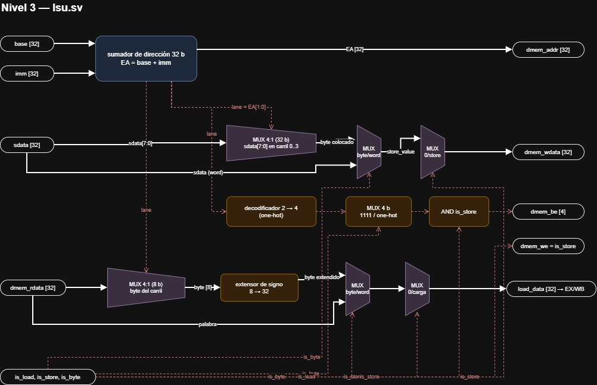

Línea continua = dato; línea discontinua = control.

| Bloque | Función | Justificación |
|---|---|---|
| Sumador de dirección | `EA = base + imm`, 32 bits, acarreo descartado | Un único modo de direccionamiento (`isa.md` §5.4). El inmediato ya viene extendido desde ID |
| Selección de carril | `lane = EA[1:0]` | Posición del byte dentro de la palabra; la dirección completa sale igual por `dmem_addr` |
| Colocador de store | MUX 4:1 entre `sdata[7:0]` en cada carril, con ceros en el resto | No hace falta un desplazador general |
| MUX de dato de store | `sb`: byte colocado; `sw`: `sdata` completo | — |
| Habilitación de dato | `dmem_wdata = 0` si no hay store | Salida determinista; sin efecto arquitectónico porque `we = 0` |
| Decodificador 2→4 y máscara | `sw`: `1111`; `sb`: un solo bit; sin store: `0000` | Escribir solo un byte preserva los otros tres (`isa.md` §5.4) |
| Selector de carga | MUX 4:1 de 8 bits según `lane` | Orden *little endian* |
| Extensor de signo | Replica el bit 7 en los 24 bits altos | `lb` es con signo (`isa.md` §6.3); extender con ceros sería otra instrucción |
| MUX de resultado | `lb`: byte extendido; `lw`: palabra; sin carga: 0 | Dos MUX 2:1 en cascada |

**Ecuaciones**

```
EA          = (base + imm) mod 2^32
lane        = EA[1:0]
dmem_addr   = EA
placed      = lane=0: {24'b0, sdata[7:0]}          lane=1: {16'b0, sdata[7:0], 8'b0}
              lane=2: {8'b0, sdata[7:0], 16'b0}    lane=3: {sdata[7:0], 24'b0}
store_value = is_byte ? placed : sdata
dmem_wdata  = is_store ? store_value : 0
dmem_we     = is_store
dmem_be     = {4{is_store}} & (is_byte ? (4'b0001 << lane) : 4'b1111)
byte_value  = dmem_rdata[8*lane+7 : 8*lane]
signed_byte = {{24{byte_value[7]}}, byte_value}
load_data   = is_load ? (is_byte ? signed_byte : dmem_rdata) : 0
```

| `lane` | Byte leído | `be` en `sb` | `wdata` con `sdata[7:0] = AA` |
|---|---|---|---|
| `00` | `[7:0]` | `0001` | `000000AA` |
| `01` | `[15:8]` | `0010` | `0000AA00` |
| `10` | `[23:16]` | `0100` | `00AA0000` |
| `11` | `[31:24]` | `1000` | `AA000000` |

**Alineación.** En `lw` y `sw`, la LSU entrega la dirección completa y la memoria
descarta `[1:0]`: un `lw` en `0x1002` entrega la palabra de `0x1000`. No hay
excepción de alineación ni acceso que combine dos palabras. Tampoco hay
verificación de rango: la jerarquía ignora los bits altos (§2.15).

**Ejemplo.** `lb r7, 2(r6)` con `r6 = 0x1000` y la palabra `0x7F80FF01` en
memoria: `EA = 0x1002`, carril 2 = `0x80`, `load_data = 0xFFFFFF80`. Un
`sb` en la misma dirección con `sdata = 0x123456AA` produce `wdata = 0x00AA0000`,
`be = 0100`, y la palabra pasa a `0x7FAAFF01`: los otros tres bytes no cambian.

**Plan de verificación** (las ecuaciones de arriba se modelaron y pasan todos los casos)

| Caso | Esperado |
|---|---|
| `lw` con `base = 0x1000`, `imm = 2` | `dmem_addr = 0x1002`; `load_data` = palabra completa |
| `sw` con `sdata = 0x12345678` | `wdata = 0x12345678`, `we = 1`, `be = 1111` |
| `sb` en los carriles 0, 1, 2 y 3, `sdata = 0x123456AA` | `be` = `0001`, `0010`, `0100`, `1000`; `wdata` = `AA` en ese carril |
| `lb` del carril 2 de `0x7F80FF01` (`0x80`) | `0xFFFFFF80` |
| `lb` del carril 3 de `0x7F80FF01` (`0x7F`) | `0x0000007F` |
| `lb` en cada carril | El byte correcto |
| `base = 0x1004`, `imm = −4` | `dmem_addr = 0x1000` |
| `lw` y `lb` | `dmem_we = 0`, `dmem_be = 0000` |
| Sin carga ni almacenamiento | `dmem_we = 0`, `dmem_be = 0000`, `wdata = 0`, `load_data = 0` |
| `sb` sobre `0x7F80FF01` en el carril 2 (a través de la jerarquía de datos) | La palabra queda `0x7FAAFF01` |

### 3.6 `main_memory.sv`

Memoria principal de datos del enunciado II §3.2.5 y §3.4: 64 KB organizados en
2048 líneas de 8 palabras, con un reloj propio más lento que el del procesador y
latencia fija por acceso de línea. Es el último nivel de las tres configuraciones
de `CACHE` (instancia `u_memory`).

| Parámetro | Defecto | Descripción |
|---|---|---|
| `MEM_DIV` | 4 | Divisor del reloj: `fmem = 100 MHz / MEM_DIV`. Válido 2, 4 o 5; otro valor produce `$fatal` |
| `INIT_FILE` | `""` | Archivo `.mem` (§1.5); vacío = memoria en cero |

`localparam TMEM = 25 + 7·MEM_DIV`: 39, 53 o 60 ciclos del procesador.

| Puerto | Dir | Bits | Descripción |
|---|---|---|---|
| `clk`, `rst` | in | 1, 1 | Reloj del procesador (100 MHz); reset asíncrono activo alto |
| `req`, `we` | in | 1, 1 | Pedido válido; escritura si `we = 1` |
| `line_addr` | in | 11 | Índice de línea 0..2047: dirección de byte dividida entre 32 |
| `wdata` | in | 256 | La palabra `i` va en `[32*i +: 32]` |
| `wmask` | in | 32 | El bit `b` habilita el byte `[8*b +: 8]`, *little endian* |
| `rdata` | out | 256 | Última lectura completa; cambia solo al terminar una lectura |
| `accepted` | out | 1 | Pulso registrado de aceptación |
| `done` | out | 1 | Pulso registrado de fin de lectura o de confirmación de escritura |
| `busy` | out | 1 | Acceso pendiente; baja junto con `done` |
| `ready` | out | 1 | Aviso combinacional: el próximo flanco registra `done` |
| `ready_rdata` | out | 256 | Línea ensamblada y estable, utilizable con `ready` |
| `read_count`, `write_count` | out | 64, 64 | Líneas aceptadas de cada tipo |
| `transfer_cycles`, `total_cycles` | out | 64, 64 | Ciclos de transferencia y ciclos desde el reset |
| `timeout_count` | out | 64 | Accesos cuyo vigilante se disparó |

El arreglo `mem[0:16383]` es de palabras de 32 bits, igual que el `.mem` de
§1.5: se inicializa en cero y luego con `$readmemh(INIT_FILE)`, con marcas `@`
de palabra. El reset reinicia el protocolo y los contadores, cancela el acceso
pendiente y **conserva la RAM**; las palabras de una escritura que ya se
transfirieron permanecen.

**Interior**


| Bloque | Dominio | Función |
|---|---|---|
| Controlador de aceptación | `clk` | Acepta `req && !busy`, guarda el pedido (`saved_addr`, `saved_we`, `saved_data`, `saved_mask`), cuenta la ventana de `TMEM` ciclos y publica `rdata`/`done` |
| Divisor (`div_phase`) | `clk` | Genera `mem_clk` de 50, 25 o 20 MHz; con `MEM_DIV = 5` el ciclo de trabajo es 40 %, con exactamente cinco ciclos entre subidas |
| Sincronizadores de 2 FF | ambos | `req_meta/req_sync` hacia la memoria; `ack_meta/ack_sync` y `completion_meta/completion_sync` hacia el procesador |
| Controlador de ráfaga | `mem_clk` | Transfiere una palabra por flanco de `mem_clk`, en ocho flancos consecutivos (`word_index`, `next_word`) |
| Arreglo RAM | `mem_clk` | Solo se accede en `posedge mem_clk`; las escrituras aplican los cuatro bits de máscara de cada palabra |
| Registro de respuesta (`response`) | `mem_clk` | Ensambla la línea leída palabra por palabra; queda estable desde la última palabra hasta el siguiente acceso |
| Vigilante | `clk` | Detecta un acceso que no terminó a `2·TMEM` ciclos |
| Contadores | `clk` | Lecturas, escrituras, ciclos de transferencia, ciclos totales y disparos del vigilante |

#### Protocolo

Se acepta en una subida de `clk` si `req && !busy` antes del flanco. Después
del flanco aparecen `accepted = 1` y `busy = 1`. El emisor puede cambiar el bus o
bajar `req` después de observar `accepted`; el módulo conserva una copia. Un
pedido presentado durante `busy` debe sostener `req` y su bus hasta la
aceptación; un pulso que desaparece antes no se guarda. `req` sostenido después
de una aceptación es otro pedido: es un protocolo de válido/listo, no detección
de flanco.

`done` dura un ciclo, exactamente `TMEM` subidas después de la aceptación, y
`busy` baja en ese mismo flanco. Un pedido válido se acepta en el flanco
inmediatamente siguiente a `done`, sin ciclos muertos. No hay cola ni dos
accesos concurrentes (notas §6.3.4, jerarquía bloqueante).

**Respuesta anticipada.** `ready` es combinacional y vale 1 cuando el siguiente
flanco registrará `done`: ráfaga completa, fin sincronizado y *handshake*
recuperado. `ready_rdata` expone la línea ya estable. Con ellas, el nivel de
arriba consume la respuesta en el **mismo flanco** en que la memoria registra
`done`. Si se usara solo `done` registrado, observarlo y consumirlo en el flanco
siguiente agregaría un ciclo a cada acceso. `ready` no acorta el acceso: la
latencia sigue siendo `TMEM`.

#### Cruce de dominios y temporización

Se usa un *handshake* de cuatro fases `req_mem↑, ack_mem↑, req_mem↓, ack_mem↓`
con dos flip-flops de sincronización por sentido. `ack_mem` reconoce la
**recepción del pedido** al transferir la primera palabra. El procesador baja
`req_mem` al observarlo y la memoria baja `ack_mem` al observar `req_sync = 0`;
esa recuperación ocurre en paralelo a la ráfaga, sin detenerla. Los buses
(`saved_*` hacia la memoria, `response` hacia el procesador) se mantienen
estables mientras se usan y no se sincronizan bit a bit: solo se sincroniza el
control (datos agrupados con control sincronizado; Clifford E. Cummings, *Clock
Domain Crossing (CDC) Design & Verification Techniques Using SystemVerilog*,
SNUG 2008). La simulación RTL no modela la metaestabilidad analógica.

Al transferir la palabra 7 cambia el bit de alternancia `completion_mem`, que se
sincroniza hacia el procesador. Al aceptar un pedido, el controlador espera el
valor opuesto al último sincronizado, para no confundir el fin del acceso
anterior con el actual. El controlador publica `rdata` y pulsa `done` al
alcanzar `TMEM`, cuando ya observó el fin de la ráfaga y el *handshake*
recuperado.

**Presupuesto para cualquier fase del reloj lento.** La primera palabra se
transfiere como máximo `3·MEM_DIV` ciclos después de aceptar (un período para
cada FF y otro para que el controlador lento observe el pedido). La última está
lista como máximo a `10·MEM_DIV` y su fin se observa como máximo a
`10·MEM_DIV + 3`. La vuelta a cero del *handshake* se observa como máximo a
`6·MEM_DIV + 6`. Todas las cotas caen dentro de `TMEM`, así que la latencia
observable es **exactamente `TMEM` en cualquier fase**:

| `MEM_DIV` | Primera palabra ≤ | Última palabra ≤ | Fin sincronizado ≤ | *Handshake* recuperado ≤ | `TMEM` |
|---|---|---|---|---|---|
| 2 | 6 | 20 | 23 | 18 | 39 |
| 4 | 12 | 40 | 43 | 30 | 53 |
| 5 | 15 | 50 | 53 | 36 | 60 |

Los 25 ciclos de la fórmula son el presupuesto de la primera palabra y de los
cruces, no una obligación de empezar la ráfaga en el ciclo 25: la ráfaga puede
terminar antes y la línea se guarda hasta la entrega. Ninguna palabra parcial se
expone al cliente.

**Traza** con `MEM_DIV = 4`, primer acceso de `tb_main_memory`
(`vvp build/tb_main_memory +TRACE_MEMORY`). El ciclo 0 es la aceptación;
`busy = 1` en 0..52 y `busy = 0, done = 1` en 53. Las subidas lentas son los
ciclos 3, 7, 11, 15…

| Ciclo | Evento | Ciclo | Evento | Ciclo | Evento |
|---|---|---|---|---|---|
| 0 | Acepta, `req_mem=1` | 18 | Espera | 36 | Espera |
| 1 | Espera | 19 | Palabra 2; `req_sync=0` | 37 | Espera |
| 2 | Espera | 20 | Espera | 38 | Espera |
| 3 | `req_meta=1` | 21 | Espera | 39 | Palabra 7; cambia `completion_mem` |
| 4 | Espera | 22 | Espera | 40 | Cambia `completion_meta` |
| 5 | Espera | 23 | Palabra 3; `ack_mem=0` | 41 | Cambia `completion_sync` |
| 6 | Espera | 24 | `ack_meta=0` | 42 | Control observa la ráfaga completa |
| 7 | `req_sync=1` | 25 | `ack_sync=0` | 43 | Espera |
| 8 | Espera | 26 | Control observa el *handshake* recuperado | 44 | Espera |
| 9 | Espera | 27 | Palabra 4 | 45 | Espera |
| 10 | Espera | 28 | Espera | 46 | Espera |
| 11 | Palabra 0; `ack_mem=1` | 29 | Espera | 47 | Espera |
| 12 | `ack_meta=1` | 30 | Espera | 48 | Espera |
| 13 | `ack_sync=1` | 31 | Palabra 5 | 49 | Espera |
| 14 | `req_mem=0` | 32 | Espera | 50 | Espera |
| 15 | Palabra 1; `req_meta=0` | 33 | Espera | 51 | Espera |
| 16 | Espera | 34 | Espera | 52 | Espera |
| 17 | Espera | 35 | Palabra 6 | 53 | Publica `rdata`, `done=1`, `busy=0` |

Si hay otro pedido válido, se acepta en el ciclo 54. Otra fase cambia los flancos
físicos de la ráfaga y del cruce, pero nunca el ciclo de publicación.

#### Vigilante y contadores

El vigilante cuenta desde la aceptación. Si la ráfaga o la vuelta a cero no
terminaron al llegar a `2·TMEM`, incrementa `timeout_count` una vez por acceso y
deja el acceso ocupado; un proceso de simulación separado reporta `$error`. Si
el cruce se recupera, el pedido puede terminar tarde; el reset permite cancelar
un acceso colgado.

`read_count` y `write_count` cuentan líneas al aceptarlas; `read_count` son los
fallos que llegaron a la memoria y su suma es el total de accesos (enunciado II
§5.3). `transfer_cycles` acumula los ciclos 1..`TMEM` de cada acceso, lectura o
escritura. `total_cycles` avanza en cada subida sin reset, también en reposo. La
utilización de la memoria se calcula en el *testbench* como
`transfer_cycles / total_cycles`. Todos son de 64 bits y se borran con reset.

#### Decisiones

| Decisión | Justificación |
|---|---|
| Líneas de 8 palabras (32 B), lectura y escritura completas con máscara de 32 bytes | Coincide con la línea de las cachés; el adaptador sin caché usa la máscara para escribir una sola palabra |
| `MEM_DIV = 100 MHz / fmem`, con `TMEM = 25 + 7·MEM_DIV` | Enunciado II §3.2.5 |
| Una escritura cuesta el mismo `TMEM` que una lectura | Conservador: el enunciado solo define la lectura |
| Un pedido a la vez | Jerarquía bloqueante (notas §6.3.4) |
| *Handshake* de 4 fases con dos FF por sentido y buses estables | Técnica estándar de cruce de dominios para datos agrupados |
| Latencia exacta `TMEM` en cualquier fase, con ráfaga física en ocho flancos lentos consecutivos | Resultado determinista para medir; cumple la transferencia de una palabra por flanco del enunciado |
| Vigilante a `2·TMEM` | Hace visible un cruce bloqueado en vez de colgar la simulación sin aviso |
| `ready`/`ready_rdata` además de `done` | Evita un ciclo de retorno por acceso sin acortar la latencia |

**Plan de verificación** (`tb_main_memory`, para `MEM_DIV` 2, 4 y 5 y todas las
fases del reloj lento)

| Caso | Esperado |
|---|---|
| Lectura de un `.mem` con marcas `@` | La línea contiene las palabras en su índice |
| Latencia | `done` exactamente `TMEM` ciclos después de `accepted`; `busy` baja con `done`; `done` dura un ciclo |
| Ráfaga | Ocho transferencias en flancos lentos consecutivos, antes de `TMEM` |
| Escritura con máscara parcial, completa y en cero | Solo cambian los bytes habilitados |
| Lectura tras escritura | Devuelve la línea escrita, en cada fase |
| Pedido durante `busy` | Espera y conserva sus datos; se acepta en el flanco siguiente a `done` |
| `ready` | La línea pública es estable antes de `done` |
| Contadores | Lecturas, escrituras, ciclos totales y de transferencia acumulados |
| Recuperación del cruce | El *handshake* termina en cero al finalizar |

**`memory.sv`.** La RAM combinacional original de 64 KB (lectura combinacional,
escritura por carril en el flanco de subida, sin reset de contenido) se conserva
con `tb_memory` como componente independiente. Ya no forma parte del sistema:
`top` usa `main_memory` y la jerarquía.

### 3.7 `imem.sv`

| Parámetro | Defecto | Descripción |
|---|---|---|
| `DEPTH` | 4096 | Bundles |
| `PC_W` | 22 | Ancho de `addr` |
| `INIT_FILE` | `""` | Archivo `.hex` (§1.5) |

| Puerto | Dir | Bits | Descripción |
|---|---|---|---|
| `clk`, `rst` | in | 1 | Reloj y reset asíncrono (pone `rdata` en 0) |
| `flush` | in | 1 | Vaciado síncrono: `rdata` pasa a 0 en el flanco (`id_redirect`); prioridad sobre `en` |
| `en` | in | 1 | Habilitación de carga; con `en = 0` `rdata` se conserva (pausa) |
| `addr` | in | `PC_W` | Índice de bundle |
| `rdata` | out | 128 | Lectura **síncrona**: registro de salida cargado en el flanco de subida |

**ROM síncrona.** El registro de salida de `imem` hace de registro IF/ID del
bundle: el bundle de `addr` aparece en `rdata` un flanco después, que es
justamente cuando lo necesita ID. No hay un registro IF/ID adicional para el
bundle. Carga con `en = ~stall` y tiene `flush` síncrono (`flush = id_redirect`)
que lo pone en cero, con la misma prioridad que `pipe_reg`: reset asíncrono >
`flush` > `en`. Así, el bundle anulado tras un salto tomado es un `nopi`, y
además `ifid_valid = 0` lo marca como anulado. Un bundle anulado no redirige el
PC (`id_redirect` incluye `ifid_valid`) ni propaga efectos, porque
`idex_valid = 0` anula `ex_commit`, CRYPTO y WB.

Al inicio, todas las posiciones en cero y luego `$readmemh(INIT_FILE)`. Así,
leer más allá del programa entrega bundles de `nopi`, no valores `X`.

**Direcciones fuera de rango.** Si `addr ≥ DEPTH`, la salida es cero (un bundle
de `nopi`); la dirección **no** se recorta a sus bits bajos. El programa no
tiene instrucción de fin y el PC sigue avanzando: si la dirección se recortara,
al llegar a `DEPTH` el PC volvería al bundle 0 y el programa se ejecutaría de
nuevo sin aviso. Con salida en cero, al terminar el programa el procesador queda
ejecutando `nopi` indefinidamente.

**Interior**

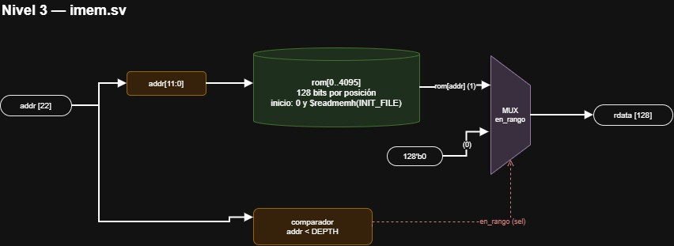

| Bloque | Función | Justificación |
|---|---|---|
| Arreglo ROM | `rom[0 : DEPTH−1]`, 128 bits cada posición | Un bundle por posición, igual que una línea del `.hex` (§1.5); la línea *n* es el PC *n* |
| Comparador de rango | `en_rango = (addr < DEPTH)` | Evita que el PC dé la vuelta al bundle 0 (ver arriba) |
| MUX de lectura | `rd_next = en_rango ? rom[addr] : 0` | Fuera de rango entrega un bundle de `nopi` |
| Registro de salida | `rst` → 0; `flush` → 0; `en` → `rdata <= rd_next` | ROM síncrona; es el registro IF/ID del bundle |
| Inicialización | Todas en 0 y luego `$readmemh(INIT_FILE, rom)` | Las posiciones que el programa no ocupa son `nopi`. `$readmemh` acepta los `_` y los comentarios `//` del `.hex` |

Nada escribe la ROM durante la ejecución.

```systemverilog
localparam int IW = $clog2(DEPTH);
logic [127:0] rom [0:DEPTH-1];

assign rd_next = (addr < DEPTH) ? rom[addr[IW-1:0]] : '0;   // fuera de rango: nopi
always_ff @(posedge clk or posedge rst)
  if (rst) rdata <= '0; else if (flush) rdata <= '0; else if (en) rdata <= rd_next;

initial begin
  for (int i = 0; i < DEPTH; i++) rom[i] = '0;
  if (INIT_FILE != "") $readmemh(INIT_FILE, rom);
end
```

**Plan de verificación** (`tb_imem`)

| Caso | Esperado |
|---|---|
| Programa de `isa.md` §11 | `rdata` en 0, 1 y 2 (un flanco después de `addr`) igual a las tres líneas del `.hex` |
| `en = 0` | `rdata` se conserva durante varios flancos aunque cambie `addr`; con `en = 1` carga |
| `rst` | `rdata` en 0, con prioridad sobre `en` |
| `flush` | `rdata` en 0 en el flanco (no antes), con prioridad sobre `en` |
| Posición sin programa | 0 |
| `addr = DEPTH − 1` | La última posición |
| `addr = DEPTH` | 0, no el bundle 0 |
| `addr` máximo (`2^PC_W − 1`) | 0 |
| `.hex` con `_` y comentarios `//` | Se carga igual que sin ellos |

### 3.8 `bru_dec` (dentro de `dispatch`)

| Puerto | Dir | Bits | Descripción |
|---|---|---|---|
| `funct` | in | 5 | Bits 30..26 |
| `br_op` | out | 3 | Ninguno (`3'b000`, obligatorio), `beq`, `bne`, `blt`, `bge`, `jef`, `jas`, `jefR` (tabla de §4.8) |
| `we` | out | 1 | `1` solo en `jas` y `jefR` |

**Interior**

Siete comparadores de igualdad de 5 bits (uno por instrucción) y cuatro redes OR.
Como las igualdades son excluyentes, no hay prioridad. Un código sin
coincidencia produce `br_op = 000` (ningún salto, §4.2) y `we = 0`.

```
br_op[0] = beq | blt | jef | jefR
br_op[1] = bne | blt | jas | jefR
br_op[2] = bge | jef | jas | jefR
we       = jas | jefR
```

`br_op` es una codificación interna, no el `funct`: cambiarla solo exige mantener
sincronizados `bru_dec` y `bru`. La tabla completa está en §4.8.

### 3.9 `bru.sv`

Combinacional; actúa en ID.

| Puerto | Dir | Bits | Descripción |
|---|---|---|---|
| `pc` | in | `PC_W` | PC del bundle en ID (de IF/ID) |
| `a` | in | 32 | Valor de `rs1` |
| `b` | in | 32 | Valor de `rs2` |
| `instr_low` | in | 22 | Bits 21..0 de la instrucción: `off` = bits 17..0, `target` = bits 21..0 |
| `br_op` | in | 3 | |
| `taken` | out | 1 | El salto se toma |
| `target` | out | `PC_W` | `pc + off`, `pc + target` o `a[21:0]` |
| `link` | out | 32 | `pc + 1`, extendido con ceros |

Comparación **con signo** en `blt` y `bge` (`isa.md` §6.2). Bloques según
`isa.md` §5.3.

**Interior**

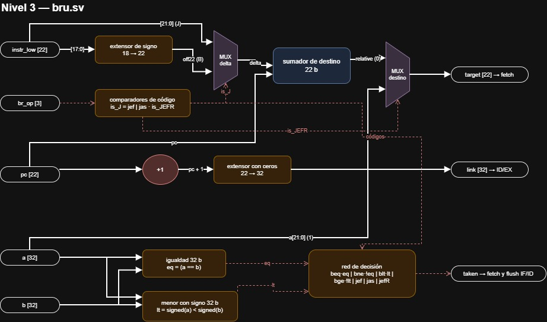

| Bloque | Función | Justificación |
|---|---|---|
| Comparadores de código | Siete indicadores a partir de `br_op`; `is_J = jef OR jas` | — |
| Extensor del desplazamiento | `off22 = {{4{instr_low[17]}}, instr_low[17:0]}` | Sin signo, −2 sería un salto enorme hacia adelante |
| MUX de desplazamiento | Formato B: `off22`; formato J: `instr_low[21:0]` | El campo J ya tiene los 22 bits del sumador |
| Sumador de destino | `pc + delta`, 22 bits, módulo 2²² | Uno solo para B, `jef` y `jas`: hay un salto por bundle (`isa.md` §5.3) |
| MUX de destino | `jefR`: `a[21:0]`; los demás: suma relativa | `jefR` es absoluto (`isa.md` §6.2) |
| Incrementador | `pc + 1` | Separado del sumador: `jas` necesita destino y enlace a la vez |
| Extensor con ceros | `link = {10'b0, pc + 1}` | El PC es un índice sin signo |
| Comparador de igualdad | `eq = (a == b)` | Sirve a `beq` y, negado, a `bne` |
| Comparador menor con signo | `lt = signed(a) < signed(b)` | Sirve a `blt` y, negado, a `bge`. Propio de la BRU, no compartido con la ALU (`isa.md` §5.3) |
| Red de decisión | Elige la condición según la operación | Los incondicionales siempre se toman; `BR_NONE` nunca |

**Ecuaciones**

```
off22    = {{4{instr_low[17]}}, instr_low[17:0]}
delta    = (jef | jas) ? instr_low[21:0] : off22
relative = (pc + delta) mod 2^22
target   = jefR ? a[21:0] : relative
link     = {10'b0, (pc + 1) mod 2^22}
eq       = (a == b)
lt       = $signed(a) < $signed(b)
taken    = (beq & eq) | (bne & !eq) | (blt & lt) | (bge & !lt) | jef | jas | jefR
```

**Comparación con signo.** No se deduce del bit de signo de `a − b`, porque el
desbordamiento puede invertirlo. Una realización válida: si los signos difieren,
`lt = a[31]`; si son iguales, comparación de magnitud sin signo.

**Las sumas usan el PC del bundle en ID, sin `+1` adicional**, y el desplazamiento
no se multiplica: cada unidad es un bundle (`isa.md` §6.2). `target` y `link` se
calculan siempre, también en `nopi`; no tienen efecto porque `taken = 0` y
`we = 0`. Con `rd = rz` en `jas`/`jefR`, el salto se toma igual y el enlace se
descarta.

| Operación | `taken` | Destino | Escribe enlace |
|---|---|---|---|
| ninguna | 0 | — | No |
| `beq` / `bne` | `eq` / `!eq` | `pc + off22` | No |
| `blt` / `bge` | `lt` / `!lt` | `pc + off22` | No |
| `jef` | 1 | `pc + target` | No |
| `jas` | 1 | `pc + target` | Sí, en `rd` |
| `jefR` | 1 | `a[21:0]` | Sí, en `rd` |

**Plan de verificación** (las ecuaciones de arriba se modelaron y pasan todos los casos)

| Caso | Esperado |
|---|---|
| `blt`, `a = −3`, `b = 5`, `pc = 10`, `off = −2` | `taken = 1`, `target = 8`, `link = 11` |
| `bge`, `a = −1`, `b = 1` | `taken = 0` |
| `beq`, `a = b = 7`, `pc = 10`, `off = +5` | `taken = 1`, `target = 15` |
| `bne`, `a = b` | `taken = 0` |
| `beq`, `bne`, `blt`, `bge` con su condición falsa | `taken = 0` |
| `jef`, `pc = 100`, `target = −40` | `taken = 1`, `target = 60` |
| `jas`, `pc = 100`, `target = +40` | `taken = 1`, `target = 140`, `link = 101` |
| `jefR`, `a = 0x00400065` | `taken = 1`, `target = 0x65` |
| `br_op = 000` | `taken = 0` |
| `bru_dec` con cada `funct` válido | El `br_op` y el `we` de la tabla de §4.8 |
| `bru_dec` con los 24 `funct` libres | `br_op = 000`, `we = 0` |

**Temporización.** La ruta de decisión (lectura del `regfile` → comparador →
decisión → PC y vaciado de IF/ID) es la ruta crítica del diseño: cuando el
operando se escribió en ese mismo ciclo, dispone de medio ciclo (§4.7).

### 3.10 `crypto_dec` y `crypto_unit.sv`

**`crypto_dec`** (dentro de `dispatch`)

| Puerto | Dir | Bits | Descripción |
|---|---|---|---|
| `funct` | in | 5 | Bits 30..26 |
| `crypto_op` | out | 3 | Ninguna (`3'b000`, obligatorio), `feis`, `auth`, `logout`, `kv_write`, `kv_lock`, `sanc` (tabla de §4.8) |
| `we` | out | 1 | `1` solo en `feis` |

**`crypto_unit.sv`** — opera en EX; contiene `key_vault.sv`.

| Puerto | Dir | Bits | Descripción |
|---|---|---|---|
| `clk`, `rst` | in | 1 | Reset normal: borra banderas, bóveda y hash; conserva el ancla (`isa.md` §7.2) |
| `init_anchor` | in | 1 | Entrada de arranque/configuración protegida. Con `rst = 1`, carga `RESET_ANCHOR` en subida de reloj; en reset normal vale 0 |
| `en` | in | 1 | `sel` del slot 1 en ID/EX |
| `crypto_op` | in | 3 | |
| `k`, `i` | in | 2 + 2 | Directos de la instrucción |
| `a`, `b` | in | 32 + 32 | Compartidos con ALU1 |
| `ex_valid` | in | 1 | ID/EX contiene un bundle válido (§2.11) |
| `ex_commit` | in | 1 | Permite aplicar los efectos del bundle una sola vez (§2.11) |
| `result` | out | 32 | Valor para `rd` (solo `feis` permitida; cero en lo demás) |
| `allowed` | out | 1 | La operación tenía el privilegio requerido (`isa.md` §6.4) |
| `crypto_stall` | out | 1 | Pide congelar el pipeline mientras `auth` no termina (§2.11) |

Cuándo cambia el estado interno:

- **Instrucciones.** Sus efectos sobre `AUTH`, `KVLOCK`, `EXC`, el ancla y las
  llaves se aplican en el flanco de subida, solo con `ex_commit = 1`. Sin
  efecto, el control realimenta los valores actuales.
- **Reset normal.** Limpia banderas, bóveda y motor de hash, sin depender de
  `ex_commit`. El ancla conserva su valor.
- **Arranque protegido.** Con `rst = 1` e `init_anchor = 1`, el ancla carga
  `RESET_ANCHOR` en el flanco de subida.
- **Hash.** Sus registros avanzan durante la espera aunque `ex_commit = 0`.

No hay puertos que expongan el estado al programa; los *testbenches* lo observan
por jerarquía.

**Interior.** CRYPTO se instancia en `core` como `u_crypto` y recibe su control
desde `dispatch`. Resumen:


| Bloque | Función |
|---|---|
| `crypto_control` | Permisos, arranque y aceptación del hash, `crypto_stall` y estado siguiente. Combinacional |
| `crypto_datapath` | Ronda Feistel (F y XOR), motor `auth_hash32` y comparador OTP |
| `auth_hash32` | Ascon-Hash256 de una ronda por ciclo: estado de 320 bits, contador de rondas 0..11. Entrada `{32'h1, token}`, salida `s0[31:0]` |
| `crypto_state` | `AUTH`, `KVLOCK`, `EXC` y ancla (35 bits). Reset normal conserva el ancla; arranque con `init_anchor` carga `RESET_ANCHOR` |
| `key_vault` | 4 × 4 palabras de 32 bits; lectura combinacional por `k`, `i`; se borra con reset |

Ecuaciones de interfaz:

```
crypto_stall = auth_req AND NOT auth_done
auth_accept  = auth_req AND auth_done AND ex_commit
write_en     = activo AND es_write AND allowed AND ex_commit
activo       = en AND ex_valid AND NOT rst
```

Diagramas de nivel 3:


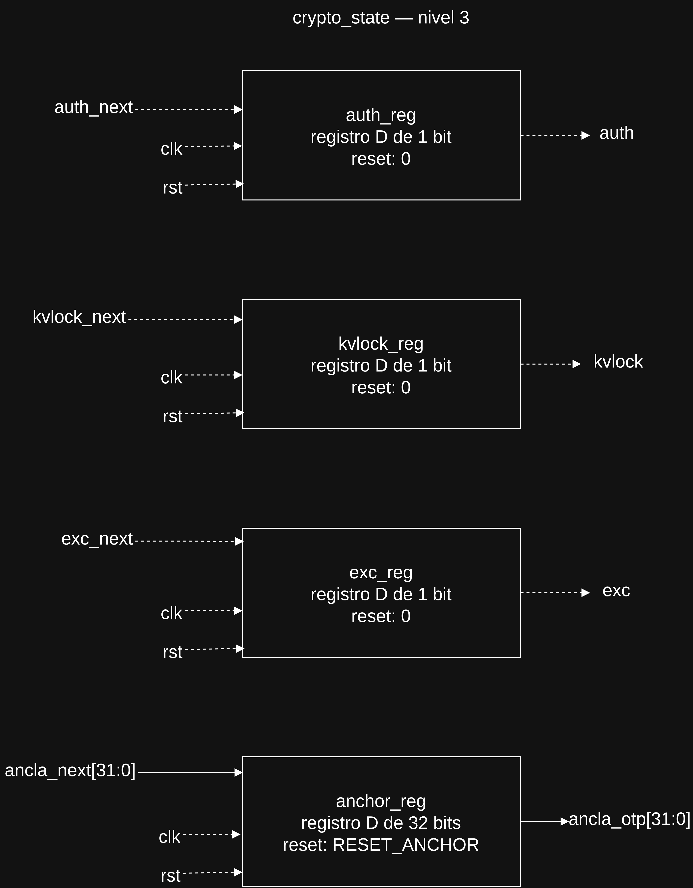


**Cadena de demostración validada:** `tools/lamport.py`, semilla `0xCAFEDECE`,
100 tokens; `RESET_ANCHOR = 32'hFEFF95FF` (x100). Primer token x99:
`0xF47BD70B`; segundo x98: `0xA45326BA`. Los archivos están en
`data/lamport_demo/`. H se contrastó con ocho vectores de la referencia C de
Ascon, incluido su KAT de cuatro bytes, y los cien eslabones coinciden con
la referencia C y el RTL. `tb_crypto_unit` verifica tokens sucesivos, rechazo
de reutilización y conservación del ancla tras reset normal.

El arranque mantiene `rst = 1` e `init_anchor = 1` durante al menos una
subida y desactiva `init_anchor` antes de liberar `rst`. `core` lleva esta
señal hasta `u_crypto` (§3.14); no puede derivarse del reset normal, porque
restauraría tokens consumidos. La conservación del ancla no sobrevive a
pérdida de alimentación o reconfiguración de la FPGA.

La tabla de `crypto_dec` está en §4.8.

### 3.11 `dispatch.sv`

Combinacional. Separa el bundle en cuatro instrucciones, instancia los
decodificadores (§3.2, §3.4, §3.8, §3.10), genera las 8 direcciones de lectura
del `regfile` (§2.5) y extiende con signo los inmediatos de los slots 0, 1 y 3.
Entrega los campos de control de ID/EX (§2.6).

**`dispatch` solo decodifica: no lee el `regfile`.** Entrega las 8 direcciones
de lectura; los datos leídos van del `regfile` directo a ID/EX, cableados en
`core`. Así `dispatch` es puramente combinacional y se prueba sin reloj. Además,
el `regfile` no puede vivir dentro de `dispatch`, porque también lo escribe WB.

| Puerto | Dir | Bits | Descripción |
|---|---|---|---|
| `bundle` | in | 128 | De IF/ID |
| `rf_raddr` | out | 8 × 4 | Direcciones de lectura (§2.5) |
| `s0_imm`, `s0_alu_op`, `s0_use_imm`, `s0_rd`, `s0_we` | out | 32, 4, 1, 4, 1 | Slot 0 |
| `s1_imm`, `s1_alu_op`, `s1_use_imm`, `s1_sel`, `s1_crypto_op`, `s1_k`, `s1_i`, `s1_rd`, `s1_we` | out | 32, 4, 1, 1, 3, 2, 2, 4, 1 | Slot 1 |
| `s2_instr_low`, `s2_br_op`, `s2_rd`, `s2_we` | out | 22, 3, 4, 1 | Slot 2, hacia la BRU y hacia ID/EX |
| `s3_imm`, `s3_is_load`, `s3_is_store`, `s3_is_byte`, `s3_rd` | out | 32, 1, 1, 1, 4 | Slot 3 |

**Interior**

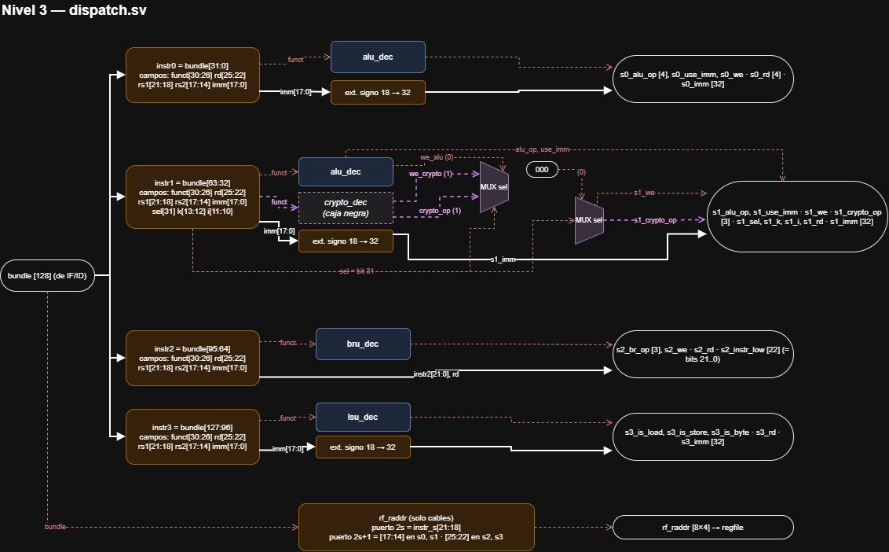

| Bloque | Función | Justificación |
|---|---|---|
| Separación de slots | Slot *s* = `bundle[32s+31 : 32s]` | Solo cables (`isa.md` §3) |
| Extracción de campos | `funct` = 30..26, `rd` = 25..22, `rs1` = 21..18, `rs2` = 17..14, `imm` = 17..0, `k` = 13..12, `i` = 11..10 | Los campos están en la misma posición en todos los formatos (`isa.md` §4): se extraen sin identificar el tipo de instrucción |
| Direcciones de lectura | Tabla de §2.5 | Fijas por slot: no requieren decodificación |
| Extensión de signo | `{{14{imm[17]}}, imm[17:0]}` en los slots 0, 1 y 3 | Todo lo que llega a EX trabaja en 32 bits (§2.6) |
| Decodificadores | `alu_dec` en los slots 0 y 1, `crypto_dec` en el 1, `bru_dec` en el 2, `lsu_dec` en el 3 | Cada tabla vive junto a su unidad (§2.5) |
| Selección del `we` del slot 1 | `s1_we = sel ? we_crypto : we_alu` | Los dos decodificadores del slot 1 producen un `we`; ID/EX lleva uno solo por slot |
| Bloqueo de CRYPTO | `s1_crypto_op = sel ? (salida de crypto_dec) : NINGUNA` | Con `sel = 0`, `crypto_dec` igual interpreta el `funct` de la ALU (por ejemplo, el `00001` de `add` como `feis`). Sin el bloqueo, un `add` en el slot 1 podría ejecutar una operación criptográfica y cambiar el estado de la bóveda |

Notas:
- **Los campos se extraen siempre**, aunque la instrucción no los use. En una
  instrucción de formato R, `imm` contiene los bits de `rs2` y del campo
  reservado: el valor se ignora porque `use_imm = 0`. En un salto condicional,
  `rd` contiene `rs2`: se ignora porque `we = 0`.
- **Con `sel = 1`, `alu_dec` del slot 1 igual produce un `alu_op`**: ALU1 calcula
  un valor que nadie usa, porque en EX el multiplexor elige CRYPTO. No hace falta
  bloquearlo, porque la ALU no tiene estado.
- El bit `sel` de los slots 0, 2 y 3 no se conecta (§2.5).

**Traza.** Bundle `05D80000_0D0FFFFE_98100000_054D0000`:
`{ add r5, r3, r4 | sanc r4 | blt r3, r4, −2 | lw r7, 0(r6) }`.

| Slot | Instrucción | Puertos (A, B) | Salidas |
|---|---|---|---|
| 0 | `add r5, r3, r4` (`054D0000`) | 0 ← `r3`, 1 ← `r4` | `alu_op` = suma, `use_imm = 0`, `rd = 5`, `we = 1`. `imm = 0x00010000` (bits de `rs2`, se ignora) |
| 1 | `sanc r4` (`98100000`) | 2 ← `r4`, 3 ← `r0` | `sel = 1`, `crypto_op = sanc`, `we = 0` (`sanc` no escribe registro) |
| 2 | `blt r3, r4, −2` (`0D0FFFFE`) | 4 ← `r3`, 5 ← `r4` | `br_op = blt`, `instr_low = 0x0FFFFE` (`off = −2`), `we = 0`. `rd = 4` (es `rs2`, se ignora) |
| 3 | `lw r7, 0(r6)` (`05D80000`) | 6 ← `r6`, 7 ← `r7` | `is_load = 1`, `imm = 0`, `rd = 7`. El puerto 7 lee `r7` y se ignora: en `lw` el campo 25..22 es el destino |

**Plan de verificación**

| Caso | Esperado |
|---|---|
| Los 5 vectores de `isa.md` §6.5, cada uno en su slot | Campos, direcciones y control correctos |
| La traza anterior | Las salidas de la tabla |
| Bundle en cero | `we = 0` en los 4 slots, `crypto_op` = NINGUNA, `br_op` = ninguno, sin carga ni almacenamiento |
| Slot 1 con `add` (`sel = 0`) | `crypto_op` = NINGUNA y `s1_we` = `we` de `alu_dec` |
| Slot 1 con `feis` (`sel = 1`) | `crypto_op` = `feis` y `s1_we` = `we` de `crypto_dec` |
| Inmediato negativo (`saddi rd, rs1, −1`) | `imm = 0xFFFFFFFF` |
| Inmediato positivo máximo (`131071`) | `imm = 0x0001FFFF` |
| `sel = 1` en el slot 0 | Se decodifica igual que con `sel = 0` |
| Puerto B en los slots 2 y 3 | Toma los bits 25..22, no los 17..14 |

### 3.12 `fetch.sv`

| Puerto | Dir | Bits | Descripción |
|---|---|---|---|
| `clk`, `rst` | in | 1 | |
| `stall` | in | 1 | `stall` de `core` (CRYPTO o memoria): conserva el PC (§2.11) |
| `branch_taken` | in | 1 | `id_redirect`: salto de la BRU ya condicionado con `ifid_valid` y `~stall` en `core` |
| `branch_target` | in | `PC_W` | De la BRU |
| `pc` | out | `PC_W` | Hacia `imem` y hacia IF/ID |

PC registrado en el flanco de subida; siguiente PC = `stall ? pc : (branch_taken ? branch_target : pc + 1)`.

**Interior**

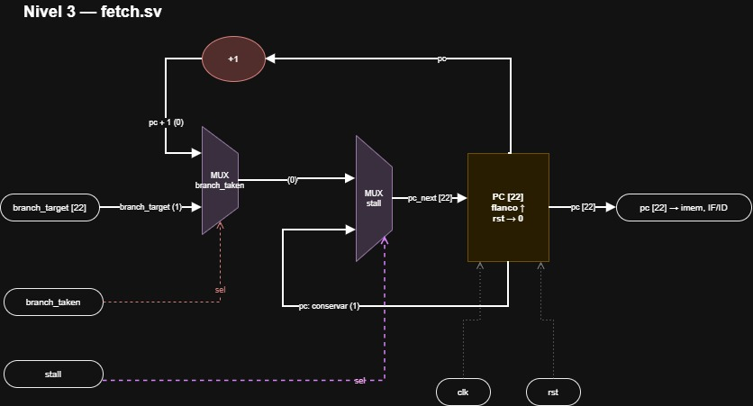

| Bloque | Función | Justificación |
|---|---|---|
| Registro PC | `PC_W` bits, flanco de subida, reset asíncrono a 0 | El programa empieza en el bundle 0 |
| Incrementador | `pc + 1` | **Propio, distinto del de la BRU**: `fetch` incrementa el PC del bundle que está en IF (siguiente a buscar); la BRU, el del bundle que está en ID (enlace de `jas`/`jefR`). Son bundles distintos |
| Multiplexor de salto | `branch_taken ? branch_target : pc + 1` | El salto se resuelve en ID y se aplica en el mismo flanco que vacía IF/ID (§2.7) |
| Multiplexor de pausa | `stall ? pc : (salida del anterior)` | Conserva el PC durante cualquier pausa (§2.11) |

`stall` tiene prioridad sobre `branch_taken`. Sin pausa, `stall = 0` y el PC avanza en todos los ciclos.

**Arranque**

| Ciclo | `rst` | PC | IF | ID (IF/ID) |
|---|---|---|---|---|
| 0 | 1 | 0 | — | vacío |
| 1 | 0 | 0 | bundle 0 | vacío |
| 2 | 0 | 1 | bundle 1 | bundle 0 |
| 3 | 0 | 2 | bundle 2 | bundle 1 |

El pipeline se llena solo: tras el reset, las etapas contienen bundles vacíos
hasta que llega el primero real.

**Plan de verificación**

| Caso | Esperado |
|---|---|
| `rst = 1` | `pc = 0` |
| Varios ciclos sin salto | `pc` = 0, 1, 2, 3… |
| `branch_taken = 1`, `branch_target = 8` | En el siguiente flanco, `pc = 8` |
| Salto hacia atrás y hacia adelante | `pc` = destino en ambos casos |
| `rst` a mitad de la ejecución | `pc = 0` de inmediato, sin esperar el flanco |
| `stall = 1` varios ciclos | `pc` no cambia; al bajar, sigue en `pc + 1` |
| `stall = 1` y `branch_taken = 1` | `pc` no cambia |

### 3.13 `pipe_reg.sv`

| Parámetro | Descripción |
|---|---|
| `W` | Ancho en bits |

| Puerto | Dir | Bits | Descripción |
|---|---|---|---|
| `clk`, `rst` | in | 1 | Reset asíncrono a cero |
| `flush` | in | 1 | En el flanco de subida, carga cero en lugar de `d` |
| `en` | in | 1 | Habilitación: con `en = 0` conserva `q` (§2.11) |
| `d` | in | `W` | |
| `q` | out | `W` | |

| Registro | `flush` | `en` |
|---|---|---|
| IF/ID | `id_redirect` | `~stall` |
| ID/EX | `0` | `~stall` |
| EX/WB | `stall` | `1` |

**Interior**

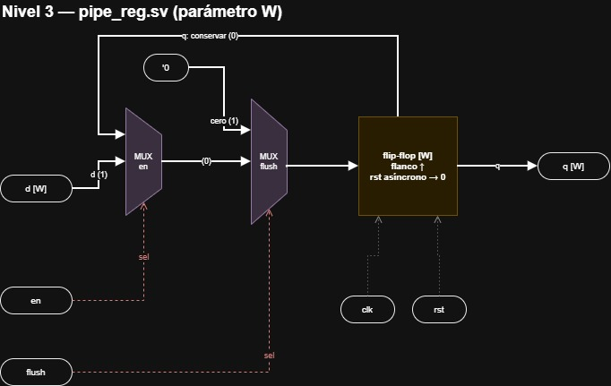

```systemverilog
always_ff @(posedge clk or posedge rst)
  if (rst)        q <= '0;    // reset asíncrono
  else if (flush) q <= '0;    // vaciado síncrono
  else if (en)    q <= d;     // con en = 0 conserva (pausa)
```

| Decisión | Justificación |
|---|---|
| **Vaciado síncrono** (en el flanco), no asíncrono | En IF/ID, `flush` es `id_redirect`, que la BRU calcula a partir del bundle que está en IF/ID. Un vaciado inmediato borraría ese bundle a mitad del ciclo, `branch_taken` caería y el vaciado se cancelaría: el registro borraría la condición que lo borra. Siendo síncrono, el bundle con el salto permanece en IF/ID todo el ciclo, y en el flanco IF/ID se vacía y el PC salta a la vez |
| **Con habilitación `en`** | Necesaria para las pausas (§2.11). Prioridad: `rst` > `flush` > `en`. En el uso real nunca coinciden `flush = 1` y `en = 0` en el mismo registro |
| Cero = vacío | Un registro en cero equivale a un bundle de `nopi` con `we = 0` (§2.7) |

**Organización en el pipeline: un `pipe_reg` por slot.** Cada registro de
segmentación es uno solo desde el punto de vista lógico (el bundle avanza
siempre completo), pero se construye con **una instancia por compartimento**:

| Registro | Instancias | Anchos |
|---|---|---|
| IF/ID | registro de salida de `imem` (128), `u_ifid_pc` | 128, 22 |
| ID/EX | `u_idex_s0`, `u_idex_s1`, `u_idex_s2`, `u_idex_s3`, `u_idex_pc`, `u_idex_ops_count` | 106, 114, 37, 103, 22, 3 |
| EX/WB | `u_exwb_s0`, `u_exwb_s1`, `u_exwb_s2`, `u_exwb_s3`, `u_exwb_pc` | 37, 37, 37, 37, 22 |
| Validez | `u_ifid_valid`, `u_idex_valid`, `u_exwb_valid` | 1, 1, 1 |

- **IF/ID guarda el bundle entero**: todavía no se ha decodificado, son 128 bits
  crudos. La división en slots ocurre en ID (`dispatch`).
- **Desde ID/EX, cada instancia lleva los campos de un solo slot**, que entran
  concatenados por `d` y se separan a la salida, en `core`, en cables con nombre
  (`idex_s0_rd`, `idex_s0_a`…). Así cada unidad recibe solo su compartimento, y
  el `.vcd` muestra los campos con nombre.
- **Todas las instancias de una misma etapa comparten `clk`, `rst` y `flush`**,
  para que el bundle avance como una unidad.
- Se descartó una sola instancia para toda la etapa (difícil de leer y de
  mantener) y una instancia por campo (unas 40 en ID/EX). También se descartó
  `struct packed`, por el soporte variable en Icarus Verilog.

**Plan de verificación**

| Caso | Esperado |
|---|---|
| `rst = 1` | `q = 0` de inmediato |
| Carga normal | En cada flanco de subida, `q = d` |
| `flush = 1` | En el flanco, `q = 0` aunque `d ≠ 0` |
| `flush` sube a mitad del ciclo | `q` no cambia hasta el flanco |
| `rst` y `flush` a la vez | `q = 0` |
| `en = 0` | `q` se conserva aunque cambie `d` |
| `flush = 1` y `en = 0` | `q = 0` |


### 3.14 `core.sv` y `top.sv`

`core.sv` conecta los módulos del pipeline según §2; sus puertos son `clk`,
`rst`, `init_anchor` y las dos interfaces de memoria de §1.3. `top.sv` instancia
`core`, `imem`, la jerarquía de datos elegida por `CACHE` y `main_memory`, y
expone solo `clk` y `rst` (§1.1). `top` genera además `init_anchor` (§2.9) y lo
pasa a `core`, que lo lleva a `u_crypto`.

**Interior de `core`**

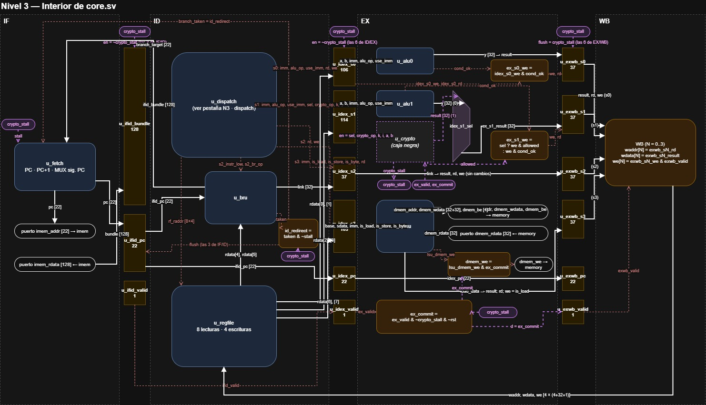

`core` es principalmente cableado. Se organiza en **cuatro secciones comentadas,
una por etapa**, más los registros de segmentación entre ellas, el control de
pausas y los contadores de rendimiento.

**Etapa IF**

| De | A |
|---|---|
| `u_fetch.pc` | `imem_addr` (puerto de `core`) y `u_ifid_pc` |
| `imem_rdata` (registro de salida de `imem`) | `ifid_bundle` (mismo valor, sin registro adicional) |
| `~stall` | `imem_en`, `en` de `u_ifid_pc` y `u_ifid_valid` |
| `id_redirect` | `imem_flush`, `flush` de `u_ifid_pc` y `u_ifid_valid`, `u_fetch.branch_taken` |

**Etapa ID**

| De | A |
|---|---|
| `ifid_bundle` | `u_dispatch.bundle` |
| `u_dispatch.rf_raddr` | `u_regfile.raddr` |
| `u_regfile.rdata[0]`, `[1]` | ID/EX slot 0: `a`, `b` |
| `u_regfile.rdata[2]`, `[3]` | ID/EX slot 1: `a`, `b` |
| `u_regfile.rdata[4]`, `[5]` | `u_bru`: `a`, `b` |
| `u_regfile.rdata[6]`, `[7]` | ID/EX slot 3: `base`, `sdata` |
| `ifid_pc`, `s2_instr_low`, `s2_br_op` | `u_bru` |
| `u_bru.taken` | `id_redirect = id_branch_taken & ifid_valid & ~stall` |
| `u_bru.target` | `u_fetch.branch_target` |
| `u_bru.link` | ID/EX slot 2 |
| Control de `u_dispatch` por slot | Su compartimento de ID/EX |
| `s0_we`, `s1_sel`, `s1_crypto_op`, `s1_we`, `s2_br_op`, `s3_is_load`, `s3_is_store` | `id_ops_count` → `u_idex_ops_count` (§2.5) |

**Etapa EX**

| De | A |
|---|---|
| ID/EX slot 0 | `u_alu0` |
| ID/EX slot 1 | `u_alu1` y `u_crypto` (`en` = `idex_s1_sel`, `ex_valid`, `ex_commit`) |
| ID/EX slot 3 | `u_lsu`; la LSU, a los puertos `dmem_*` de `core` |
| `dmem_rdata`, `mem_read_saved` | `lsu_rdata` → `u_lsu.dmem_rdata` |
| `ex_commit`, `idex_ops_count`, `id_redirect`, `crypto_stall`, `mem_stall`, `stall` | `u_perf_counters` |

Lógica propia de la etapa (unas pocas líneas, sin módulo aparte):

```systemverilog
// Slot 1: ALU1 o CRYPTO, según sel (isa.md §3.1)
assign ex_s1_result = idex_s1_sel ? crypto_result : alu1_y;

// we final de cada slot (§2.6)
assign ex_s0_we = idex_s0_we & alu0_cond_ok;                       // ifmov
assign ex_s1_we = idex_s1_sel ? (idex_s1_we & crypto_allowed)      // privilegio
                              : (idex_s1_we & alu1_cond_ok);       // ifmov
assign ex_s2_we = idex_s2_we;                                      // jas, jefR
assign ex_s3_we = idex_s3_is_load;                                 // lw, lb

// Pedido único de memoria y pausa combinada (§2.11)
assign memory_bundle = ex_valid && (idex_s3_is_load || idex_s3_is_store);
assign dmem_req    = memory_bundle && !hecho && !rst;
assign mem_stall   = memory_bundle && !hecho && !dmem_listo;
assign stall       = crypto_stall | mem_stall;
assign ex_commit   = ex_valid & ~stall & ~rst;
assign dmem_we     = lsu_dmem_we & dmem_req;                       // store con el pedido único
assign lsu_rdata   = hecho ? mem_read_saved : dmem_rdata;
assign id_redirect = id_branch_taken & ifid_valid & ~stall;        // salto retenido; bundle anulado no redirige
```

Se descartó un módulo `execute.sv` aparte: es muy poca lógica para un módulo
propio, y la lista del enunciado I §7.2 no lo pide.

**Etapa WB**

| De | A |
|---|---|
| `exwb_sN_rd`, `exwb_sN_result`, `exwb_sN_we & exwb_valid` (N = 0..3) | `u_regfile.waddr[N]`, `wdata[N]`, `we[N]` |

**Convención de nombres.** Pensada para que el `.vcd` se lea solo en GTKWave:

| Qué | Convención | Ejemplo |
|---|---|---|
| Instancias | `u_` + módulo | `u_regfile`, `u_alu0`, `u_alu1`, `u_bru`, `u_crypto`, `u_perf_counters` |
| Salidas de registros de segmentación | registro + slot + campo | `idex_s0_rd`, `exwb_s3_result` |
| Señales internas de una etapa | etapa + nombre | `id_branch_taken`, `ex_s1_result` |

**Interior de `top`**

| Parámetro | Descripción |
|---|---|
| `IMEM_INIT` | Archivo `.hex` del programa, pasado a `imem` |
| `DMEM_INIT` | Archivo `.mem` de datos, pasado a `main_memory` y al monitor del TB (vacío = ceros) |
| `PC_W`, `IMEM_DEPTH` | Ancho del PC y bundles de la ROM |
| `DMEM_WORDS` | Debe valer 16384; otro valor produce `$fatal` |
| `CACHE` | Jerarquía de datos: 0, 1 o 2 (§2.12); por defecto 2 |
| `MEM_DIV` | Divisor de la memoria principal: 2, 4 o 5 |

| Bloque | Instancias | Conexiones |
|---|---|---|
| Siempre | `u_core`, `u_imem`, `u_memory` | `u_core` ↔ `u_imem` por la interfaz de §1.3; el canal de línea `line_*` llega a `u_memory` |
| `g_direct` (`CACHE = 0`) | `u_mem_adapter` | Interfaz de palabra de `u_core` → adaptador → `line_*` |
| `g_cache` (`CACHE = 1`) | `u_l1`, `u_wbuf` (`DEPTH = 4`) | Palabra → `u_l1`; línea y *push* de `u_l1` → `u_wbuf`; abajo de `u_wbuf` → `line_*` con `down_resp_src = 0` |
| `g_cache2` (`CACHE = 2`) | `u_l1`, `u_wbuf` (`DEPTH = 4`), `u_l2`, `u_ebuf` (`DEPTH = 8`) | Palabra → `u_l1`; `u_l1` → `u_wbuf` (línea y *push*); `u_wbuf` → `u_l2`; `u_l2` → `u_ebuf` (línea y *push*); abajo de `u_ebuf` → `line_*` con `down_resp_src = 0` |

Los contadores de las cachés y de los buffers no se sacan por puertos: los lee
el *testbench* por jerarquía, por ejemplo `dut.g_cache2.u_l1.read_hits`.

Cada *testbench* elige el programa, los datos y la configuración sin modificar
el código:

```systemverilog
top #(.IMEM_INIT("prueba_saltos.hex"), .DMEM_INIT("hola.mem"),
      .CACHE(2), .MEM_DIV(4)) dut (.clk, .rst);
```

La jerarquía para depurar es, por ejemplo, `dut.u_core.u_regfile.regs[5]`,
`dut.u_memory.mem[1024]` o `dut.g_cache2.u_l2.read_misses`.

**Al integrar.** Las conexiones de esta sección siguen las interfaces de §3.
Cualquier diferencia entre un módulo implementado y su interfaz se documenta
aquí, no ajustando `core` o `top` en silencio.

**Plan de verificación** (con `tb_top` y `tb_programa`, programas escritos con el ensamblador)

| Caso | Esperado |
|---|---|
| Arranque tras reset | El bundle 0 llega a ID en el ciclo 2 (§3.12) |
| Varios bundles en vuelo | En un mismo ciclo, el `.vcd` muestra `ifid_pc`, `idex_pc` y `exwb_pc` con bundles distintos |
| Dependencia a 1 bundle de distancia | El consumidor lee el valor **viejo** |
| Dependencia a 2 bundles de distancia | El consumidor lee el valor **nuevo** |
| Salto tomado | El bundle siguiente se descarta; los demás slots del bundle con el salto se ejecutan |
| `ifmov` con condición falsa | `rd` no cambia |
| Slot 1 con ALU y con CRYPTO en bundles distintos | El resultado sale de la unidad indicada por `sel` |
| `sw` seguido de `lw` a la misma dirección en el bundle siguiente | El `lw` obtiene el valor nuevo (`isa.md` §9.4), con y sin fallo de caché |
| Programa de ejemplo de `isa.md` §11 | Termina con `r4 = 4` |
| PC más allá del programa | El procesador ejecuta `nopi` indefinidamente, sin volver al bundle 0 |
| `auth` | El pipeline se congela 13 ciclos; el bundle siguiente ya ve `AUTH` actualizado |
| `auth` en un bundle con `sw` y `add` | El `sw` escribe una vez y el `add` escribe una vez en WB |
| `auth` y acceso a memoria en el mismo bundle | Pausa igual a la unión de las dos esperas; un solo acceso (`tb_auth_lsu`) |
| Salto tomado en ID durante una pausa | Se aplica una sola vez, al reanudar |
| Mismo programa con `CACHE` 0, 1 y 2 | Mismos registros y misma memoria final; solo cambian los ciclos |
| Programa que cifra y descifra un archivo de varios bloques | Cifrado igual a la referencia en C del enunciado I (Fig. 1) y descifrado igual al original |


### 3.15 `mem_adapter.sv`

Adaptador de la configuración sin caché (`CACHE = 0`): convierte cada pedido de
palabra en un único acceso de línea a `main_memory`, sin guardar líneas.
Interfaz de palabra como esclavo y de línea como maestro (§2.13).

| Puerto | Dir | Bits | Descripción |
|---|---|---|---|
| `clk`, `rst` | in | 1, 1 | |
| `req`, `we`, `addr`, `wdata`, `be` | in | 1, 1, 32, 32, 4 | Interfaz de palabra desde `core` |
| `rdata`, `listo` | out | 32, 1 | Palabra leída y fin de la operación |
| `line_req`, `line_we`, `line_addr`, `line_wdata`, `line_mask` | out | 1, 1, 11, 256, 32 | Pedido de línea |
| `line_accepted`, `line_ready`, `line_rdata` | in | 1, 1, 256 | Respuesta de la memoria |

**Interior**

| Bloque | Función |
|---|---|
| Selección de campos | `line_addr = addr[15:5]`; `palabra = addr[4:2]` |
| Colocación del store | `wdata` va en `[32*palabra +: 32]` de `line_wdata` y `be` en `[4*palabra +: 4]` de `line_mask`; el resto de la máscara en cero |
| Registro del pedido | `active` y `sent` distinguen pedido pendiente, aceptado y terminado; `saved_addr`, `saved_we`, `saved_data`, `saved_be` lo conservan |
| Selección de palabra leída | `rdata = line_rdata[32*palabra +: 32]` con `line_ready` |

- El primer pedido atraviesa el adaptador **combinacionalmente**, sin un ciclo
  para capturar sus campos; después se usan los registros.
- `line_req` se mantiene hasta observar `line_accepted` y baja en ese mismo
  ciclo; no se repite aunque `core` siga con `req = 1` durante la espera.
- `listo = line_ready`, así que el núcleo consume la palabra en el mismo flanco
  en que la memoria registra `done`.
- Un store es un solo acceso de línea con máscara: no hay lectura-modificación-
  escritura ni dos accesos por store.

Cada operación de memoria cuesta exactamente `TMEM` ciclos de pausa (§2.16).

**Plan de verificación** (`tb_mem_adapter`): palabra leída en las ocho posiciones
de la línea; cada carril de byte y su máscara; `line_req` baja al observar
`accepted`; espera con la memoria ocupada sin accesos duplicados; un acceso de
línea por pedido.

### 3.16 `l1_cache.sv`

Caché L1 de datos: 4 KB, 2 vías, 64 conjuntos, líneas de 32 B, *write-back* con
*write-allocate* y reemplazo LRU (§2.14, §2.15). Esclavo de la interfaz de
palabra; maestro de la interfaz de línea; dueño del puerto de *push* hacia el
*write buffer*. Detalle completo en [`l1_cache.md`](l1_cache.md).

| Grupo | Puertos |
|---|---|
| Palabra (desde `core`) | `req`, `we`, `addr[31:0]`, `wdata[31:0]`, `be[3:0]` → `rdata[31:0]`, `listo` |
| Línea (hacia abajo) | `line_req`, `line_we`, `line_addr[10:0]`, `line_wdata[255:0]`, `line_mask[31:0]` → `line_accepted`, `line_ready`, `line_rdata[255:0]`, `resp_src[1:0]` |
| *Push* | `push`, `push_addr[10:0]`, `push_data[255:0]` → `full` |
| Contadores (64 bits) | `read_count`, `write_count`, `read_hits`, `read_misses`, `write_hits`, `write_misses`, `stall_buffer_cycles`, `stall_l2_cycles`, `stall_memory_cycles`, `stall_full_cycles` |

**Interior**

| Bloque | Función |
|---|---|
| Arreglos de etiquetas y datos | 2 vías × 64 conjuntos; etiqueta de 5 bits, bits `valid` y `dirty` por línea, 256 bits de datos |
| Bit LRU por conjunto | Indica la vía menos usada; se actualiza en cada acierto y en cada llenado |
| Comparadores de etiqueta | Dos, en paralelo; definen acierto y vía |
| Selección de palabra | `addr[4:2]` sobre la línea de la vía que acierta (o de la línea que llega) |
| Fusión de bytes | Aplica `be` sobre la palabra de la línea en un store y marca la línea sucia |
| Registro de fallo | Dirección, operación, dato, máscara y vía víctima del único fallo pendiente |
| Control de víctima | Bit `evicted` para empujar la víctima sucia una sola vez |
| Atribución de pausas | `pending_stalls` acumula los ciclos del fallo y los suma, al terminar, al contador del origen indicado por `resp_src` |

**Acierto.** `listo = 1` y la palabra salen combinacionalmente en el mismo ciclo
del pedido. En el flanco se actualiza LRU y, si es un store, se fusionan los
bytes y la línea queda sucia. No hay pausa ni acceso inferior.

**Fallo.**
1. Se elige la víctima una sola vez (la vía LRU, o una vía inválida) y se
   guardan los datos del pedido.
2. Se presenta `line_req` (lectura de la línea). Si la víctima es válida y sucia,
   en el mismo ciclo se presenta `push` con `push_addr = {etiqueta, conjunto}` y
   la línea completa. Si la víctima es sucia y `full = 1`, se inhiben el *push* y
   el llenado hasta que haya espacio (pausa por buffer lleno). Una víctima limpia
   o inválida no espera.
3. `line_req` se mantiene hasta `line_accepted`; una respuesta inmediata con
   `line_ready` no necesita aceptación previa.
4. Con `line_ready` se instala la línea (etiqueta, `valid`, LRU) y se confirma el
   pedido: `listo = 1`. Si era un store, sus bytes se fusionan sobre la línea
   recibida y queda sucia; si era un load, se entrega la palabra y la línea queda
   limpia.

**Plan de verificación** (`tb_l1_cache`): aciertos y fallos de lectura y de
escritura; LRU en los dos órdenes de acceso; desalojo sucio con *push* y
desalojo limpio sin *push*; *buffer* lleno que bloquea el *push* y el llenado,
pero no a una víctima limpia o inválida; *forwarding* sin pausa; store aplicado
una sola vez; pausas atribuidas a buffer, L2 y memoria; identidades entre
contadores.

### 3.17 `line_buffer.sv`

FIFO de líneas completas, instanciado dos veces: como *write buffer* L1 → L2
(`DEPTH = 4`) y como *eviction buffer* L2 → memoria (`DEPTH = 8`). Detalle
completo en [`line_buffer.md`](line_buffer.md).

| Grupo | Puertos |
|---|---|
| Lectura (esclavo, desde arriba) | `req`, `we`, `line_addr[10:0]`, `wdata[255:0]`, `wmask[31:0]` → `accepted`, `ready`, `ready_rdata[255:0]`, `resp_src[1:0]` |
| *Push* (desde arriba) | `push`, `push_addr[10:0]`, `push_data[255:0]` → `full` |
| Abajo (maestro) | `down_req`, `down_we`, `down_line_addr[10:0]`, `down_wdata[255:0]`, `down_wmask[31:0]` → `down_accepted`, `down_ready`, `down_ready_rdata[255:0]`, `down_resp_src[1:0]` |
| Contadores (64 bits) | `received_count`, `forwarding_count`, `full_cycles`, `max_occupancy` |

**Interior**

| Bloque | Función |
|---|---|
| Cola circular | `DEPTH` entradas de dirección y línea; punteros de lectura y escritura y contador de ocupación |
| Comparadores de dirección | Uno por entrada válida; eligen la entrada **más nueva** que coincide con la lectura |
| Árbitro hacia abajo | Lectura pendiente antes que drenaje; un drenaje aceptado no se interrumpe |
| Registro de lectura pendiente | Conserva una lectura que ya salió hacia abajo hasta recibir su respuesta |

**Comportamiento.**
- `push` con `full = 0` guarda la línea en el flanco.
- **Lectura que coincide con una entrada:** respuesta en el mismo ciclo con
  `ready = 1`, la línea de la entrada más nueva y `resp_src = 2`. La entrada sigue
  en la cola y se drena igual.
- **Lectura sin coincidencia:** pasa hacia abajo en el mismo ciclo; `ready`,
  `ready_rdata` y `resp_src` vuelven desde abajo sin cambios.
- **Drenaje:** con la cola no vacía y el nivel de abajo libre, escribe la entrada
  más vieja con `wmask` en unos y la retira al terminar. Hacia abajo sale un
  acceso a la vez.

**Plan de verificación** (`tb_line_buffer`): *push* hasta llenarse y ocupación
máxima; drenaje en orden FIFO con una escritura por entrada; *forwarding* en el
mismo ciclo desde la entrada más nueva, también durante un drenaje; la entrada
no se retira por *forwarding*; prioridad de la lectura sobre el drenaje sin
interrumpir un drenaje aceptado; contadores exactos; prueba contra
`main_memory`.

### 3.18 `l2_cache.sv`

Caché L2 unificada: 16 KB, 4 vías, 128 conjuntos, líneas de 32 B, *write-back*,
reemplazo con LFSR y 8 ciclos por acceso (§2.14, §2.15). Esclava de la interfaz
de línea hacia el *write buffer*, maestra hacia el *eviction buffer*. Detalle
completo en [`l2_cache.md`](l2_cache.md).

| Grupo | Puertos |
|---|---|
| Línea (esclavo, desde arriba) | `req`, `we`, `line_addr[10:0]`, `wdata[255:0]`, `wmask[31:0]` → `accepted`, `ready`, `ready_rdata[255:0]`, `resp_src[1:0]` |
| Línea (maestro, hacia abajo) | `line_req`, `line_we`, `line_line_addr[10:0]`, `line_wdata[255:0]`, `line_wmask[31:0]` → `line_accepted`, `line_ready`, `line_rdata[255:0]`, `line_resp_src[1:0]` |
| *Push* | `push`, `push_addr[10:0]`, `push_data[255:0]` → `full` |
| Contadores (64 bits) | `read_count`, `write_count`, `read_hits`, `read_misses`, `write_hits`, `write_misses`, `stall_full_cycles` |
| Parámetro | `REPL` (sin efecto en la implementación actual: siempre LFSR) |

**Interior**

| Bloque | Función |
|---|---|
| Arreglos de etiquetas y datos | 4 vías × 128 conjuntos; etiqueta de 4 bits, `valid` y `dirty` por línea |
| Máquina de estados | `IDLE` → `LOOKUP` → (`MISS` → `WAIT_LINE`) → `IDLE` |
| Contador `age` | Cuenta los 8 ciclos del acceso en `LOOKUP` |
| Elección de víctima | La primera vía inválida; si las cuatro son válidas, `lfsr[1:0]` |
| LFSR de 8 bits | Semilla `0xA5`, realimentación `x⁸ + x⁶ + x⁵ + x⁴ + 1`; avanza en cada reemplazo |
| Control de víctima | Bit `pushed` para empujar la víctima sucia una sola vez |

**Secuencia de un acceso.**
1. En `IDLE`, un `req` se captura y se responde con `accepted`.
2. `LOOKUP` cuenta 8 ciclos y decide al final.
3. **Acierto de lectura:** `ready = 1`, la línea residente y `resp_src = 1`.
4. **Acierto de escritura:** fusiona los bytes de `wmask`, marca la línea sucia y
   confirma, sin escribir a memoria.
5. **Fallo de escritura:** libera la víctima e instala la línea recibida como
   válida y sucia, **sin leer el nivel inferior**.
6. **Fallo de lectura:** libera la víctima, pide la línea abajo y la mantiene
   pedida hasta `line_accepted` (`WAIT_LINE`); con `line_ready` la instala limpia y
   responde hacia arriba con el `resp_src` que trae (0 memoria, 2 *eviction
   buffer*).

Una víctima válida y sucia se empuja al *eviction buffer* con
`push_addr = {etiqueta, conjunto}`. Si `full = 1`, L2 se detiene y cuenta
`stall_full_cycles` en cada ciclo bloqueado.

Como L2 es NINE, una línea instalada por un fallo de lectura queda también en
L1, y un desalojo de L1 no invalida nada en L2.

**Plan de verificación** (`tb_l2_cache`): acierto con `ready` a los 8 ciclos;
fallo con pedido abajo al terminar la búsqueda; escritura de una línea ausente
sin leer memoria; toda escritura en 8 ciclos; vía inválida antes que el LFSR;
desalojo de una línea sucia; buffer lleno; pedido inferior sostenido hasta la
aceptación.

### 3.19 `perf_counters.sv`

Contadores de rendimiento del procesador (enunciado II §5.1). Observa señales de
`core` sin intervenir en el pipeline ni agregar puertos a `top` o `core`.
Instancia `u_perf_counters`.

| Puerto | Dir | Bits | Descripción |
|---|---|---|---|
| `clk`, `rst` | in | 1, 1 | |
| `ex_commit` | in | 1 | El bundle de EX se confirma |
| `ops_count` | in | 3 | Operaciones no-NOP del bundle de EX (`idex_ops_count`) |
| `id_redirect` | in | 1 | Salto tomado aplicado |
| `crypto_stall`, `mem_stall`, `stall` | in | 1, 1, 1 | Causas de pausa y su unión |
| `ciclos`, `bundles`, `instrucciones`, `saltos` | out | 64 c/u | |
| `pausa_crypto`, `pausa_memoria`, `pausa_total` | out | 64 c/u | |

**Interior.** Siete registros de 64 bits que avanzan en el flanco de subida y se
borran con el reset asíncrono:

```systemverilog
ciclos        <= ciclos + 1;                                  // cada subida sin reset
if (ex_commit)    bundles       <= bundles + 1;
if (ex_commit)    instrucciones <= instrucciones + ops_count;
if (id_redirect)  saltos        <= saltos + 1;
if (crypto_stall) pausa_crypto  <= pausa_crypto + 1;
if (mem_stall)    pausa_memoria <= pausa_memoria + 1;
if (stall)        pausa_total   <= pausa_total + 1;           // la coincidencia cuenta una vez
```

El significado de cada contador, la identidad entre ellos y el instante de
lectura están en §5.1 y §5.2.

**Plan de verificación** (`tb_perf_counters`): dos ciclos iniciales sin
confirmación; un bundle detenido se confirma y se cuenta una vez; la cantidad de
operaciones viaja y se retiene con el bundle; las pausas no suman instrucciones;
`pausa_total` no duplica la coincidencia; pausa de memoria integrada con el
núcleo.

---

## 4. Nivel 4 — Especificación para implementar

Este nivel fija todo lo necesario para escribir el código **sin tomar
decisiones**: la temporización, las convenciones de codificación compartidas, la
declaración exacta de cada módulo, la posición de cada campo en los registros de
segmentación, las tablas de verdad y una traza con los valores esperados.

| § | Contenido | Para qué sirve al implementar |
|---|---|---|
| 4.1 | Temporización de un ciclo | Qué se evalúa en cada flanco |
| 4.2 | Convenciones de codificación | Valores que varios módulos deben interpretar igual |
| 4.3 | Declaración de cada módulo | La cabecera exacta del código, con nombres y anchos |
| 4.4 | Distribución de bits de los registros de segmentación | El orden de concatenación de cada `pipe_reg` |
| 4.5 | Tablas de verdad | La lógica de `fetch`, `pipe_reg`, `regfile`, `dispatch` y EX |
| 4.6 | Traza del pipeline completo | Los valores esperados en `tb_top` y en GTKWave |
| 4.7 | Ruta crítica | La justificación de la temporización |
| 4.8 | Tablas de decodificación | `alu_dec`, `lsu_dec`, `bru_dec` y `crypto_dec` |

### 4.1 Temporización de un ciclo

| Instante | Qué ocurre |
|---|---|
| **Flanco de subida** | Avanzan el PC, IF/ID, ID/EX y EX/WB (con `en = ~stall`). Se aplican el store cuyo pedido recibió `listo` (en L1, o al instalar la línea tras un fallo), el estado de CRYPTO y los registros de la jerarquía y de los contadores |
| Primera mitad | La lógica de IF, ID y EX evalúa con los valores nuevos |
| **Flanco de bajada** | El `regfile` escribe los resultados que están en EX/WB |
| Segunda mitad | ID vuelve a leer el `regfile`, ya con lo recién escrito; la BRU decide; todo queda listo para el siguiente flanco de subida |

**Por qué el `regfile` escribe en bajada.** EX/WB captura en el flanco de subida.
Si el `regfile` también escribiera en subida, lo haría al **final** del ciclo de
WB, cuando el bundle que está en ID ya leyó: la separación entre dependientes
sería de 2 bundles y rompería el contrato de `isa.md` §9.1. Escribiendo en bajada
(primera mitad) y leyendo de forma combinacional (segunda mitad) se cumple la
convención de las notas §3.2.2 y la separación es de 1 bundle.

| Ciclo | `add r5, r3, r4` (bundle N) | Bundle N+2 | ¿Ve el `r5` nuevo? |
|---|---|---|---|
| c1 | ID | — | |
| c2 | EX | IF | |
| c3 | WB: escribe `r5` en el flanco de bajada | ID: lee `r5` en la segunda mitad | ✅ |

### 4.2 Convenciones de codificación

Valores que un módulo produce y otro interpreta. Son parte de la interfaz.

| Señal | Regla | Quién la usa |
|---|---|---|
| `br_op` (3 bits) | **`3'b000` = ningún salto.** El resto, según la tabla de §4.8 | `bru_dec` → `bru` |
| `crypto_op` (3 bits) | **`3'b000` = ninguna operación.** El resto, según la tabla de §4.8 | `crypto_dec` → `dispatch` (bloqueo con `sel = 0`) → `crypto_unit` |
| `alu_op` (4 bits) | Según la tabla de §4.8; con `we = 0` el valor no importa | `alu_dec` → `alu` |
| Registro de segmentación en cero | Equivale a un bundle de `nopi`: todos los `we` en 0, `br_op` y `crypto_op` en `000`, sin carga ni almacenamiento | Reset y vaciado |

La regla del cero es la misma que la de `isa.md` §3.2 (`nopi` = `funct 00000`):
**todo en cero significa «no hacer nada»** en cualquier punto del pipeline.

### 4.3 Declaración de cada módulo

Transcripción exacta de las interfaces de §3. Los puertos con varios elementos
son arreglos empaquetados (§3.1). Una cabecera no se cambia sin documentarlo aquí.

**`regfile`**
```systemverilog
module regfile #(
  parameter int NUM_SLOTS = 4,
  parameter int XLEN      = 32,
  parameter int NUM_REGS  = 16,
  parameter int AW        = $clog2(NUM_REGS),
  parameter int NUM_RD    = 2 * NUM_SLOTS
)(
  input  logic                           clk, rst,
  input  logic [NUM_RD-1:0][AW-1:0]      raddr,   // puerto 2s = rs1, 2s+1 = B del slot s
  output logic [NUM_RD-1:0][XLEN-1:0]    rdata,
  input  logic [NUM_SLOTS-1:0][AW-1:0]   waddr,
  input  logic [NUM_SLOTS-1:0][XLEN-1:0] wdata,
  input  logic [NUM_SLOTS-1:0]           we
);
```

**`pipe_reg`**
```systemverilog
module pipe_reg #(parameter int W = 1)(
  input  logic         clk, rst, flush, en,
  input  logic [W-1:0] d,
  output logic [W-1:0] q
);
```

**`fetch`**
```systemverilog
module fetch #(parameter int PC_W = 22)(
  input  logic            clk, rst,
  input  logic            stall,
  input  logic            branch_taken,
  input  logic [PC_W-1:0] branch_target,
  output logic [PC_W-1:0] pc
);
```

**`dispatch`**
```systemverilog
module dispatch (
  input  logic [127:0]     bundle,
  output logic [7:0][3:0]  rf_raddr,
  // slot 0 — ALU0
  output logic [31:0] s0_imm,  output logic [3:0] s0_alu_op, output logic s0_use_imm,
  output logic [3:0]  s0_rd,   output logic       s0_we,
  // slot 1 — ALU1 o CRYPTO
  output logic [31:0] s1_imm,  output logic [3:0] s1_alu_op, output logic s1_use_imm,
  output logic        s1_sel,  output logic [2:0] s1_crypto_op,
  output logic [1:0]  s1_k,    output logic [1:0] s1_i,
  output logic [3:0]  s1_rd,   output logic       s1_we,
  // slot 2 — BRU
  output logic [21:0] s2_instr_low, output logic [2:0] s2_br_op,
  output logic [3:0]  s2_rd,        output logic       s2_we,
  // slot 3 — LSU
  output logic [31:0] s3_imm,
  output logic        s3_is_load, s3_is_store, s3_is_byte,
  output logic [3:0]  s3_rd
);
```

**`core`**
```systemverilog
module core #(parameter int PC_W = 22)(
  input  logic            clk, rst, init_anchor,   // init_anchor: arranque protegido (§2.9)
  output logic [PC_W-1:0] imem_addr,
  output logic            imem_en, imem_flush,
  input  logic [127:0]    imem_rdata,
  output logic [31:0]     dmem_addr, dmem_wdata,
  output logic            dmem_req, dmem_we,
  output logic [3:0]      dmem_be,
  input  logic            dmem_listo,
  input  logic [31:0]     dmem_rdata
);
```

**`top`**
```systemverilog
module top #(
  parameter     IMEM_INIT  = "",
  parameter     DMEM_INIT  = "",
  parameter int PC_W       = 22,
  parameter int IMEM_DEPTH = 4096,
  parameter int DMEM_WORDS = 16384,
  parameter int MEM_DIV    = 4,
  parameter int CACHE      = 2
)(
  input logic clk, rst
);
```

**Unidades y ROM** (transcripción de §3.2–§3.10)
```systemverilog
module alu_dec    (input  logic [4:0] funct,
                   output logic [3:0] alu_op, output logic use_imm, output logic we);

module alu        (input  logic [31:0] a, b, imm, input logic [3:0] alu_op, input logic use_imm,
                   output logic [31:0] y, output logic cond_ok);

module lsu_dec    (input  logic [4:0] funct,
                   output logic is_load, is_store, is_byte);

module lsu        (input  logic [31:0] base, sdata, imm, input logic is_load, is_store, is_byte,
                   output logic [31:0] dmem_addr, dmem_wdata, output logic dmem_we,
                   output logic [3:0] dmem_be, input logic [31:0] dmem_rdata,
                   output logic [31:0] load_data);

module bru_dec    (input  logic [4:0] funct,
                   output logic [2:0] br_op, output logic we);

module bru #(parameter int PC_W = 22)
                  (input  logic [PC_W-1:0] pc, input logic [31:0] a, b,
                   input  logic [21:0] instr_low, input logic [2:0] br_op,
                   output logic taken, output logic [PC_W-1:0] target, output logic [31:0] link);

module crypto_dec (input  logic [4:0] funct,
                   output logic [2:0] crypto_op, output logic we);

module crypto_unit #(parameter logic [31:0] RESET_ANCHOR = 32'hFEFF95FF)
                  (input  logic clk, rst, init_anchor, en, ex_valid, ex_commit,
                   input  logic [2:0] crypto_op,
                   input  logic [1:0] k, i, input logic [31:0] a, b,
                   output logic [31:0] result, output logic allowed, crypto_stall);

module imem #(parameter int DEPTH = 4096, parameter int PC_W = 22, parameter INIT_FILE = "")
                  (input  logic clk, rst, flush, en,
                   input  logic [PC_W-1:0] addr, output logic [127:0] rdata);
```

**Jerarquía de datos y medición** (transcripción de §3.6 y §3.15–§3.19)
```systemverilog
module main_memory #(parameter int MEM_DIV = 4, parameter INIT_FILE = "")(
  input  logic clk, rst,
  input  logic req, we,
  input  logic [10:0]  line_addr,
  input  logic [255:0] wdata,
  input  logic [31:0]  wmask,
  output logic [255:0] rdata,
  output logic accepted, done, busy, ready,
  output logic [255:0] ready_rdata,
  output logic [63:0]  read_count, write_count, transfer_cycles, total_cycles, timeout_count
);

module mem_adapter (
  input  logic clk, rst,
  input  logic req, we,                       // interfaz de palabra (esclavo)
  input  logic [31:0] addr, wdata,
  input  logic [3:0]  be,
  output logic [31:0] rdata,
  output logic listo,
  output logic line_req, line_we,             // interfaz de línea (maestro)
  output logic [10:0]  line_addr,
  output logic [255:0] line_wdata,
  output logic [31:0]  line_mask,
  input  logic line_accepted, line_ready,
  input  logic [255:0] line_rdata
);

module l1_cache (
  input  logic clk, rst,
  input  logic req, we,                       // interfaz de palabra (esclavo)
  input  logic [31:0] addr, wdata,
  input  logic [3:0]  be,
  output logic [31:0] rdata,
  output logic listo,
  output logic line_req, line_we,             // interfaz de línea (maestro)
  output logic [10:0]  line_addr,
  output logic [255:0] line_wdata,
  output logic [31:0]  line_mask,
  input  logic line_accepted, line_ready,
  input  logic [255:0] line_rdata,
  input  logic [1:0]   resp_src,
  output logic push,                          // push de víctima sucia
  output logic [10:0]  push_addr,
  output logic [255:0] push_data,
  input  logic full,
  output logic [63:0] read_count, write_count,
  output logic [63:0] read_hits, read_misses, write_hits, write_misses,
  output logic [63:0] stall_buffer_cycles, stall_l2_cycles,
  output logic [63:0] stall_memory_cycles, stall_full_cycles
);

module line_buffer #(parameter int DEPTH = 4)(
  input  logic clk, rst,
  input  logic req, we,                       // lectura desde arriba (esclavo)
  input  logic [10:0]  line_addr,
  input  logic [255:0] wdata,
  input  logic [31:0]  wmask,
  output logic accepted, ready,
  output logic [255:0] ready_rdata,
  output logic [1:0]   resp_src,
  input  logic push,                          // push desde arriba
  input  logic [10:0]  push_addr,
  input  logic [255:0] push_data,
  output logic full,
  output logic down_req, down_we,             // hacia abajo (maestro)
  output logic [10:0]  down_line_addr,
  output logic [255:0] down_wdata,
  output logic [31:0]  down_wmask,
  input  logic down_accepted, down_ready,
  input  logic [255:0] down_ready_rdata,
  input  logic [1:0]   down_resp_src,
  output logic [63:0] received_count, forwarding_count, full_cycles, max_occupancy
);

module l2_cache #(parameter int REPL = 0)(
  input  logic clk, rst,
  input  logic req, we,                       // interfaz de línea (esclavo)
  input  logic [10:0]  line_addr,
  input  logic [255:0] wdata,
  input  logic [31:0]  wmask,
  output logic accepted, ready,
  output logic [255:0] ready_rdata,
  output logic [1:0]   resp_src,
  output logic line_req, line_we,             // interfaz de línea (maestro)
  output logic [10:0]  line_line_addr,
  output logic [255:0] line_wdata,
  output logic [31:0]  line_wmask,
  input  logic line_accepted, line_ready,
  input  logic [255:0] line_rdata,
  input  logic [1:0]   line_resp_src,
  output logic push,                          // push de víctima sucia
  output logic [10:0]  push_addr,
  output logic [255:0] push_data,
  input  logic full,
  output logic [63:0] read_count, write_count,
  output logic [63:0] read_hits, read_misses, write_hits, write_misses,
  output logic [63:0] stall_full_cycles
);

module perf_counters (
  input  logic clk, rst,
  input  logic ex_commit,
  input  logic [2:0] ops_count,
  input  logic id_redirect, crypto_stall, mem_stall, stall,
  output logic [63:0] ciclos, bundles, instrucciones, saltos,
  output logic [63:0] pausa_crypto, pausa_memoria, pausa_total
);
```

`memory.sv` conserva su cabecera original (`clk`, `addr`, `wdata`, `we`, `be` →
`rdata`, parámetros `DEPTH_WORDS` e `INIT_FILE`); `top` no lo instancia.

### 4.4 Distribución de bits de los registros de segmentación

Cada `pipe_reg` recibe sus campos concatenados en `d`, **del bit más
significativo al menos significativo, en el orden de estas tablas**. A la salida,
`core` los separa con una asignación en el **mismo orden**:

```systemverilog
pipe_reg #(.W(106)) u_idex_s0 (
  .clk, .rst, .flush(1'b0), .en(~stall),
  .d({rf_rdata[0], rf_rdata[1], s0_imm, s0_alu_op, s0_use_imm, s0_rd, s0_we}),
  .q(idex_s0_q)
);
assign {idex_s0_a, idex_s0_b, idex_s0_imm, idex_s0_alu_op,
        idex_s0_use_imm, idex_s0_rd, idex_s0_we} = idex_s0_q;
```

Escribir la concatenación y la separación en el mismo orden garantiza que cada
campo caiga en su lugar sin calcular posiciones a mano. Las posiciones de las
tablas sirven para depurar en GTKWave.

**IF/ID**

| Instancia | `W` | `d` | `flush` | `en` |
|---|---|---|---|---|
| registro de salida de `imem` | 128 | `rom[pc]` | `id_redirect` (`imem_flush`) | `~stall` (`imem_en`) |
| `u_ifid_pc` | 22 | `pc` de `fetch` | `id_redirect` | `~stall` |

**ID/EX** (`flush` = 0, `en` = `~stall` en todas)

`u_idex_s0` — W = 106

| Campo | Bits | Posición | Origen |
|---|---|---|---|
| `a` | 32 | `[105:74]` | `rf_rdata[0]` |
| `b` | 32 | `[73:42]` | `rf_rdata[1]` |
| `imm` | 32 | `[41:10]` | `s0_imm` |
| `alu_op` | 4 | `[9:6]` | `s0_alu_op` |
| `use_imm` | 1 | `[5]` | `s0_use_imm` |
| `rd` | 4 | `[4:1]` | `s0_rd` |
| `we` | 1 | `[0]` | `s0_we` |

`u_idex_s1` — W = 114

| Campo | Bits | Posición | Origen |
|---|---|---|---|
| `a` | 32 | `[113:82]` | `rf_rdata[2]` |
| `b` | 32 | `[81:50]` | `rf_rdata[3]` |
| `imm` | 32 | `[49:18]` | `s1_imm` |
| `alu_op` | 4 | `[17:14]` | `s1_alu_op` |
| `use_imm` | 1 | `[13]` | `s1_use_imm` |
| `sel` | 1 | `[12]` | `s1_sel` |
| `crypto_op` | 3 | `[11:9]` | `s1_crypto_op` |
| `k` | 2 | `[8:7]` | `s1_k` |
| `i` | 2 | `[6:5]` | `s1_i` |
| `rd` | 4 | `[4:1]` | `s1_rd` |
| `we` | 1 | `[0]` | `s1_we` |

`u_idex_s2` — W = 37

| Campo | Bits | Posición | Origen |
|---|---|---|---|
| `link` | 32 | `[36:5]` | `link` de `bru` |
| `rd` | 4 | `[4:1]` | `s2_rd` |
| `we` | 1 | `[0]` | `s2_we` |

`u_idex_s3` — W = 103

| Campo | Bits | Posición | Origen |
|---|---|---|---|
| `base` | 32 | `[102:71]` | `rf_rdata[6]` |
| `sdata` | 32 | `[70:39]` | `rf_rdata[7]` |
| `imm` | 32 | `[38:7]` | `s3_imm` |
| `is_load` | 1 | `[6]` | `s3_is_load` |
| `is_store` | 1 | `[5]` | `s3_is_store` |
| `is_byte` | 1 | `[4]` | `s3_is_byte` |
| `rd` | 4 | `[3:0]` | `s3_rd` |

`u_idex_pc` — W = 22, `d` = `ifid_pc`

`u_idex_valid` — W = 1, `d` = `ifid_valid`

`u_idex_ops_count` — W = 3, `d` = `id_ops_count` (§2.5)

**EX/WB** (`flush` = `stall`, `en` = 1 en todas)

`u_exwb_s0` … `u_exwb_s3` — W = 37 cada una

| Campo | Bits | Posición | Origen |
|---|---|---|---|
| `result` | 32 | `[36:5]` | `ex_sN_result` |
| `rd` | 4 | `[4:1]` | `idex_sN_rd` |
| `we` | 1 | `[0]` | `ex_sN_we` (§4.5) |

| Slot | `ex_sN_result` |
|---|---|
| 0 | `y` de `u_alu0` |
| 1 | `idex_s1_sel ? result de u_crypto : y de u_alu1` |
| 2 | `idex_s2_link` |
| 3 | `load_data` de `u_lsu` |

`u_exwb_pc` — W = 22, `d` = `idex_pc`

Los tres bits de validez (`u_ifid_valid`, `u_idex_valid`, `u_exwb_valid`) se
conectan según la tabla de §2.11.

### 4.5 Tablas de verdad

**`fetch` — siguiente PC**

| `rst` | `stall` | `branch_taken` | PC después del flanco de subida |
|---|---|---|---|
| 1 | x | x | 0 (de inmediato, sin esperar el flanco) |
| 0 | 1 | x | `pc` |
| 0 | 0 | 0 | `pc + 1` |
| 0 | 0 | 1 | `branch_target` |

**`pipe_reg` — prioridad**

| `rst` | `flush` | `en` | `q` después del flanco de subida |
|---|---|---|---|
| 1 | x | x | 0 (de inmediato) |
| 0 | 1 | x | 0 |
| 0 | 0 | 1 | `d` |
| 0 | 0 | 0 | `q` (se conserva) |

**`regfile` — escritura de cada slot `s`, en el flanco de bajada**

| `rst` | `we[s]` | `waddr[s]` | Efecto |
|---|---|---|---|
| 1 | x | x | Los 16 registros a 0 (de inmediato) |
| 0 | 0 | x | Nada |
| 0 | 1 | 0 | Nada (`r0` bloqueado) |
| 0 | 1 | ≠ 0 | `regs[waddr[s]] ← wdata[s]` |

Los slots se evalúan en orden 0, 1, 2, 3 dentro del mismo bloque: si dos escriben
el mismo registro, queda el de número mayor.

**`dispatch` — puerto B y slot 1**

| Slot | `rf_raddr[2s]` | `rf_raddr[2s+1]` |
|---|---|---|
| 0 | `bundle[21:18]` | `bundle[17:14]` |
| 1 | `bundle[53:50]` | `bundle[49:46]` |
| 2 | `bundle[85:82]` | `bundle[89:86]` |
| 3 | `bundle[117:114]` | `bundle[121:118]` |

| `s1_sel` (`bundle[63]`) | `s1_we` | `s1_crypto_op` |
|---|---|---|
| 0 | `we` de `alu_dec` del slot 1 | `3'b000` |
| 1 | `we` de `crypto_dec` | `crypto_op` de `crypto_dec` |

Extensión de signo (slots 0, 1 y 3): `sN_imm = {{14{instr[17]}}, instr[17:0]}`.

**EX — `we` final de cada slot**

| Slot | Condición | `ex_sN_we` |
|---|---|---|
| 0 | — | `idex_s0_we & cond_ok de u_alu0` |
| 1 | `idex_s1_sel = 0` | `idex_s1_we & cond_ok de u_alu1` |
| 1 | `idex_s1_sel = 1` | `idex_s1_we & allowed de u_crypto` |
| 2 | — | `idex_s2_we` |
| 3 | — | `idex_s3_is_load` |

### 4.6 Traza del pipeline completo

Programa de ejemplo de `isa.md` §11, calculado con un modelo ciclo a ciclo que
sigue las reglas de §4.1. Es el resultado que debe reproducir `tb_top`.

```
bundle 0:         { mov r4, 0        | mov r5, 3 | nopi             | nopi }
bundle 1:         { nopi             | nopi      | nopi             | nopi }
bundle 2 (lazo):  { saddi r4, r4, 1  | nopi      | blt r4, r5, lazo | nopi }
bundles 3 en adelante: nopi (imem entrega cero)
```

Las columnas IF, ID, EX y WB indican qué bundle ocupa cada etapa durante el
ciclo. «Vacío» es un registro de segmentación en cero (reset o vaciado).

| Ciclo | PC (IF) | ID | EX | WB | `id_branch_taken` | Destino | Escritura en WB (↓) | `r4` | `r5` |
|---|---|---|---|---|---|---|---|---|---|
| 1 | 0 | vacío | vacío | vacío | 0 | — | — | 0 | 0 |
| 2 | 1 | 0 | vacío | vacío | 0 | — | — | 0 | 0 |
| 3 | 2 | 1 | 0 | vacío | 0 | — | — | 0 | 0 |
| 4 | 3 | 2 | 1 | 0 | 1 | 2 | r4←0, r5←3 | 0 | 3 |
| 5 | 2 | vacío | 2 | 1 | 0 | — | — | 0 | 3 |
| 6 | 3 | 2 | vacío | 2 | 1 | 2 | r4←1 | 1 | 3 |
| 7 | 2 | vacío | 2 | vacío | 0 | — | — | 1 | 3 |
| 8 | 3 | 2 | vacío | 2 | 1 | 2 | r4←2 | 2 | 3 |
| 9 | 2 | vacío | 2 | vacío | 0 | — | — | 2 | 3 |
| 10 | 3 | 2 | vacío | 2 | 0 | — | r4←3 | 3 | 3 |
| 11 | 4 | 3 | 2 | vacío | 0 | — | — | 3 | 3 |
| 12 | 5 | 4 | 3 | 2 | 0 | — | r4←4 | 4 | 3 |
| 13 | 6 | 5 | 4 | 3 | 0 | — | — | 4 | 3 |
| 14 | 7 | 6 | 5 | 4 | 0 | — | — | 4 | 3 |

Lo que demuestra la traza:

- **Separación de 1 bundle (ciclo 4).** El `blt` del bundle 2 compara `r4` y `r5`
  en el mismo ciclo en que WB los escribe, en el flanco de bajada: ve `r5 = 3` y
  salta.
- **Vaciado (ciclos 5, 7, 9).** Cada salto tomado deja ID vacío en el ciclo
  siguiente: el bundle 3, que ya estaba en IF, se descarta.
- **El slot del `saddi` se ejecuta aunque el salto se tome**, y su resultado
  llega a tiempo a la siguiente evaluación del `blt`, dos ciclos después.
- **El `blt` ve el valor anterior al `saddi` de su propio bundle** (`isa.md`
  §9.3): compara 0, 1, 2 y 3; con 3 no salta (ciclo 10), y `r4` termina en 4
  (ciclo 12).
- **Varios bundles en vuelo**: desde el ciclo 4, las cuatro etapas tienen
  bundles distintos al mismo tiempo.
- **Al terminar el programa** el PC sigue avanzando y el procesador ejecuta
  `nopi` (§3.7).

**Nota para GTKWave.** Un registro de segmentación vacío tiene `pc = 0`, igual
que el bundle 0. En la traza, `idex_pc = 0` en el ciclo 5 es un bundle vacío, no
el bundle 0. Se distinguen por el contexto, o por los bits de validez (§2.11).

### 4.7 Ruta crítica

El proyecto se evalúa por simulación, sin síntesis, así que la ruta crítica se
argumenta por profundidad de lógica. Cada etapa tiene un camino combinacional
entre dos flancos:

| Etapa | Camino más largo | Tiempo disponible |
|---|---|---|
| IF | PC → lectura de `imem` → IF/ID | Ciclo completo |
| **ID** | `regfile` escribe (↓) → multiplexor 16:1 de lectura → comparador de 32 bits de la BRU → `taken` → multiplexor de siguiente PC y `flush` → PC e IF/ID | **Medio ciclo**, cuando el operando acaba de escribirse |
| EX (ALU) | ID/EX → multiplexor de segundo operando → sumador de 32 bits o desplazador de barril (5 niveles) → multiplexor de resultado → multiplexor del slot 1 → EX/WB | Ciclo completo |
| EX (LSU, acierto en L1) | ID/EX → sumador de dirección de 32 bits → lectura de etiquetas y datos de las 2 vías de L1 → comparadores de etiqueta → selección de vía y de palabra → selección de byte → extensión de signo → EX/WB | Ciclo completo |
| EX (LSU, *forwarding*) | ID/EX → sumador de dirección → fallo en L1 → comparación con las entradas del *write buffer* → línea de vuelta → selección de palabra en L1 → selección de byte → EX/WB | Ciclo completo |
| WB | EX/WB → escritura del `regfile` | Flanco de bajada |

**La ruta crítica es la de ID.** Su lógica no es la más profunda (EX tiene un
sumador de 32 bits seguido de la búsqueda en L1), pero es la única que
dispone de **medio ciclo**: cuando un salto depende de un valor escrito en ese
mismo ciclo, el dato existe recién desde el flanco de bajada. Eso exige

```
T / 2  ≥  t(mux 16:1) + t(comparador 32 bits) + t(mux 2:1) + t(setup)
```

es decir, un periodo de reloj del doble del camino de ID.

**Es el costo de la separación de 1 bundle**, y se acepta a propósito: escribir
el `regfile` en subida daría a ID el ciclo completo, pero exigiría 2 bundles de
separación entre dependientes (`isa.md` §9.1), duplicando los `nopi` de un
programa típico. Se cambia algo de frecuencia de reloj por menos ciclos por
programa.

**Caminos largos de la jerarquía.** El acierto combinacional de L1 alarga EX
respecto de la RAM original: a la suma de la dirección se agregan la lectura de
las dos vías, la comparación de etiquetas y la selección de palabra, todo dentro
del mismo ciclo, como exige el enunciado II §3.3 para que el acierto no detenga
el pipeline. El *forwarding* desde un buffer en el mismo ciclo es el camino más
largo de EX (búsqueda en L1, comparación con las entradas del buffer y línea de
vuelta). Se acepta porque el diseño se evalúa en simulación; en una
implementación sintetizada, ese camino se cortaría con un registro y costaría un
ciclo de pausa por *forwarding*. Ninguno de los dos caminos comparte el medio
ciclo de ID, así que la ruta crítica sigue siendo la de ID.

Las señales de pausa salen de registros o de comparaciones al inicio del ciclo:
`crypto_stall` de los registros de CRYPTO y `mem_stall` del pedido en EX y de
`listo`. En un acierto de L1, `listo` depende de la comparación de etiquetas, así
que `stall` llega a las habilitaciones de los registros al final del camino de
EX, no al de ID.

### 4.8 Tablas de decodificación

Respetan las convenciones de §4.2.

**`lsu_dec`** (`isa.md` §6.3)

| `funct` | Instrucción | `is_load` | `is_store` | `is_byte` |
|---|---|---|---|---|
| `00000` | `nopi` | 0 | 0 | 0 |
| `00001` | `lw` | 1 | 0 | 0 |
| `00010` | `sw` | 0 | 1 | 0 |
| `00011` | `lb` | 1 | 0 | 1 |
| `00100` | `sb` | 0 | 1 | 1 |
| `00101`–`11111` | libres | 0 | 0 | 0 |

**`bru_dec`** (`isa.md` §6.2)

| `funct` | Instrucción | `br_op` | Nombre | `we` |
|---|---|---|---|---|
| `00000` | `nopi` | `000` | `BR_NONE` | 0 |
| `00001` | `beq` | `001` | `BR_BEQ` | 0 |
| `00010` | `bne` | `010` | `BR_BNE` | 0 |
| `00011` | `blt` | `011` | `BR_BLT` | 0 |
| `00100` | `bge` | `100` | `BR_BGE` | 0 |
| `00101` | `jefR` | `111` | `BR_JEFR` | 1 |
| `10000` | `jef` | `101` | `BR_JEF` | 0 |
| `10001` | `jas` | `110` | `BR_JAS` | 1 |
| los 24 restantes | libres | `000` | `BR_NONE` | 0 |

**`alu_dec`** (`isa.md` §6.1)

| `funct` | Instrucción | `alu_op` | Nombre | `use_imm` | `we` |
|---|---|---|---|---|---|
| `00000` | `nopi` | `0000` | — | 0 | 0 |
| `00001` | `add` | `0000` | `ALU_ADD` | 0 | 1 |
| `00010` | `sub` | `0001` | `ALU_SUB` | 0 | 1 |
| `00011` | `and` | `0010` | `ALU_AND` | 0 | 1 |
| `00100` | `or` | `0011` | `ALU_OR` | 0 | 1 |
| `00101` | `xor` | `0100` | `ALU_XOR` | 0 | 1 |
| `00110` | `sll` | `0101` | `ALU_SLL` | 0 | 1 |
| `00111` | `srl` | `0110` | `ALU_SRL` | 0 | 1 |
| `01000` | `sra` | `0111` | `ALU_SRA` | 0 | 1 |
| `01001` | `slt` | `1000` | `ALU_SLT` | 0 | 1 |
| `01010` | `sle` | `1001` | `ALU_SLE` | 0 | 1 |
| `01011` | `seq` | `1010` | `ALU_SEQ` | 0 | 1 |
| `01100` | `sne` | `1011` | `ALU_SNE` | 0 | 1 |
| `01101` | `ifmov` | `1100` | `ALU_IFMOV` | 0 | 1 |
| `10000` | `saddi` | `0000` | `ALU_ADD` | 1 | 1 |
| `10001` | `xori` | `0100` | `ALU_XOR` | 1 | 1 |
| `10010` | `mov` | `1101` | `ALU_PASS` | 1 | 1 |
| `01110`, `01111`, `10011`–`11111` | libres | `0000` | — | `funct[4]` | 0 |

`1110` y `1111` de `alu_op` no se usan; la ALU devuelve `0` en ellos.

**`crypto_dec`** (`isa.md` §6.4). `crypto_op = funct[2:0]` en los códigos válidos

| `funct` | Instrucción | `crypto_op` | `we` |
|---|---|---|---|
| `00000` | `nopi` | `000` | 0 |
| `00001` | `feis` | `001` | 1 |
| `00010` | `auth` | `010` | 0 |
| `00011` | `logout` | `011` | 0 |
| `00100` | `kv_write` | `100` | 0 |
| `00101` | `kv_lock` | `101` | 0 |
| `00110` | `sanc` | `110` | 0 |
| `00111`–`11111` | libres | `000` | 0 |

Valida los 5 bits: un código libre nunca se convierte en una operación válida.
Dentro de `crypto_unit`, `111` también se trata como ninguna operación.


---

## 5. Medición y verificación

El procesador y la jerarquía se instrumentan con contadores de hardware de
64 bits; las tasas, el IPC, la utilización y el AMAT se calculan en el
*testbench* a partir de ellos. La forma de ejecutar programas, las opciones de
`make` y el formato de los reportes están en [`simulation.md`](simulation.md); los
programas de prueba de memoria, en [`benchmarks_memoria.md`](benchmarks_memoria.md); y
los resultados medidos con su análisis, en [`rendimiento.md`](rendimiento.md).

### 5.1 Contadores del procesador

`u_perf_counters` (§3.19) se lee por jerarquía en
`dut.u_core.u_perf_counters.<registro>`. La primera subida después de liberar el
reset cuenta el ciclo 1.

| Registro | Señal de `core` | Qué cuenta |
|---|---|---|
| `ciclos` | Cada subida con `rst = 0` | Ciclos desde el reset, incluidos llenado, burbujas y pausas |
| `bundles` | `ex_commit` | Bundles confirmados, incluidos los bundles válidos de cuatro `nopi` |
| `instrucciones` | `ex_commit` y `idex_ops_count` | Operaciones no-NOP de los bundles confirmados |
| `saltos` | `id_redirect` | Saltos tomados aplicados; un salto retenido durante una pausa se cuenta al aplicarse |
| `pausa_crypto` | `crypto_stall` | Ciclos detenidos por `auth` |
| `pausa_memoria` | `mem_stall` | Ciclos detenidos esperando a la jerarquía de datos |
| `pausa_total` | `stall` | Ciclos detenidos por cualquiera de las dos causas, una vez si coinciden |

**Instrucciones.** `ops_count` se calcula en ID (§2.5): una operación válida
cuenta aunque no escriba por condición (`ifmov`), por permisos (CRYPTO) o por
tener `rz` como destino, y los saltos condicionales no tomados también cuentan.
La métrica mide operaciones no-NOP confirmadas, no escrituras exitosas. Como
`ops_count` viaja en ID/EX y solo `ex_commit` habilita la suma, un bundle detenido
varios ciclos se cuenta una vez, y los bundles anulados (`idex_valid = 0`) no
suman.

**IPC** = `instrucciones / ciclos`, calculado en simulación con división real y
protección para cero.

### 5.2 Identidad de ciclos e instante de corte

Cada ciclo, EX hace exactamente una de estas cosas: confirma un bundle, está
detenido, contiene el bundle anulado por un salto tomado, o todavía se está
llenando tras el reset (dos ciclos: tras la primera subida el bundle 0 está en
IF/ID y tras la segunda en ID/EX). De ahí:

```
ciclos = bundles + saltos + pausa_total + 2 − EX_anulado
```

`EX_anulado = !idex_valid` en el instante del corte. `saltos` se incrementa en el
flanco que aplica la redirección, pero el ciclo que esa redirección cuesta es el
que el bundle anulado pasa en EX. Si el corte cae justo en ese ciclo, el salto ya
está contado y el ciclo todavía no sumó `ciclos`; el término lo descuenta. Si el
programa llega al final sin un salto pendiente, `EX_anulado = 0`.

**Instante de corte.** Un programa termina con `jef 0` (salto a sí mismo).
`tb_programa` toma la foto de los contadores la primera vez que ese bundle está
en ID, es válido (`ifid_valid = 1`) **y no hay pausa** (`stall = 0`). Sin la
condición de pausa, el corte podría caer mientras EX espera a la memoria y la
foto mezclaría una pausa a medias. El corte no espera la confirmación del salto
final ni incluye los cinco ciclos de drenaje que se usan después para comprobar
resultados y volcar la memoria. El *testbench* verifica la identidad en cada
programa y falla si no se cumple; también comprueba que `ciclos` coincida con el
ciclo de llegada.

**Ejemplo** con la traza de §4.6 (programa de `isa.md` §11, sin pausas). La foto
se toma durante un ciclo, así que `ciclos` vale el número de subidas ya
contadas: uno menos que el número de ciclo de la traza. EX confirma bundles
válidos en los ciclos 3, 4, 5, 7, 9 y 11, contiene un bundle anulado en los
ciclos 6, 8 y 10, y los saltos se aplican en las subidas que cierran los ciclos
4, 6 y 8.

| Corte en el ciclo | `ciclos` | `bundles` | `saltos` | `pausa_total` | EX contiene | `EX_anulado` | `bundles + saltos + pausa + 2 − EX_anulado` |
|---|---|---|---|---|---|---|---|
| 6 | 5 | 3 (ciclos 3, 4, 5) | 1 (subida 4) | 0 | Bundle anulado | 1 | 3 + 1 + 0 + 2 − 1 = **5** |
| 12 | 11 | 6 (ciclos 3, 4, 5, 7, 9, 11) | 3 (subidas 4, 6, 8) | 0 | Bundle 3, válido | 0 | 6 + 3 + 0 + 2 − 0 = **11** |

En el corte del ciclo 6, el salto aplicado en la subida 4 ya está en `saltos`,
pero el ciclo que cuesta es el ciclo 6 mismo, que todavía no terminó; por eso
se descuenta.

`programs/fin_con_store.asm` cubre el caso del final: coloca un store a una línea
fría justo antes del `jef 0`. El `jef 0` llega a ID mientras el store espera a la
memoria, y el corte se toma recién cuando la pausa termina; la identidad se
cumple en las tres configuraciones de `CACHE`.

### 5.3 Monitor de memoria

`tb_programa.u_monitor` (`mem_monitor.sv`) es un *scoreboard* de la memoria
arquitectónica:

- Inicializa 16384 palabras en cero y carga el mismo `DMEM_INIT` que `u_memory`.
- En cada subida, antes de las actualizaciones secuenciales, observa la interfaz
  de palabra: aplica cada store con `req && listo && we` y su máscara de bytes, y
  compara cada load (`req && listo && !we`) con su copia.
- Su copia produce la comparación con `.exp.mem`, el listado de palabras
  modificadas y `dump.mem` (§1.5).

Así se valida el resultado de un programa en las tres configuraciones sin forzar
el vaciado de la jerarquía ni exigir que la memoria principal ya tenga los datos
sucios. El monitor no se reinicia con `rst` y sus contadores se reportan después
de los cinco ciclos finales.

### 5.4 Reportes de la jerarquía

En el instante de corte, `tb_programa` informa los contadores de la configuración
elegida:

| Nivel | Contadores | Derivados |
|---|---|---|
| L1 (`CACHE` 1 y 2) | Lecturas, escrituras, aciertos y fallos de cada una; pausas por origen (buffer, L2, memoria) y por *write buffer* lleno | Tasa de aciertos y de fallos |
| *Write buffer* | Líneas recibidas, *forwarding*, ciclos lleno, ocupación máxima | |
| L2 (`CACHE` 2) | Lecturas (llenados de L1), escrituras (drenajes del *write buffer*), aciertos y fallos de cada una; pausas por *eviction buffer* lleno | Tasa de aciertos y de fallos |
| *Eviction buffer* | Igual que el *write buffer* | |
| Memoria principal | Lecturas, escrituras, ciclos de transferencia, ciclos totales | Utilización |

**Consistencia.** L1 atribuye cada pausa a su origen al terminar el fallo; la
suma de sus pausas por origen más las de buffer lleno debe coincidir con
`pausa_memoria` del núcleo, y el *testbench* lo comprueba.

**AMAT.** Se informan dos valores con `CACHE = 2`:

```
AMAT medido  = 1 + pausa_memoria / accesos_L1
AMAT fórmula = 1 + m_L1 · (8 + m_L2 · Tmem)
```

El medido incluye *forwarding*, contención y esperas por buffer lleno; la
fórmula es la referencia nominal de §2.16. La diferencia entre los dos es una
medida de cuánto pesan esos efectos.

**Archivos.** Además del reporte en consola, el *testbench* escribe `l1.txt` y
`l2.txt` con el estado final de cada caché (etiqueta, validez, suciedad y datos
de cada línea) para inspeccionar la jerarquía después de simular.

`make metricas` ejecuta la matriz de programas de prueba, tamaños, divisores y
configuraciones, y genera las tablas comparativas; su descripción está en
[`benchmarks_memoria.md`](benchmarks_memoria.md) y sus resultados en
[`rendimiento.md`](rendimiento.md).

### 5.5 Valores de referencia

**Antes de la memoria principal.** Con la RAM combinacional original, ningún
acceso detenía el pipeline. Estas cifras quedan como línea base de los
programas de validación:

| Programa | Ciclos | Bundles | Instrucciones | IPC | Saltos | Pausa CRYPTO | Pausa total |
|---|---|---|---|---|---|---|---|
| ejercicio1 | 230 | 202 | 167 | 0.726 | 27 | 0 | 0 |
| ejercicio2 | 382 | 366 | 290 | 0.759 | 15 | 0 | 0 |
| salto_doble | 8 | 5 | 4 | 0.500 | 2 | 0 | 0 |
| ejercicio3 | 17084 | 14771 | 13978 | 0.818 | 2299 | 13 | 13 |

En ejercicio3 se confirma un `auth`: sus 13 ciclos con `crypto_stall = 1` se
cuentan como pausa y su ciclo de confirmación como un bundle.

**Sin caché (`CACHE = 0`).** Cada operación de memoria agrega exactamente `Tmem`
ciclos respecto de la RAM combinacional, salvo la parte que se solapa con un
`auth` del mismo bundle:

```
ciclos_sin_caché = ciclos_RAM_combinacional + Tmem · accesos − solape_CRYPTO
```

`programs/auth_lsu.asm` lo comprueba: carga los tokens x99 y x98, un dato
`0x1234abcd`, ejecuta `auth + sw` en un bundle y `auth + lw` en otro, copia el
dato leído y termina. Hace seis accesos (cuatro lecturas y dos escrituras) y dos
`auth`. Con la RAM combinacional toma 41 ciclos, 26 de pausa CRYPTO; con la
memoria lenta esos 26 ciclos quedan dentro de las esperas de memoria:

| `MEM_DIV` | `Tmem` | `auth_lsu`: 41 + 6·`Tmem` − 26 |
|---|---|---|
| 2 | 39 | 249 |
| 4 | 53 | 333 |
| 5 | 60 | 375 |

`tb_auth_lsu` verifica ambos tokens, `auth` sin excepción, dato y copia
correctos, seis accesos únicos, dos arranques de hash, dos `auth` confirmados,
ciclos y pausa total, para los tres divisores y también con una memoria de
respuesta inmediata que ejercita `hecho` y el dato guardado.

**Con caché.** Las cifras de `CACHE` 1 y 2 dependen del recorrido, del tamaño de
los datos y del nivel de optimización del compilador. Se obtienen con
`make metricas` y `make sim`, y se analizan en [`rendimiento.md`](rendimiento.md).

---

## 6. Registro de decisiones

| # | Tema | Decisión |
|---|---|---|
| D-01 | Temporización del `regfile` | Escritura en el flanco de bajada y lectura combinacional: separación de 1 bundle (§4.1) |
| D-02 | `IMEM_DEPTH` | 4096 bundles por defecto, ajustable por parámetro |
| D-03 | Ruta crítica | La etapa ID, por disponer de medio ciclo (§4.7) |
| D-04 | Interior de CRYPTO | Ascon con pausa estructural de `auth` (§2.11, §3.10); `RESET_ANCHOR = 0xFEFF95FF` |
| D-05 | Interior de la ALU, `alu_dec` e `imem` | §3.2, §3.3, §3.7 y tabla de `alu_dec` en §4.8 |
| D-06 | Arreglos empaquetados como puertos | Icarus Verilog 12 los acepta (`tb_icarus`) |
| D-07 | Formato del volcado de datos | `$writememh` sin marcas `@`: siempre la memoria completa desde 0; la línea *n* es la dirección `4·n` (§1.5) |
| D-08 | Origen de `init_anchor` | Registro de encendido en `top` (§2.9); `top` expone solo `clk` y `rst` |
| D-09 | ROM síncrona | El registro de salida de `imem` es IF/ID del bundle, con `en = ~stall` y `flush = id_redirect` (§3.7) |
| D-10 | Pausa combinada | `stall = crypto_stall \| mem_stall` gobierna PC, IF/ID, ID/EX, EX/WB, `id_redirect` y `ex_commit` (§2.11) |
| D-11 | Memoria principal por líneas | Líneas de 32 B, reloj `clk / MEM_DIV`, `Tmem = 25 + 7·MEM_DIV` exacto en cualquier fase, *handshake* de 4 fases, vigilante y contadores (§3.6) |
| D-12 | Contadores del procesador | Siete contadores de 64 bits en `u_perf_counters`; operaciones contadas en ID y transportadas por ID/EX (§3.19, §5.1) |
| D-13 | Acceso a datos desde EX | Un solo pedido de palabra por bundle; `hecho` y `mem_read_saved` guardan la respuesta hasta el commit; el store viaja con el pedido (§2.11) |
| D-14 | Respuesta anticipada | `ready`/`ready_rdata` en cada nivel de línea para consumir la respuesta en el mismo flanco que la termina (§2.13, §3.6) |
| D-15 | Configuraciones de la jerarquía | `CACHE` 0, 1 y 2 con `u_memory` fuera del `generate`; por defecto 2 (§2.12) |
| D-16 | Políticas de caché y buffers | Tabla de §2.14: L1 *write-back* + *write-allocate* con LRU, L2 *write-back* con LFSR y 8 ciclos, NINE, llenado en ambos niveles, buffers de 4 y 8 líneas con *forwarding* en el mismo ciclo, prioridad del llenado |
| D-17 | Interfaz común entre niveles | Una sola interfaz de línea, igual a la de `main_memory`, para todas las fronteras; `resp_src` sube para atribuir pausas (§2.13) |
| D-18 | Observación de la memoria | Monitor de palabra en el *testbench* para validar loads y volcar la memoria sin vaciar la jerarquía (§5.3) |
| D-19 | Identidad de ciclos | `ciclos = bundles + saltos + pausa_total + 2 − EX_anulado`, con corte en `jef 0` válido en ID y `stall = 0` (§5.2) |
