# Microarquitectura del procesador VLIW — Grupo 6

**CE 4301 Arquitectura de Computadores I**
Instituto Tecnológico de Costa Rica · Escuela de Ingeniería en Computadores

**Estado:** niveles 1 a 4 cerrados para todos los módulos.
**Última actualización:** 14 de octubre de 2026 — diagramas de bloques de los niveles 1, 2 y 3
**Especificación de referencia:** `docs/isa.md`, revisión 1

---

## Contenido

0. [Alcance y método](#0-alcance-y-método)
1. [Nivel 1 — El procesador como caja negra](#1-nivel-1--el-procesador-como-caja-negra)
2. [Nivel 2 — Organización del pipeline](#2-nivel-2--organización-del-pipeline)
3. [Nivel 3 — Interfaz de cada módulo](#3-nivel-3--interfaz-de-cada-módulo)
4. [Nivel 4 — Especificación para implementar](#4-nivel-4--especificación-para-implementar)
5. [Registro de decisiones](#5-registro-de-decisiones)

---

## 0. Alcance y método

Este documento describe **cómo se implementa** el ISA de `isa.md`. No modifica
el ISA: ante cualquier diferencia, `isa.md` es la fuente oficial y la
microarquitectura debe ajustarse a él.

El diseño se describe de arriba hacia abajo en cuatro niveles:

| Nivel | Contenido |
|---|---|
| 1 | El procesador como caja negra y sus interfaces con las memorias |
| 2 | Etapas del pipeline, registros de segmentación y flujo de control |
| 3 | Interfaz y bloques internos de cada módulo |
| 4 | Temporización, tablas de decodificación y máquinas de estado |

Las **interfaces del Nivel 3 están fijas**: permiten que cada módulo se diseñe y
pruebe por separado. El interior de cada módulo (bloques, tablas, máquinas de
estado) está documentado en la subsección correspondiente.

### 0.1 Clasificación de la organización

Siguiendo la terminología de las notas de clase del curso, el procesador es un
**VLIW con segmentación diversificada** (notas §4.1.4, §5.1): un único
*front-end* de búsqueda y decodificación compartido, y una etapa de ejecución
dividida en unidades funcionales especializadas que convergen en una única etapa
de escritura.

Como en todo VLIW, **no existe red de despacho**: cada campo del paquete está
ligado de forma fija a una unidad funcional, de modo que el campo mismo
determina el destino (notas §5.1). La única decisión de despacho del diseño es el
multiplexor del slot 1, gobernado por el bit `sel`.

### 0.2 Equivalencia de términos

| `isa.md` y este documento | Notas de clase |
|---|---|
| *bundle* | paquete |
| *slot* | campo |
| `nopi` | NOP |

---

## 1. Nivel 1 — El procesador como caja negra

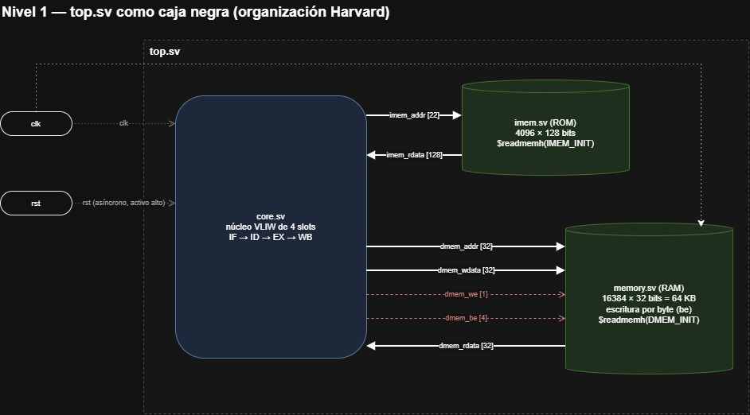

### 1.1 Interfaz externa de `top.sv`

El sistema completo (núcleo y memorias) se expone con solo dos señales. Las
memorias se inicializan con `$readmemh`.

| Puerto | Dir | Bits | Descripción |
|---|---|---|---|
| `clk` | in | 1 | Reloj del sistema |
| `rst` | in | 1 | Reset asíncrono, activo alto (§2.9) |

### 1.2 Organización de la memoria: Harvard

Memoria de instrucciones y memoria de datos físicamente separadas, cada una con
su propio bus.

**Justificación.** En cada ciclo, IF lee un bundle mientras la LSU, en EX, puede
acceder a un dato. Con una memoria unificada ambos accesos competirían por el
mismo puerto: un riesgo estructural en cada `lw`/`sw`, que habría que resolver
con un *stall*. Duplicar el recurso es la solución estructural por defecto de
todo procesador segmentado (notas §3.2.1) y elimina el riesgo sin costo de
desempeño.

| Memoria | Módulo | Equivale a | Ancho de lectura | Dirección | Escritura |
|---|---|---|---|---|---|
| Instrucciones | `imem.sv` | ROM | 128 bits (un bundle) | Índice de bundle | Nunca |
| Datos | `memory.sv` | RAM | 32 bits | Palabra (`addr[31:2]`) | Por byte, con máscara `be` |

Se usan dos módulos, y no uno solo parametrizado, porque cumplen funciones
distintas: forzar un puerto de escritura en la ROM solo para reutilizar código
no aporta nada. `memory.sv` conserva el nombre que exige el enunciado §7.2,
porque lo que el enunciado describe con ese nombre (64 KB, *little endian*,
inyección de archivos) es la memoria de datos.

### 1.3 Interfaces entre el núcleo y las memorias

**Núcleo ↔ `imem.sv`**

| Señal | Dir (desde el núcleo) | Bits | Nota |
|---|---|---|---|
| `imem_addr` | out | `PC_W` | Índice de bundle |
| `imem_rdata` | in | 128 | Bundle completo, lectura combinacional |

**Núcleo ↔ `memory.sv`**

| Señal | Dir (desde el núcleo) | Bits | Nota |
|---|---|---|---|
| `dmem_addr` | out | 32 | Dirección de byte; la memoria usa `addr[31:2]` |
| `dmem_wdata` | out | 32 | Dato ya acomodado en su carril de byte por la LSU |
| `dmem_we` | out | 1 | Habilitación de escritura |
| `dmem_be` | out | 4 | Máscara de bytes: `1111` en `sw`, un solo bit en `sb` |
| `dmem_rdata` | in | 32 | Palabra completa, lectura combinacional |

La memoria **no conoce bytes ni alineación**: la selección de byte y la
extensión de signo las hace la LSU (`isa.md` §5.4).

### 1.4 Parámetros

Exigidos por el enunciado §5.1 en lugar de constantes incrustadas.

| Parámetro | Valor por defecto | Descripción |
|---|---|---|
| `NUM_SLOTS` | 4 | Slots por bundle |
| `BUNDLE_W` | 128 | Ancho del bundle |
| `XLEN` | 32 | Ancho de registros y datos |
| `NUM_REGS` | 16 | Registros de propósito general |
| `PC_W` | 22 | Ancho del PC, igual al sumador de destino de `isa.md` §5.3 |
| `IMEM_DEPTH` | 4096 | Bundles en `imem.sv` (64 KB de instrucciones) |
| `DMEM_WORDS` | 16384 | Palabras en `memory.sv` (64 KB, el mínimo del enunciado) |

**Sobre `PC_W`.** El PC cuenta bundles, no bytes. 22 bits alcanzan para unos
4 millones de bundles. El direccionamiento de 32 bits de `isa.md` §2 aplica a la
memoria de datos.

### 1.5 Formatos de inicialización

Los enunciados exigen `$readmemh` para la memoria de instrucciones (CE 4301 §5.3)
y un `.mem` «o similar» con los bytes del archivo (§5.4), pero no fijan el ancho
de línea ni el orden. Estos formatos son el contrato entre el hardware y las
herramientas (ensamblador, carga y extracción).

**Programa para `imem.sv` (`.hex`): un bundle de 128 bits por línea**, con los
slots en el orden de `isa.md` §3 (slot 3 a la izquierda, slot 0 a la derecha).
La línea *n* es el bundle *n*, igual que el PC.

```
05D80000_00000000_00000000_054D0000     // bundle 0: lw r7,0(r6) en slot 3; add r5,r3,r4 en slot 0
00000000_00000000_00000000_00000000     // bundle 1: vacío
```

**Datos para `memory.sv` (`.mem`): una palabra de 32 bits por línea**, con marcas
`@` en unidades de palabra. Los bytes de un archivo se agrupan de 4 en 4 en orden
*little endian*, y la dirección inicial debe ser múltiplo de 4. Ejemplo: el texto
`Hola` cargado en `0x1000`:

```
@400          // 0x1000 / 4
616C6F48      // bytes 'H'(48) 'o'(6F) 'l'(6C) 'a'(61), el primero en el byte menos significativo
```

**Volcado de `memory.sv`**: lo genera el *testbench* al terminar la simulación con
`$writememh(archivo, <ruta>.u_memory.mem)`, **siempre la memoria completa y sin
rango** (M-07). El archivo tiene 16384 palabras de 32 bits, una por línea, en el
mismo orden *little endian* del `.mem`: la línea de datos *n* es la palabra de la
dirección `4·n`. Icarus no escribe marcas `@` en el volcado, solo líneas de
comentario `// …`, que se ignoran. `extract_data.py` ubica una dirección contando
líneas de datos desde 0.

```
// 0x00000000
00000000      // palabra 0, dirección 0x0000
...
616c6f48      // palabra 0x400, dirección 0x1000: 'H' 'o' 'l' 'a'
```

---

## 2. Nivel 2 — Organización del pipeline

### 2.1 Jerarquía de módulos

```
top.sv
├── imem.sv            ROM: 128 bits por lectura, índice de bundle
├── memory.sv          RAM: datos, 64 KB, escritura por byte
└── core.sv
    ├── fetch.sv       PC y multiplexor de siguiente PC
    ├── pipe_reg.sv    una instancia por slot en cada etapa (§3.13)
    ├── dispatch.sv    contiene alu_dec ×2, crypto_dec, bru_dec, lsu_dec
    ├── regfile.sv     16×32, 8 lecturas, 4 escrituras
    ├── bru.sv         actúa en ID
    ├── alu.sv ×2
    ├── crypto_unit.sv contiene key_vault.sv
    └── lsu.sv
```

La lista del enunciado §7.2 (`top, alu, lsu, bru, crypto_unit, key_vault,
dispatch, regfile, memory`) es la mínima. Se agregan `core`, `fetch`, `pipe_reg`
e `imem` para separar responsabilidades, como valora el enunciado §5.1.

### 2.2 Diagrama del pipeline

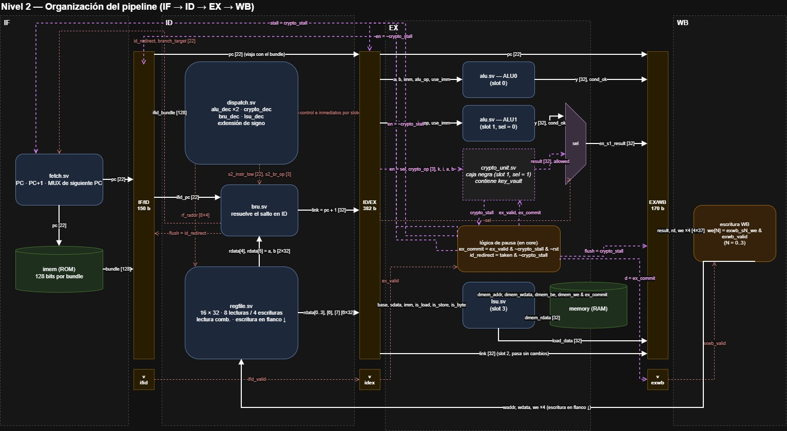

Los registros de segmentación miden 150 bits (IF/ID), 382 bits (ID/EX) y
170 bits (EX/WB); su contenido está en §2.6.

Cuatro etapas, `IF → ID → EX → WB`, sin etapa MEM: la memoria responde en el
mismo ciclo (`isa.md` §5.4, §9).

### 2.3 Qué ocurre en cada etapa

| Etapa | Trabajo |
|---|---|
| **IF** | Se presenta el PC a `imem`; se lee el bundle de 128 bits; se elige el siguiente PC (`PC + 1` o el destino de la BRU) |
| **ID** | `dispatch` separa los cuatro slots y los decodifica en paralelo; se leen los 8 operandos del `regfile`; se extiende el inmediato; **la BRU resuelve el salto** |
| **EX** | ALU0, ALU1 o CRYPTO, y LSU ejecutan en paralelo; la LSU accede a `memory`; el slot 2 solo transporta el valor de enlace |
| **WB** | Los cuatro slots escriben en el `regfile`, en el flanco de bajada |

### 2.4 Unidad de avance: el bundle

**Un PC por bundle, no por slot.** Los cuatro slots entran juntos a IF y viajan
juntos por el pipeline. `PC + 1` es el bundle siguiente, y no es posible saltar
a la mitad de un bundle.

Los cuatro slots **leen** juntos en ID y **escriben** juntos en WB, pero no se
**evalúan** en el mismo ciclo: la BRU decide en ID, y las demás unidades trabajan
un ciclo después, en EX.

**El PC viaja por los tres registros de segmentación** porque:
- la BRU necesita el PC del bundle que está en ID, no el que está en IF, para
  calcular `PC + off` y el enlace `PC + 1`;
- permite identificar en el `.vcd` qué bundle ocupa cada etapa, que es lo que
  demuestra el solapamiento exigido por el enunciado §5.1.

### 2.5 Decodificación

**En ID, con un decodificador independiente por unidad**, instanciados dentro de
`dispatch`.

| Decodificador | Slot | Produce |
|---|---|---|
| `alu_dec` (×2) | 0 y 1 | `alu_op`, `use_imm`, `we` |
| `crypto_dec` | 1 | `crypto_op`, `we` |
| `bru_dec` | 2 | `br_op`, `we` (solo `jas`/`jefR`) |
| `lsu_dec` | 3 | `is_load`, `is_store`, `is_byte` |

**Justificación.**
- Las notas de clase definen ID como la etapa donde «se decodifica la
  instrucción y se leen del banco de registros los operandos» (notas §3.1.2), y
  el enunciado §5.1 exige que decode/dispatch decodifique y despache en el mismo
  ciclo.
- El espacio de `funct` es independiente por unidad (`isa.md` §6): `00001` es
  `add`, `beq` o `lw` según el slot. Con un decodificador por unidad, cada tabla
  vive junto a su unidad y la diseña el mismo responsable.
- Los registros de segmentación llevan «la información de control que las
  etapas siguientes todavía necesitan» (notas §3.1.2): EX recibe control ya
  traducido y solo ejecuta.

**Las direcciones de lectura no requieren decodificación.** Como cada slot tiene
una unidad fija, la posición de los registros fuente también es fija:

| Slot | Puerto A del `regfile` | Puerto B del `regfile` |
|---|---|---|
| 0, 1 (ALU, CRYPTO) | bits 21..18 (`rs1`) | bits 17..14 (`rs2`) |
| 2 (BRU) | bits 21..18 (`rs1`) | bits 25..22 (`rs2` del formato B) |
| 3 (LSU) | bits 21..18 (`rs1`) | bits 25..22 (fuente de `sw`/`sb`) |

Si una instrucción no usa un puerto, este se lee de todos modos y el valor se
ignora: leer no tiene efecto.

**Valores inválidos** (`isa.md` §4.1):

| Caso | Comportamiento del hardware |
|---|---|
| `funct` sin instrucción asignada | El decodificador produce `we = 0` y ninguna acción: equivale a `nopi` |
| `sel = 1` en los slots 0, 2 o 3 | El bit no se conecta |
| Dos slots del mismo bundle con el mismo `rd` | Gana el slot de número mayor (§3.1); indefinido para el programador |

### 2.6 Registros de segmentación

**IF/ID — 150 bits**

| Campo | Bits | Origen |
|---|---|---|
| `bundle` | 128 | `imem_rdata` |
| `pc` | 22 | PC actual |

**ID/EX — 382 bits**

| Slot | Campos | Bits |
|---|---|---|
| 0 — ALU0 | `a`, `b`, `imm`, `alu_op`, `use_imm`, `rd`, `we` | 32+32+32+4+1+4+1 = 106 |
| 1 — ALU1/CRYPTO | `a`, `b`, `imm`, `alu_op`, `use_imm`, `sel`, `crypto_op`, `k`, `i`, `rd`, `we` | 32+32+32+4+1+1+3+2+2+4+1 = 114 |
| 2 — BRU | `link`, `rd`, `we` | 32+4+1 = 37 |
| 3 — LSU | `base`, `sdata`, `imm`, `is_load`, `is_store`, `is_byte`, `rd` | 32+32+32+1+1+1+4 = 103 |
| — | `pc` | 22 |
| | **Total** | **382** |

Notas:
- **`alu_op` es una codificación interna**, no el `funct`: `saddi` llega como
  suma, `xori` como XOR y `mov` como «pasar el inmediato». La ALU no repite
  casos. Son 14 operaciones en 4 bits.
- **El inmediato se extiende con signo a 32 bits en ID** (copia del bit 17), de
  modo que todo lo que llega a EX trabaja en 32 bits.
- **El multiplexor de segundo operando queda dentro de la ALU**, en EX, porque
  `isa.md` §5.2 lo lista como bloque interno de la ALU.
- **En el slot 1, `a` y `b` se comparten** entre ALU1 y CRYPTO: son los mismos
  dos puertos del `regfile` (`isa.md` §5.1).
- **En el slot 3, `we` es `is_load`**: `sw` y `sb` no escriben registro.
- **En el slot 2, `link = PC + 1`**, calculado en ID y extendido con ceros.

**EX/WB — 170 bits**

| Campo | Bits por slot | Total |
|---|---|---|
| `result` | 32 | 128 |
| `rd` | 4 | 16 |
| `we` | 1 | 4 |
| `pc` | — | 22 |
| | | **170** |

Origen de `result` y de `we` en cada slot:

| Slot | `result` | `we` final |
|---|---|---|
| 0 | Salida de ALU0 | `we AND cond_ok` de ALU0 (§3.3) |
| 1 | ALU1 o CRYPTO, según `sel` | `sel = 0`: `we AND cond_ok` de ALU1; `sel = 1`: `we AND allowed` de CRYPTO |
| 2 | `link`, sin cambios | `we` |
| 3 | Dato leído, con selección de byte y extensión de signo ya aplicadas | `is_load` |

### 2.7 Saltos

**La BRU resuelve en ID** (`isa.md` §5.3, §10; notas §3.2.3). Cuando el salto se
toma:

1. `branch_taken` y `branch_target` llegan a `fetch`, que carga el destino en el
   PC en el siguiente flanco de subida.
2. **La misma señal `branch_taken` vacía IF/ID** en ese flanco: el bundle que ya
   había entrado a IF se descarta.

**Se descarta el bundle siguiente, no el que contiene el salto.** Un bundle se
ejecuta siempre completo; el salto solo decide cuál bundle viene después
(`isa.md` §10).

**Traza.** El bundle 10 contiene `add r5, r3, r4` en el slot 0 y
`beq r6, r7, −2` (tomado) en el slot 2.

| Ciclo | IF | ID | EX | WB | Lo que ocurre |
|---|---|---|---|---|---|
| t | 11 | **10** | 9 | 8 | La BRU calcula `10 + (−2) = 8` y activa `branch_taken` |
| t+1 | 8 | ~~11~~ → vacío | **10** | 9 | El PC cargó 8; IF/ID se vació; el `add` del bundle 10 se ejecuta |
| t+2 | 9 | 8 | vacío | **10** | El `add` escribe `r5` |

**El vaciado sale gratis.** Vaciar IF/ID pone 128 bits en cero, que se
decodifican como `nopi` en los cuatro slots con `we = 0`. Ese bundle vacío
atraviesa ID/EX y EX/WB sin efecto. Por eso **solo IF/ID se vacía por un
salto**. EX/WB también tiene `flush`, pero solo para las burbujas de la pausa de
`auth` (§2.11).

### 2.8 CRYPTO

CRYPTO ocupa el slot 1 cuando `sel = 1`. Su interfaz con el pipeline está fija
(§3.10); su interior (bóveda, función F, Lamport, control de acceso) se
documenta en esa subsección.

- **Escritura condicionada.** El decodificador solo sabe que `feis` escribe; si
  hay permiso lo sabe CRYPTO, porque `AUTH` vive dentro de ella. El `we` final
  del slot 1 es `we AND allowed`, calculado en EX.
- **Latencia de 1 ciclo**, escritura en WB como todas las unidades, **salvo
  `auth`**: calcula el hash Ascon en 14 ciclos y congela el pipeline mientras
  tanto (§2.11).
- **La bóveda y el estado se escriben al final de EX**, no en WB (diseño de
  Saddy). El enunciado §4.1 describe WB como la etapa que escribe «cuando
  corresponda, en la bóveda de llaves», pero deja libertad en la organización.
  Se escribe en EX por la misma razón que la memoria de datos con un `sw`: la
  bóveda no es un registro de propósito general y no tiene que esperar a WB.
  Así, un `feis` en el bundle siguiente a un `kv_write` ya usa la palabra nueva,
  igual que un `lw` después de un `sw` (§2.10).
- **Aislamiento.** La bóveda, `ancla_otp` y el registro de estado son internos.
  Ningún puerto de salida los expone hacia el `regfile` ni hacia la memoria
  (`isa.md` §7.1).

### 2.9 Reset

**Asíncrono, activo alto** para los registros que se borran. El ancla OTP es la
excepción: conserva su valor durante el reset normal y se inicializa de forma
síncrona durante el arranque protegido.

**Justificación.** Es el patrón `flopr` ya usado y probado por el grupo, y
coincide con el «reset físico» de `isa.md` §7: una señal que actúa de inmediato,
sin depender del reloj.

| Elemento | Valor tras el reset |
|---|---|
| PC | 0 |
| IF/ID, ID/EX, EX/WB | Todo en cero: bundles de `nopi` con `we = 0` |
| Bits de validez (§2.11) | 0 |
| `regfile` | Todos los registros en cero |
| `imem`, `memory` | Sin cambio: los inicializa `$readmemh` |
| CRYPTO | Banderas, llaves y hash pendiente en cero; el ancla se conserva. Con `rst = 1` e `init_anchor = 1` en subida, carga `RESET_ANCHOR` (`isa.md` §7.2) |

Limpiar el `regfile` no lo exige `isa.md`, pero evita valores `X` en el `.vcd` y
hace reproducible toda simulación.

**Arranque protegido (`init_anchor`, M-08).** `init_anchor` no sale del reset
normal ni de una instrucción: lo genera `top` con un registro de encendido,
`por_done`. Este vale 0 al encender o configurar el sistema (se inicializa en la
declaración, como el valor de configuración de un registro en una FPGA) y pasa
a 1 en el primer flanco de subida con `rst = 1`:

```systemverilog
logic por_done = 1'b0;                         // valor al encender o configurar
always_ff @(posedge clk) if (rst) por_done <= 1'b1;
assign init_anchor = rst & ~por_done;          // solo en el primer reset
```

Así, el primer reset carga `RESET_ANCHOR` y los resets posteriores conservan el
ancla: un token consumido no vuelve a valer. `top` sigue exponiendo solo `clk` y
`rst` (§1.1), y los *testbenches* no cambian: basta con mantener `rst = 1` en el
primer flanco de subida, como ya hacen todos.

### 2.10 Riesgos

| Riesgo | Tratamiento | Responsable |
|---|---|---|
| Estructural de memoria | Eliminado por la organización Harvard | Hardware |
| Estructural de banco de registros | Eliminado: 8 puertos de lectura y 4 de escritura | Hardware |
| RAW entre registros | Separación de 1 bundle, por escritura y lectura en mitades opuestas del ciclo (§4.1) | Software |
| WAR, WAW entre bundles | No ocurren: el pipeline es en orden (notas §3.2.2) | — |
| WAW dentro de un bundle | Prohibido por `isa.md` §9.3 | Software |
| De control | Resolución en ID y vaciado de un bundle | Hardware |
| Estructural de CRYPTO (`auth` ocupa la unidad 14 ciclos) | Pausa de todo el pipeline (§2.11) | Hardware |

No hay *forwarding*, *scoreboarding* ni *stalls* por dependencia de datos
(enunciado §4.1; `isa.md` §1.1).

**Dependencias a través de memoria.** Un `sw` escribe al final de su EX, y un
`lw` del bundle siguiente lee la memoria en su propio EX, ya con el valor nuevo:
no hace falta separación (`isa.md` §9.4).

### 2.11 Pausa por `auth`

`auth` ocupa CRYPTO **14 ciclos en EX**: uno de carga, doce de ronda y uno de
finalización (diseño de Saddy, §3.10). Mientras tanto, el pipeline se congela.
Es la **única pausa** del procesador y es por riesgo estructural: el enunciado
§4.1 la permite si se documenta y justifica (`isa.md` §1.1, §9.2).

**Decisión (11 de octubre).** Se conserva Ascon y se respeta **tal cual el
contrato de la unidad de Saddy**, con sus tres señales y sus bits de validez. Así
su módulo se integra sin cambios.

**Señales**

| Señal | De → a | Ecuación |
|---|---|---|
| `crypto_stall` | `u_crypto` → `core` | Interna de CRYPTO: `auth_req AND NOT auth_done` |
| `ex_valid` | `u_idex_valid` → `u_crypto` | Bit de validez del bundle que está en EX |
| `ex_commit` | `core` → `u_crypto`, memoria y `u_exwb_valid` | `ex_valid & ~crypto_stall & ~rst` |

**Qué hace cada elemento con `crypto_stall = 1`**

| Elemento | Comportamiento | Implementación en `core` |
|---|---|---|
| PC | Se conserva | `u_fetch.stall = crypto_stall` |
| IF/ID | Se conserva | `en = ~crypto_stall` |
| ID/EX | Se conserva: los operandos del `auth` quedan estables durante el hash | `en = ~crypto_stall` |
| EX/WB | Recibe una burbuja | `flush = crypto_stall`; `u_exwb_valid` recibe `ex_commit` (0) |
| BRU en ID | No redirige el PC ni vacía IF/ID hasta reanudar | `id_redirect = id_branch_taken & ~crypto_stall`, hacia `fetch` y hacia el `flush` de IF/ID |
| Memoria de datos | No escribe; un `sw` del bundle del `auth` se aplica una sola vez | `dmem_we = lsu_dmem_we & ex_commit` |
| `regfile` | WB solo escribe bundles válidos | `we[N] = exwb_sN_we & exwb_valid` |
| CRYPTO | Avanza el hash; aplica banderas, ancla y bóveda solo con `ex_commit` | Interno (Saddy) |

**Bits de validez** (contrato de Saddy, §5 de su diseño). Tres instancias de
`pipe_reg` de 1 bit:

| Instancia | `d` | `en` | `flush` | Significado |
|---|---|---|---|---|
| `u_ifid_valid` | `1'b1` | `~crypto_stall` | `id_redirect` | IF/ID contiene un bundle buscado y no anulado |
| `u_idex_valid` (`ex_valid`) | `ifid_valid` | `~crypto_stall` | `0` | ID/EX contiene un bundle real |
| `u_exwb_valid` | `ex_commit` | `1` | `0` | El bundle en EX/WB terminó una sola vez |

Con la convención «cero = `nopi`» (§2.7), el `flush` de EX/WB ya basta para que
WB no escriba. `exwb_valid` es redundante, pero se mantiene para respetar el
contrato de la unidad de Saddy sin reinterpretarlo.

**Traza.** Bundle B con `auth` entra a EX en el ciclo `c`:

| Ciclo | IF | ID | EX | WB | `crypto_stall` | `ex_commit` |
|---|---|---|---|---|---|---|
| c | B+2 | B+1 | B | B−1 | 1 | 0 |
| c+1 … c+12 | B+2 | B+1 | B | burbuja | 1 | 0 |
| c+13 | B+2 | B+1 | B | burbuja | 0 | 1 |
| c+14 | B+3 | B+2 | B+1 | B | 0 | 1 |

Son 13 ciclos de pausa por cada `auth`.

**La regla de separación no cambia.** Durante la pausa, WB solo contiene
burbujas, así que el `regfile` no cambia y lo que lee el bundle B+1 en ID es lo
mismo que leería sin pausa. Por eso la pausa es transparente para el compilador.

**Temporización.** `crypto_stall` sale de registros internos de CRYPTO
(`busy`, `done`) y de ID/EX, al inicio del ciclo. Llega a las habilitaciones y al
multiplexor del PC sin pasar por la ruta crítica de ID (§4.7).

---

## 3. Nivel 3 — Interfaz de cada módulo

Convenciones comunes a todos los módulos:

- `rst` es asíncrono y activo alto; los módulos combinacionales no lo usan.
- La lógica combinacional asigna valores por defecto a todas sus salidas al
  inicio del bloque, para no inferir *latches*.
- Cada módulo tiene su *testbench* `tb_<módulo>.sv`, que genera `tb_<módulo>.vcd`.

Cada subsección fija la interfaz y documenta el **interior** del módulo: bloques,
tablas y decisiones.

### 3.1 `regfile.sv`

Banco de 16 registros de 32 bits, 8 puertos de lectura y 4 de escritura.

| Puerto | Dir | Bits | Descripción |
|---|---|---|---|
| `clk`, `rst` | in | 1 | |
| `raddr[0:7]` | in | 8 × 4 | Direcciones de lectura. El slot *s* usa los puertos `2s` (A) y `2s+1` (B) |
| `rdata[0:7]` | out | 8 × 32 | Lectura **combinacional** |
| `waddr[0:3]` | in | 4 × 4 | Dirección de escritura de cada slot |
| `wdata[0:3]` | in | 4 × 32 | Dato de cada slot |
| `we[0:3]` | in | 4 × 1 | Habilitación de cada slot |

Comportamiento:
- **Escritura en el flanco de bajada** (§4.1).
- `r0` (`rz`) siempre se lee como cero; las escrituras a él se descartan.
- Si dos slots escriben el mismo registro, gana el de número mayor.
- El reset pone los 16 registros en cero.

**Interior**

| Parámetro | Valor | Origen |
|---|---|---|
| `NUM_REGS` | 16 | `isa.md` §2 |
| `XLEN` | 32 | `isa.md` §2 |
| `NUM_SLOTS` | 4 | `isa.md` §3 |
| `NUM_RD` | `2 × NUM_SLOTS` = 8 | Dos operandos por slot (`isa.md` §5.1) |
| `NUM_WR` | `NUM_SLOTS` = 4 | Un resultado por slot |
| `AW` | `$clog2(NUM_REGS)` = 4 | Ancho de dirección |

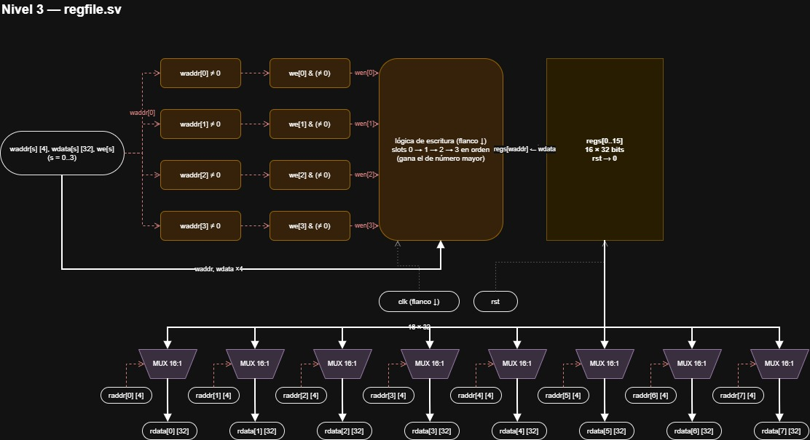

| Bloque | Función | Justificación |
|---|---|---|
| Arreglo `regs` | 16 registros de 32 bits | `isa.md` §8 |
| Lógica de escritura | Un solo bloque en el flanco de bajada que recorre los 4 puertos en orden y escribe si `we[s] = 1` y `waddr[s] ≠ 0` | Escribir en bajada da 1 bundle de separación (§4.1). Al recorrer en orden, la última asignación gana: el slot 3 tiene prioridad sin lógica adicional |
| Bloqueo de `r0` | La condición `waddr[s] ≠ 0` impide escribir `r0`; el reset lo deja en cero | Cuesta 4 comparadores (uno por escritura); forzar la lectura costaría 8 (uno por lectura) |
| 8 multiplexores de lectura | `rdata[p] = regs[raddr[p]]`, combinacional | 4 slots leen 2 operandos cada uno en el mismo ciclo (`isa.md` §5.1, §9.3) |

**Declaración de puertos.** Los puertos con varios elementos se declaran como
arreglos **empaquetados** (`logic [NUM_RD-1:0][AW-1:0] raddr`), no como arreglos
no empaquetados (`logic [AW-1:0] raddr [NUM_RD]`). Es el mismo circuito, pero
los arreglos no empaquetados como puertos de módulo tienen soporte incompleto en
algunas versiones de Icarus Verilog. Esto aplica también a `dispatch` y `core`.

**Simulación.** Como el `regfile` escribe en el flanco de bajada e ID/EX captura
en el de subida, nunca coinciden: no hay carreras entre bloques que dependan del
orden de evaluación del simulador. Los *testbenches* leen los registros por
jerarquía (`dut.u_core.u_regfile.regs[5]`); no hace falta un puerto de
depuración.

**Plan de verificación**

| Caso | Estímulo | Esperado |
|---|---|---|
| Reset | `rst = 1` | Los 16 registros en cero |
| Escritura simple | `we[0] = 1`, `waddr[0] = 5`, `wdata[0] = 0xCAFE` | Tras el flanco de bajada, `regs[5] = 0xCAFE` |
| `r0` | Escribir `0x1234` en `r0` | `rdata` del puerto que lee `r0` = 0 |
| 4 escrituras simultáneas | Los 4 slots a registros distintos | Las 4 quedan |
| Prioridad | Slots 1 y 3 al mismo registro | Queda el valor del slot 3 |
| `we = 0` | `waddr` y `wdata` válidos con `we = 0` | El registro no cambia |
| 8 lecturas simultáneas | 8 direcciones distintas | Cada `rdata` corresponde a su dirección |
| Misma dirección en varios puertos | Los 8 puertos leen `r7` | Los 8 entregan el mismo valor |
| Escritura y lectura en el mismo ciclo | Escribir `r9` y leer `r9` en el mismo ciclo | Antes del flanco de bajada: valor viejo; después: valor nuevo |
| Escritura en subida ignorada | Cambiar `we`/`wdata` y dar solo un flanco de subida | El registro no cambia hasta el flanco de bajada |

### 3.2 `alu_dec` (dentro de `dispatch`)

Traduce el `funct` de una instrucción de ALU a las señales de control de la ALU.
Combinacional.

| Puerto | Dir | Bits | Descripción |
|---|---|---|---|
| `funct` | in | 5 | Bits 30..26 de la instrucción |
| `alu_op` | out | 4 | Operación interna (tabla de §4.8) |
| `use_imm` | out | 1 | Segundo operando: `0` = `rs2`, `1` = inmediato |
| `we` | out | 1 | `1` en las 16 instrucciones válidas; `0` en `nopi` y en los `funct` libres |

**Interior.** Verificado con un modelo de referencia contra la tabla de `isa.md` §6.1.

Es una tabla de búsqueda: un `case` sobre `funct` sin estado. Cada instrucción
válida da su `alu_op` y `we = 1`. `nopi` y los `funct` libres dan `we = 0`, y con
eso el slot no tiene efecto aunque la ALU calcule algo.

```
use_imm = funct[4]      // en las 16 válidas: el bit alto separa R (0) de I (1)
we      = funct ∈ {00001..01101, 10000..10010}
alu_op  = tabla de §4.8
```

| Decisión | Razón |
|---|---|
| `alu_op` de 4 bits con 14 códigos | Las 16 instrucciones caben en 14 operaciones internas: `add`/`saddi` comparten la suma y `xor`/`xori` comparten el XOR; solo cambia `use_imm` |
| `use_imm = funct[4]` | `isa.md` §6.1 pone todas las de formato I en `1xxxx`. Así no hace falta otra columna en la tabla |
| `we = 0` en `nopi` y libres | Un `funct` sin asignar no debe escribir nada (convención §4.2) |

### 3.3 `alu.sv`

Combinacional. Dos instancias idénticas (slots 0 y 1).

| Puerto | Dir | Bits | Descripción |
|---|---|---|---|
| `a` | in | 32 | Valor de `rs1` |
| `b` | in | 32 | Valor de `rs2` |
| `imm` | in | 32 | Inmediato ya extendido con signo |
| `alu_op` | in | 4 | Operación |
| `use_imm` | in | 1 | Selecciona `imm` en lugar de `b` como segundo operando |
| `y` | out | 32 | Resultado |
| `cond_ok` | out | 1 | `0` solo en `ifmov` con `b == 0` (no debe escribir); `1` en todo lo demás |

Bloques internos según `isa.md` §5.2: sumador/restador, bloque lógico,
desplazador de barril (5 bits bajos del segundo operando), multiplexor de segundo
operando, multiplexor de resultado. Las comparaciones se derivan de la resta,
con signo y corregidas por desbordamiento.

**Por qué `cond_ok`.** `ifmov` deja `rd` sin cambio si `rs2 == 0`. El slot solo
tiene dos puertos de lectura (`rs1`, `rs2`), así que el valor previo de `rd` no
está disponible para reescribirlo: la única implementación posible es **no
escribir**. La condición depende de un dato, así que se calcula en EX.

**Interior.** Verificado con un modelo de referencia (21 de 21 casos del plan de
verificación).

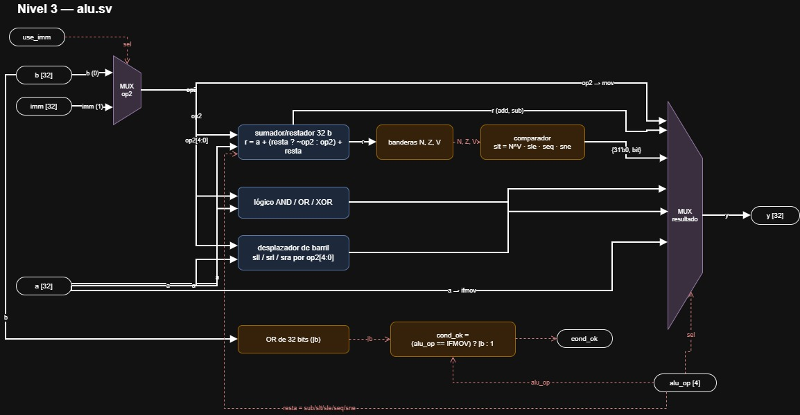

| Bloque | Qué hace | Por qué así |
|---|---|---|
| MUX de `op2` | `op2 = use_imm ? imm : b` | Un solo camino de datos para formato R e I |
| Sumador/restador | `r = a + (resta ? ~op2 : op2) + resta` | Un sumador sirve a `add`, `saddi`, `sub` y las 4 comparaciones. `resta = 1` en `sub`, `slt`, `sle`, `seq`, `sne` |
| Banderas | `N = r[31]`, `Z = (r == 0)`, `V = (a[31] == x[31]) & (r[31] != a[31])`, con `x` el segundo sumando ya invertido | Necesarias para comparar con signo |
| Comparador | `slt = N XOR V`, `sle = slt OR Z`, `seq = Z`, `sne = ~Z`; resultado `{31'b0, bit}` | `N` solo falla con desbordamiento; `N ^ V` corrige (p. ej. `0x7FFFFFFF < 0x80000000` da 0) |
| Lógico | AND, OR y XOR de `a` con `op2` | Directo |
| Desplazador de barril | `a << sh`, `a >> sh`, `$signed(a) >>> sh`, con `sh = op2[4:0]` | En hardware son 5 niveles de MUX (1, 2, 4, 8, 16). Solo se usan los 5 bits bajos (C-03) |
| MUX de resultado | Elige según `alu_op` | `ifmov` saca `a`; `mov` saca `op2` (ignora `rs1`) |
| `cond_ok` | `cond_ok = (alu_op == ifmov) ? (b != 0) : 1` | Ver arriba. Usa `b` (rs2), nunca `imm` |

El `we` final del slot se calcula en EX como `we & cond_ok` (§3.14).

**Plan de verificación** (`tb_alu`):

| Caso | Entrada | Esperado |
|---|---|---|
| Suma con desbordamiento | `add 0x7FFFFFFF, 1` | `0x80000000` |
| Resta negativa | `sub 0, 1` | `0xFFFFFFFF` |
| `slt` con desbordamiento | `slt 0x7FFFFFFF, 0x80000000` | `0` |
| `slt` con desbordamiento | `slt 0x80000000, 0x7FFFFFFF` | `1` |
| `slt` negativo | `slt -1, 0` | `1` |
| Iguales | `slt 5,5` / `sle 5,5` | `0` / `1` |
| `seq` / `sne` | `7, 7` | `1` / `0` |
| `sra` / `srl` | `0x80000000, 4` | `0xF8000000` / `0x08000000` |
| Solo 5 bits | `sll 1, 33` | `2` |
| Lógicas | `and 0xF0F0,0xFF00` / `or 0xF0,0x0F` / `xor 0xFF,0x0F` | `0xF000` / `0xFF` / `0xF0` |
| Inmediato | `xori 0xFF, 0x0F` / `saddi 5, -1` | `0xF0` / `4` |
| `mov` | `rs1 = 123`, `imm = 0xABC` | `0xABC` |
| `ifmov` | `a = 0xDEAD`, `b = 0` / `b = 5` | `y = 0xDEAD`, `cond_ok = 0` / `1` |
| `cond_ok` fuera de `ifmov` | `add` con `b = 0` | `cond_ok = 1` |

### 3.4 `lsu_dec` (dentro de `dispatch`)

| Puerto | Dir | Bits | Descripción |
|---|---|---|---|
| `funct` | in | 5 | Bits 30..26 |
| `is_load` | out | 1 | `lw`, `lb` |
| `is_store` | out | 1 | `sw`, `sb` |
| `is_byte` | out | 1 | `lb`, `sb` |

Un `funct` libre o `nopi` produce las tres salidas en cero.

**Interior** — diseño de Gabriel, integrado y verificado el 11 de octubre.

Cuatro comparadores de igualdad de 5 bits (uno por instrucción) y tres compuertas
OR. Sin estado.

```
is_load  = (funct == 00001) | (funct == 00011)     // lw, lb
is_store = (funct == 00010) | (funct == 00100)     // sw, sb
is_byte  = (funct == 00011) | (funct == 00100)     // lb, sb
```

`is_load` e `is_store` nunca valen 1 a la vez. La tabla completa está en §4.8.

### 3.5 `lsu.sv`

Combinacional.

| Puerto | Dir | Bits | Descripción |
|---|---|---|---|
| `base` | in | 32 | Valor de `rs1` |
| `sdata` | in | 32 | Valor de la fuente de `sw`/`sb` (campo 25..22) |
| `imm` | in | 32 | Desplazamiento ya extendido con signo |
| `is_load`, `is_store`, `is_byte` | in | 1 + 1 + 1 | Control |
| `dmem_addr` | out | 32 | `base + imm` |
| `dmem_wdata` | out | 32 | `sw`: `sdata`; `sb`: byte bajo de `sdata` copiado en el carril de `addr[1:0]` |
| `dmem_we` | out | 1 | `is_store` |
| `dmem_be` | out | 4 | `sw`: `1111`; `sb`: un bit según `addr[1:0]`; carga: `0000` |
| `dmem_rdata` | in | 32 | Palabra leída |
| `load_data` | out | 32 | `lw`: la palabra; `lb`: el byte de `addr[1:0]` con extensión de signo |

En `lw`/`sw` se ignoran `addr[1:0]` (`isa.md` §5.4).

**Interior** — diseño de Gabriel, integrado y verificado el 11 de octubre.

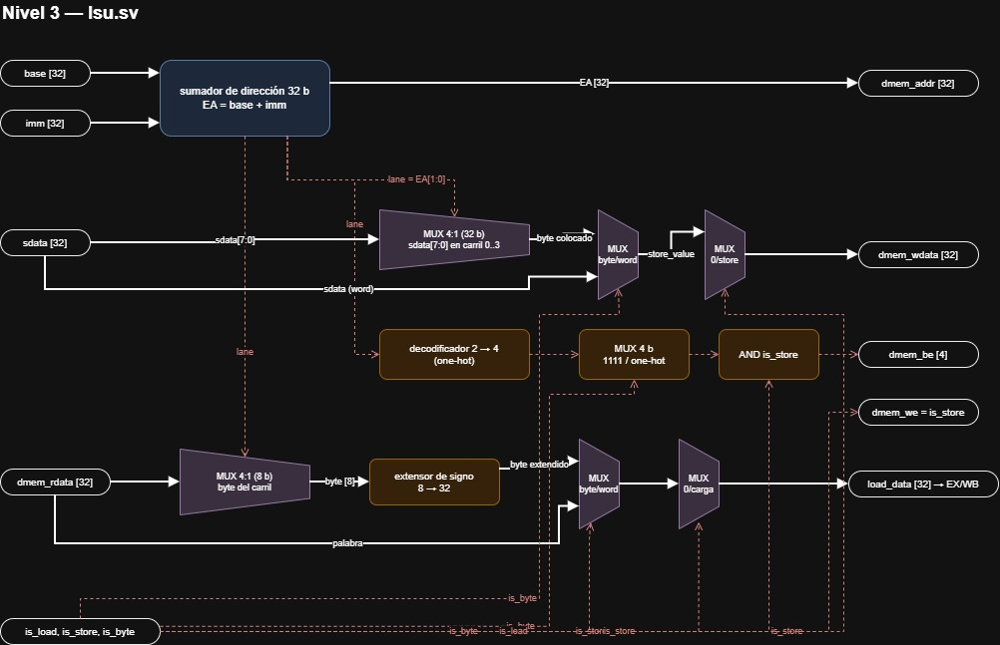

Línea continua = dato; línea discontinua = control.

| Bloque | Función | Justificación |
|---|---|---|
| Sumador de dirección | `EA = base + imm`, 32 bits, acarreo descartado | Un único modo de direccionamiento (`isa.md` §5.4). El inmediato ya viene extendido desde ID |
| Selección de carril | `lane = EA[1:0]` | Posición del byte dentro de la palabra; la dirección completa sale igual por `dmem_addr` |
| Colocador de store | MUX 4:1 entre `sdata[7:0]` en cada carril, con ceros en el resto | No hace falta un desplazador general |
| MUX de dato de store | `sb`: byte colocado; `sw`: `sdata` completo | — |
| Habilitación de dato | `dmem_wdata = 0` si no hay store | Salida determinista; sin efecto arquitectónico porque `we = 0` |
| Decodificador 2→4 y máscara | `sw`: `1111`; `sb`: un solo bit; sin store: `0000` | Escribir solo un byte preserva los otros tres (`isa.md` §5.4) |
| Selector de carga | MUX 4:1 de 8 bits según `lane` | Orden *little endian* |
| Extensor de signo | Replica el bit 7 en los 24 bits altos | `lb` es con signo (`isa.md` §6.3); extender con ceros sería otra instrucción |
| MUX de resultado | `lb`: byte extendido; `lw`: palabra; sin carga: 0 | Dos MUX 2:1 en cascada |

**Ecuaciones**

```
EA          = (base + imm) mod 2^32
lane        = EA[1:0]
dmem_addr   = EA
placed      = lane=0: {24'b0, sdata[7:0]}          lane=1: {16'b0, sdata[7:0], 8'b0}
              lane=2: {8'b0, sdata[7:0], 16'b0}    lane=3: {sdata[7:0], 24'b0}
store_value = is_byte ? placed : sdata
dmem_wdata  = is_store ? store_value : 0
dmem_we     = is_store
dmem_be     = {4{is_store}} & (is_byte ? (4'b0001 << lane) : 4'b1111)
byte_value  = dmem_rdata[8*lane+7 : 8*lane]
signed_byte = {{24{byte_value[7]}}, byte_value}
load_data   = is_load ? (is_byte ? signed_byte : dmem_rdata) : 0
```

| `lane` | Byte leído | `be` en `sb` | `wdata` con `sdata[7:0] = AA` |
|---|---|---|---|
| `00` | `[7:0]` | `0001` | `000000AA` |
| `01` | `[15:8]` | `0010` | `0000AA00` |
| `10` | `[23:16]` | `0100` | `00AA0000` |
| `11` | `[31:24]` | `1000` | `AA000000` |

**Alineación.** En `lw` y `sw`, la LSU entrega la dirección completa y la memoria
descarta `[1:0]`: un `lw` en `0x1002` entrega la palabra de `0x1000`. No hay
excepción de alineación ni acceso que combine dos palabras. Tampoco hay
verificación de rango: la memoria ignora los bits altos (§3.6).

**Ejemplo.** `lb r7, 2(r6)` con `r6 = 0x1000` y la palabra `0x7F80FF01` en
memoria: `EA = 0x1002`, carril 2 = `0x80`, `load_data = 0xFFFFFF80`. Un
`sb` en la misma dirección con `sdata = 0x123456AA` produce `wdata = 0x00AA0000`,
`be = 0100`, y la palabra pasa a `0x7FAAFF01`: los otros tres bytes no cambian.

**Plan de verificación** (las ecuaciones de arriba se modelaron y pasan todos los casos)

| Caso | Esperado |
|---|---|
| `lw` con `base = 0x1000`, `imm = 2` | `dmem_addr = 0x1002`; `load_data` = palabra completa |
| `sw` con `sdata = 0x12345678` | `wdata = 0x12345678`, `we = 1`, `be = 1111` |
| `sb` en los carriles 0, 1, 2 y 3, `sdata = 0x123456AA` | `be` = `0001`, `0010`, `0100`, `1000`; `wdata` = `AA` en ese carril |
| `lb` del carril 2 de `0x7F80FF01` (`0x80`) | `0xFFFFFF80` |
| `lb` del carril 3 de `0x7F80FF01` (`0x7F`) | `0x0000007F` |
| `lb` en cada carril | El byte correcto |
| `base = 0x1004`, `imm = −4` | `dmem_addr = 0x1000` |
| `lw` y `lb` | `dmem_we = 0`, `dmem_be = 0000` |
| Sin carga ni almacenamiento | `dmem_we = 0`, `dmem_be = 0000`, `wdata = 0`, `load_data = 0` |
| `sb` sobre `0x7F80FF01` en el carril 2 (con `memory`) | La palabra queda `0x7FAAFF01` |

### 3.6 `memory.sv`

| Parámetro | Defecto | Descripción |
|---|---|---|
| `DEPTH_WORDS` | 16384 | Palabras de 32 bits (64 KB) |
| `INIT_FILE` | `""` | Archivo `.mem` (§1.5); vacío = sin inicializar |

| Puerto | Dir | Bits | Descripción |
|---|---|---|---|
| `clk` | in | 1 | |
| `addr` | in | 32 | Dirección de byte; usa `addr[log2(DEPTH_WORDS)+1 : 2]` |
| `wdata` | in | 32 | |
| `we` | in | 1 | |
| `be` | in | 4 | Escribe solo los bytes con su bit en 1 |
| `rdata` | out | 32 | Lectura combinacional |

- Escritura en el **flanco de subida** (al final de la etapa EX).
- Sin reset de contenido. Al inicio, todas las palabras en cero y luego
  `$readmemh(INIT_FILE)` si se indicó.
- Los bits de dirección por encima del tamaño se ignoran.

**Interior**

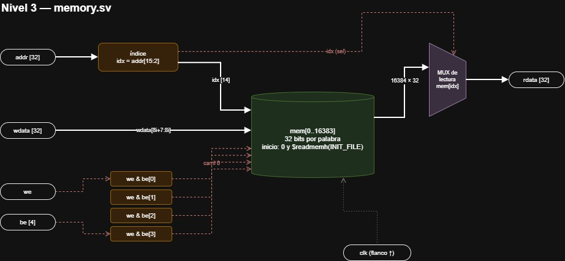

| Bloque | Función | Justificación |
|---|---|---|
| Arreglo de palabras | `mem[0 : DEPTH_WORDS−1]`, 32 bits cada una | Coincide con el `.mem` de §1.5 (una palabra por línea) y entrega `lw` en un solo acceso. Un arreglo de bytes obligaría a juntar 4 lecturas |
| Índice | `idx = addr[AW+1 : 2]`, `AW = log2(DEPTH_WORDS)` | Descarta `addr[1:0]` (selección de byte, la hace la LSU) y los bits altos |
| Lectura | `rdata = mem[idx]`, combinacional | No hay etapa MEM: `lw` lee y entrega dentro de EX (`isa.md` §5.4, latencia de un ciclo) |
| Escritura por carril | En el flanco de subida, si `we & be[i]`: `mem[idx][8i+7 : 8i] ← wdata[8i+7 : 8i]` | `sb` cambia un solo byte y conserva los otros tres. *Little endian*: el carril 0 es la dirección `4·idx` |
| Inicialización | Todas las palabras en 0 y luego `$readmemh(INIT_FILE, mem)` si se indicó | Sin valores `X` en la simulación; el archivo de `load_file` entra por aquí |
| Sin reset | `rst` no borra el contenido | Una RAM real no se borra con el reset, y así el archivo cargado sobrevive a un reset del núcleo |

```systemverilog
localparam int AW = $clog2(DEPTH_WORDS);
logic [31:0]   mem [0:DEPTH_WORDS-1];
logic [AW-1:0] idx;

assign idx   = addr[AW+1:2];          // palabra: se ignoran addr[1:0] y los bits altos
assign rdata = mem[idx];              // lectura combinacional

always_ff @(posedge clk)              // escritura al final de EX
  if (we)
    for (int i = 0; i < 4; i++)
      if (be[i]) mem[idx][8*i +: 8] <= wdata[8*i +: 8];

initial begin
  for (int i = 0; i < DEPTH_WORDS; i++) mem[i] = '0;
  if (INIT_FILE != "") $readmemh(INIT_FILE, mem);
end
```

**Consecuencias.**
- `DEPTH_WORDS` debe ser potencia de 2, para que el índice sean bits directos de
  la dirección.
- Una dirección de 64 KB o más se refleja sobre la memoria (`0x12000` lee lo
  mismo que `0x2000`). No hay excepción de rango; el mapa de memoria del
  compilador mantiene los datos dentro de 0x0000–0xFFFF.
- Un `sw` seguido de un `lw` a la misma dirección en el bundle siguiente lee el
  valor nuevo: la escritura ocurre en el flanco que separa los dos EX
  (`isa.md` §9.4).

**Plan de verificación** (con un modelo de referencia, todos los casos pasan)

| Caso | Esperado |
|---|---|
| `.mem` con `@400` y `616C6F48` | Los bytes de `0x1000` a `0x1003` son `H`, `o`, `l`, `a` |
| `sw` de `0x12345678` en `0x2000` | La palabra es `0x12345678` |
| `sb` con `be = 0100`, `wdata = 0x00AA0000` | La palabra pasa a `0x12AA5678`; los otros bytes no cambian |
| `we = 0` con `be = 1111` | Nada cambia |
| `we = 1` con `be = 0000` | Nada cambia |
| Lectura en `0x2002` | La palabra de `0x2000` |
| Lectura en `0x12000` | La palabra de `0x2000` |
| Escritura y lectura en el mismo ciclo | Antes del flanco, el valor viejo; después, el nuevo |
| Volcado completo con `$writememh` | La línea de datos `0x400` es `616c6f48`; se vuelve a leer con `$readmemh` (§1.5, M-07) |

### 3.7 `imem.sv`

| Parámetro | Defecto | Descripción |
|---|---|---|
| `DEPTH` | 4096 | Bundles |
| `INIT_FILE` | `""` | Archivo `.hex` (§1.5) |

| Puerto | Dir | Bits | Descripción |
|---|---|---|---|
| `addr` | in | `PC_W` | Índice de bundle |
| `rdata` | out | 128 | Lectura combinacional |

Al inicio, todas las posiciones en cero y luego `$readmemh(INIT_FILE)`. Así,
leer más allá del programa entrega bundles de `nopi`, no valores `X`.

**Direcciones fuera de rango.** Si `addr ≥ DEPTH`, la salida es cero (un bundle
de `nopi`); la dirección **no** se recorta a sus bits bajos. El programa no
tiene instrucción de fin y el PC sigue avanzando: si la dirección se recortara,
al llegar a `DEPTH` el PC volvería al bundle 0 y el programa se ejecutaría de
nuevo sin aviso. Con salida en cero, al terminar el programa el procesador queda
ejecutando `nopi` indefinidamente.

**Interior**

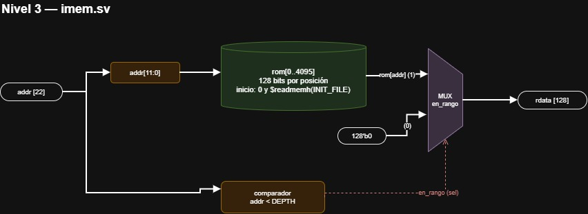

| Bloque | Función | Justificación |
|---|---|---|
| Arreglo ROM | `rom[0 : DEPTH−1]`, 128 bits cada posición | Un bundle por posición, igual que una línea del `.hex` (§1.5); la línea *n* es el PC *n* |
| Comparador de rango | `en_rango = (addr < DEPTH)` | Evita que el PC dé la vuelta al bundle 0 (ver arriba) |
| MUX de salida | `rdata = en_rango ? rom[addr] : 0` | Fuera de rango entrega un bundle de `nopi` |
| Inicialización | Todas en 0 y luego `$readmemh(INIT_FILE, rom)` | Las posiciones que el programa no ocupa son `nopi`. `$readmemh` acepta los `_` y los comentarios `//` del `.hex` |
| Sin reloj ni escritura | Puramente combinacional | Es una ROM: nada la escribe durante la ejecución |

```systemverilog
localparam int IW = $clog2(DEPTH);
logic [127:0] rom [0:DEPTH-1];

assign rdata = (addr < DEPTH) ? rom[addr[IW-1:0]] : '0;   // fuera de rango: nopi

initial begin
  for (int i = 0; i < DEPTH; i++) rom[i] = '0;
  if (INIT_FILE != "") $readmemh(INIT_FILE, rom);
end
```

**Plan de verificación** (con un modelo de referencia, todos los casos pasan)

| Caso | Esperado |
|---|---|
| Programa de `isa.md` §11 | `rdata` en 0, 1 y 2 igual a las tres líneas del `.hex` |
| Posición sin programa | 0 |
| `addr = DEPTH − 1` | La última posición |
| `addr = DEPTH` | 0, no el bundle 0 |
| `addr` máximo (`2^PC_W − 1`) | 0 |
| `.hex` con `_` y comentarios `//` | Se carga igual que sin ellos |

### 3.8 `bru_dec` (dentro de `dispatch`)

| Puerto | Dir | Bits | Descripción |
|---|---|---|---|
| `funct` | in | 5 | Bits 30..26 |
| `br_op` | out | 3 | Ninguno (`3'b000`, obligatorio), `beq`, `bne`, `blt`, `bge`, `jef`, `jas`, `jefR` (tabla de §4.8) |
| `we` | out | 1 | `1` solo en `jas` y `jefR` |

**Interior** — diseño de Gabriel, integrado y verificado el 11 de octubre.

Siete comparadores de igualdad de 5 bits (uno por instrucción) y cuatro redes OR.
Como las igualdades son excluyentes, no hay prioridad. Un código sin
coincidencia produce `br_op = 000` (ningún salto, §4.2) y `we = 0`.

```
br_op[0] = beq | blt | jef | jefR
br_op[1] = bne | blt | jas | jefR
br_op[2] = bge | jef | jas | jefR
we       = jas | jefR
```

`br_op` es una codificación interna, no el `funct`: cambiarla solo exige mantener
sincronizados `bru_dec` y `bru`. La tabla completa está en §4.8.

### 3.9 `bru.sv`

Combinacional; actúa en ID.

| Puerto | Dir | Bits | Descripción |
|---|---|---|---|
| `pc` | in | `PC_W` | PC del bundle en ID (de IF/ID) |
| `a` | in | 32 | Valor de `rs1` |
| `b` | in | 32 | Valor de `rs2` |
| `instr_low` | in | 22 | Bits 21..0 de la instrucción: `off` = bits 17..0, `target` = bits 21..0 |
| `br_op` | in | 3 | |
| `taken` | out | 1 | El salto se toma |
| `target` | out | `PC_W` | `pc + off`, `pc + target` o `a[21:0]` |
| `link` | out | 32 | `pc + 1`, extendido con ceros |

Comparación **con signo** en `blt` y `bge` (`isa.md` §6.2). Bloques según
`isa.md` §5.3.

**Interior** — diseño de Gabriel, integrado y verificado el 11 de octubre.

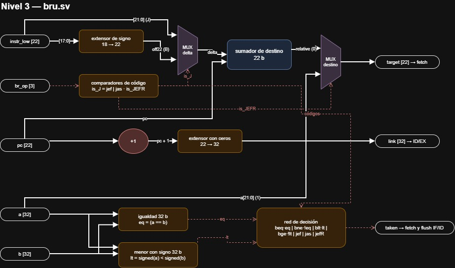

| Bloque | Función | Justificación |
|---|---|---|
| Comparadores de código | Siete indicadores a partir de `br_op`; `is_J = jef OR jas` | — |
| Extensor del desplazamiento | `off22 = {{4{instr_low[17]}}, instr_low[17:0]}` | Sin signo, −2 sería un salto enorme hacia adelante |
| MUX de desplazamiento | Formato B: `off22`; formato J: `instr_low[21:0]` | El campo J ya tiene los 22 bits del sumador |
| Sumador de destino | `pc + delta`, 22 bits, módulo 2²² | Uno solo para B, `jef` y `jas`: hay un salto por bundle (`isa.md` §5.3) |
| MUX de destino | `jefR`: `a[21:0]`; los demás: suma relativa | `jefR` es absoluto (C-06) |
| Incrementador | `pc + 1` | Separado del sumador: `jas` necesita destino y enlace a la vez |
| Extensor con ceros | `link = {10'b0, pc + 1}` | El PC es un índice sin signo |
| Comparador de igualdad | `eq = (a == b)` | Sirve a `beq` y, negado, a `bne` |
| Comparador menor con signo | `lt = signed(a) < signed(b)` | Sirve a `blt` y, negado, a `bge` (C-04). Propio de la BRU, no compartido con la ALU (`isa.md` §5.3) |
| Red de decisión | Elige la condición según la operación | Los incondicionales siempre se toman; `BR_NONE` nunca |

**Ecuaciones**

```
off22    = {{4{instr_low[17]}}, instr_low[17:0]}
delta    = (jef | jas) ? instr_low[21:0] : off22
relative = (pc + delta) mod 2^22
target   = jefR ? a[21:0] : relative
link     = {10'b0, (pc + 1) mod 2^22}
eq       = (a == b)
lt       = $signed(a) < $signed(b)
taken    = (beq & eq) | (bne & !eq) | (blt & lt) | (bge & !lt) | jef | jas | jefR
```

**Comparación con signo.** No se deduce del bit de signo de `a − b`, porque el
desbordamiento puede invertirlo. Una realización válida: si los signos difieren,
`lt = a[31]`; si son iguales, comparación de magnitud sin signo.

**Las sumas usan el PC del bundle en ID, sin `+1` adicional**, y el desplazamiento
no se multiplica: cada unidad es un bundle (`isa.md` §6.2). `target` y `link` se
calculan siempre, también en `nopi`; no tienen efecto porque `taken = 0` y
`we = 0`. Con `rd = rz` en `jas`/`jefR`, el salto se toma igual y el enlace se
descarta.

| Operación | `taken` | Destino | Escribe enlace |
|---|---|---|---|
| ninguna | 0 | — | No |
| `beq` / `bne` | `eq` / `!eq` | `pc + off22` | No |
| `blt` / `bge` | `lt` / `!lt` | `pc + off22` | No |
| `jef` | 1 | `pc + target` | No |
| `jas` | 1 | `pc + target` | Sí, en `rd` |
| `jefR` | 1 | `a[21:0]` | Sí, en `rd` |

**Plan de verificación** (las ecuaciones de arriba se modelaron y pasan todos los casos)

| Caso | Esperado |
|---|---|
| `blt`, `a = −3`, `b = 5`, `pc = 10`, `off = −2` | `taken = 1`, `target = 8`, `link = 11` |
| `bge`, `a = −1`, `b = 1` | `taken = 0` |
| `beq`, `a = b = 7`, `pc = 10`, `off = +5` | `taken = 1`, `target = 15` |
| `bne`, `a = b` | `taken = 0` |
| `beq`, `bne`, `blt`, `bge` con su condición falsa | `taken = 0` |
| `jef`, `pc = 100`, `target = −40` | `taken = 1`, `target = 60` |
| `jas`, `pc = 100`, `target = +40` | `taken = 1`, `target = 140`, `link = 101` |
| `jefR`, `a = 0x00400065` | `taken = 1`, `target = 0x65` |
| `br_op = 000` | `taken = 0` |
| `bru_dec` con cada `funct` válido | El `br_op` y el `we` de la tabla de §4.8 |
| `bru_dec` con los 24 `funct` libres | `br_op = 000`, `we = 0` |

**Temporización.** La ruta de decisión (lectura del `regfile` → comparador →
decisión → PC y vaciado de IF/ID) es la ruta crítica del diseño: cuando el
operando se escribió en ese mismo ciclo, dispone de medio ciclo (§4.7).

### 3.10 `crypto_dec` y `crypto_unit.sv`

**`crypto_dec`** (dentro de `dispatch`)

| Puerto | Dir | Bits | Descripción |
|---|---|---|---|
| `funct` | in | 5 | Bits 30..26 |
| `crypto_op` | out | 3 | Ninguna (`3'b000`, obligatorio), `feis`, `auth`, `logout`, `kv_write`, `kv_lock`, `sanc` (tabla de §4.8) |
| `we` | out | 1 | `1` solo en `feis` |

**`crypto_unit.sv`** — opera en EX; contiene `key_vault.sv`.

| Puerto | Dir | Bits | Descripción |
|---|---|---|---|
| `clk`, `rst` | in | 1 | Reset normal: borra banderas, bóveda y hash; conserva el ancla (`isa.md` §7.2) |
| `init_anchor` | in | 1 | Entrada de arranque/configuración protegida. Con `rst = 1`, carga `RESET_ANCHOR` en subida de reloj; en reset normal vale 0 |
| `en` | in | 1 | `sel` del slot 1 en ID/EX |
| `crypto_op` | in | 3 | |
| `k`, `i` | in | 2 + 2 | Directos de la instrucción |
| `a`, `b` | in | 32 + 32 | Compartidos con ALU1 |
| `ex_valid` | in | 1 | ID/EX contiene un bundle válido (§2.11) |
| `ex_commit` | in | 1 | Permite aplicar los efectos del bundle una sola vez (§2.11) |
| `result` | out | 32 | Valor para `rd` (solo `feis` permitida; cero en lo demás) |
| `allowed` | out | 1 | La operación tenía el privilegio requerido (`isa.md` §6.4) |
| `crypto_stall` | out | 1 | Pide congelar el pipeline mientras `auth` no termina (§2.11) |

Cuándo cambia el estado interno:

- **Instrucciones.** Sus efectos sobre `AUTH`, `KVLOCK`, `EXC`, el ancla y las
  llaves se aplican en el flanco de subida, solo con `ex_commit = 1`. Sin
  efecto, el control realimenta los valores actuales.
- **Reset normal.** Limpia banderas, bóveda y motor de hash, sin depender de
  `ex_commit`. El ancla conserva su valor.
- **Arranque protegido.** Con `rst = 1` e `init_anchor = 1`, el ancla carga
  `RESET_ANCHOR` en el flanco de subida.
- **Hash.** Sus registros avanzan durante la espera aunque `ex_commit = 0`.

No hay puertos que expongan el estado al programa; los *testbenches* lo observan
por jerarquía.

**Interior** — diseño de CRYPTO de Saddy, implementado y validado como subsistema el 12 de octubre. La integración
con `core` y `dispatch` sigue pendiente de Luis. Resumen:


| Bloque | Función |
|---|---|
| `crypto_control` | Permisos, arranque y aceptación del hash, `crypto_stall` y estado siguiente. Combinacional |
| `crypto_datapath` | Ronda Feistel (F y XOR), motor `auth_hash32` y comparador OTP |
| `auth_hash32` | Ascon-Hash256 de una ronda por ciclo: estado de 320 bits, contador de rondas 0..11. Entrada `{32'h1, token}`, salida `s0[31:0]` |
| `crypto_state` | `AUTH`, `KVLOCK`, `EXC` y ancla (35 bits). Reset normal conserva el ancla; arranque con `init_anchor` carga `RESET_ANCHOR` |
| `key_vault` | 4 × 4 palabras de 32 bits; lectura combinacional por `k`, `i`; se borra con reset |

Ecuaciones de interfaz clave (de su diseño):

```
crypto_stall = auth_req AND NOT auth_done
auth_accept  = auth_req AND auth_done AND ex_commit
write_en     = activo AND es_write AND allowed AND ex_commit
activo       = en AND ex_valid AND NOT rst
```

Diagramas de nivel 3 (de su diseño):


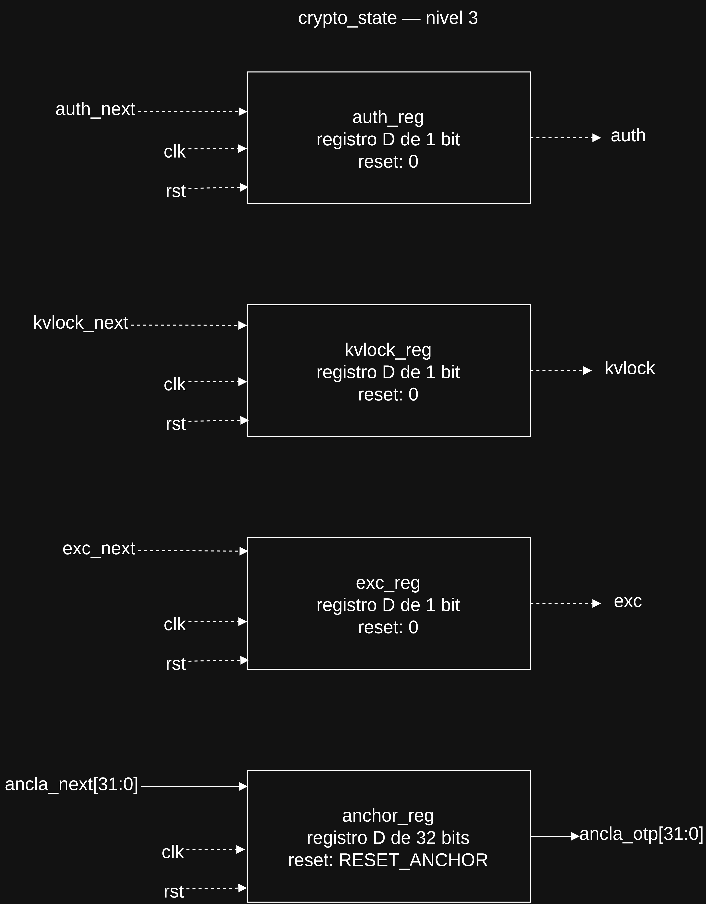


**Cadena de demostración validada:** `tools/lamport.py`, semilla `0xCAFEDECE`,
100 tokens; `RESET_ANCHOR = 32'hFEFF95FF` (x100). Primer token x99:
`0xF47BD70B`; segundo x98: `0xA45326BA`. Los archivos están en
`data/lamport_demo/`. H se contrastó con ocho vectores de la referencia C de
Ascon, incluido su KAT de cuatro bytes, y los cien eslabones coinciden con
la referencia C y el RTL. `tb_crypto_unit` verifica tokens sucesivos, rechazo
de reutilización y conservación del ancla tras reset normal.

El arranque mantiene `rst = 1` e `init_anchor = 1` durante al menos una
subida y desactiva `init_anchor` antes de liberar `rst`. `core` lleva esta
señal hasta `u_crypto` (§3.14); no puede derivarse del reset normal, porque
restauraría tokens consumidos. La conservación del ancla no sobrevive a
pérdida de alimentación o reconfiguración de la FPGA.

La tabla de `crypto_dec` está en §4.8.

### 3.11 `dispatch.sv`

Combinacional. Separa el bundle en cuatro instrucciones, instancia los
decodificadores (§3.2, §3.4, §3.8, §3.10), genera las 8 direcciones de lectura
del `regfile` (§2.5) y extiende con signo los inmediatos de los slots 0, 1 y 3.
Entrega los campos de control de ID/EX (§2.6).

**`dispatch` solo decodifica: no lee el `regfile`.** Entrega las 8 direcciones
de lectura; los datos leídos van del `regfile` directo a ID/EX, cableados en
`core`. Así `dispatch` es puramente combinacional y se prueba sin reloj. Además,
el `regfile` no puede vivir dentro de `dispatch`, porque también lo escribe WB.

| Puerto | Dir | Bits | Descripción |
|---|---|---|---|
| `bundle` | in | 128 | De IF/ID |
| `rf_raddr` | out | 8 × 4 | Direcciones de lectura (§2.5) |
| `s0_imm`, `s0_alu_op`, `s0_use_imm`, `s0_rd`, `s0_we` | out | 32, 4, 1, 4, 1 | Slot 0 |
| `s1_imm`, `s1_alu_op`, `s1_use_imm`, `s1_sel`, `s1_crypto_op`, `s1_k`, `s1_i`, `s1_rd`, `s1_we` | out | 32, 4, 1, 1, 3, 2, 2, 4, 1 | Slot 1 |
| `s2_instr_low`, `s2_br_op`, `s2_rd`, `s2_we` | out | 22, 3, 4, 1 | Slot 2, hacia la BRU y hacia ID/EX |
| `s3_imm`, `s3_is_load`, `s3_is_store`, `s3_is_byte`, `s3_rd` | out | 32, 1, 1, 1, 4 | Slot 3 |

**Interior**

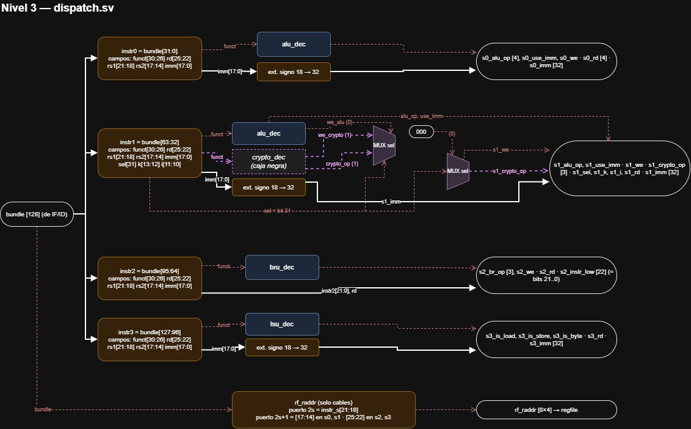

| Bloque | Función | Justificación |
|---|---|---|
| Separación de slots | Slot *s* = `bundle[32s+31 : 32s]` | Solo cables (`isa.md` §3) |
| Extracción de campos | `funct` = 30..26, `rd` = 25..22, `rs1` = 21..18, `rs2` = 17..14, `imm` = 17..0, `k` = 13..12, `i` = 11..10 | Los campos están en la misma posición en todos los formatos (`isa.md` §4): se extraen sin identificar el tipo de instrucción |
| Direcciones de lectura | Tabla de §2.5 | Fijas por slot: no requieren decodificación |
| Extensión de signo | `{{14{imm[17]}}, imm[17:0]}` en los slots 0, 1 y 3 | Todo lo que llega a EX trabaja en 32 bits (§2.6) |
| Decodificadores | `alu_dec` en los slots 0 y 1, `crypto_dec` en el 1, `bru_dec` en el 2, `lsu_dec` en el 3 | Cada uno lo diseña el responsable de su unidad (§2.5) |
| Selección del `we` del slot 1 | `s1_we = sel ? we_crypto : we_alu` | Los dos decodificadores del slot 1 producen un `we`; ID/EX lleva uno solo por slot |
| Bloqueo de CRYPTO | `s1_crypto_op = sel ? (salida de crypto_dec) : NINGUNA` | Con `sel = 0`, `crypto_dec` igual interpreta el `funct` de la ALU (por ejemplo, el `00001` de `add` como `feis`). Sin el bloqueo, un `add` en el slot 1 podría ejecutar una operación criptográfica y cambiar el estado de la bóveda |

Notas:
- **Los campos se extraen siempre**, aunque la instrucción no los use. En una
  instrucción de formato R, `imm` contiene los bits de `rs2` y del campo
  reservado: el valor se ignora porque `use_imm = 0`. En un salto condicional,
  `rd` contiene `rs2`: se ignora porque `we = 0`.
- **Con `sel = 1`, `alu_dec` del slot 1 igual produce un `alu_op`**: ALU1 calcula
  un valor que nadie usa, porque en EX el multiplexor elige CRYPTO. No hace falta
  bloquearlo, porque la ALU no tiene estado.
- El bit `sel` de los slots 0, 2 y 3 no se conecta (§2.5).

**Traza.** Bundle `05D80000_0D0FFFFE_98100000_054D0000`:
`{ add r5, r3, r4 | sanc r4 | blt r3, r4, −2 | lw r7, 0(r6) }`.

| Slot | Instrucción | Puertos (A, B) | Salidas |
|---|---|---|---|
| 0 | `add r5, r3, r4` (`054D0000`) | 0 ← `r3`, 1 ← `r4` | `alu_op` = suma, `use_imm = 0`, `rd = 5`, `we = 1`. `imm = 0x00010000` (bits de `rs2`, se ignora) |
| 1 | `sanc r4` (`98100000`) | 2 ← `r4`, 3 ← `r0` | `sel = 1`, `crypto_op = sanc`, `we = 0` (`sanc` no escribe registro) |
| 2 | `blt r3, r4, −2` (`0D0FFFFE`) | 4 ← `r3`, 5 ← `r4` | `br_op = blt`, `instr_low = 0x0FFFFE` (`off = −2`), `we = 0`. `rd = 4` (es `rs2`, se ignora) |
| 3 | `lw r7, 0(r6)` (`05D80000`) | 6 ← `r6`, 7 ← `r7` | `is_load = 1`, `imm = 0`, `rd = 7`. El puerto 7 lee `r7` y se ignora: en `lw` el campo 25..22 es el destino |

**Plan de verificación**

| Caso | Esperado |
|---|---|
| Los 5 vectores de `isa.md` §6.5, cada uno en su slot | Campos, direcciones y control correctos |
| La traza anterior | Las salidas de la tabla |
| Bundle en cero | `we = 0` en los 4 slots, `crypto_op` = NINGUNA, `br_op` = ninguno, sin carga ni almacenamiento |
| Slot 1 con `add` (`sel = 0`) | `crypto_op` = NINGUNA y `s1_we` = `we` de `alu_dec` |
| Slot 1 con `feis` (`sel = 1`) | `crypto_op` = `feis` y `s1_we` = `we` de `crypto_dec` |
| Inmediato negativo (`saddi rd, rs1, −1`) | `imm = 0xFFFFFFFF` |
| Inmediato positivo máximo (`131071`) | `imm = 0x0001FFFF` |
| `sel = 1` en el slot 0 | Se decodifica igual que con `sel = 0` |
| Puerto B en los slots 2 y 3 | Toma los bits 25..22, no los 17..14 |

### 3.12 `fetch.sv`

| Puerto | Dir | Bits | Descripción |
|---|---|---|---|
| `clk`, `rst` | in | 1 | |
| `stall` | in | 1 | `crypto_stall`: conserva el PC (§2.11) |
| `branch_taken` | in | 1 | De la BRU, ya condicionado con `~crypto_stall` en `core` |
| `branch_target` | in | `PC_W` | De la BRU |
| `pc` | out | `PC_W` | Hacia `imem` y hacia IF/ID |

PC registrado en el flanco de subida; siguiente PC = `stall ? pc : (branch_taken ? branch_target : pc + 1)`.

**Interior**

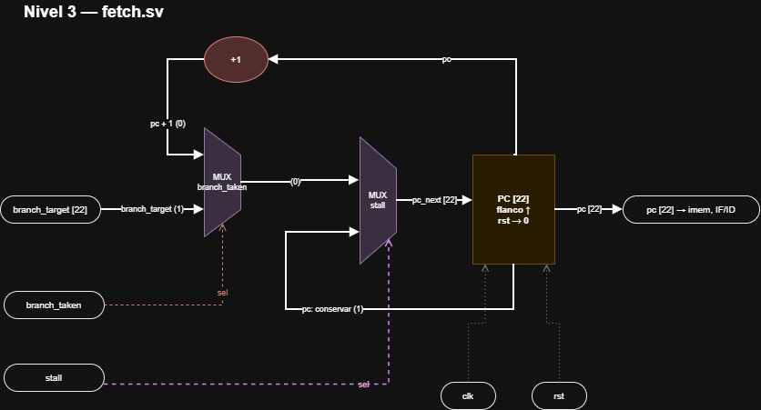

| Bloque | Función | Justificación |
|---|---|---|
| Registro PC | `PC_W` bits, flanco de subida, reset asíncrono a 0 | El programa empieza en el bundle 0 |
| Incrementador | `pc + 1` | **Propio, distinto del de la BRU**: `fetch` incrementa el PC del bundle que está en IF (siguiente a buscar); la BRU, el del bundle que está en ID (enlace de `jas`/`jefR`). Son bundles distintos |
| Multiplexor de salto | `branch_taken ? branch_target : pc + 1` | El salto se resuelve en ID y se aplica en el mismo flanco que vacía IF/ID (§2.7) |
| Multiplexor de pausa | `stall ? pc : (salida del anterior)` | Conserva el PC durante la pausa de `auth` (§2.11) |

`stall` tiene prioridad sobre `branch_taken`. Fuera de un `auth`, `stall = 0` y el PC avanza en todos los ciclos.

**Arranque**

| Ciclo | `rst` | PC | IF | ID (IF/ID) |
|---|---|---|---|---|
| 0 | 1 | 0 | — | vacío |
| 1 | 0 | 0 | bundle 0 | vacío |
| 2 | 0 | 1 | bundle 1 | bundle 0 |
| 3 | 0 | 2 | bundle 2 | bundle 1 |

El pipeline se llena solo: tras el reset, las etapas contienen bundles vacíos
hasta que llega el primero real.

**Plan de verificación**

| Caso | Esperado |
|---|---|
| `rst = 1` | `pc = 0` |
| Varios ciclos sin salto | `pc` = 0, 1, 2, 3… |
| `branch_taken = 1`, `branch_target = 8` | En el siguiente flanco, `pc = 8` |
| Salto hacia atrás y hacia adelante | `pc` = destino en ambos casos |
| `rst` a mitad de la ejecución | `pc = 0` de inmediato, sin esperar el flanco |
| `stall = 1` varios ciclos | `pc` no cambia; al bajar, sigue en `pc + 1` |
| `stall = 1` y `branch_taken = 1` | `pc` no cambia |

### 3.13 `pipe_reg.sv`

| Parámetro | Descripción |
|---|---|
| `W` | Ancho en bits |

| Puerto | Dir | Bits | Descripción |
|---|---|---|---|
| `clk`, `rst` | in | 1 | Reset asíncrono a cero |
| `flush` | in | 1 | En el flanco de subida, carga cero en lugar de `d` |
| `en` | in | 1 | Habilitación: con `en = 0` conserva `q` (§2.11) |
| `d` | in | `W` | |
| `q` | out | `W` | |

| Registro | `flush` | `en` |
|---|---|---|
| IF/ID | `id_redirect` | `~crypto_stall` |
| ID/EX | `0` | `~crypto_stall` |
| EX/WB | `crypto_stall` | `1` |

**Interior**

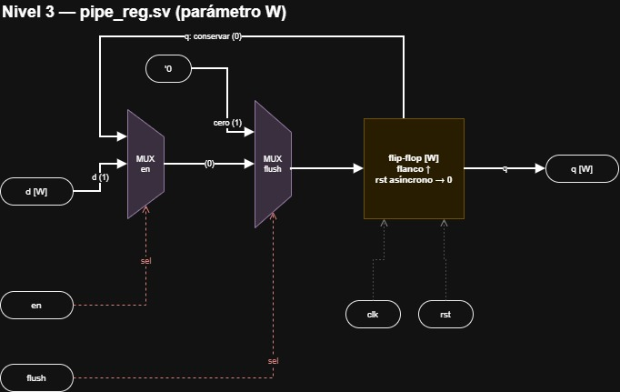

```systemverilog
always_ff @(posedge clk or posedge rst)
  if (rst)        q <= '0;    // reset asíncrono
  else if (flush) q <= '0;    // vaciado síncrono
  else if (en)    q <= d;     // con en = 0 conserva (pausa de auth)
```

| Decisión | Justificación |
|---|---|
| **Vaciado síncrono** (en el flanco), no asíncrono | En IF/ID, `flush` es `id_redirect`, que la BRU calcula a partir del bundle que está en IF/ID. Un vaciado inmediato borraría ese bundle a mitad del ciclo, `branch_taken` caería y el vaciado se cancelaría: el registro borraría la condición que lo borra. Siendo síncrono, el bundle con el salto permanece en IF/ID todo el ciclo, y en el flanco IF/ID se vacía y el PC salta a la vez |
| **Con habilitación `en`** | Necesaria para la pausa de `auth` (§2.11). Prioridad: `rst` > `flush` > `en`. En el uso real nunca coinciden `flush = 1` y `en = 0` en el mismo registro |
| Cero = vacío | Un registro en cero equivale a un bundle de `nopi` con `we = 0` (§2.7) |

**Organización en el pipeline: un `pipe_reg` por slot.** Cada registro de
segmentación es uno solo desde el punto de vista lógico (el bundle avanza
siempre completo), pero se construye con **una instancia por compartimento**:

| Registro | Instancias | Anchos |
|---|---|---|
| IF/ID | `u_ifid_bundle`, `u_ifid_pc` | 128, 22 |
| ID/EX | `u_idex_s0`, `u_idex_s1`, `u_idex_s2`, `u_idex_s3`, `u_idex_pc` | 106, 114, 37, 103, 22 |
| EX/WB | `u_exwb_s0`, `u_exwb_s1`, `u_exwb_s2`, `u_exwb_s3`, `u_exwb_pc` | 37, 37, 37, 37, 22 |
| Validez | `u_ifid_valid`, `u_idex_valid`, `u_exwb_valid` | 1, 1, 1 |

- **IF/ID guarda el bundle entero**: todavía no se ha decodificado, son 128 bits
  crudos. La división en slots ocurre en ID (`dispatch`).
- **Desde ID/EX, cada instancia lleva los campos de un solo slot**, que entran
  concatenados por `d` y se separan a la salida, en `core`, en cables con nombre
  (`idex_s0_rd`, `idex_s0_a`…). Así cada unidad recibe solo su compartimento, y
  el `.vcd` muestra los campos con nombre.
- **Todas las instancias de una misma etapa comparten `clk`, `rst` y `flush`**,
  para que el bundle avance como una unidad.
- Se descartó una sola instancia de 382 bits por etapa (difícil de leer y de
  mantener) y una instancia por campo (unas 40 en ID/EX). También se descartó
  `struct packed`, por el soporte variable en Icarus Verilog.

**Plan de verificación**

| Caso | Esperado |
|---|---|
| `rst = 1` | `q = 0` de inmediato |
| Carga normal | En cada flanco de subida, `q = d` |
| `flush = 1` | En el flanco, `q = 0` aunque `d ≠ 0` |
| `flush` sube a mitad del ciclo | `q` no cambia hasta el flanco |
| `rst` y `flush` a la vez | `q = 0` |
| `en = 0` | `q` se conserva aunque cambie `d` |
| `flush = 1` y `en = 0` | `q = 0` |

### 3.14 `core.sv` y `top.sv`

`core.sv` conecta los módulos anteriores según §2; sus puertos son `clk`, `rst`
y las dos interfaces de memoria de §1.3. `top.sv` instancia `core`, `imem` y
`memory`, y expone solo `clk` y `rst` (§1.1). `top` genera además `init_anchor`
(§2.9, M-08) y lo pasa a `core`, que lo lleva a `u_crypto`.

**Interior de `core`**

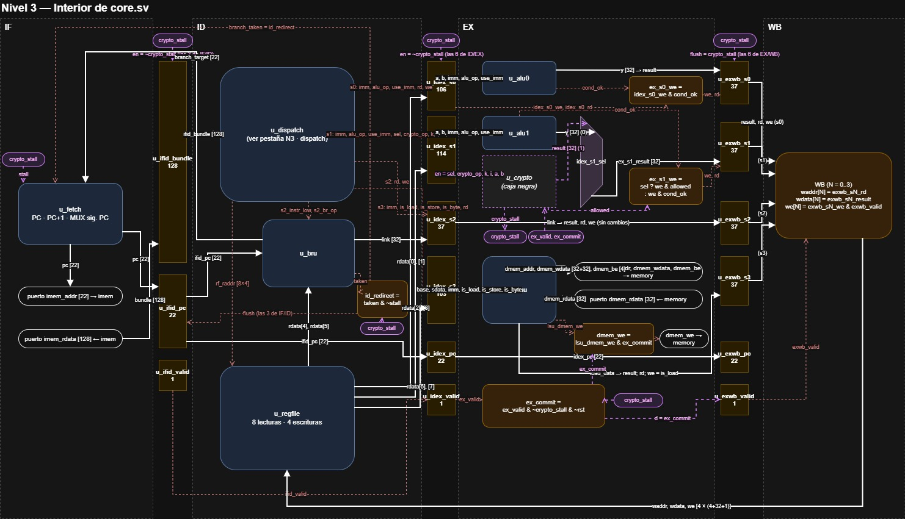

`core` es principalmente cableado. Se organiza en **cuatro secciones comentadas,
una por etapa**, más los registros de segmentación entre ellas.

**Etapa IF**

| De | A |
|---|---|
| `u_fetch.pc` | `imem_addr` (puerto de `core`) e `ifid_pc` |
| `imem_rdata` | `ifid_bundle` |

**Etapa ID**

| De | A |
|---|---|
| `ifid_bundle` | `u_dispatch.bundle` |
| `u_dispatch.rf_raddr` | `u_regfile.raddr` |
| `u_regfile.rdata[0]`, `[1]` | ID/EX slot 0: `a`, `b` |
| `u_regfile.rdata[2]`, `[3]` | ID/EX slot 1: `a`, `b` |
| `u_regfile.rdata[4]`, `[5]` | `u_bru`: `a`, `b` |
| `u_regfile.rdata[6]`, `[7]` | ID/EX slot 3: `base`, `sdata` |
| `ifid_pc`, `s2_instr_low`, `s2_br_op` | `u_bru` |
| `u_bru.taken`, `u_bru.target` | `id_redirect = id_branch_taken & ~crypto_stall` hacia `u_fetch` y hacia el `flush` de IF/ID y de `u_ifid_valid` |
| `u_bru.link` | ID/EX slot 2 |
| Control de `u_dispatch` por slot | Su compartimento de ID/EX |

**Etapa EX**

| De | A |
|---|---|
| ID/EX slot 0 | `u_alu0` |
| ID/EX slot 1 | `u_alu1` y `u_crypto` (`en` = `idex_s1_sel`, `ex_valid`, `ex_commit`) |
| ID/EX slot 3 | `u_lsu`; la LSU, a los puertos `dmem_*` de `core` |

Lógica propia de la etapa (unas pocas líneas, sin módulo aparte):

```systemverilog
// Slot 1: ALU1 o CRYPTO, según sel (isa.md §3.1)
assign ex_s1_result = idex_s1_sel ? crypto_result : alu1_y;

// we final de cada slot (§2.6)
assign ex_s0_we = idex_s0_we & alu0_cond_ok;                       // ifmov
assign ex_s1_we = idex_s1_sel ? (idex_s1_we & crypto_allowed)      // privilegio
                              : (idex_s1_we & alu1_cond_ok);       // ifmov
assign ex_s2_we = idex_s2_we;                                      // jas, jefR
assign ex_s3_we = idex_s3_is_load;                                 // lw, lb

// Pausa de auth (§2.11), contrato de crypto_unit
assign ex_commit   = ex_valid & ~crypto_stall & ~rst;
assign dmem_we     = lsu_dmem_we & ex_commit;                      // store una sola vez
assign id_redirect = id_branch_taken & ~crypto_stall;              // salto retenido
```

Se descartó un módulo `execute.sv` aparte: es muy poca lógica para un módulo
propio, y la lista del enunciado §7.2 no lo pide.

**Etapa WB**

| De | A |
|---|---|
| `exwb_sN_rd`, `exwb_sN_result`, `exwb_sN_we & exwb_valid` (N = 0..3) | `u_regfile.waddr[N]`, `wdata[N]`, `we[N]` |

**Convención de nombres.** Pensada para que el `.vcd` se lea solo en GTKWave:

| Qué | Convención | Ejemplo |
|---|---|---|
| Instancias | `u_` + módulo | `u_regfile`, `u_alu0`, `u_alu1`, `u_bru`, `u_crypto` |
| Salidas de registros de segmentación | registro + slot + campo | `idex_s0_rd`, `exwb_s3_result` |
| Señales internas de una etapa | etapa + nombre | `id_branch_taken`, `ex_s1_result` |

**Interior de `top`**

| Parámetro | Descripción |
|---|---|
| `IMEM_INIT` | Archivo `.hex` del programa, pasado a `imem` |
| `DMEM_INIT` | Archivo `.mem` de datos, pasado a `memory` (vacío = sin datos) |

Cada *testbench* elige el programa y los datos sin modificar el código:

```systemverilog
top #(.IMEM_INIT("prueba_saltos.hex"), .DMEM_INIT("hola.mem")) dut (.clk, .rst);
```

Instancias: `u_core`, `u_imem`, `u_memory`. La jerarquía para depurar es, por
ejemplo, `dut.u_core.u_regfile.regs[5]`.

**Al integrar.** Las conexiones de esta sección siguen las interfaces de §3.
Cualquier diferencia entre un módulo implementado y su interfaz se acuerda con
su responsable y se documenta aquí, no ajustando `core` en silencio.

**Plan de verificación** (con `tb_top`, programas escritos con el ensamblador)

| Caso | Esperado |
|---|---|
| Arranque tras reset | El bundle 0 llega a ID en el ciclo 2 (§3.12) |
| Varios bundles en vuelo | En un mismo ciclo, el `.vcd` muestra `ifid_pc`, `idex_pc` y `exwb_pc` con bundles distintos |
| Dependencia a 1 bundle de distancia | El consumidor lee el valor **viejo** |
| Dependencia a 2 bundles de distancia | El consumidor lee el valor **nuevo** |
| Salto tomado | El bundle siguiente se descarta; los demás slots del bundle con el salto se ejecutan |
| `ifmov` con condición falsa | `rd` no cambia |
| Slot 1 con ALU y con CRYPTO en bundles distintos | El resultado sale de la unidad indicada por `sel` |
| `sw` seguido de `lw` a la misma dirección en el bundle siguiente | El `lw` obtiene el valor nuevo (`isa.md` §9.4) |
| Programa de ejemplo de `isa.md` §11 | Termina con `r4 = 4` |
| PC más allá del programa | El procesador ejecuta `nopi` indefinidamente, sin volver al bundle 0 |
| `auth` | El pipeline se congela 13 ciclos; el bundle siguiente ya ve `AUTH` actualizado |
| `auth` en un bundle con `sw` y `add` | El `sw` escribe una vez y el `add` escribe una vez en WB |
| Salto tomado en ID durante la pausa | Se aplica una sola vez, al reanudar |
| Programa que cifra y descifra un archivo de varios bloques | Cifrado igual a la referencia en C del enunciado (Fig. 1) y descifrado igual al original |

---

## 4. Nivel 4 — Especificación para implementar

Este nivel fija todo lo necesario para escribir el código **sin tomar
decisiones**: la temporización, las convenciones de codificación compartidas, la
declaración exacta de cada módulo, la posición de cada campo en los registros de
segmentación, las tablas de verdad y una traza con los valores esperados.

| § | Contenido | Para qué sirve al implementar |
|---|---|---|
| 4.1 | Temporización de un ciclo | Qué se evalúa en cada flanco |
| 4.2 | Convenciones de codificación | Valores que varios módulos deben interpretar igual |
| 4.3 | Declaración de cada módulo | La cabecera exacta del código, con nombres y anchos |
| 4.4 | Distribución de bits de los registros de segmentación | El orden de concatenación de cada `pipe_reg` |
| 4.5 | Tablas de verdad | La lógica de `fetch`, `pipe_reg`, `regfile`, `dispatch` y EX |
| 4.6 | Traza del pipeline completo | Los valores esperados en `tb_top` y en GTKWave |
| 4.7 | Ruta crítica | La justificación de la temporización |
| 4.8 | Tablas de decodificación | `alu_dec`, `lsu_dec`, `bru_dec` y `crypto_dec` |

### 4.1 Temporización de un ciclo

| Instante | Qué ocurre |
|---|---|
| **Flanco de subida** | Avanzan el PC, IF/ID, ID/EX y EX/WB. Se escriben la memoria de datos (`sw`/`sb` del bundle que terminaba EX) y el estado de CRYPTO |
| Primera mitad | La lógica de IF, ID y EX evalúa con los valores nuevos |
| **Flanco de bajada** | El `regfile` escribe los resultados que están en EX/WB |
| Segunda mitad | ID vuelve a leer el `regfile`, ya con lo recién escrito; la BRU decide; todo queda listo para el siguiente flanco de subida |

**Por qué el `regfile` escribe en bajada.** EX/WB captura en el flanco de subida.
Si el `regfile` también escribiera en subida, lo haría al **final** del ciclo de
WB, cuando el bundle que está en ID ya leyó: la separación entre dependientes
sería de 2 bundles y rompería el contrato de `isa.md` §9.1. Escribiendo en bajada
(primera mitad) y leyendo de forma combinacional (segunda mitad) se cumple la
convención de las notas §3.2.2 y la separación es de 1 bundle.

| Ciclo | `add r5, r3, r4` (bundle N) | Bundle N+2 | ¿Ve el `r5` nuevo? |
|---|---|---|---|
| c1 | ID | — | |
| c2 | EX | IF | |
| c3 | WB: escribe `r5` en el flanco de bajada | ID: lee `r5` en la segunda mitad | ✅ |

### 4.2 Convenciones de codificación

Valores que un módulo produce y otro interpreta. Son parte de la interfaz.

| Señal | Regla | Quién la usa |
|---|---|---|
| `br_op` (3 bits) | **`3'b000` = ningún salto.** El resto, según la tabla de §4.8 | `bru_dec` → `bru` |
| `crypto_op` (3 bits) | **`3'b000` = ninguna operación.** El resto, según la tabla de §4.8 | `crypto_dec` → `dispatch` (bloqueo con `sel = 0`) → `crypto_unit` |
| `alu_op` (4 bits) | Según la tabla de §4.8; con `we = 0` el valor no importa | `alu_dec` → `alu` |
| Registro de segmentación en cero | Equivale a un bundle de `nopi`: todos los `we` en 0, `br_op` y `crypto_op` en `000`, sin carga ni almacenamiento | Reset y vaciado |

La regla del cero es la misma que la de `isa.md` §3.2 (`nopi` = `funct 00000`):
**todo en cero significa «no hacer nada»** en cualquier punto del pipeline.

### 4.3 Declaración de cada módulo

Transcripción exacta de las interfaces de §3. Los puertos con varios elementos
son arreglos empaquetados (§3.1). Una cabecera no se cambia sin acordarlo con
el responsable de integración y documentarlo aquí.

**`regfile`**
```systemverilog
module regfile #(
  parameter int NUM_SLOTS = 4,
  parameter int XLEN      = 32,
  parameter int NUM_REGS  = 16,
  parameter int AW        = $clog2(NUM_REGS),
  parameter int NUM_RD    = 2 * NUM_SLOTS
)(
  input  logic                           clk, rst,
  input  logic [NUM_RD-1:0][AW-1:0]      raddr,   // puerto 2s = rs1, 2s+1 = B del slot s
  output logic [NUM_RD-1:0][XLEN-1:0]    rdata,
  input  logic [NUM_SLOTS-1:0][AW-1:0]   waddr,
  input  logic [NUM_SLOTS-1:0][XLEN-1:0] wdata,
  input  logic [NUM_SLOTS-1:0]           we
);
```

**`pipe_reg`**
```systemverilog
module pipe_reg #(parameter int W = 1)(
  input  logic         clk, rst, flush, en,
  input  logic [W-1:0] d,
  output logic [W-1:0] q
);
```

**`fetch`**
```systemverilog
module fetch #(parameter int PC_W = 22)(
  input  logic            clk, rst,
  input  logic            stall,
  input  logic            branch_taken,
  input  logic [PC_W-1:0] branch_target,
  output logic [PC_W-1:0] pc
);
```

**`dispatch`**
```systemverilog
module dispatch (
  input  logic [127:0]     bundle,
  output logic [7:0][3:0]  rf_raddr,
  // slot 0 — ALU0
  output logic [31:0] s0_imm,  output logic [3:0] s0_alu_op, output logic s0_use_imm,
  output logic [3:0]  s0_rd,   output logic       s0_we,
  // slot 1 — ALU1 o CRYPTO
  output logic [31:0] s1_imm,  output logic [3:0] s1_alu_op, output logic s1_use_imm,
  output logic        s1_sel,  output logic [2:0] s1_crypto_op,
  output logic [1:0]  s1_k,    output logic [1:0] s1_i,
  output logic [3:0]  s1_rd,   output logic       s1_we,
  // slot 2 — BRU
  output logic [21:0] s2_instr_low, output logic [2:0] s2_br_op,
  output logic [3:0]  s2_rd,        output logic       s2_we,
  // slot 3 — LSU
  output logic [31:0] s3_imm,
  output logic        s3_is_load, s3_is_store, s3_is_byte,
  output logic [3:0]  s3_rd
);
```

**`core`**
```systemverilog
module core #(parameter int PC_W = 22)(
  input  logic            clk, rst,
  input  logic            init_anchor,   // arranque protegido (§2.9, M-08)
  output logic [PC_W-1:0] imem_addr,
  input  logic [127:0]    imem_rdata,
  output logic [31:0]     dmem_addr, dmem_wdata,
  output logic            dmem_we,
  output logic [3:0]      dmem_be,
  input  logic [31:0]     dmem_rdata
);
```

**`top`**
```systemverilog
module top #(
  parameter     IMEM_INIT  = "",
  parameter     DMEM_INIT  = "",
  parameter int PC_W       = 22,
  parameter int IMEM_DEPTH = 4096,
  parameter int DMEM_WORDS = 16384
)(
  input logic clk, rst
);
```

**Unidades y memorias** (transcripción de §3.2–§3.10)
```systemverilog
module alu_dec    (input  logic [4:0] funct,
                   output logic [3:0] alu_op, output logic use_imm, output logic we);

module alu        (input  logic [31:0] a, b, imm, input logic [3:0] alu_op, input logic use_imm,
                   output logic [31:0] y, output logic cond_ok);

module lsu_dec    (input  logic [4:0] funct,
                   output logic is_load, is_store, is_byte);

module lsu        (input  logic [31:0] base, sdata, imm, input logic is_load, is_store, is_byte,
                   output logic [31:0] dmem_addr, dmem_wdata, output logic dmem_we,
                   output logic [3:0] dmem_be, input logic [31:0] dmem_rdata,
                   output logic [31:0] load_data);

module bru_dec    (input  logic [4:0] funct,
                   output logic [2:0] br_op, output logic we);

module bru #(parameter int PC_W = 22)
                  (input  logic [PC_W-1:0] pc, input logic [31:0] a, b,
                   input  logic [21:0] instr_low, input logic [2:0] br_op,
                   output logic taken, output logic [PC_W-1:0] target, output logic [31:0] link);

module crypto_dec (input  logic [4:0] funct,
                   output logic [2:0] crypto_op, output logic we);

module crypto_unit #(parameter logic [31:0] RESET_ANCHOR = 32'hFEFF95FF)
                  (input  logic clk, rst, init_anchor, en, ex_valid, ex_commit,
                   input  logic [2:0] crypto_op,
                   input  logic [1:0] k, i, input logic [31:0] a, b,
                   output logic [31:0] result, output logic allowed, crypto_stall);

module memory #(parameter int DEPTH_WORDS = 16384, parameter INIT_FILE = "")
                  (input  logic clk, input logic [31:0] addr, wdata, input logic we,
                   input  logic [3:0] be, output logic [31:0] rdata);

module imem #(parameter int DEPTH = 4096, parameter int PC_W = 22, parameter INIT_FILE = "")
                  (input  logic [PC_W-1:0] addr, output logic [127:0] rdata);
```

### 4.4 Distribución de bits de los registros de segmentación

Cada `pipe_reg` recibe sus campos concatenados en `d`, **del bit más
significativo al menos significativo, en el orden de estas tablas**. A la salida,
`core` los separa con una asignación en el **mismo orden**:

```systemverilog
pipe_reg #(.W(106)) u_idex_s0 (
  .clk, .rst, .flush(1'b0), .en(~crypto_stall),
  .d({rf_rdata[0], rf_rdata[1], s0_imm, s0_alu_op, s0_use_imm, s0_rd, s0_we}),
  .q(idex_s0_q)
);
assign {idex_s0_a, idex_s0_b, idex_s0_imm, idex_s0_alu_op,
        idex_s0_use_imm, idex_s0_rd, idex_s0_we} = idex_s0_q;
```

Escribir la concatenación y la separación en el mismo orden garantiza que cada
campo caiga en su lugar sin calcular posiciones a mano. Las posiciones de las
tablas sirven para depurar en GTKWave.

**IF/ID**

| Instancia | `W` | `d` | `flush` | `en` |
|---|---|---|---|---|
| `u_ifid_bundle` | 128 | `imem_rdata` | `id_redirect` | `~crypto_stall` |
| `u_ifid_pc` | 22 | `pc` de `fetch` | `id_redirect` | `~crypto_stall` |

**ID/EX** (`flush` = 0, `en` = `~crypto_stall` en todas)

`u_idex_s0` — W = 106

| Campo | Bits | Posición | Origen |
|---|---|---|---|
| `a` | 32 | `[105:74]` | `rf_rdata[0]` |
| `b` | 32 | `[73:42]` | `rf_rdata[1]` |
| `imm` | 32 | `[41:10]` | `s0_imm` |
| `alu_op` | 4 | `[9:6]` | `s0_alu_op` |
| `use_imm` | 1 | `[5]` | `s0_use_imm` |
| `rd` | 4 | `[4:1]` | `s0_rd` |
| `we` | 1 | `[0]` | `s0_we` |

`u_idex_s1` — W = 114

| Campo | Bits | Posición | Origen |
|---|---|---|---|
| `a` | 32 | `[113:82]` | `rf_rdata[2]` |
| `b` | 32 | `[81:50]` | `rf_rdata[3]` |
| `imm` | 32 | `[49:18]` | `s1_imm` |
| `alu_op` | 4 | `[17:14]` | `s1_alu_op` |
| `use_imm` | 1 | `[13]` | `s1_use_imm` |
| `sel` | 1 | `[12]` | `s1_sel` |
| `crypto_op` | 3 | `[11:9]` | `s1_crypto_op` |
| `k` | 2 | `[8:7]` | `s1_k` |
| `i` | 2 | `[6:5]` | `s1_i` |
| `rd` | 4 | `[4:1]` | `s1_rd` |
| `we` | 1 | `[0]` | `s1_we` |

`u_idex_s2` — W = 37

| Campo | Bits | Posición | Origen |
|---|---|---|---|
| `link` | 32 | `[36:5]` | `link` de `bru` |
| `rd` | 4 | `[4:1]` | `s2_rd` |
| `we` | 1 | `[0]` | `s2_we` |

`u_idex_s3` — W = 103

| Campo | Bits | Posición | Origen |
|---|---|---|---|
| `base` | 32 | `[102:71]` | `rf_rdata[6]` |
| `sdata` | 32 | `[70:39]` | `rf_rdata[7]` |
| `imm` | 32 | `[38:7]` | `s3_imm` |
| `is_load` | 1 | `[6]` | `s3_is_load` |
| `is_store` | 1 | `[5]` | `s3_is_store` |
| `is_byte` | 1 | `[4]` | `s3_is_byte` |
| `rd` | 4 | `[3:0]` | `s3_rd` |

`u_idex_pc` — W = 22, `d` = `ifid_pc`

**EX/WB** (`flush` = `crypto_stall`, `en` = 1 en todas)

`u_exwb_s0` … `u_exwb_s3` — W = 37 cada una

| Campo | Bits | Posición | Origen |
|---|---|---|---|
| `result` | 32 | `[36:5]` | `ex_sN_result` |
| `rd` | 4 | `[4:1]` | `idex_sN_rd` |
| `we` | 1 | `[0]` | `ex_sN_we` (§4.5) |

| Slot | `ex_sN_result` |
|---|---|
| 0 | `y` de `u_alu0` |
| 1 | `idex_s1_sel ? result de u_crypto : y de u_alu1` |
| 2 | `idex_s2_link` |
| 3 | `load_data` de `u_lsu` |

`u_exwb_pc` — W = 22, `d` = `idex_pc`

Los tres bits de validez (`u_ifid_valid`, `u_idex_valid`, `u_exwb_valid`) se
conectan según la tabla de §2.11.

### 4.5 Tablas de verdad

**`fetch` — siguiente PC**

| `rst` | `stall` | `branch_taken` | PC después del flanco de subida |
|---|---|---|---|
| 1 | x | x | 0 (de inmediato, sin esperar el flanco) |
| 0 | 1 | x | `pc` |
| 0 | 0 | 0 | `pc + 1` |
| 0 | 0 | 1 | `branch_target` |

**`pipe_reg` — prioridad**

| `rst` | `flush` | `en` | `q` después del flanco de subida |
|---|---|---|---|
| 1 | x | x | 0 (de inmediato) |
| 0 | 1 | x | 0 |
| 0 | 0 | 1 | `d` |
| 0 | 0 | 0 | `q` (se conserva) |

**`regfile` — escritura de cada slot `s`, en el flanco de bajada**

| `rst` | `we[s]` | `waddr[s]` | Efecto |
|---|---|---|---|
| 1 | x | x | Los 16 registros a 0 (de inmediato) |
| 0 | 0 | x | Nada |
| 0 | 1 | 0 | Nada (`r0` bloqueado) |
| 0 | 1 | ≠ 0 | `regs[waddr[s]] ← wdata[s]` |

Los slots se evalúan en orden 0, 1, 2, 3 dentro del mismo bloque: si dos escriben
el mismo registro, queda el de número mayor.

**`dispatch` — puerto B y slot 1**

| Slot | `rf_raddr[2s]` | `rf_raddr[2s+1]` |
|---|---|---|
| 0 | `bundle[21:18]` | `bundle[17:14]` |
| 1 | `bundle[53:50]` | `bundle[49:46]` |
| 2 | `bundle[85:82]` | `bundle[89:86]` |
| 3 | `bundle[117:114]` | `bundle[121:118]` |

| `s1_sel` (`bundle[63]`) | `s1_we` | `s1_crypto_op` |
|---|---|---|
| 0 | `we` de `alu_dec` del slot 1 | `3'b000` |
| 1 | `we` de `crypto_dec` | `crypto_op` de `crypto_dec` |

Extensión de signo (slots 0, 1 y 3): `sN_imm = {{14{instr[17]}}, instr[17:0]}`.

**EX — `we` final de cada slot**

| Slot | Condición | `ex_sN_we` |
|---|---|---|
| 0 | — | `idex_s0_we & cond_ok de u_alu0` |
| 1 | `idex_s1_sel = 0` | `idex_s1_we & cond_ok de u_alu1` |
| 1 | `idex_s1_sel = 1` | `idex_s1_we & allowed de u_crypto` |
| 2 | — | `idex_s2_we` |
| 3 | — | `idex_s3_is_load` |

### 4.6 Traza del pipeline completo

Programa de ejemplo de `isa.md` §11, calculado con un modelo ciclo a ciclo que
sigue las reglas de §4.1. Es el resultado que debe reproducir `tb_top`.

```
bundle 0:         { mov r4, 0        | mov r5, 3 | nopi             | nopi }
bundle 1:         { nopi             | nopi      | nopi             | nopi }
bundle 2 (lazo):  { saddi r4, r4, 1  | nopi      | blt r4, r5, lazo | nopi }
bundles 3 en adelante: nopi (imem entrega cero)
```

Las columnas IF, ID, EX y WB indican qué bundle ocupa cada etapa durante el
ciclo. «Vacío» es un registro de segmentación en cero (reset o vaciado).

| Ciclo | PC (IF) | ID | EX | WB | `id_branch_taken` | Destino | Escritura en WB (↓) | `r4` | `r5` |
|---|---|---|---|---|---|---|---|---|---|
| 1 | 0 | vacío | vacío | vacío | 0 | — | — | 0 | 0 |
| 2 | 1 | 0 | vacío | vacío | 0 | — | — | 0 | 0 |
| 3 | 2 | 1 | 0 | vacío | 0 | — | — | 0 | 0 |
| 4 | 3 | 2 | 1 | 0 | 1 | 2 | r4←0, r5←3 | 0 | 3 |
| 5 | 2 | vacío | 2 | 1 | 0 | — | — | 0 | 3 |
| 6 | 3 | 2 | vacío | 2 | 1 | 2 | r4←1 | 1 | 3 |
| 7 | 2 | vacío | 2 | vacío | 0 | — | — | 1 | 3 |
| 8 | 3 | 2 | vacío | 2 | 1 | 2 | r4←2 | 2 | 3 |
| 9 | 2 | vacío | 2 | vacío | 0 | — | — | 2 | 3 |
| 10 | 3 | 2 | vacío | 2 | 0 | — | r4←3 | 3 | 3 |
| 11 | 4 | 3 | 2 | vacío | 0 | — | — | 3 | 3 |
| 12 | 5 | 4 | 3 | 2 | 0 | — | r4←4 | 4 | 3 |
| 13 | 6 | 5 | 4 | 3 | 0 | — | — | 4 | 3 |
| 14 | 7 | 6 | 5 | 4 | 0 | — | — | 4 | 3 |

Lo que demuestra la traza:

- **Separación de 1 bundle (ciclo 4).** El `blt` del bundle 2 compara `r4` y `r5`
  en el mismo ciclo en que WB los escribe, en el flanco de bajada: ve `r5 = 3` y
  salta.
- **Vaciado (ciclos 5, 7, 9).** Cada salto tomado deja ID vacío en el ciclo
  siguiente: el bundle 3, que ya estaba en IF, se descarta.
- **El slot del `saddi` se ejecuta aunque el salto se tome**, y su resultado
  llega a tiempo a la siguiente evaluación del `blt`, dos ciclos después.
- **El `blt` ve el valor anterior al `saddi` de su propio bundle** (`isa.md`
  §9.3): compara 0, 1, 2 y 3; con 3 no salta (ciclo 10), y `r4` termina en 4
  (ciclo 12).
- **Varios bundles en vuelo**: desde el ciclo 4, las cuatro etapas tienen
  bundles distintos al mismo tiempo.
- **Al terminar el programa** el PC sigue avanzando y el procesador ejecuta
  `nopi` (§3.7).

**Nota para GTKWave.** Un registro de segmentación vacío tiene `pc = 0`, igual
que el bundle 0. En la traza, `idex_pc = 0` en el ciclo 5 es un bundle vacío, no
el bundle 0. Se distinguen por el contexto, o por los bits de validez (§2.11).

### 4.7 Ruta crítica

El proyecto se evalúa por simulación, sin síntesis, así que la ruta crítica se
argumenta por profundidad de lógica. Cada etapa tiene un camino combinacional
entre dos flancos:

| Etapa | Camino más largo | Tiempo disponible |
|---|---|---|
| IF | PC → lectura de `imem` → IF/ID | Ciclo completo |
| **ID** | `regfile` escribe (↓) → multiplexor 16:1 de lectura → comparador de 32 bits de la BRU → `taken` → multiplexor de siguiente PC y `flush` → PC e IF/ID | **Medio ciclo**, cuando el operando acaba de escribirse |
| EX (ALU) | ID/EX → multiplexor de segundo operando → sumador de 32 bits o desplazador de barril (5 niveles) → multiplexor de resultado → multiplexor del slot 1 → EX/WB | Ciclo completo |
| EX (LSU) | ID/EX → sumador de dirección de 32 bits → lectura de `memory` → selección de byte → extensión de signo → EX/WB | Ciclo completo |
| WB | EX/WB → escritura del `regfile` | Flanco de bajada |

**La ruta crítica es la de ID.** Su lógica no es la más profunda (EX tiene un
sumador de 32 bits seguido de una lectura de memoria), pero es la única que
dispone de **medio ciclo**: cuando un salto depende de un valor escrito en ese
mismo ciclo, el dato existe recién desde el flanco de bajada. Eso exige

```
T / 2  ≥  t(mux 16:1) + t(comparador 32 bits) + t(mux 2:1) + t(setup)
```

es decir, un periodo de reloj del doble del camino de ID.

**Es el costo de la separación de 1 bundle**, y se acepta a propósito: escribir
el `regfile` en subida daría a ID el ciclo completo, pero exigiría 2 bundles de
separación entre dependientes (`isa.md` §9.1), duplicando los `nopi` de un
programa típico. Se cambia algo de frecuencia de reloj por menos ciclos por
programa.

### 4.8 Tablas de decodificación

Respetan las convenciones de §4.2.

**`lsu_dec`** (`isa.md` §6.3)

| `funct` | Instrucción | `is_load` | `is_store` | `is_byte` |
|---|---|---|---|---|
| `00000` | `nopi` | 0 | 0 | 0 |
| `00001` | `lw` | 1 | 0 | 0 |
| `00010` | `sw` | 0 | 1 | 0 |
| `00011` | `lb` | 1 | 0 | 1 |
| `00100` | `sb` | 0 | 1 | 1 |
| `00101`–`11111` | libres | 0 | 0 | 0 |

**`bru_dec`** (`isa.md` §6.2)

| `funct` | Instrucción | `br_op` | Nombre | `we` |
|---|---|---|---|---|
| `00000` | `nopi` | `000` | `BR_NONE` | 0 |
| `00001` | `beq` | `001` | `BR_BEQ` | 0 |
| `00010` | `bne` | `010` | `BR_BNE` | 0 |
| `00011` | `blt` | `011` | `BR_BLT` | 0 |
| `00100` | `bge` | `100` | `BR_BGE` | 0 |
| `00101` | `jefR` | `111` | `BR_JEFR` | 1 |
| `10000` | `jef` | `101` | `BR_JEF` | 0 |
| `10001` | `jas` | `110` | `BR_JAS` | 1 |
| los 24 restantes | libres | `000` | `BR_NONE` | 0 |

**`alu_dec`** (`isa.md` §6.1)

| `funct` | Instrucción | `alu_op` | Nombre | `use_imm` | `we` |
|---|---|---|---|---|---|
| `00000` | `nopi` | `0000` | — | 0 | 0 |
| `00001` | `add` | `0000` | `ALU_ADD` | 0 | 1 |
| `00010` | `sub` | `0001` | `ALU_SUB` | 0 | 1 |
| `00011` | `and` | `0010` | `ALU_AND` | 0 | 1 |
| `00100` | `or` | `0011` | `ALU_OR` | 0 | 1 |
| `00101` | `xor` | `0100` | `ALU_XOR` | 0 | 1 |
| `00110` | `sll` | `0101` | `ALU_SLL` | 0 | 1 |
| `00111` | `srl` | `0110` | `ALU_SRL` | 0 | 1 |
| `01000` | `sra` | `0111` | `ALU_SRA` | 0 | 1 |
| `01001` | `slt` | `1000` | `ALU_SLT` | 0 | 1 |
| `01010` | `sle` | `1001` | `ALU_SLE` | 0 | 1 |
| `01011` | `seq` | `1010` | `ALU_SEQ` | 0 | 1 |
| `01100` | `sne` | `1011` | `ALU_SNE` | 0 | 1 |
| `01101` | `ifmov` | `1100` | `ALU_IFMOV` | 0 | 1 |
| `10000` | `saddi` | `0000` | `ALU_ADD` | 1 | 1 |
| `10001` | `xori` | `0100` | `ALU_XOR` | 1 | 1 |
| `10010` | `mov` | `1101` | `ALU_PASS` | 1 | 1 |
| `01110`, `01111`, `10011`–`11111` | libres | `0000` | — | `funct[4]` | 0 |

`1110` y `1111` de `alu_op` no se usan; la ALU devuelve `0` en ellos.

**`crypto_dec`** (`isa.md` §6.4). `crypto_op = funct[2:0]` en los códigos válidos

| `funct` | Instrucción | `crypto_op` | `we` |
|---|---|---|---|
| `00000` | `nopi` | `000` | 0 |
| `00001` | `feis` | `001` | 1 |
| `00010` | `auth` | `010` | 0 |
| `00011` | `logout` | `011` | 0 |
| `00100` | `kv_write` | `100` | 0 |
| `00101` | `kv_lock` | `101` | 0 |
| `00110` | `sanc` | `110` | 0 |
| `00111`–`11111` | libres | `000` | 0 |

Valida los 5 bits: un código libre nunca se convierte en una operación válida.
Dentro de `crypto_unit`, `111` también se trata como ninguna operación.

---

## 5. Registro de decisiones

| # | Tema | Estado |
|---|---|---|
| M-01 | Temporización del `regfile` | ✅ Cerrada: escritura en bajada, lectura combinacional (§4.1) |
| M-02 | `IMEM_DEPTH` | ✅ Cerrada: 4096 bundles por defecto, ajustable por parámetro |
| M-03 | Ruta crítica | ✅ Cerrada: la etapa ID, por disponer de medio ciclo (§4.7) |
| M-04 | Interior de CRYPTO | ✅ Cerrada: diseño Ascon de Saddy con pausa estructural de `auth` (§2.11, §3.10). `RESET_ANCHOR = 0xFEFF95FF`; implementación y TB completos, pendiente integración de Luis |
| M-05 | Interior de la ALU, `alu_dec`, `memory` e `imem` | ✅ Cerrada (11 oct): §3.2, §3.3, §3.6, §3.7 y tabla de `alu_dec` en §4.8 |
| M-06 | Arreglos empaquetados en Icarus Verilog (F-03) | ✅ Cerrada (11 oct): Icarus 12.0 los acepta como puertos (`tb_icarus`, PASS) |
| M-07 | Formato del volcado de `memory` | ✅ Cerrada (12 oct): `$writememh` de Icarus no escribe marcas `@`, así que el volcado es siempre la memoria completa desde 0; la línea *n* es la dirección `4·n` (§1.5) |
| M-08 | Origen de `init_anchor` | ✅ Cerrada (12 oct): registro de encendido en `top` (§2.9); `core` recibe `init_anchor` y `top` mantiene solo `clk` y `rst` |
